<div align="center">
  <picture>
    <source media="(prefers-color-scheme: dark)" srcset=".github/logotype-white.svg" />
    
  </picture>

  ### 100개 이상의 코딩 에이전트 팀을 오케스트레이션하는 멀티 디바이스 컨트롤 룸
  **휴대폰, 데스크톱, 브라우저에서.**

  Claude Code, Codex, OpenCode, Pi 등이 여러분의 머신에서 함께, 그리고 병렬로 작업합니다.

  세션은 에이전트를 넘나들며 서브에이전트를 실행할 수 있습니다. 예를 들어 Claude가 Codex에게 리뷰를 요청하거나, Codex가 Claude 서브에이전트에게 작업을 위임할 수 있습니다. 세션 도중에 에이전트를 전환할 수도 있습니다. 어디에 있든 승인하고, 방향을 잡고, 리뷰하고, 커밋하세요.

  **오픈 소스 · 셀프 호스팅 가능 · 종단 간 암호화**

  <p><a href="README.md">English</a> | <a href="README.ja.md">日本語</a> | <a href="README.zh-CN.md">简体中文</a> | <a href="README.ko.md">한국어</a> | <a href="README.es.md">Español</a></p>

  <p>
    <a href="#get-started">시작하기</a> ·
    <a href="#downloads">다운로드</a> ·
    <a href="https://docs.happier.dev">문서</a> ·
    <a href="#self-hosting">셀프 호스팅</a> ·
    <a href="https://discord.gg/W6Pb8KuHfg">Discord</a>
  </p>

  <p>
    <a href="LICENCE"></a>
    <a href="https://happier.dev/download"></a>
    <a href="https://discord.gg/W6Pb8KuHfg"></a>
    <a href="https://docs.happier.dev/releases"></a>
  </p>

  <a href="https://github.com/happier-dev/happier/discussions/226"><strong>Happier 프로젝트 최신 소식</strong></a>

  <p>Happier는 무료 오픈 소스입니다.<br />
    이미 사용 중인 구독과 코딩 에이전트를 그대로 사용합니다.</p>

  <p>
    
  </p>
  <p>
    
  </p>

  <p><b>기본 지원 에이전트 (그 외 30개 이상)</b></p>
    <!-- .github/supported-agents-light.png and .github/supported-agents-dark.png are generated by scripts/generateSupportedAgentsStrip.mjs; regenerate them, do not hand-edit -->
<p align="center">
  <a href="https://happier.dev/agents">
    <picture>
      <source media="(prefers-color-scheme: dark)" srcset=".github/supported-agents-dark.png" />
      
    </picture>
  </a>
</p>

<p>ACP를 지원하는 에이전트라면 무엇이든 설정에서 추가할 수 있습니다.</p>
</div>


<a id="get-started"></a>
## 시작하기

### 1. 컴퓨터에 설치하기

데스크톱 앱으로 시작하는 것을 권장합니다. CLI와 데몬을 알아서 설정해 줍니다.

<a href="https://happier.dev/download">
  <picture>
    <source media="(prefers-color-scheme: dark)" srcset=".github/download-desktop-white.svg" />
    
  </picture>
</a>
<br /><br />
<details>
<summary><b>터미널이 더 편하신가요?</b> 데스크톱 앱 없이 CLI와 데몬 설치하기</summary>

macOS/Linux:

```bash
curl -fsSL https://happier.dev/install | bash
```

Windows:

```powershell
iwr https://happier.dev/install.ps1 -useb | iex
```

npm 패키지를 꼭 쓰고 싶다면: `npm install -g @happier-dev/cli` ([CLI 문서](https://docs.happier.dev/apps/cli)).

</details>

<details>
<summary><b>원격 컴퓨터나 devbox에 설치하시나요?</b> 내 머신에서 SSH로 설정하기</summary>

명령어 하나로 원격 호스트에 CLI와 데몬을 설치하고(릴리스 서명 검증 완료), 내 머신 중 하나로 등록합니다.

```bash
happier machine setup --ssh user@host
```

원격 머신에서 브라우저 없이 로그인하려면, 이미 로그인된 머신에서 다음을 실행하세요.

```bash
happier auth pair-remote --ssh user@host
```

원격 호스트에서 직접 헤드리스로 로그인할 수도 있습니다. `happier auth login --no-open --method web`을 실행하면 인증 URL이 출력되고, 아무 브라우저에서나 승인하면 됩니다. [머신과 데몬](https://docs.happier.dev/apps/daemon)

</details>

로그인은 앱에서 하거나 처음 실행할 때 하면 됩니다.

### 2. 휴대폰 추가하기

<table>
  <tr>
    <td align="center">
      <a href="https://happier.dev/appstore"></a>
    </td>
    <td align="center">
      <a href="https://happier.dev/playstore"></a>
    </td>
    <td align="center">
      <a href="https://happier.dev/apk"><b>APK&nbsp;직접&nbsp;다운로드</b></a><br /><sub>안정 버전</sub>
    </td>
  </tr>
  <tr>
    <td align="center">
      <a href="https://happier.dev/appstore"><picture><source media="(prefers-color-scheme: dark)" srcset=".github/qr-app-store-white.svg" /></picture></a>
    </td>
    <td align="center">
      <a href="https://happier.dev/playstore"><picture><source media="(prefers-color-scheme: dark)" srcset=".github/qr-play-store-white.svg" /></picture></a>
    </td>
    <td align="center">
      <a href="https://happier.dev/apk"><picture><source media="(prefers-color-scheme: dark)" srcset=".github/qr-apk-white.svg" /></picture></a>
    </td>
  </tr>
</table>

같은 계정으로 로그인하면 세션, 머신, 설정이 이미 준비되어 있습니다.

### 3. 세션 시작하기

**앱에서 →** **새 세션**을 누르고 머신, 폴더, 에이전트를 선택하세요. 터미널은 필요 없습니다.

**또는 터미널에서**, 아무 프로젝트 폴더에서나:

```bash
happier            # Claude Code
happier codex      # Codex
happier opencode   # OpenCode
```

어느 쪽이든 세션은 모든 기기에 동시에 나타납니다. 터미널에서 계속 입력하고, 휴대폰으로 진행 상황을 따라가며 승인하고, 브라우저에서 리뷰하세요. 다른 에이전트와 명령어는 `happier --help`에서 확인할 수 있습니다.

## 할 수 있는 일

<h3 align="center">📱 휴대폰, 데스크톱, 웹에서 에이전트 실행하기</h3>

<p align="center">지금 손에 든 기기에서 세션을 시작하고, 방향을 잡고, 리뷰하고, 승인하세요. 세션은 크로스 디바이스로 동작하므로 어디서든 같은 세션을 이어갈 수 있습니다. 머신에서 이미 실행 중인 Claude Code, Codex, OpenCode 세션도 마찬가지입니다. <a href="https://docs.happier.dev/sessions/continuing-a-session">세션 이어가기</a></p>

<p align="center">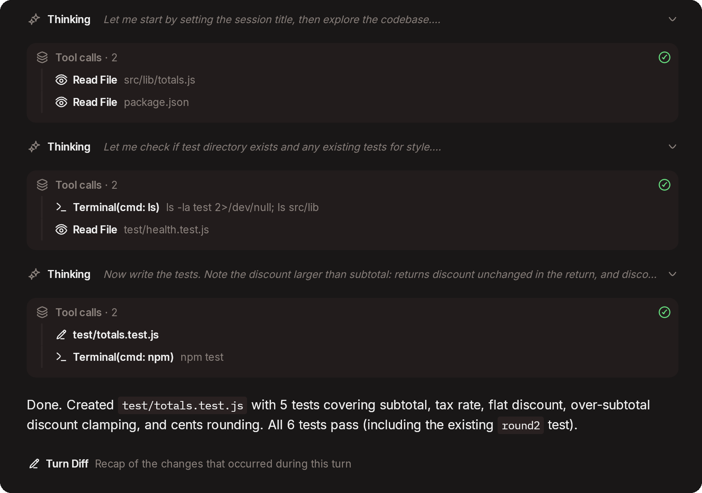</p>

<br/>

<h3 align="center">🖥️ 여러 머신에 걸친 병렬 세션 오케스트레이션</h3>

<p align="center">원하는 만큼 세션을 실행하고, 세션마다 머신, 폴더, 에이전트, 모델을 고르세요. 어느 머신에서 실행되든 하나의 목록에서 모두 따라갈 수 있습니다. <a href="https://docs.happier.dev/sessions/new-session-shortcuts">세션 시작하기</a> · <a href="https://docs.happier.dev/apps/daemon">머신과 데몬</a></p>

<p align="center">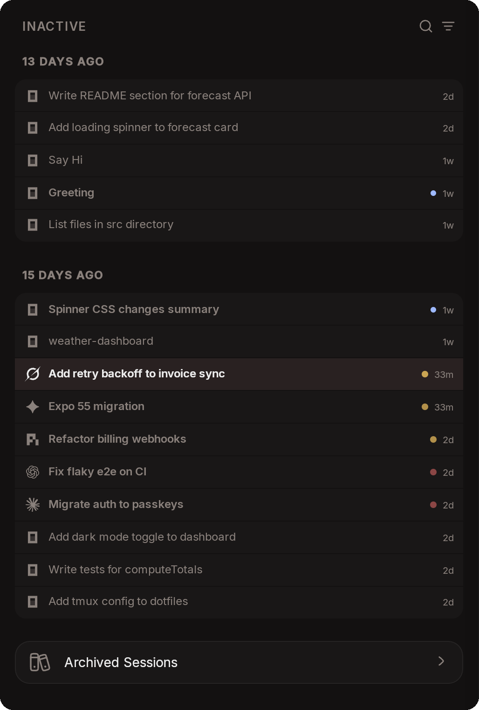</p>

<br/>

<h3 align="center">🔄 세션 도중에 에이전트 전환하기</h3>

<p align="center">세션을 그 자리에서 Claude에서 Codex로, 또는 반대로 옮기세요. 세션의 ID, 기록, 설정은 그대로 유지되고, 넘겨받는 에이전트는 최근 대화의 요약을 받습니다. <a href="https://docs.happier.dev/sessions/continue-with-another-agent">다른 에이전트로 계속하기</a></p>

<p align="center">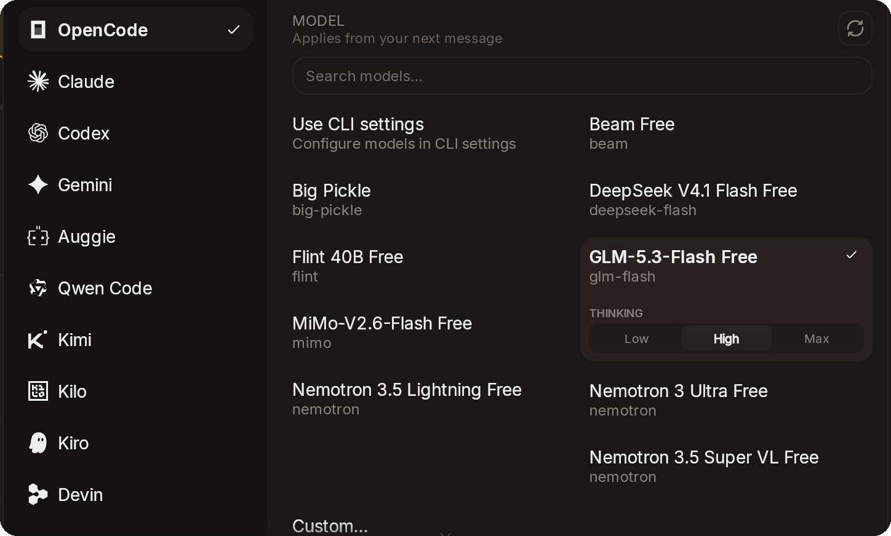</p>

<br/>

<h3 align="center">🔔 내가 처리할 일을 모은 받은편지함</h3>

<p align="center">권한 요청, 에이전트의 질문, 읽지 않은 세션이 모든 세션과 머신에 걸쳐 하나의 알림 센터에 모입니다. 푸시 알림을 누르면 요청한 바로 그 세션이 열립니다. <a href="https://docs.happier.dev/sessions/inbox-and-approvals">받은편지함과 승인</a></p>

<p align="center">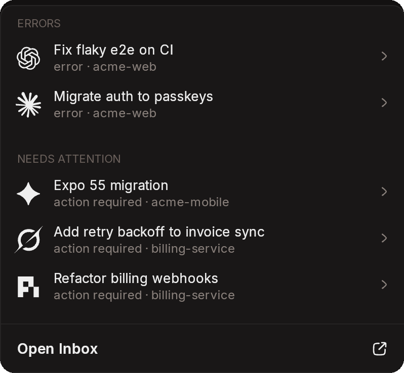</p>

<br/>

<h3 align="center">📝 diff를 리뷰하고 코멘트 보내기</h3>

<p align="center">에이전트가 변경한 내용을 살펴보고, 수정이 필요한 줄을 정확히 표시하세요. 코멘트는 같은 세션이나 새 세션으로 바로 보낼 수 있습니다. <a href="https://docs.happier.dev/code/review-comments">리뷰 코멘트</a></p>

<p align="center">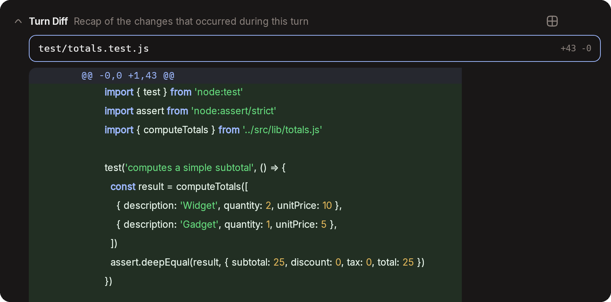</p>

<br/>

<h3 align="center">🌿 어떤 기기에서든 Git과 워크트리</h3>

<p align="center">스테이징, 커밋, 푸시, 브랜치 생성, 풀 리퀘스트 생성까지 앱을 떠나지 않고 할 수 있습니다. 로컬 또는 원격의 어떤 브랜치에서든 별도의 Git 워크트리로 세션을 시작하거나, 지금 있는 폴더에서 시작할 수 있습니다. <a href="https://docs.happier.dev/code/git">Git</a> · <a href="https://docs.happier.dev/sessions/new-session-shortcuts">새 세션 옵션</a></p>

<p align="center">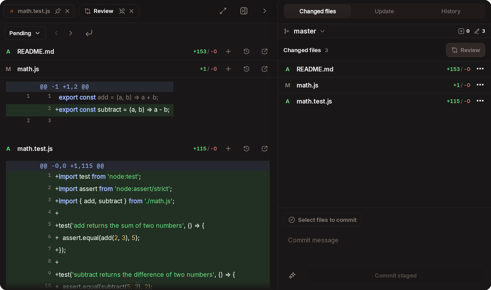</p>

<br/>

<h3 align="center">📬 큐에 넣고, 방향 잡기</h3>

<p align="center">에이전트가 작업하는 동안 메시지를 큐에 넣고, 실행되기 전에 순서를 바꾸거나 수정하세요. 실행 중인 턴을 중단하지 않고 방향을 잡을 수도 있습니다. <a href="https://docs.happier.dev/sessions/steering">스티어링</a> · <a href="https://docs.happier.dev/sessions/pending-queue">대기 큐</a></p>

<p align="center">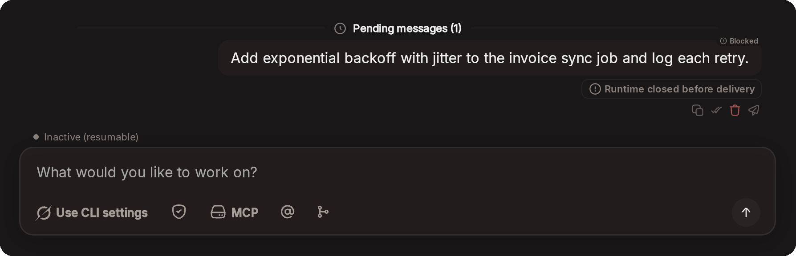</p>

<br/>

<h3 align="center">🪪 구독, 계정 풀, 사용량 한도</h3>

<p align="center">같은 서비스에 대해 내가 가진 여러 계정을 연결하고 하나의 풀로 묶으세요. 자동 전환을 켜 두면 한 계정이 사용량 한도에 도달하거나 로그인이 만료될 때 풀이 세션을 다른 계정으로 옮겨 작업이 계속됩니다. 전환할 계정이 없으면 Claude 세션은 한도가 초기화될 때 자동으로 재개됩니다. <a href="https://docs.happier.dev/accounts/connected-services">연결된 서비스와 풀</a> · <a href="https://happier.dev/features/usage-limits">사용량 한도</a></p>

<p align="center">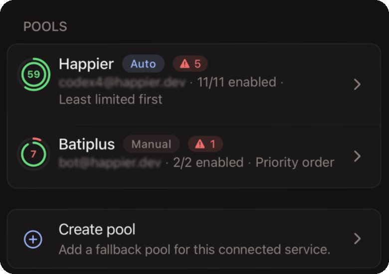</p>

<br/>

<h3 align="center">📊 계정 사용량 확인하기</h3>

<p align="center">연결된 계정과 구독마다 얼마나 남았는지 확인하세요. Claude 구독이라면 5시간 한도와 주간 한도, 그리고 각각이 초기화되기까지 남은 시간을 볼 수 있습니다. <a href="https://docs.happier.dev/accounts/connected-services">연결된 서비스</a></p>

<p align="center">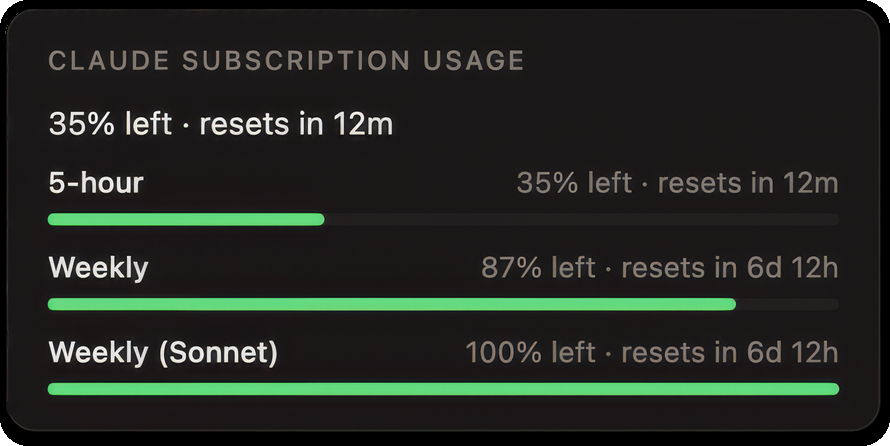</p>

<br/>

<h3 align="center">🤝 에이전트를 넘나드는 서브에이전트</h3>

<p align="center">세션은 다른 에이전트에게 작업을 넘길 수 있습니다. 예를 들어 Claude가 Codex에서 리뷰, 계획, 위임 실행을 시작하면, 세션의 에이전트 탭에서 모든 실행을 따라갈 수 있습니다. <a href="https://docs.happier.dev/extending/subagents">위임된 작업</a></p>

<p align="center">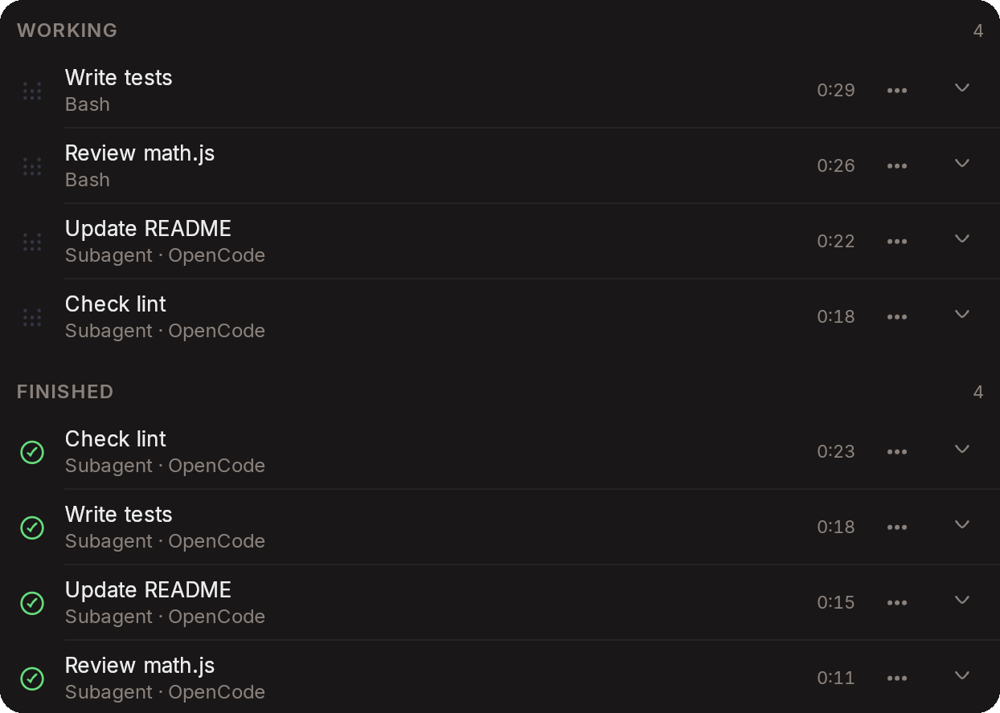</p>

<br/>

<h3 align="center">🗂️ 파일, 에디터, 터미널</h3>

<p align="center">어떤 기기에서든 세션 폴더의 파일을 탐색, 검색, 편집하세요. 간단한 명령이 필요할 때는 연결된 머신에서 터미널을 열 수 있습니다. <a href="https://docs.happier.dev/code/files-and-editor">파일과 에디터</a> · <a href="https://docs.happier.dev/extras/embedded-terminal">내장 터미널</a></p>

<p align="center">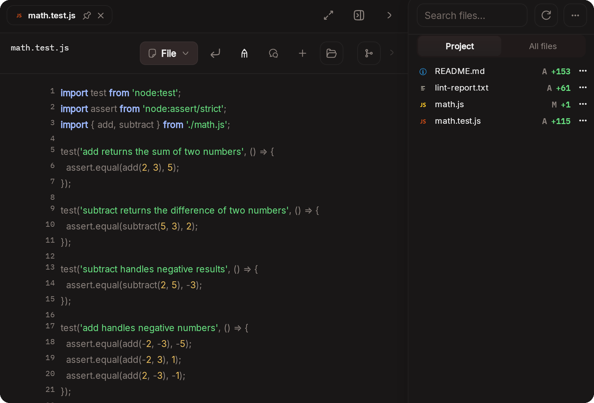</p>

<br/>

<h3 align="center">⌨️ 터미널이 좋다면? 계속 쓰세요!</h3>

<p align="center">Claude Code, Codex, OpenCode를 각자의 터미널 UI에서 실행하세요. Happier가 그 세션을 모든 기기에 미러링하므로 어디서든 진행 상황을 따라가고, 메시지를 보내고, 승인할 수 있습니다. <a href="https://docs.happier.dev/sessions/claude-unified-terminal">Claude 통합 터미널</a></p>


<br/>

<h3 align="center">🎙️ 음성</h3>

<p align="center">음성 어시스턴트는 실행 중인 세션을 따라가고, 나 대신 권한 요청에 응답하며, 받아쓴 메시지를 보냅니다. ElevenLabs 실시간 음성을 사용하거나, 온디바이스 음성 처리, OpenAI 호환 엔드포인트, Google Gemini와 Google Cloud, Kokoro로 로컬 파이프라인을 구성할 수 있습니다. <a href="https://docs.happier.dev/voice">음성</a></p>

<p align="center">
<picture><source media="(prefers-color-scheme: dark)" srcset=".github/screenshots/voice/elevenlabs-dark.svg"></picture>&nbsp;&nbsp;&nbsp;
<picture><source media="(prefers-color-scheme: dark)" srcset=".github/screenshots/voice/openai-dark.svg"></picture>&nbsp;&nbsp;&nbsp;
<picture><source media="(prefers-color-scheme: dark)" srcset=".github/screenshots/voice/googlegemini-dark.svg"></picture>&nbsp;&nbsp;&nbsp;
<picture><source media="(prefers-color-scheme: dark)" srcset=".github/screenshots/voice/googlecloud-dark.svg"></picture>
</p>

<br/>

### 그 밖의 기능

- **세션 핸드오프.** 실행 중인 Claude Code 또는 OpenCode 세션을 다른 머신으로 옮기고, 원하면 작업 트리도 함께 가져갈 수 있습니다. [세션 핸드오프](https://docs.happier.dev/sessions/session-handoff)
- **세션 공유.** 보기 또는 편집 권한으로 다른 사람을 초대하거나, 읽기 전용 공개 링크를 게시하세요. [세션 공유](https://docs.happier.dev/accounts/session-sharing)
- **MCP 서버로서의 Happier.** `happier mcp serve`를 사용하면 어떤 MCP 호스트든 세션을 만들고, 메시지를 보내고, 세션 작업을 실행할 수 있습니다. [MCP 서버로서의 Happier](https://docs.happier.dev/extending/happier-as-mcp-server) · [CLI](https://docs.happier.dev/apps/cli)
- **MCP 서버는 한 번만 설정.** 모든 머신의 모든 에이전트에서 사용할 수 있습니다. [MCP 서버](https://docs.happier.dev/extending/mcp-servers)
- **SSH로 머신 추가**, 앱에서도 CLI에서도 가능합니다. [머신과 데몬](https://docs.happier.dev/apps/daemon)
- **셀프 호스팅.** 셀프 호스팅 릴레이에서도 같은 앱, 암호화, 기능이 동작합니다. [셀프 호스팅](https://docs.happier.dev/self-hosting)
- **종단 간 암호화.** 콘텐츠는 기본적으로 내 기기에서 암호화됩니다. [보안](#security)

단계별 가이드는 [guides.happier.dev](https://guides.happier.dev)에서 볼 수 있습니다.

## Happier의 동작 방식

```
      Phone           Desktop          Browser
        │                │                │
        └────────────────┼────────────────┘
                         │
                         ▼
          Happier relay (hosted or yours)
        syncs end-to-end encrypted sessions
          between your devices and machines
                         │
                         ▼
      Your machines (laptop, desktop, VPS, dev box)
        the Happier daemon starts and manages
          agent processes where your code lives
                         │
                         ▼
      Claude Code · Codex · OpenCode · Pi · ...
        each agent talks to its own model
                provider directly
```

릴레이는 자신이 읽을 수 없는 콘텐츠를 저장하고 전달합니다. 세션 콘텐츠는 서버에 도달하기 전에 내 기기에서 암호화됩니다. 서버는 세션 ID, 타임스탬프, 턴 상태, 사용량 메타데이터처럼 라우팅에 필요한 정보만 처리합니다. 에이전트는 계속해서 각자의 모델 제공업체와 직접 통신합니다.

<a id="self-hosting"></a>
## 셀프 호스팅

명령어 하나로 나만의 릴레이를 실행하세요.

```bash
happier relay host install --mode system
```

현재 머신에 관리형 릴레이 서비스를 설치하고 업데이트합니다. 원격 호스트라면: `happier relay host install --ssh user@host --mode system`.

자세한 내용은 [셀프 호스팅 문서](https://docs.happier.dev/self-hosting/self-host-runtime)([happier.dev/self-host](https://happier.dev/self-host)에서도 접근 가능)를 참고하세요. 대안으로 [Docker](https://docs.happier.dev/self-hosting/docker)와 [Proxmox](https://docs.happier.dev/self-hosting/proxmox)도 있습니다.

<a id="security"></a>
## 보안

- **콘텐츠는 기본적으로 종단 간 암호화됩니다.** 코드, 프롬프트, 메시지, 대화 기록은 서버에 도달하기 전에 내 기기에서 암호화됩니다. [암호화](https://docs.happier.dev/security/encryption)
- **서버는 라우팅 메타데이터를 처리합니다.** 기기 간 동기화를 위해 세션 ID, 타임스탬프, 턴 상태, 사용량 메타데이터는 릴레이가 볼 수 있습니다.
- **셀프 호스팅 운영자는 저장 정책을 선택할 수 있습니다.** 셀프 호스팅 서버는 배포 환경에 맞게 다른 저장 정책으로 구성할 수 있습니다. [서버 암호화 설정](https://docs.happier.dev/self-hosting/encryption)
- **모델 트래픽은 에이전트가 직접 처리합니다.** 각 에이전트는 자신의 모델 제공업체와 직접 통신합니다.

더 자세한 내용은 [보안 문서](https://docs.happier.dev/security)를 참고하세요.

<a id="downloads"></a>
## 다운로드

| 플랫폼 | 받기 |
| --- | --- |
| iOS | [App Store](https://apps.apple.com/app/happier-claude-codex-opencode/id6758554297) |
| Android | [Google Play](https://happier.dev/playstore) · [APK](https://happier.dev/apk) |
| macOS · Windows · Linux (데스크톱 앱) | [happier.dev/download](https://happier.dev/download) · [모든 데스크톱 빌드](https://github.com/happier-dev/happier/releases/tag/ui-desktop-stable) |
| Web | [cloud.happier.dev](https://cloud.happier.dev) |
| CLI (macOS, Linux) | `curl -fsSL https://happier.dev/install \| bash` |
| CLI (Windows) | `iwr https://happier.dev/install.ps1 -useb \| iex` |

릴리스 노트는 [변경 내역](https://docs.happier.dev/releases)에서 볼 수 있습니다.

### 릴리스 채널과 나이틀리 빌드

위의 방법은 모두 **stable** 채널을 설치합니다. 이보다 앞서 배포되는 채널이 두 개 더 있으며, 나란히 설치되므로(`happier`, `hprev`, `hdev`) 사용해 보더라도 stable 환경이 망가지지 않습니다.

- **preview**: 새 기능이 stable보다 먼저 이곳에 들어옵니다.
- **dev**: 최신 변경 사항을 담은 나이틀리 빌드입니다. 미완성 커밋이 포함될 수 있고 언제든 깨질 수 있습니다.

<details>
<summary><b>preview 또는 dev 빌드 설치하기</b></summary>

Preview (macOS/Linux, 그다음 Windows):

```bash
curl -fsSL https://happier.dev/install-preview | bash
```

```powershell
iwr https://happier.dev/install-preview.ps1 -useb | iex
```

Dev:

```bash
curl -fsSL https://happier.dev/install-dev | bash
```

```powershell
iwr https://happier.dev/install-dev.ps1 -useb | iex
```

그런 다음 `happier` 대신 **`hprev`** 또는 **`hdev`** 명령을 실행하세요. `happier`를 dev 레인에 연결하고 싶다면 `.bashrc`/`.zshrc`에 `alias happier='hdev'`를 추가하세요.

`dev`에서는 모든 구성 요소(CLI, 앱, 데몬, 서버)를 dev 릴리스로 실행해야 합니다. 호스팅 클라우드(cloud.happier.dev)는 `stable`로 운영되므로 `preview`와 `dev` 기능이 동작하지 않을 수 있고, `dev`에는 호스팅 웹 앱이 없습니다(dev 웹 UI를 쓰려면 dev 서버를 셀프 호스팅하세요).

모바일 및 서버 dev 빌드:

- [iOS TestFlight](https://testflight.apple.com/join/PyRCsaS3)
- [Android dev APK](https://github.com/happier-dev/happier/releases/download/ui-mobile-dev/happier-dev-android.apk)
- 서버 이미지: [Docker Hub `happierdev/relay-server:dev`](https://hub.docker.com/repository/docker/happierdev/relay-server/tags/dev) · [GHCR](https://github.com/happier-dev/happier/pkgs/container/relay-server)
- Dev box (CLI + 데몬 + 에이전트 사전 설치): [Docker Hub `happierdev/dev-box:dev`](https://hub.docker.com/repository/docker/happierdev/dev-box/tags/dev)

</details>

채널이 릴리스 태그에 어떻게 대응하는지, 설치 방법별로 어떻게 업데이트되는지:
[docs.happier.dev/releases/updates](https://docs.happier.dev/releases/updates).

## 커뮤니티와 기여

Happier는 공개적으로 개발되며, 실제 피드백을 통해 성장합니다. 무언가 고장 났거나, 빠져 있거나, 어색하게 느껴진다면 알려 주세요.

- 버그 (재현 단계와 함께): [GitHub issues](https://github.com/happier-dev/happier/issues)
- 아이디어와 설계 관련 질문: [GitHub discussions](https://github.com/happier-dev/happier/discussions)
- 소식, 질문, 간단한 피드백: [Discord](https://discord.gg/W6Pb8KuHfg)
- 코드, 문서, 개발 환경 설정: [CONTRIBUTING.md](CONTRIBUTING.md)

명확한 이슈 하나가 풀 리퀘스트보다 더 가치 있는 경우가 많습니다. 무엇을 했는지, 무엇을 기대했는지, 실제로는 무슨 일이 일어났는지 적어 주세요.

## 왜 “Happier”인가요?

저희는 원래 [Happy](https://github.com/slopus/happy)의 기여자로 시작해 수정 사항, 개선 사항, 새 기능을 업스트림에 제출했습니다.

업무에서 매일 사용했고, 그 콘셉트를 정말 좋아했습니다.
그러다 시간이 지나면서, 저희의 필요에는 메인 프로젝트 안에서 편하게 시도하기 어려운 더 빠른 반복이 필요하다는 것을 깨달았습니다.

그래서 저희가 쓸 것을 직접 만들기 시작했습니다.

몇 주에 걸쳐 기반을 다듬고, 고치고, 확장한 끝에 다른 사람들도 써 보고, 사용하고, 앞으로의 방향을 함께 만들어 갈 수 있도록 Happier를 공개하기로 했습니다.

Happier는 Happy가 마련해 준 기반에 깊이 감사하면서, 더 빠르게 움직이고 더 협력적인 방향을 탐색하는 프로젝트입니다. 저희는 Happy를 좋아했고, 지금도 좋아합니다. ❤️ Happy가 없었다면 Happier도 없었을 것입니다.

<div align="center">
<hr />
스위스에서 만들었습니다. MIT 라이선스.

Anthropic, OpenAI, Google과 제휴하거나 보증을 받지 않았습니다.
</div>
