<div align="center">
  <picture>
    <source media="(prefers-color-scheme: dark)" srcset=".github/logotype-white.svg" />
    
  </picture>

  ### 100'den fazla kodlama ajanından oluşan ekipleri yönetmek için çoklu cihaz kontrol odası
  **Telefonunuzdan, masaüstünüzden ve tarayıcınızdan.**

  Claude Code, Codex, OpenCode, Pi ve daha fazlası, kendi makinelerinizde birlikte ve paralel çalışır.

  Oturumlar ajanlar arasında alt ajanlar başlatabilir: örneğin Claude, Codex'ten inceleme isteyebilir veya Codex işi Claude alt ajanlarına devredebilir. Oturum ortasında ajan değiştirin. Nerede olursanız olun onaylayın, yönlendirin, inceleyin ve commit atın.

  **Açık kaynak · Kendi sunucunuzda barındırılabilir · Uçtan uca şifreli**

  <p><a href="README.md">English</a> | <a href="README.ja.md">日本語</a> | <a href="README.zh-CN.md">简体中文</a> | <a href="README.ko.md">한국어</a> | <a href="README.es.md">Español</a> | <a href="README.tr.md">Türkçe</a></p>

  <p>
    <a href="#başlarken">Başlarken</a> ·
    <a href="#i̇ndirmeler">İndirmeler</a> ·
    <a href="https://docs.happier.dev">Belgeler</a> ·
    <a href="#kendi-sunucunuzda-barındırma">Kendi sunucunuzda barındırma</a> ·
    <a href="https://discord.gg/W6Pb8KuHfg">Discord</a>
  </p>

  <p>
    <a href="LICENCE"></a>
    <a href="https://happier.dev/download"></a>
    <a href="https://discord.gg/W6Pb8KuHfg"></a>
    <a href="https://docs.happier.dev/releases"></a>
  </p>

  <a href="https://github.com/happier-dev/happier/discussions/226"><strong>En son Happier proje güncellemesi</strong></a>

  <p>Happier ücretsiz ve açık kaynaklıdır.<br />
    Mevcut aboneliklerinizi ve kodlama ajanlarınızı kullanırsınız.</p>

  <p>
    
  </p>
  <p>
    
  </p>

  <p><b>Yerleşik olarak desteklenen ajanlar (ve 30+ fazlası)</b></p>
    <!-- .github/supported-agents-light.png and .github/supported-agents-dark.png are generated by scripts/generateSupportedAgentsStrip.mjs; regenerate them, do not hand-edit -->
<p align="center">
  <a href="https://happier.dev/agents">
    <picture>
      <source media="(prefers-color-scheme: dark)" srcset=".github/supported-agents-dark.png" />
      
    </picture>
  </a>
</p>

<p>ACP konuşan herhangi bir ajan ayarlardan eklenebilir.</p>
</div>


## Başlarken

### 1. Bilgisayarınıza kurun

Başlamanın önerilen yolu masaüstü uygulamasıdır: CLI'ı ve arka plan servisini (daemon) sizin için kurar.

<a href="https://happier.dev/download">
  <picture>
    <source media="(prefers-color-scheme: dark)" srcset=".github/download-desktop-white.svg" />
    
  </picture>
</a>
<br /><br />
<details>
<summary><b>Terminali mi tercih ediyorsunuz?</b> Masaüstü uygulaması olmadan CLI ve daemon'ı kurun</summary>

macOS/Linux:

```bash
curl -fsSL https://happier.dev/install | bash
```

Windows:

```powershell
iwr https://happier.dev/install.ps1 -useb | iex
```

Özellikle npm paketini tercih ediyorsanız: `npm install -g @happier-dev/cli` ([CLI belgeleri](https://docs.happier.dev/apps/cli)).

</details>

<details>
<summary><b>Zaten Claude Code, Codex veya başka bir kodlama ajanı mı kullanıyorsunuz?</b> Happier'ı sizinle birlikte kursun</summary>

Bunu ajanınıza yapıştırın:

```text
Set up Happier on this computer by following https://docs.happier.dev/getting-started/agent-setup.mdx
Fetch that file raw (for example with curl) and follow it step by step with me.
```

Bilmesi gerekenleri sorar, her değişikliği onaylatır ve oturum açma onayı ile ajanınızın kendi girişini size bırakır. [Kodlama ajanınızla kurulum](https://docs.happier.dev/getting-started/agent-setup)

</details>

<details>
<summary><b>Grok Bot mu kullanıyorsunuz?</b> X üzerinde Grok aracılığıyla Happier'ı kurun ve yönetin</summary>

X üzerinde [Happier oturum kontrolü Grok Bot](https://x.ai/bot/eI3Gm7MjAxV_bgJ_MB0pk) eklentisini kurun. İlk çalıştırmada kendi bilgisayarına Happier CLI'ı kurar, Happier Cloud hesabınızla veya kendi barındırdığınız aktarıcıyla (relay) eşleşir ve daemon'ı başlatır. Ne kadar müdahil olacağını siz belirlersiniz: yalnızca izleme, yardım etme veya oturumları yönetme. [Grok Bot entegrasyonu](https://docs.happier.dev/extending/grok-bot-integration)

</details>

<details>
<summary><b>Uzak bir bilgisayara veya devbox'a mı kuruyorsunuz?</b> Kendi makinenizden SSH üzerinden kurun</summary>

Tek bir komut uzak sunucuya CLI ve daemon'ı kurar (sürüm imzası doğrulanmış) ve onu makinelerinizden biri olarak kaydeder:

```bash
happier machine setup --ssh user@host
```

Uzak makinede tarayıcı olmadan oturum açmak için, zaten oturum açmış olduğunuz bir makineden şunu çalıştırın:

```bash
happier auth pair-remote --ssh user@host
```

Doğrudan uzak sunucuda başsız (headless) alternatif: `happier auth login --no-open --method web` herhangi bir tarayıcıdan onaylayabileceğiniz bir yetkilendirme URL'si yazdırır. [Makineler ve daemon](https://docs.happier.dev/apps/daemon)

</details>

Uygulamadan veya ilk çalıştırmada oturum açarsınız.

### 2. Telefonunuzu ekleyin

<table>
  <tr>
    <td align="center">
      <a href="https://happier.dev/appstore"></a>
    </td>
    <td align="center">
      <a href="https://happier.dev/playstore"></a>
    </td>
    <td align="center">
      <a href="https://happier.dev/apk"><b>Doğrudan&nbsp;APK</b></a><br /><sub>kararlı sürüm</sub>
    </td>
  </tr>
  <tr>
    <td align="center">
      <a href="https://happier.dev/appstore"><picture><source media="(prefers-color-scheme: dark)" srcset=".github/qr-app-store-white.svg" /></picture></a>
    </td>
    <td align="center">
      <a href="https://happier.dev/playstore"><picture><source media="(prefers-color-scheme: dark)" srcset=".github/qr-play-store-white.svg" /></picture></a>
    </td>
    <td align="center">
      <a href="https://happier.dev/apk"><picture><source media="(prefers-color-scheme: dark)" srcset=".github/qr-apk-white.svg" /></picture></a>
    </td>
  </tr>
</table>

Aynı hesapla oturum açtığınızda oturumlarınız, makineleriniz ve ayarlarınız hazır olur.

### 3. Bir oturum başlatın

**Uygulamada →** **New session** düğmesine basın; makineyi, klasörü ve ajanı seçin. Terminal gerekmez.

**Veya terminalde**, herhangi bir proje klasöründen:

```bash
happier            # Claude Code
happier codex      # Codex
happier opencode   # OpenCode
```

Her iki şekilde de oturum aynı anda her yerde görünür: terminalde yazmaya devam edin, telefonunuzdan takip edip onaylayın, tarayıcıda inceleyin. `happier --help` diğer ajanları ve komutları listeler.

## Neler yapabilirsiniz?

<h3 align="center">📱 Ajanlarınızı telefonunuzdan, masaüstünüzden veya webden çalıştırın</h3>

<p align="center">Elinizde hangi cihaz varsa oradan oturum başlatın, yönlendirin, inceleyin ve onaylayın. Oturumlar cihazlar arasıdır; makinenizde halihazırda çalışan Claude Code, Codex veya OpenCode oturumları dahil nerede olursanız olun aynı oturumdan devam edersiniz. <a href="https://docs.happier.dev/sessions/continuing-a-session">Bir oturuma devam etme</a></p>

<p align="center">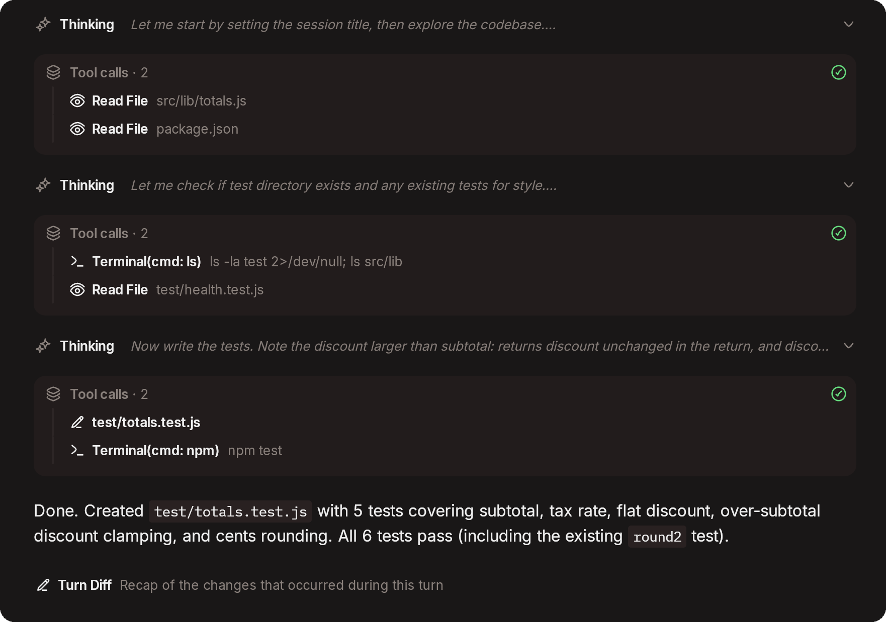</p>

<br/>

<h3 align="center">🖥️ Makineler arasında paralel oturumları orkestre edin</h3>

<p align="center">İstediğiniz kadar oturum çalıştırın ve her biri için makine, klasör, ajan ve model seçin. Hangi makinede çalışırlarsa çalışsınlar hepsini tek listeden izleyin. <a href="https://docs.happier.dev/sessions/new-session-shortcuts">Oturum başlatma</a> · <a href="https://docs.happier.dev/apps/daemon">Makineler ve daemon</a></p>

<p align="center">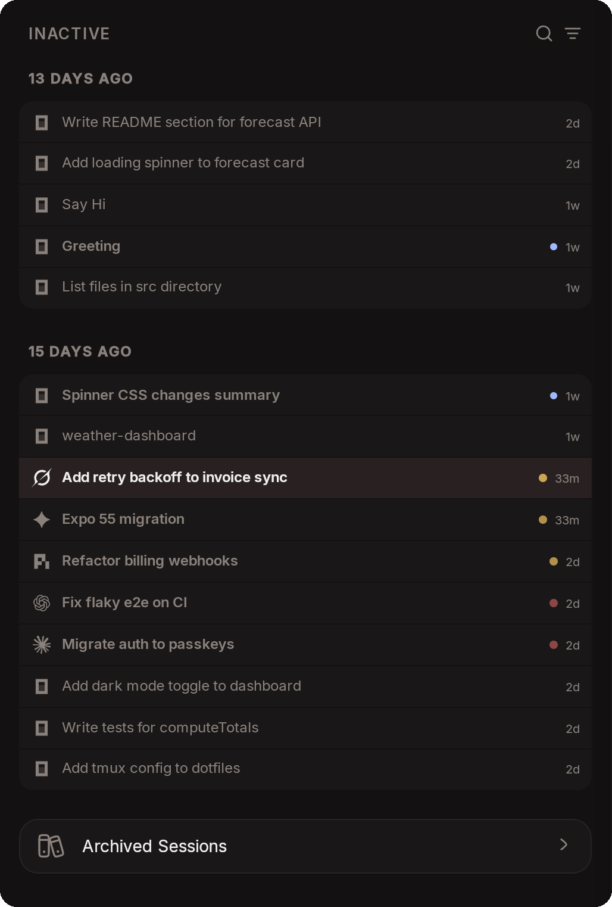</p>

<br/>

<h3 align="center">🔄 Oturum ortasında ajan değiştirin</h3>

<p align="center">Bir oturumu yerinde Claude'dan Codex'e veya tersine taşıyın. Oturum kimliğini, geçmişini ve ayarlarını korur; yeni gelen ajan son konuşmanın özetini alır. <a href="https://docs.happier.dev/sessions/continue-with-another-agent">Başka bir ajanla devam etme</a></p>

<p align="center">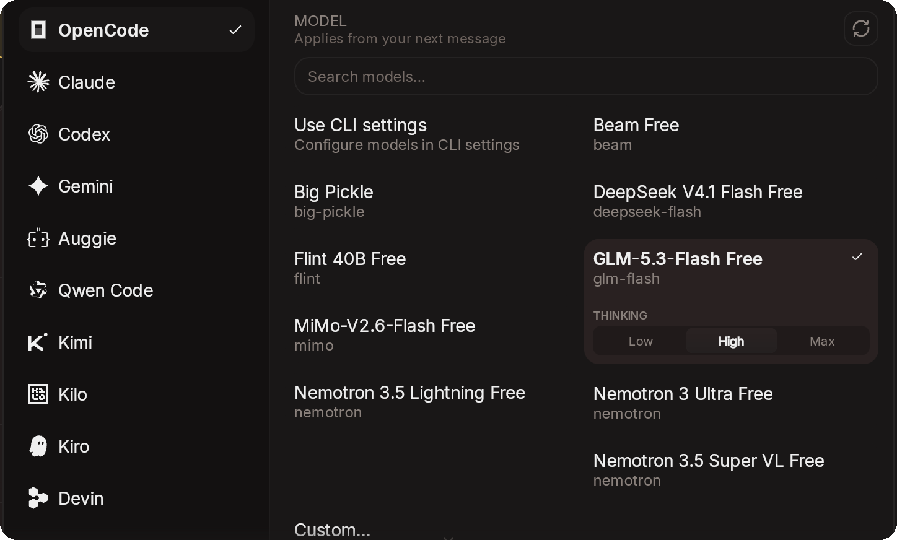</p>

<br/>

<h3 align="center">🔔 Sizi bekleyenler için tek gelen kutusu</h3>

<p align="center">İzin istekleri, ajan soruları ve okunmamış oturumlar tüm oturumlar ve makineler genelinde tek bir odak merkezinde toplanır. Bir bildirim sizi doğrudan soru soran oturuma götürür. <a href="https://docs.happier.dev/sessions/inbox-and-approvals">Gelen kutusu ve onaylar</a></p>

<p align="center">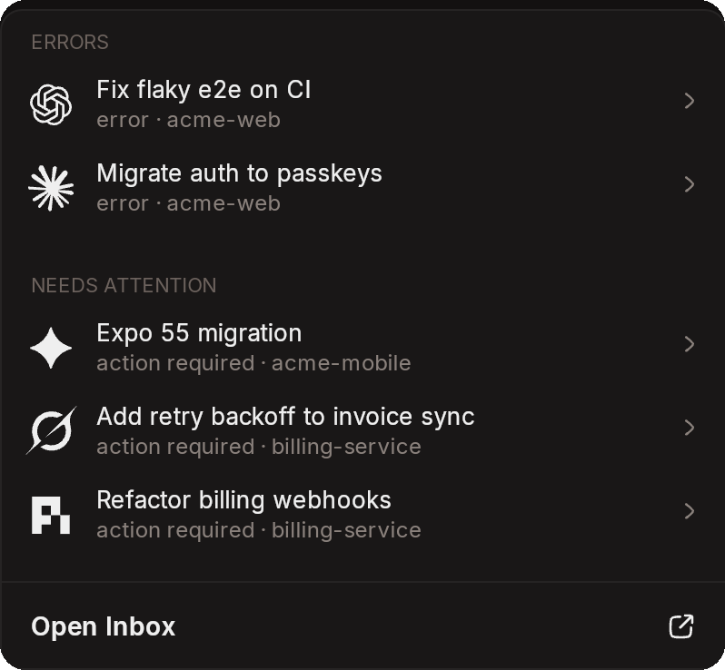</p>

<br/>

<h3 align="center">📝 Farkları (diff) inceleyin ve notları geri gönderin</h3>

<p align="center">Ajanınızın değişikliklerine göz atın ve ele alınmasını istediğiniz satırları tam olarak işaretleyin. Notları doğrudan aynı oturuma veya yeni bir oturuma gönderin. <a href="https://docs.happier.dev/code/review-comments">İnceleme yorumları</a></p>

<p align="center">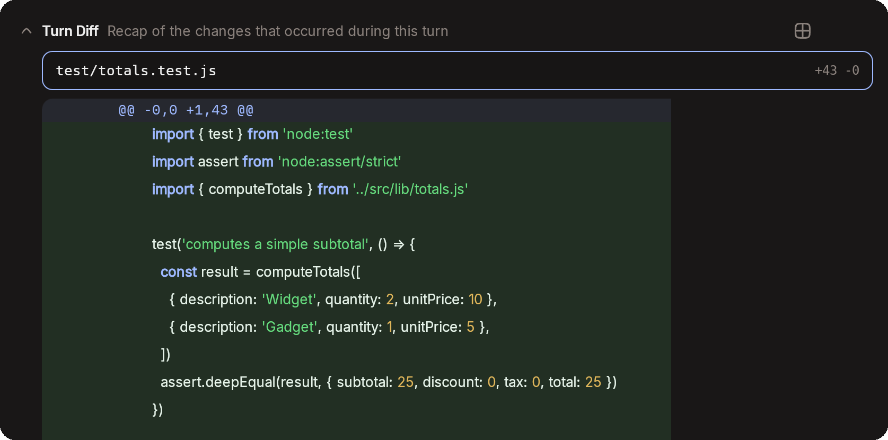</p>

<br/>

<h3 align="center">🌿 Herhangi bir cihazdan Git ve worktree yönetimi</h3>

<p align="center">Uygulamadan çıkmadan değişiklikleri sahneleyin, commit atın, gönderin, dal oluşturun ve pull request açın. Herhangi bir yerel veya uzak daldan kendi Git worktree'si içinde veya bulunduğunuz klasörde oturum başlatın. <a href="https://docs.happier.dev/code/git">Git</a> · <a href="https://docs.happier.dev/sessions/new-session-shortcuts">Yeni oturum seçenekleri</a></p>

<p align="center">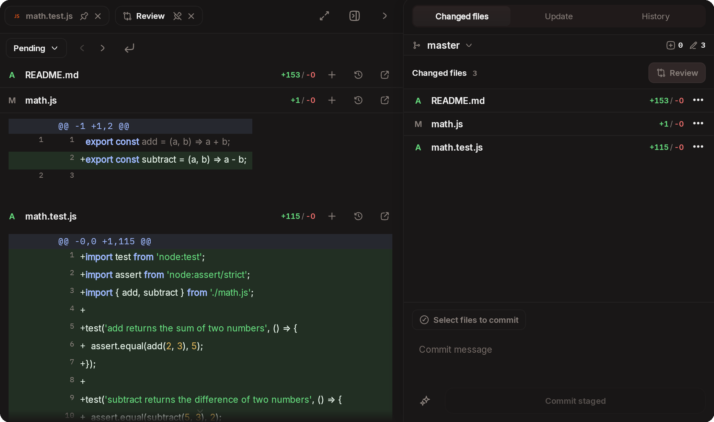</p>

<br/>

<h3 align="center">📬 Sıraya alın, yönlendirin</h3>

<p align="center">Ajan çalışırken mesajları sıraya alın ve çalışmadan önce sıralarını değiştirin veya düzenleyin. Devam eden bir turu kesintiye uğratmadan yönlendirin. <a href="https://docs.happier.dev/sessions/steering">Yönlendirme</a> · <a href="https://docs.happier.dev/sessions/pending-queue">Bekleyen kuyruk</a></p>

<p align="center">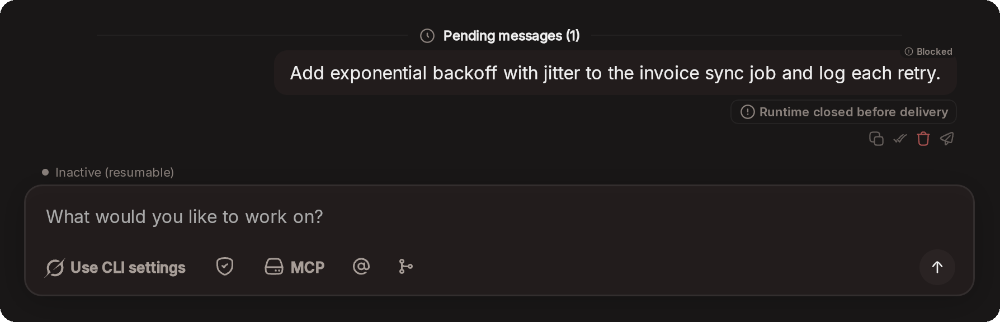</p>

<br/>

<h3 align="center">🪪 Abonelikler, hesap havuzları ve kullanım sınırları</h3>

<p align="center">Aynı hizmet için sahip olduğunuz birden fazla hesabı bağlayın ve bir havuzda gruplayın. Otomatik geçiş açıkken bir hesap kullanım sınırına ulaştığında veya oturumu sona erdiğinde havuz oturumları başka bir hesaba aktarır; böylece iş kesintiye uğramaz. Geçilecek hesap kalmadığında Claude oturumları sınır sıfırlandığında kendiliğinden devam eder. <a href="https://docs.happier.dev/accounts/connected-services">Bağlı hizmetler ve havuzlar</a> · <a href="https://happier.dev/features/usage-limits">Kullanım sınırları</a></p>

<p align="center">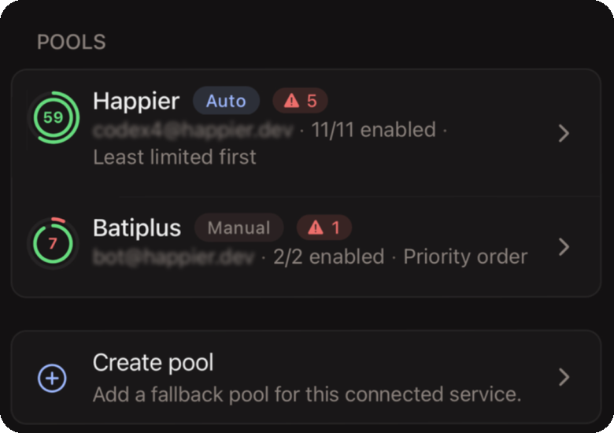</p>

<br/>

<h3 align="center">📊 Hesap kullanımınızı takip edin</h3>

<p align="center">Bağlı hesaplarınızın ve aboneliklerinizin her birinde ne kadar kullanım kaldığını görün. Claude aboneliği için bu, 5 saatlik ve haftalık sınırlar ile her birinin sıfırlanmasına kalan süreyi gösterir. <a href="https://docs.happier.dev/accounts/connected-services">Bağlı hizmetler</a></p>

<p align="center">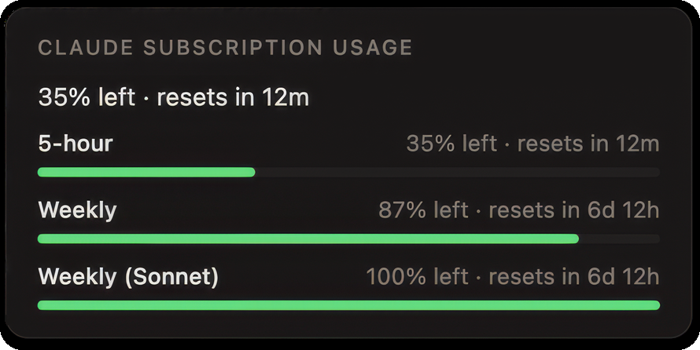</p>

<br/>

<h3 align="center">🤝 Ajanlar arası alt ajanlar</h3>

<p align="center">Bir oturum işi başka bir ajana devredebilir. Örneğin Claude, Codex üzerinde bir inceleme, plan veya görev çalıştırabilir ve siz her çalışmayı oturumdaki Agents sekmesinden izleyebilirsiniz. <a href="https://docs.happier.dev/extending/subagents">Devredilen işler</a></p>

<p align="center">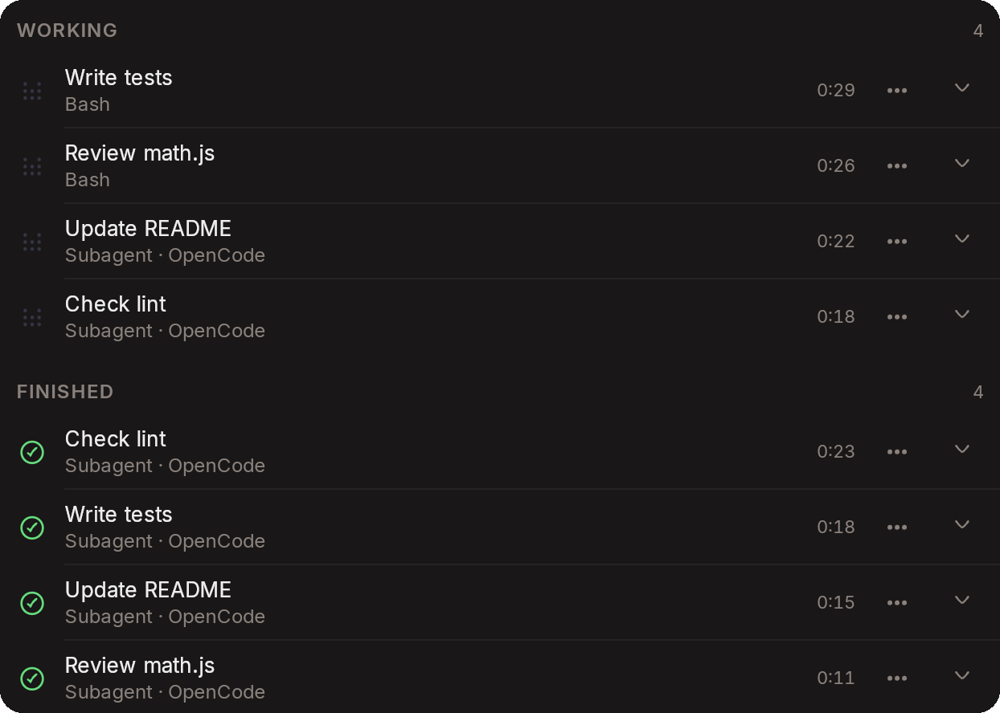</p>

<br/>

<h3 align="center">🗂️ Dosyalar, düzenleyici ve terminal</h3>

<p align="center">Bir oturumun klasöründeki dosyalara herhangi bir cihazdan göz atın, arama yapın ve düzenleyin. Hızlı bir komut gerektiğinde bağlı makinede terminal açın. <a href="https://docs.happier.dev/code/files-and-editor">Dosyalar ve düzenleyici</a> · <a href="https://docs.happier.dev/extras/embedded-terminal">Gömülü terminal</a></p>

<p align="center">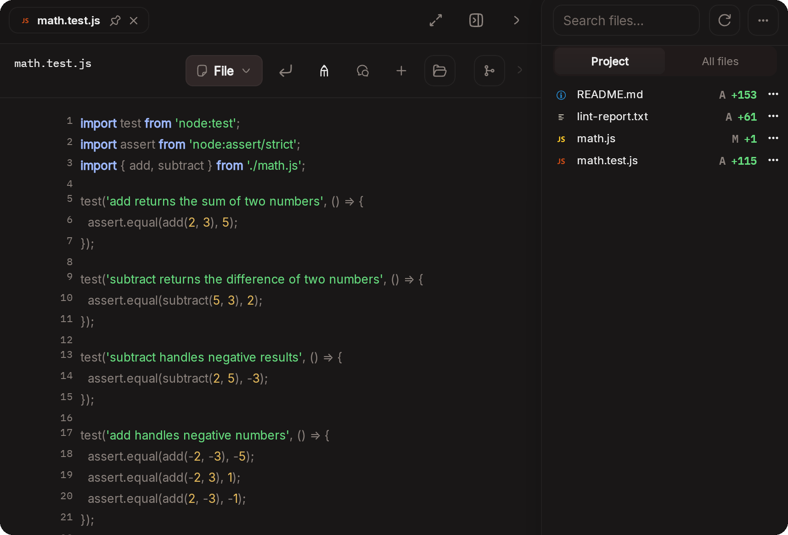</p>

<br/>

<h3 align="center">⌨️ Terminali seviyor musunuz? Kullanmaya devam edin!</h3>

<p align="center">Claude Code, Codex veya OpenCode'u kendi terminal arayüzlerinde çalıştırın. Happier bu oturumları her cihaza yansıtır; böylece her yerden takip edebilir, mesaj gönderebilir ve onay verebilirsiniz. <a href="https://docs.happier.dev/sessions/claude-unified-terminal">Claude birleşik terminali</a></p>


<br/>

<h3 align="center">🎙️ Sesli kontrol</h3>

<p align="center">Sesli asistan çalışan oturumlarınızı takip eder, sizin yerinize izin isteklerini yanıtlar ve dikte ettiğiniz mesajları gönderir. Gerçek zamanlı ElevenLabs sesini kullanın veya cihaz içi konuşma, OpenAI uyumlu uç noktalar, Google Gemini ve Google Cloud ya da Kokoro ile yerel bir hat kurun. <a href="https://docs.happier.dev/voice">Ses</a></p>

<p align="center">
<picture><source media="(prefers-color-scheme: dark)" srcset=".github/screenshots/voice/elevenlabs-dark.svg"></picture>&nbsp;&nbsp;&nbsp;
<picture><source media="(prefers-color-scheme: dark)" srcset=".github/screenshots/voice/openai-dark.svg"></picture>&nbsp;&nbsp;&nbsp;
<picture><source media="(prefers-color-scheme: dark)" srcset=".github/screenshots/voice/googlegemini-dark.svg"></picture>&nbsp;&nbsp;&nbsp;
<picture><source media="(prefers-color-scheme: dark)" srcset=".github/screenshots/voice/googlecloud-dark.svg"></picture>
</p>

<br/>

### Pakete dahil diğer özellikler

- **Oturum devri (Session handoff).** Canlı bir Claude Code veya OpenCode oturumunu başka bir makineye taşıyın ve isterseniz çalışma ağacını da birlikte götürün. [Oturum devri](https://docs.happier.dev/sessions/session-handoff)
- **Oturum paylaşımı.** Birini görüntüleme veya düzenleme erişimiyle davet edin ya da salt-okunur herkese açık bağlantı yayımlayın. [Oturum paylaşımı](https://docs.happier.dev/accounts/session-sharing)
- **MCP sunucusu olarak Happier.** `happier mcp serve` herhangi bir MCP istemcisinin oturum oluşturmasına, mesaj göndermesine ve oturum eylemleri çalıştırmasına olanak tanır. [MCP sunucusu olarak Happier](https://docs.happier.dev/extending/happier-as-mcp-server) · [CLI](https://docs.happier.dev/apps/cli)
- **Grok Bot entegrasyonu.** X üzerinde Grok aracılığıyla Happier oturumlarını kurun ve yönetin — kurulum, izleme ve oturum kontrolü tek bir paylaşılabilir botta. [Grok Bot entegrasyonu](https://docs.happier.dev/extending/grok-bot-integration)
- **Bir kez yapılandırılan MCP sunucuları.** Her makinedeki her ajanla birlikte kullanın. [MCP sunucuları](https://docs.happier.dev/extending/mcp-servers)
- **SSH üzerinden makine ekleme** (uygulamadan veya CLI'dan). [Makineler ve daemon](https://docs.happier.dev/apps/daemon)
- **Kendi sunucunuzda barındırma.** Kendi barındırdığınız aktarıcı aynı uygulamaları, şifrelemeyi ve özellikleri çalıştırır. [Kendi sunucunuzda barındırma](https://docs.happier.dev/self-hosting)
- **Uçtan uca şifreleme.** İçerik varsayılan olarak cihazlarınızda şifrelenir. [Güvenlik](#güvenlik)

Adım adım rehberler [guides.happier.dev](https://guides.happier.dev) adresindedir.

## Happier nasıl çalışır?

```
      Telefon          Masaüstü         Tarayıcı
        │                │                │
        └────────────────┼────────────────┘
                         │
                         ▼
       Happier aktarıcısı (barındırılan veya sizin)
      cihazlarınız ve makineleriniz arasında uçtan uca
            şifreli oturumları eşitler
                         │
                         ▼
     Makineleriniz (dizüstü, masaüstü, VPS, dev box)
      Happier daemon'ı kodunuzun bulunduğu yerde
           ajan süreçlerini başlatır ve yönetir
                         │
                         ▼
      Claude Code · Codex · OpenCode · Pi · ...
        her ajan kendi model sağlayıcısıyla
                doğrudan konuşur
```

Aktarıcı (relay) okuyamadığı içeriği depolar ve iletir: oturum içeriği sunucuya ulaşmadan önce cihazlarınızda şifrelenir. Sunucu yalnızca yönlendirmenin gerektirdiği oturum kimlikleri, zaman damgaları, tur durumu ve kullanım meta verilerini işler. Ajanlarınız kendi model sağlayıcılarıyla doğrudan konuşmaya devam eder.

## Kendi sunucunuzda barındırma

Tek komutla kendi aktarıcınızı çalıştırın:

```bash
happier relay host install --mode system
```

Bu komut mevcut makinede yönetilen bir aktarıcı servisi kurar ve günceller. Uzak bir sunucu için: `happier relay host install --ssh user@host --mode system`.

[Kendi sunucunuzda barındırma belgeleri](https://docs.happier.dev/self-hosting/self-host-runtime) ([happier.dev/self-host](https://happier.dev/self-host) üzerinden de erişilebilir) ayrıntıları kapsar; alternatif olarak [Docker](https://docs.happier.dev/self-hosting/docker) ve [Proxmox](https://docs.happier.dev/self-hosting/proxmox) seçenekleri mevcuttur.

## Güvenlik

- **İçerik varsayılan olarak uçtan uca şifrelidir.** Kod, istemler, mesajlar ve dökümler bir sunucuya ulaşmadan önce cihazlarınızda şifrelenir. [Şifreleme](https://docs.happier.dev/security/encryption)
- **Sunucu yönlendirme meta verilerini işler.** Oturum kimlikleri, zaman damgaları, tur durumu ve kullanım meta verileri cihazlarınızı eşitleyebilmesi için aktarıcıya görünür.
- **Kendi sunucusunu barındıran operatörler depolama politikalarını seçer.** Kendi barındırdığınız sunucu, dağıtımınız için farklı depolama politikalarıyla yapılandırılabilir. [Sunucu şifreleme ayarları](https://docs.happier.dev/self-hosting/encryption)
- **Model trafiği ajanlarınızda kalır.** Her ajan kendi model sağlayıcısıyla doğrudan konuşur.

Daha fazlası [güvenlik belgelerinde](https://docs.happier.dev/security).

## İndirmeler

| Platform | Edinin |
| --- | --- |
| iOS | [App Store](https://apps.apple.com/app/happier-claude-codex-opencode/id6758554297) |
| Android | [Google Play](https://happier.dev/playstore) · [APK](https://happier.dev/apk) |
| macOS · Windows · Linux (masaüstü uygulaması) | [happier.dev/download](https://happier.dev/download) · [tüm masaüstü derlemeleri](https://github.com/happier-dev/happier/releases/tag/ui-desktop-stable) |
| Web | [cloud.happier.dev](https://cloud.happier.dev) |
| CLI (macOS, Linux) | `curl -fsSL https://happier.dev/install \| bash` |
| CLI (Windows) | `iwr https://happier.dev/install.ps1 -useb \| iex` |

Sürüm notları [değişiklik günlüğündedir](https://docs.happier.dev/releases).

### Sürüm kanalları ve gecelik derlemeler

Yukarıdaki her şey **stable** (kararlı) kanalını kurar. Ondan önce iki daha hızlı kanal yayımlanır ve yan yana kurulurlar (`happier`, `hprev`, `hdev`), böylece birini denemek kararlı kurulumunuzu asla bozmaz:

- **preview**: yeni özellikler kararlı sürümden önce ilk olarak buraya gelir.
- **dev**: en son değişikliklerin gecelik derlemeleri. Eksik commit'ler içerebilir ve her an bozulabilir.

<details>
<summary><b>Preview veya dev derlemelerini kurun</b></summary>

Preview (macOS/Linux, ardından Windows):

```bash
curl -fsSL https://happier.dev/install-preview | bash
```

```powershell
iwr https://happier.dev/install-preview.ps1 -useb | iex
```

Dev:

```bash
curl -fsSL https://happier.dev/install-dev | bash
```

```powershell
iwr https://happier.dev/install-dev.ps1 -useb | iex
```

Ardından `happier` yerine **`hprev`** veya **`hdev`** çalıştırın. `happier` komutunun dev kanalına işaret etmesini istiyorsanız `.bashrc`/`.zshrc` dosyanıza `alias happier='hdev'` ekleyin.

`dev` kanalında her şeyi dev sürümlerinden çalıştırmanız gerekir (CLI, uygulama, daemon ve sunucu): barındırılan bulut (`cloud.happier.dev`) `stable` çalıştırır, bu nedenle `preview` ve `dev` özellikleri onunla çalışmayabilir ve `dev` kanalının barındırılan web uygulaması yoktur (dev web arayüzünü kullanmak için dev sunucusunu kendiniz barındırın).

Mobil ve sunucu dev derlemeleri:

- [iOS TestFlight](https://testflight.apple.com/join/PyRCsaS3)
- [Android dev APK](https://github.com/happier-dev/happier/releases/download/ui-mobile-dev/happier-dev-android.apk)
- Sunucu imajları: [Docker Hub `happierdev/relay-server:dev`](https://hub.docker.com/repository/docker/happierdev/relay-server/tags/dev) · [GHCR](https://github.com/happier-dev/happier/pkgs/container/relay-server)
- Dev box (CLI + daemon + ajanlar önceden kurulu): [Docker Hub `happierdev/dev-box:dev`](https://hub.docker.com/repository/docker/happierdev/dev-box/tags/dev)

</details>

Kanalların sürüm etiketleriyle nasıl eşleştiği ve her kurulum yönteminin nasıl güncellendiği:
[docs.happier.dev/releases/updates](https://docs.happier.dev/releases/updates).

## Topluluk ve katkıda bulunma

Happier açık biçimde geliştirilir ve gerçek geri bildirimlerle büyür. Bir şey bozuk, eksik veya garip görünüyorsa bunu duymak isteriz.

- Hatalar (yeniden oluşturma adımlarıyla): [GitHub issues](https://github.com/happier-dev/happier/issues)
- Fikirler ve tasarım soruları: [GitHub discussions](https://github.com/happier-dev/happier/discussions)
- Haberler, sorular ve hızlı geri bildirim: [Discord](https://discord.gg/W6Pb8KuHfg)
- Kod, belgeler ve geliştirme kurulumu: [CONTRIBUTING.md](CONTRIBUTING.md)

Net bir issue çoğu zaman bir pull request'ten daha değerlidir: ne yaptığınızı, ne beklediğinizi ve bunun yerine ne olduğunu belirtin.

## Neden “Happier”?

Başlangıçta [Happy](https://github.com/slopus/happy) projesine katkıda bulunanlar olarak yola çıktık; yukarı akışa düzeltmeler, iyileştirmeler ve yeni özellikler gönderdik.

İşimizde her gün kullanıyorduk ve fikri gerçekten seviyorduk.
Zamanla kendi ihtiyaçlarımızın ana proje içinde rahatça keşfedemeyeceğimiz kadar hızlı yineleme gerektirdiğini fark ettik.

Bu yüzden kendimiz için geliştirmeye başladık.

Haftalarca temeli iyileştirip düzeltip genişlettikten sonra, başkalarının da deneyebilmesi, kullanabilmesi ve sıradakini şekillendirmeye yardımcı olabilmesi için Happier'ı paylaşmaya karar verdik.

Happier, Happy'nin sağladığı temele derin minnettarlık duyarken daha hızlı ilerleyen ve daha iş birlikçi bir yönü keşfetmekle ilgilidir. Happy'yi sevdik ve hâlâ seviyoruz. ❤️ Onsuz Happier var olmazdı.

<div align="center">
<hr />
İsviçre'de geliştirildi. MIT lisanslıdır.

Anthropic, OpenAI veya Google ile bağlantılı veya onlar tarafından onaylı değildir.
</div>
