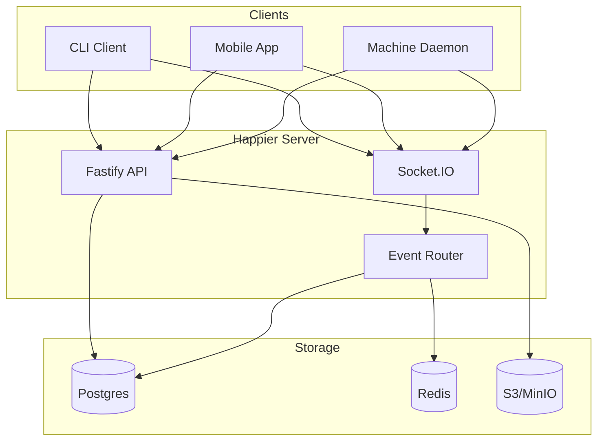
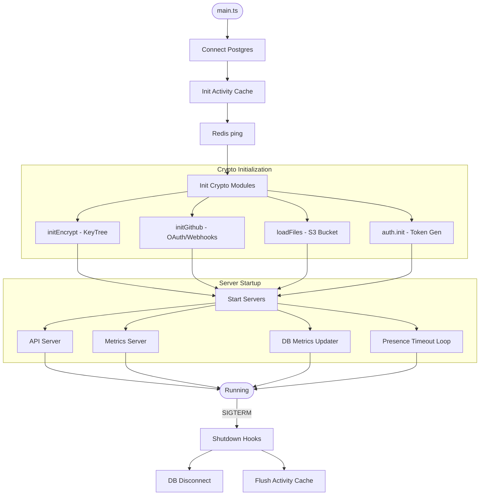
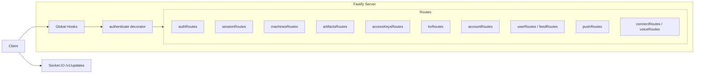
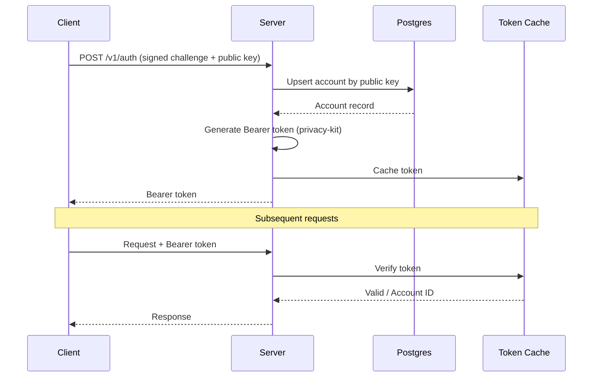
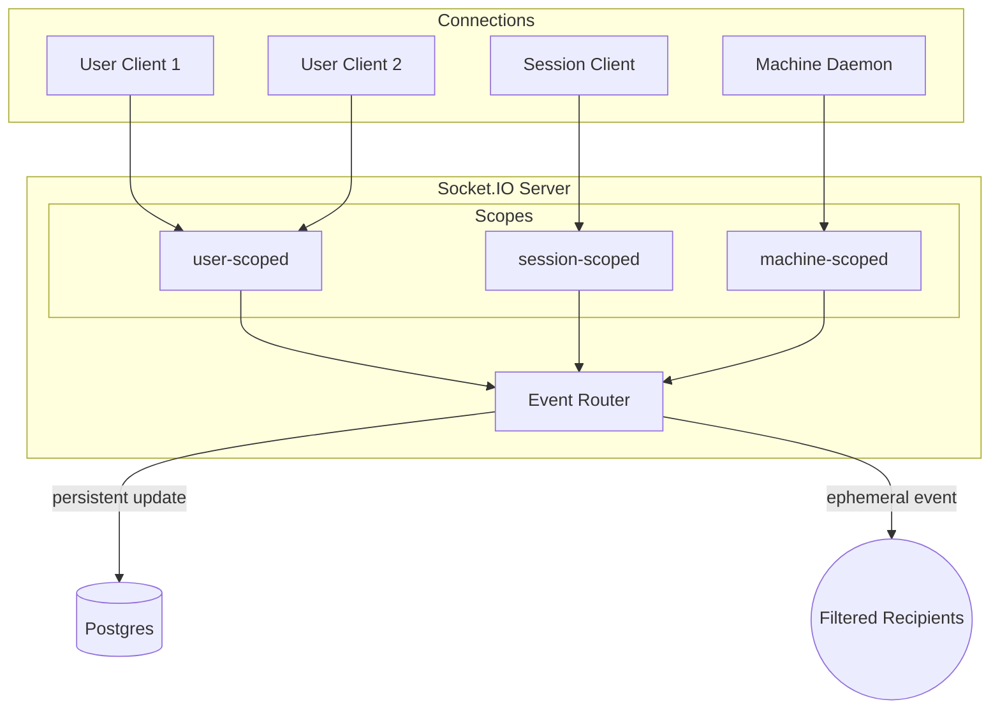
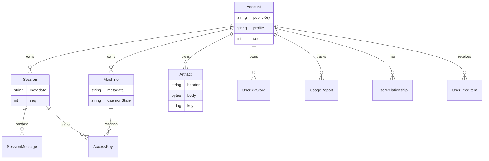
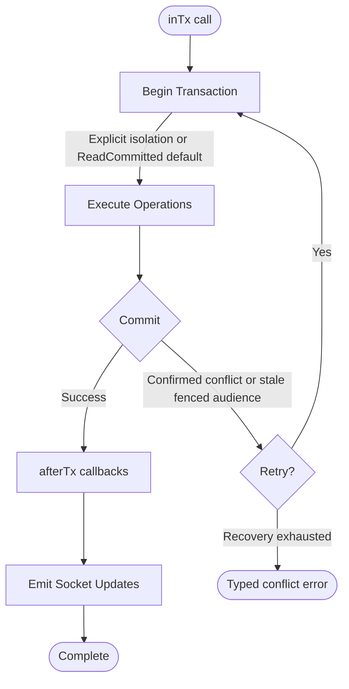
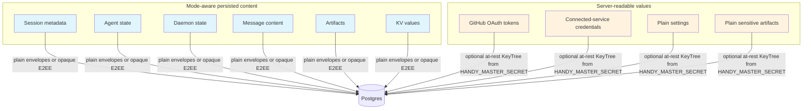

# Backend Architecture

This document describes the Happier backend structure as implemented in `apps/server`. It focuses on how the server is wired, how data flows through the system, and which subsystems handle which responsibilities.

## System overview

## At a glance
- Runtime: Node.js + Fastify for HTTP, Socket.IO for realtime.
- Database: Postgres via Prisma.
- Cache/bus: Redis client is initialized (currently only pinged).
- Blob storage: S3-compatible (MinIO) for uploaded assets.
- Crypto: privacy-kit for auth tokens and encrypted service tokens.
- Metrics: Prometheus-style `/metrics` server + per-request HTTP metrics.

## Process lifecycle
Entry point: `apps/server/sources/main.ts`.

Startup sequence:
1. Connect Postgres (`db.$connect()`).
2. Init activity cache (presence) and Redis connection check (`redis.ping()`).
3. Initialize crypto modules:
   - `initEncrypt()` derives a KeyTree from `HANDY_MASTER_SECRET`.
   - `loadFiles()` verifies S3 bucket access.
   - `auth.init()` prepares token generator/verifier.
4. Start API server (`startApi()`), metrics server, database metrics updater, and presence timeout loop.
5. Remain alive until shutdown signal.

Shutdown hooks are registered for DB disconnect and activity-cache flush.

## API layer
`startApi()` in `sources/app/api/api.ts` wires the HTTP server:
- Fastify instance with Zod validators/serializers.
- Global hooks for monitoring and error handling.
- `authenticate` decorator that verifies Bearer tokens.
- Route modules under `sources/app/api/routes`.
- Socket.IO server attached at `/v1/updates`.

HTTP routes are organized by domain:
- Auth (`authRoutes`)
- Sessions + messages (`sessionRoutes`)
- Machines (`machinesRoutes`)
- Artifacts (`artifactsRoutes`)
- Access keys (`accessKeysRoutes`)
- Key-value store (`kvRoutes`)
- Account + usage (`accountRoutes`)
- Social + feed (`userRoutes`, `feedRoutes`)
- Push tokens (`pushRoutes`)
- Integrations (`connectRoutes`, `voiceRoutes`)
- Version checks (`versionRoutes`)
- Dev-only logging (`devRoutes`)

## Authentication and tokens

Clients authenticate through method modules resolved by one effective Home decision:

- **Key challenge** — the primary method. Clients authenticate with a server-issued,
  single-use signed challenge (`/v1/auth`, v2) using the Account's public key; the
  server upserts the Account by public key and returns a Bearer token. Tokens are
  generated and verified by privacy-kit using `HANDY_MASTER_SECRET` and cached
  in-memory for fast verification.
- **External providers** — GitHub OAuth, generic OIDC, and WorkOS identity provider
  adapters authenticate through their own callbacks and finalize through the same
  Account/identity owners (see [enterprise-identity.md](enterprise-identity.md)).
  GitHub OAuth still uses short-lived "ephemeral" tokens to protect the callback and is
  separate from normal auth.
- **mTLS** — certificate authentication for browsers and service clients.
- **Native email/password (0.3 development)** — the one credential row per Account that
  stores a password verifier: a server-side scrypt hash for Plain Accounts, or an
  E2EE password envelope plus a one-way verifier of the client-derived authentication
  key (see [encryption.md](encryption.md) for the envelope). Password verification is
  admission to the existing token owner; it never mints encryption material or a
  second credential shape. The method is unreleased, and it is available by default:
  a Home administrator governs it through the Home governance policy like any other
  authentication method, and self-service provisioning additionally requires
  transactional-mail readiness. `HAPPIER_FEATURE_AUTH_EMAIL_PASSWORD__ENABLED=0` and
  `HAPPIER_FEATURE_AUTH_EMAIL_PASSWORD__PROVISION_ENABLED=0` are the operator opt-outs
  for a deployment that wants the method or its self-service admission off entirely;
  they are not an enablement stage. Real SMTP, loaded-client and mixed-version runs are
  release checks, separate from that policy decision.

One effective authentication-method decision — resolved from deployment policy, the
persisted Home governance document, and transactional-mail readiness — is the single
source feeding `/v1/features` publication, request admission, startup lockout safety,
and the contextual `POST /v1/auth/entry` projection. Consumers must not recompute
availability from environment variables or provider registries. The Home's permitted
Account modes narrow fresh provisioning only; they do not disable login, recovery, or
connection for an existing Account whose persisted mode is no longer offered for new
Accounts. Proven mailbox control is recorded by the narrow `AccountEmail` owner,
whose rows exist only after proof
(invitation acceptance, sign-in-email change, or trusted provider admission); the
native sign-in locator itself stays the globally unique `AccountIdentity(provider='email')`
row. Released 0.2 clients classify unknown method ids as OAuth, so the static
`/v1/features` auth projection remains an old-client-safe subset that omits
`email_password`; new clients read the complete list from `/v1/auth/entry`
(see [compatibility.md](compatibility.md)).

## Realtime sync architecture

### Connection types
Socket.IO connections are tagged by scope:
- `user-scoped`: receive all user updates.
- `session-scoped`: receive updates only for one session.
- `machine-scoped`: daemon connections for machine state.

In 0.3 development, `emitSocketPlannedRestart` sends `server:restarting` only
to sockets attached to the retiring API process. A healthy Redis peer keeps
its connections; one node's shutdown is not a cluster-wide Home outage.
The event name and retry hint are unchanged for clients on the retiring node.

### Event router
`EventRouter` (`sources/app/events/eventRouter.ts`) maintains per-user connection sets and routes:
- **Persistent `update` events**: database-backed changes with a user-level monotonic `seq`.
- **Ephemeral events**: presence/usage signals that are not persisted.

The router implements recipient filters so updates go only to interested connections (e.g., all session listeners or a specific machine).

### Update sequence numbers

In 0.3 development, generic `account-change` wakes coalesce once per committed
transaction and recipient Account's V3 stored-content audience. The first
post-commit callback retains its position and emits that Account's maximum
allocated cursor as `seq`; every change still allocates its own cursor, and
entity hints remain in the durable feed. Attempt-local state is discarded on
rollback/replay. Exact-Machine plugin-webhook wakes are a separate audience and
do not join this coalescing.

The development wake body optionally carries `changeKinds` and `entityIds`:
the deduplicated union of that recipient's allocations in the committed
transaction. These are already server-visible routing facts, never hints,
titles, names or content. The feed remains authoritative; wake metadata does
not advance materialization or replace any feed row. Development UI socket
readers pass these advisory facts through the single `homeAccountChange` owner,
which makes kind-less, empty, unknown and Account/security wakes coarse before
domain relevance filters run. Advisory ids never prove feed consumption:
`feedPageConsumed` is emitted only after detailed feed planner dispatch and
exact Session-system-record invalidation. It is not a cursor checkpoint or a
materialization proof. Observed Session records revalidate from relevant wake
ids even while catch-up is held; secondary Home snapshot demand reuses the
existing change planner's domain classification. Reconnect, observer gaps and
blocked-cursor recovery retain their existing behavior.
Exact-Machine webhook wakes may omit these fields and retain coarse behavior.

- `Account.seq` is the Account change-feed cursor. `markAccountChanged` and its ordered set forms record publication intents during `inTx` domain work. At the terminal publication phase, their single owner locks the complete recipient union in sorted Account-id order, allocates cursors and persists coalesced `AccountChange` rows, then commits. PostgreSQL uses `FOR NO KEY UPDATE` for this phase. In current development, the admission owner reuses already-held serializing/exclusive locks when they cover every recipient; content admission still requires the terminal locking SELECT. Admitted work that records no publication operation allocates no cursor and emits no change wake. Ordinary writers acquire no further Session/resource locks after publication locking. The sole exception is the already-exclusively-admitted physical Account-erasure tail: its final `Account.delete` and existing FK cascades/SET NULL run after allocation through the same Account-owned operation seam. Cross-Account shared-Session writers admit the retiring member before resource locking, so they cannot hold those rows while waiting on its exclusive erasure entry. The Account lock stays held through commit: once a reader checkpoints C, no change at cursor ≤ C can become visible later. Coalescing permits cursor gaps; content-free socket wakes run through `afterTx`, and the durable feed owns recovery.
- Ordinary PostgreSQL content admission takes compatible Account `FOR KEY SHARE` through `accountSessionOwnerMetadataFence.ts`, before resource locking and current-mode/current-authority reads. The complete entry set includes actual publication recipients as well as Accounts whose domain resources are affected; admitting only the actor can still cycle with a multi-Account exclusive operation. Sessions, grants and other mutable resources serialize their domain work through their owning row locks or CAS. In current development, Account-wide Collection, Pet and ordinary Artifact quota writers, and transition-stage cleanup, use the same owner's `serializing` intent (`FOR NO KEY UPDATE`): they serialize with each other while admitting unrelated content. Quota-configured Artifact grant/envelope writers and quoted Discussion admission join this cohort before resource locks to avoid reversing Artifact/Account order. Terminal cursor publication still conflicts with this lock. Mode/key/credential authority, authoritative lifecycle, retention-floor, identity and erasure mutations retain exclusive `FOR UPDATE`. Composed transition preparation selects exclusive admission before cleanup. Every caller chooses its strongest intent for the complete sorted audience at entry; an expanded or stronger nested request replays the attempt before acquiring another lock. `FOR SHARE` is unsuitable because it conflicts with cursor updates. MySQL retains early exclusive `FOR UPDATE` for all intents; SQLite retains its single-writer reservation. Provider differences remain inside the canonical owners.
- Session/Follow/Workflow, Machine, Artifact and Discussion audience owners recheck current recipients before domain work and during terminal publication. Growth beyond the captured audience aborts the attempt through existing `inTx` replay rather than extending the lock set out of order. Resource checks must account for the transaction's own mutations: creating a Session does not by itself mean the Account audience grew. Child-only and projection-only publishers still enter through their canonical resource owner before mutation: a nullable `AccountChange` foreign key can otherwise acquire a parent lock too late, including against physical deletion cascades.
- Physical Account erasure composes its cleanup scope with lifecycle admission before the first exclusive lock and rechecks discovery after acquisition. Session and Discussion cleanup own the retained authored/received grant predicates; erasure also includes owned Session deletion, responsibility cleanup and their workflow projections. These relationships belong to erasure admission, not the ordinary Account-status census. Cleanup cannot extend the admitted cohort or suppress surviving recipients, and the final physical-delete exception remains unchanged.
- Publication returns explicit `AccountChangePublication` handles, not an eagerly allocated number. Code that needs an outward cursor uses `transactionResult` to project the response after terminal allocation, or resolves the handle inside `afterTx`. Final Account-currentness projections read after queued Account mutations and allocation, before commit. The encryption coordinator prelocks its activation receipt during domain work; terminal publication atomically fills that receipt with the actual allocated cursor, preserving the activation-result constraint.
- In 0.3 development, Connected Account mutations use the Protocol-owned Connected Services Account-change builder: a known service publishes `account/connected-service:<pluginId>/<localId>` with `connectedServices: true` and its `connectedServiceRef`; bulk changes publish the separate `account/connected-services` entity. The existing per-entity coalescing and cursor filter retain exactly the services changed after a reader's checkpoint. Ordinary `account/self` hints keep replacement semantics, so later settings or username writes carry no inherited service scope. The shared reader also treats retained predecessor `account/self` rows with `connectedServices: true` as broad invalidations. Broad changes and reconnect/cursor recovery require full invalidation. Real health changes still publish Team credential-source changes because health can withdraw or restore direct-material eligibility. Named-service mutations publish to Teams whose connected-account or pool sources use that service; bulk changes and unreadable source bindings retain broad source-Team publication. The daemon's direct-material subscription consumes these explicit Team changes and completeness recovery, while connected-service facts independently invalidate retained authorization.
- The 0.3 V4 credential reader includes committed health in its read-only top-level `health` field, beside the presentation-only `metadata` accepted by credential replacement and Account encryption migration. The daemon's status settlement compares the health seen by the invocation's final credential-currentness read before issuing a health mutation. An unchanged status preserves committed refresh timestamps and publishes no Account change; real status transitions and refresh-result settlement retain their fenced mutation and Team publication paths. Named-service invalidations reach only binding watches authorized for those services before reading the binding store; broad changes, registry replacement and durable binding changes retain their freshness checks.
- Account delivery-mute edits read and merge the current scope list in the terminal Account operation, then resolve their changed/disposition result through `transactionResult`. Compatible entry alone does not serialize list replacements. Session delivery-mute edits retain their Session resource lock before reading and merging.
- Entity deletion preserves the change's durable kind, entity id, hint and cursor. Nullable entity links reflect final materialized existence, matching their existing `ON DELETE SET NULL` semantics even when deletion followed the queued intent during domain work. They are not a reason to drop the removal invalidation.
- Complete non-database awaits—imports, asynchronous crypto, RPC and provider calls—before the transaction. Immutable Collection-contract preparation precedes admission; mutable intent, quota and readiness checks remain protected. Account-owned settings/feed writes join terminal publication where an earlier Account update would invert resource locking. Refusal and failed result projection roll back domain rows, counters and change rows together. This is an internal development-source transaction contract; it changes no cursor schema or client wire format. See [PostgreSQL row locking](https://www.postgresql.org/docs/17/explicit-locking.html#LOCKING-ROWS), [MySQL locking reads](https://dev.mysql.com/doc/refman/8.0/en/innodb-locking-reads.html), and [SQLite transactions](https://www.sqlite.org/lang_transaction.html).
- Sessions and artifacts maintain their own `seq` for per-object ordering.

## Presence and activity

The current development server has separate session and machine presence owners:

- Machine heartbeats use the existing ActivityCache/batched persistence path in `sources/app/presence`.
- Released `session-alive` events enter `sources/app/api/socket/sessionUpdateHandler.ts`. The adapter delegates authorization, registration, and conditional liveness writes to `createSessionPublisherPresence`; machine batching is not a second session-presence writer.
- Session heartbeat coalescing retains the latest server-received observation. Its next flush deadline is the earlier of 60 seconds after the preceding write settles and half the configured session expiry after that write's observation time. This preserves the default write budget while bounding durable observation age for short expiries. Delayed writes retain the observation time rather than inventing a newer heartbeat. Close/disconnect clears pending work, and generation/fence checks prevent a replaced publisher from refreshing its successor. Database failures remain observable and use the adapter's retry backoff; coalescing cannot guarantee liveness during an outage.
- `runPresenceTimeoutTick` reads durable timestamps and conditionally expires the observed session fence. Session and machine expiry default to ten minutes, with a separate timeout-loop tick; these are not a ten-minute flush timer. Runtime activity snapshots describe agent activity separately from reachability.

These are development-source semantics, not a claim that every published server already contains them.

The development Session-awareness presenter keeps reported `background_active`
work in the shared Working bucket even when its observation freshness is stale.
The localized presenter says "awaiting updates" and retains paused motion;
observation age does not settle the work. List placement, Work filters and report
rollups consume the same presentation owner. Idle activity, offline presence,
archive and admitted requests keep their normal precedence. These are development
source semantics, not a statement about a published UI.

The development UI reconciles public lifecycle facts through
`sessionLifecycleProjection.ts` at full Session apply, list replacement, and list
patch publication. Full hydration uses the retained detail and the current
Home-qualified row before the existing detailed thinking-grace and resume owner
runs. The ready-event tuple and protocol runtime-activity revision merge therefore
survive older HTTP responses, including the first hydration of a cached row.
Device-local presence remains separate from durable `active` state. Pending flags
retain a newer cached observation tuple without fabricating detailed request
counts; detailed zero-count presentation keeps its existing null request-age
semantics. Metadata layout, access, safe locked titles, viewer unread state, and
content hydration keep their existing owners. The socket urgency classifier
publishes turn-status and runtime-status changes through its existing urgent path;
timestamp-only activity keeps its existing window.

Archive progress in the development UI belongs to the transient
`SessionsDomain.sessionArchiveOperations` map, keyed by Home-qualified
`SessionAddress`. Direct, stop-and-archive, and bulk UI actions claim it after
confirmation; object-identity settlement cannot retire a later operation.
The UI Action adapter borrows that exact admission object. Report Stop and Archive
share child admission within the same invocation; terminal children release their
own progress while the lead remains pending until its caller settles. Invocation
cleanup releases remaining owned admissions without replacing the domain owner
or serializing these objects into Action inputs.
Existing row and index projections derive Archiving presentation and pending
visibility from that owner, without changing authoritative membership or generic
attention retention. Home identity discovery resolves retained aliases through
the existing profile owner. Archive and unarchive completion patch the captured
Home's rows and memberships; a focus change cannot write a same-id Session on
another Home. Account replacement or logout retires the affected Home's pending
operations; focus changes and same-account reauthentication preserve them.

The archive network stage has one 75-second lifetime through carrier acquisition,
readiness, request headers, and response consumption. Stop completes before that
clock starts; unarchive retains its existing request lifecycle. The HTTP owner consumes the
archive response while cancellation and captured authority remain live, and the
operation applies local results only after that request returns. Timeout or
caller/account cancellation releases UI admission. A timeout can follow a server
commit, so it is a failure to confirm completion, not evidence that the server
rolled the write back. Existing reachability startup and carrier custody keep
their own owners. Context settlement releases a carrier that arrives after caller
cancellation without cancelling a shared native dial. An active-session conflict
fails immediately; the UI does not poll or repeat Stop. A missing runner permits
one authoritative archive attempt.
Accepted Stop and ordinary disconnect do not establish runner exit: inactive
state still requires acknowledged, fenced publisher Close, a proven machine Stop,
or the existing presence-expiry path.

## Storage and persistence
### Database (Prisma)
In 0.3 development source, `sources/storage/prisma.ts` constructs runtime and
maintenance clients with `errorFormat: 'minimal'` for every database provider.
This disables Prisma's per-query source call-site capture in development and QA,
while retaining error messages, codes and metadata for `inTx` and the shared HTTP
error handler. Server diagnostics do not depend on Prisma source snippets.

Prisma models live in `prisma/schema.prisma`. Key tables:

- `Account`: public key identity, profile, settings, seq counters.
- `Session` + `SessionMessage`: explicit plain or encrypted metadata/message content
  selected by the persisted Session mode.
- `Machine`: explicit plain or encrypted metadata and daemon state selected by the
  persisted Machine representation.
- `Artifact`: explicit plain or encrypted header/body plus its mode/key marker.
- `AccessKey`: encrypted per-session-per-machine access keys.
- `UserKVStore`: domain-owned opaque bytes with optimistic versions; each domain,
  such as Todo, owns its plain/encrypted envelope.
- `UsageReport`: usage aggregation per session/key.
- `UserRelationship` + `UserFeedItem`: social graph and feed.

### Transactions and retries

`inTx()` wraps Prisma transactions with:

- In 0.3 development source, ReadCommitted is the PostgreSQL/MySQL default. Named cross-row invariants retain Serializable. `inReadSnapshot` owns the read-only coherent-view policy: PostgreSQL RepeatableRead without SSI predicate locks, retaining the existing MySQL and SQLite isolation/read-snapshot behavior. Content capture/readmission, Home configuration, directory listing, standalone Session recipient census and fresh Session read admission consume this policy; their composing writers retain their own transactions.
- Account cursor publication does not make Serializable a writer default. A PostgreSQL snapshot taken before an unrelated cursor advance cannot later lock or update that Account version, even when the writer's domain rows do not conflict. RepeatableRead writers have the same concurrent-update failure. Use ReadCommitted when the canonical resource locks, conditional writes and current admission rechecks protect the complete mutation; terminal rechecks run through `beforeAccountChangePublication` after the ordered Account locks and acquire no further resource locks. Retain stronger isolation only for a named rule the existing guards do not cover. A coherent multi-query read, same-row stale overwrite and cross-row write skew require different proofs; an isolation comment or unique row identity does not establish that proof. See [PostgreSQL transaction isolation](https://www.postgresql.org/docs/16/transaction-iso.html).
- Home-directory upsert, delete, preferred-Home assignment and issuer-link replacement/deletion use the existing exclusive Account admission before capturing descriptor revisions, first-Home preference or displaced issuer binding. Standalone writers use ReadCommitted; composed sign-in writers select their strongest complete audience at entry and reuse that admission. Descriptor monotonicity, preference existence and exact displaced-binding approval invalidation remain with the directory owner rather than transport wrappers. Fresh native provisioning with an invitation admits the existing Team audience and prospective Account together before any provisioning write, so invitation acceptance does not discover a wider cohort after admission.
- RepeatableRead admits read-only serialization anomalies: a stable view need not match any serial ordering with overlapping writers ([PostgreSQL isolation](https://www.postgresql.org/docs/16/transaction-iso.html#XACT-REPEATABLE-READ)). The content owner promises a coherent capture followed by a separate fresh policy readmission, including access/mode/key rejection. The Home owner promises a request/job configuration snapshot, with mutation admission in its own transaction. Neither read owner certifies cross-transaction business invariants or serial ordering with writers.
- PostgreSQL `readOnly: true` declares `SET TRANSACTION READ ONLY` before the caller's queries on every attempt. Persistent-table writes then fail; isolation, retry and deadline accounting stay with `inTx`. It does not enable `DEFERRABLE`, which can block snapshot acquisition ([PostgreSQL transaction modes](https://www.postgresql.org/docs/16/sql-set-transaction.html)).
- Automatic retry on `P2034`, PostgreSQL serialization/deadlock failures and stale fenced audiences, using the existing provider-owned recovery budget.
- In current 0.3 development source, Artifact grant, revoke and recipient-key-envelope HTTP mutations use named ReadCommitted transactions. Their shared Artifact owner admits the complete Account audience before locking the Artifact parent, fences mode/key authority changes and rechecks recipients after admission and at terminal publication. This avoids invalidating a Serializable snapshot when an unrelated Artifact, Session or Account publisher advances the same Account cursor. Quota-enabled writers consume the existing `serializing` admission cohort.
- Optional `prepare` runs before each attempt and returns a transactional fence, invoked after the wrapper's PostgreSQL SHOW/SET utility commands and before callback reads. In current 0.3 development source, HTTP Session Archive/Unarchive and ordinary Layout-1 tag create/rejoin prepare their complete publication audience, then lock and recheck it before admission reads. Discussion Archive/Restore uses the same lifecycle through its canonical Discussion audience owner, including participant and Follow-destination Sessions; changed ownership or an expanded audience replays preparation. These archive operations and fenced tag admission use ReadCommitted. Initial Folder/Tag placement holds Account content admission through assignment commit; the organization deletion owners take exclusive Account admission before reading their tree or assignments, preserving active-resource predicates without certifying unrelated cursor writes. Creation-time direct/Team grant admission and Discussion-participant binding reuse their canonical pure eligibility/disclosure readers after terminal Account locking, so a withdrawn grant rolls back the newborn Session, slot binding and Follow publication together. A tag identity appearing or changing during preparation replays discovery before rejoin. Composed resource rules stay with their admission owners; each remaining isolation opt-in needs its own invariant proof. Other callers keep their existing path and budgets.
- Public Profile publication, consent updates and withdrawal share one exclusive Account admission reader, including identity-driven withdrawal. Moderation and handle reclaim admit the complete Home-governance audience before authorizing the operator. Account-local Profile transfer preparation and activation take the existing exclusive Account admission before checking their complete row census, including the canonical import shared-resource classification; foreign Artifact/Secret inventories retain their separate admission requirements. These are development-source transaction choices; public requests, responses and stored formats are unchanged.
- Session organization counts, hierarchy and whole-order replacement share the existing exclusive Account admission through `organization/changes.ts`, before reading the aggregate. Session-specific operations admit their complete Session audience at that strongest intent initially; nested import owners reuse it without widening or upgrading. Creation placement retains its opposing content admission. Private reply-progress HTTP/socket writers instead use the existing exact original-JSON CAS and current linked admission at ReadCommitted; they allocate no Account cursor and do not introduce a second progress owner.
- `afterTx()` to emit socket updates after commit.

In 0.3 development source, PostgreSQL transactions share one absolute operation deadline across preparation, local admission, native acquisition, callback SQL and retry backoff. `inTx` uses the caller's deadline when supplied; otherwise it derives one at entry from the configured maxWait plus timeout (normally 10 + 15 seconds). Retries never renew that allowance. Whole-transaction replay is limited to structured concurrency aborts (`P2034`, SQLSTATE `40001`/`40P01`) and explicit domain replay requests, within the existing retry cap and backoff. Expired `P2028`, internal execution expiry, statement cancellation (`57014`) and ordinary lock timeout (`55P03`) settle without another attempt. Expired execution and statement/lock-budget expiry use `database_transaction_timeout` HTTP 503; exhausted conflicts use `database_transaction_conflict_exhausted`. Cancellation without evidence of expiry retains its rollback classification; unknown commit outcomes remain distinct. SQLite retains its own retry budget.

Local admission and native transaction acquisition consume the same acquisition budget. Callback entry rechecks that budget before user work, including when a transaction pooler delays BEGIN beyond Prisma's own pool wait. An expired PostgreSQL entry settles without running user work, `afterTx` or another acquisition attempt. Request-deadline and acquisition exhaustion both project through the shared HTTP error mapper as 503 `database_connection_unavailable`. This entry check prevents a late commit; it does not interrupt a BEGIN still queued at the pooler.

Account publication holds its row locks through commit. The required lock order is the complete prospective Account audience in id order before Session write locks or the retained owner-metadata fence. Session discovery includes retained grants on unpublished Sessions and inactive Accounts, so later publication or reactivation cannot introduce an unfenced reader. The same census covers manager Follow destinations, managed source Sessions and requested lifecycle Automation publications. After acquisition, the canonical Session helper rechecks the audience; an expanded audience rolls back and replays the whole transaction instead of extending locks out of order. Grant/membership/Account-status writers fence their affected Session audiences before mutation. Pending admission similarly rechecks its selected Machine/controller after acquisition.

Workflow publication composes Run/watchers, review Sessions, Automation and eligible managed-controller audiences before any owner-mode or domain write fence. Session lifecycle producers include that composed audience before their first lock. These helpers acquire locks only; `markAccountsChanged` remains the single cursor-allocation/publication owner. A Session-only presence touch that allocates no Account cursor needs no Account prelock. Serializable alone does not prevent Account/Session deadlocks.

Exhausted confirmed-rollback conflicts become `database_transaction_conflict_exhausted`, projected once as HTTP 503. Pending admission retains its existing `session_input_storage_unavailable` rejection (nothing sent; draft kept). SQLite transport/execution ambiguity remains an unknown outcome even if a later attempt rolls back or fails acquisition; caller deadlines retain their typed error and original cause. Diagnostics report the transaction class and last driver's SQLSTATE/code, failed-statement relation and fixed conflict-message summary when available. Unknown driver messages, SQL, parameters and driver DETAIL are omitted; a failed-statement relation does not identify the conflicting relation.

In development source, the Account admission owner sets PostgreSQL `application_name` once per managed write attempt, immediately before its first Account lock. It uses one transaction-local utility `SET LOCAL`, preserving the caller's first-snapshot ordering; `SELECT set_config` would establish a Serializable snapshot early. The value is the existing transaction class followed by the validated web-latency request id, or `unattributed` without that trace context. PostgreSQL's 63-byte limit shortens the class prefix when needed while retaining the full request id. Commit or rollback restores the backend's previous application name. Transactions without Account admission, unmanaged callers, SQLite and MySQL receive no attribution statement. A matching loaded server with `HAPPIER_WEB_LATENCY_TRACE=1` is required to join idle Account holders to request traces; transaction age and last SQL alone do not establish lock-hold duration or its cause.

The same opt-in development trace distinguishes Session RPC connection, issue and ACK wait; runner outbox persistence, delivery-slot admission and transcript socket ACK; and server publisher queue admission versus execution. `socket.transcript-observation.ack` marks the successful observation response immediately before invoking its callback, not proof that the caller received it. Actor resolution and realtime/ready publication can follow that marker, so the complete socket-handler span is not an ACK latency. Successful `db.*` spans require trace-level server logs; other phase summaries use debug. Request roots are process-local: join the caller, runner and server using the owned Session and a single unambiguous original operation, not an assumed shared UUID. The default Session RPC ACK budget is 20 seconds after connection; whole-command time additionally includes startup and admission outside that wait.

Development source adds one content-free `db.transaction.phases` record per managed interactive `inTx` attempt with `HAPPIER_WEB_LATENCY_TRACE=1` and `HAPPIER_SERVER_LOG_LEVEL=trace`. It records the original entry/deadline, configured and bounded allowances, local admission submit/acquire, native callback start/end, publication completion and native settlement; unreached phases are null. Existing SQL spans carry the same request id and attempt id, so their durations and completion timestamps distinguish SQL from gaps between statements. Settlement uses the transaction owner's existing certainty (`committed`, `rolled-back`, `not-started` or `unknown`); P2028 discovery is a fixed query, batch query, or commit label, with numeric native timeout/elapsed and SQLSTATE when exposed. No SQL, parameters or raw Prisma messages enter these records. Disabled capture adds no trace state, clock or timer work. This capture does not itself identify a lock holder or explain time in client/event-loop gaps; those require contemporaneous evidence.

Exhaustion diagnostics distinguish Prisma P2028 as `acquisition-unavailable`, `expired-timeout`, `transaction-not-found` or `unclassified` in `prismaTransactionErrorKind`, using the existing recovery classifiers. Acquisition exhaustion records `outcome: acquisition-unavailable`; execution or statement-budget expiry records `outcome: deadline-exceeded`; other confirmed rollback exhaustion records `outcome: conflict-exhausted`. These labels do not change retry or outcome-certainty policy, and never include raw Prisma messages. Team restore and credential deletion supply `teams.restore` and `teams.credentials.delete` transaction classes to this same owner and Account admission label.

This development-source pattern is used for multi-write operations like batch KV mutation and session deletion.

Home-login redemption prepares required authenticated descriptor publication before opening its Serializable link/approval/Account/token transaction. Preparation owns the publication queue, native status observation and durable continuity IO. Immediately before issuance, the descriptor owner rechecks the running Home's identity, configured authentication origin/ingress and current endpoint lifecycle/key without IO. A destination change during admission is rejected; descriptor revision and routing hints do not change credential identity. Continuity records preserve publication ordering and cannot replace the running endpoint's lifecycle authority.

### Blob storage (S3/MinIO)
The server uses S3-compatible storage for user assets (e.g., avatars):
- `storage/files.ts` configures the S3 client.
- `uploadImage` processes and stores files and writes metadata to `UploadedFile`.
- Public URLs are derived from `S3_PUBLIC_URL`.

### Redis
A Redis client is initialized in `main.ts` and pinged at startup. It can be expanded for caching or pub/sub if needed.

## Data confidentiality model

- E2EE content remains opaque ciphertext to the server. Plain-account and
  plain-Session content is intentionally server-readable and uses strict domain
  envelopes, sometimes base64-encoded by byte-oriented routes.
- Artifacts and domain-owned KV values may be plain or encrypted; base64 is transport
  encoding and does not imply confidentiality.
- The server encrypts service tokens and may seal selected plaintext Settings,
  Connected Service credentials, and Artifact content using the KeyTree derived from
  `HANDY_MASTER_SECRET`. This persistence-only sealing is not E2EE and never appears
  on the public wire.

## Integrations
- **GitHub**: OAuth connect + webhook verification, optional if env vars are set.
- **AI vendors**: encrypted token storage for `openai`, `anthropic`, `gemini`.
- **Voice**: RevenueCat subscription check + ElevenLabs token minting.
- **Push tokens**: stored for later notification delivery.

## Observability

In 0.3 development source, Prisma validation failures reaching the global HTTP
error handler return the opaque HTTP 500 envelope with code
`database_query_validation_failed`. The existing shared-QA/latency query extension
captures model and operation at the query boundary. `storage/prismaErrors.ts`
projects recognized validation sentences into field/argument names only; request
logs and sanitized exception monitoring never receive the invocation or its
values. Failures outside that extension retain unknown model/operation rather
than inferring them from query text. This diagnostic is distinct from shared-QA
P2021/P2022 schema mismatch guidance and adds no retry or database write.

- `/health` route checks DB connectivity.
- Metrics server exposes `/metrics` for Prometheus.
- HTTP request counters and duration histograms are captured via Fastify hooks.
- WebSocket event counters and connection gauges are in `metrics2.ts`.

## Key implementation references
- Entrypoint: `apps/server/sources/main.ts`
- API server: `apps/server/sources/app/api/api.ts`
- Socket server: `apps/server/sources/app/api/socket.ts`
- Event routing: `apps/server/sources/app/events/eventRouter.ts`
- Presence: `apps/server/sources/app/presence`
- Storage: `apps/server/sources/storage`
- Prisma schema: `apps/server/prisma/schema.prisma`
