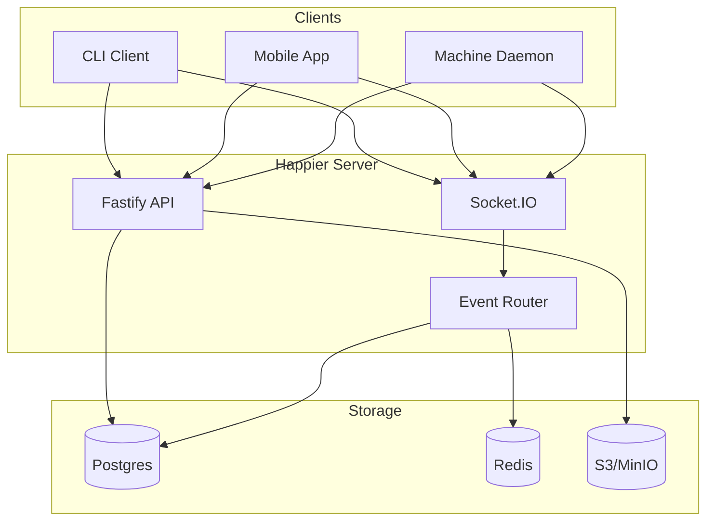
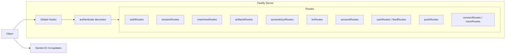
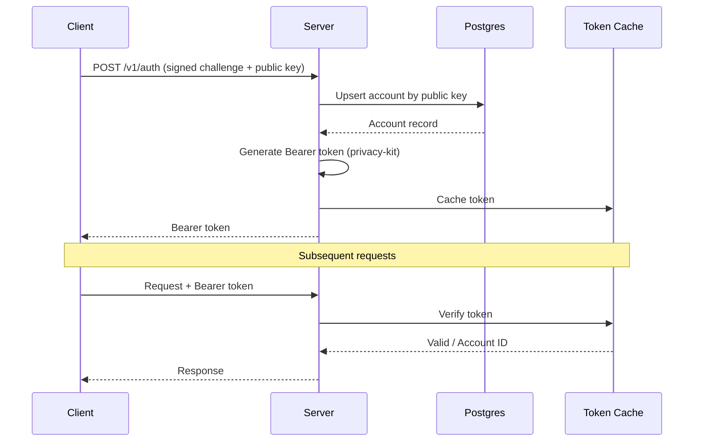
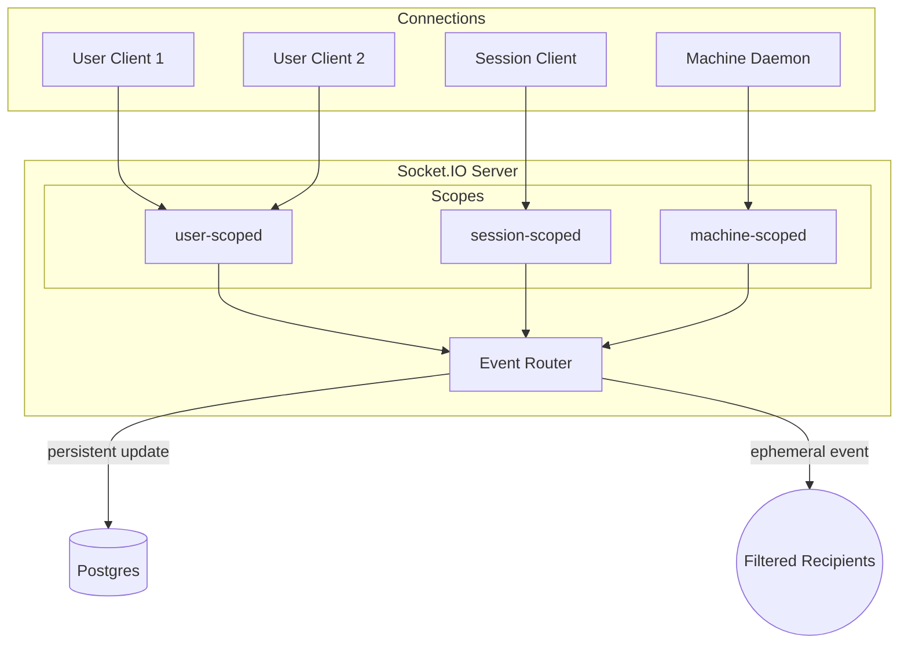
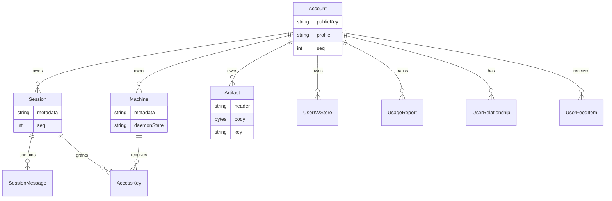
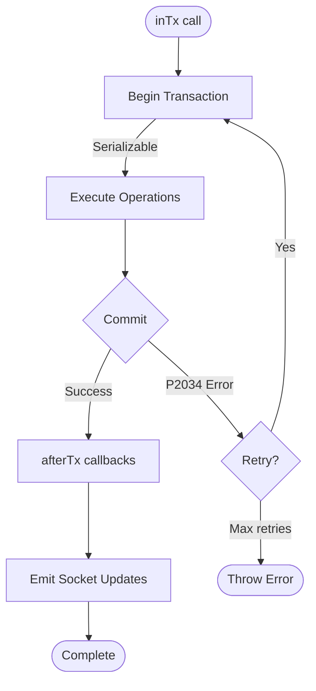
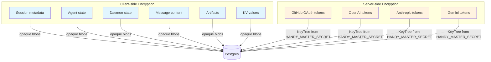

# Backend Architecture

This document describes the Happier backend structure as implemented in `apps/server`. It focuses on how the server is wired, how data flows through the system, and which subsystems handle which responsibilities.

## System overview

## At a glance
- Runtime: Node.js + Fastify for HTTP, Socket.IO for realtime.
- Database: Postgres via Prisma.
- Cache/bus: Redis client is initialized (currently only pinged).
- Blob storage: S3-compatible (MinIO) for uploaded assets.
- Crypto: privacy-kit for auth tokens and encrypted service tokens.
- Metrics: Prometheus-style `/metrics` server + per-request HTTP metrics.

## Process lifecycle
Entry point: `apps/server/sources/main.ts`.

Startup sequence:
1. Connect Postgres (`db.$connect()`).
2. Init activity cache (presence) and Redis connection check (`redis.ping()`).
3. Initialize crypto modules:
   - `initEncrypt()` derives a KeyTree from `HANDY_MASTER_SECRET`.
   - `initGithub()` configures GitHub App/webhooks if env vars exist.
   - `loadFiles()` verifies S3 bucket access.
   - `auth.init()` prepares token generator/verifier.
4. Start API server (`startApi()`), metrics server, database metrics updater, and presence timeout loop.
5. Remain alive until shutdown signal.

Shutdown hooks are registered for DB disconnect and activity-cache flush.

## API layer
`startApi()` in `sources/app/api/api.ts` wires the HTTP server:
- Fastify instance with Zod validators/serializers.
- Global hooks for monitoring and error handling.
- `authenticate` decorator that verifies Bearer tokens.
- Route modules under `sources/app/api/routes`.
- Socket.IO server attached at `/v1/updates`.

HTTP routes are organized by domain:
- Auth (`authRoutes`)
- Sessions + messages (`sessionRoutes`)
- Machines (`machinesRoutes`)
- Artifacts (`artifactsRoutes`)
- Access keys (`accessKeysRoutes`)
- Key-value store (`kvRoutes`)
- Account + usage (`accountRoutes`)
- Social + feed (`userRoutes`, `feedRoutes`)
- Push tokens (`pushRoutes`)
- Integrations (`connectRoutes`, `voiceRoutes`)
- Version checks (`versionRoutes`)
- Dev-only logging (`devRoutes`)

## Authentication and tokens

The backend does not store passwords. Instead:
- Clients authenticate with a signed challenge (`/v1/auth`) using a public key.
- The server upserts the account by public key and returns a Bearer token.
- Tokens are generated and verified by privacy-kit using `HANDY_MASTER_SECRET`.
- Tokens are cached in-memory for fast verification.

GitHub OAuth uses short-lived "ephemeral" tokens to protect the callback and is separate from normal auth.

## Realtime sync architecture

### Connection types
Socket.IO connections are tagged by scope:
- `user-scoped`: receive all user updates.
- `session-scoped`: receive updates only for one session.
- `machine-scoped`: daemon connections for machine state.

### Event router
`EventRouter` (`sources/app/events/eventRouter.ts`) maintains per-user connection sets and routes:
- **Persistent `update` events**: database-backed changes with a user-level monotonic `seq`.
- **Ephemeral events**: presence/usage signals that are not persisted.

The router implements recipient filters so updates go only to interested connections (e.g., all session listeners or a specific machine).

### Update sequence numbers
- `Account.seq` is the per-user update counter. It is incremented by `allocateUserSeq` and used as `UpdatePayload.seq`.
- Sessions and artifacts maintain their own `seq` for per-object ordering.

## Presence and activity

The current development server has separate session and machine presence owners:

- Machine heartbeats use the existing ActivityCache/batched persistence path in `sources/app/presence`.
- Released `session-alive` events enter `sources/app/session/runtimeActivity/socketEvents.ts`. The adapter delegates authorization, registration, and conditional liveness writes to `createSessionPublisherPresence`; machine batching is not a second session-presence writer.
- `publishSessionPublisherLifecycleUpdate` invalidates account badges through the existing debounced refresh owner whenever it publishes reachability, including registration, close, and timeout. Activity-only updates retain their explicit badge-change signal. Closing reachability does not clear pending approval or user-action counts; those remain request-owner facts.
- Session heartbeat coalescing retains the latest server-received observation until shared persistence admission, so heartbeats received while queued replace the older pending observation before it is written. An accepted heartbeat keeps its original observation if a queued close clears pending work, preserving heartbeat-before-close ordering. Its next flush deadline is the earlier of 60 seconds after the preceding write settles and half the configured session expiry after that write's observation time. This preserves the default write budget while bounding durable observation age for short expiries. Delayed writes retain the observation time rather than inventing a newer heartbeat. Disconnect clears pending work, and generation/fence checks prevent a replaced publisher from refreshing its successor. Database failures remain observable and use the adapter's retry backoff; coalescing cannot guarantee liveness during an outage.
- Stop completion uses the publisher's acknowledged runtime-activity close or the fenced explicit machine-stop finalizer after the daemon reports a proven stop. An accepted stop request, an opaque encrypted RPC reply, and an ordinary socket disconnect do not prove that the runner exited. Ordinary disconnect makes runtime activity unobserved; it does not mark the session inactive or end its turn. Archive continues to require the server's authoritative inactive state.
- `runPresenceTimeoutTick` reads durable timestamps and conditionally expires the observed session fence. Session and machine expiry default to ten minutes, with a separate timeout-loop tick; these are not a ten-minute flush timer. Runtime activity snapshots describe agent activity separately from reachability.

These are development-source semantics, not a claim that every published server already contains them.

The development UI keeps reported background work in its configured Working placement
while publisher presence remains active and online. Observation age does not settle that
work or move an unread reply into Needs attention. The existing session-work observation
owner states uncertainty separately: stale list rows pause their working indicator and
say "working, awaiting updates…" until fresh evidence arrives. An explicit idle activity
snapshot, offline presence, archive, or actionable request still changes presentation
through the normal lifecycle and attention owners.

The development UI can retain a hidden detailed Session while updating only its
list projection. `sessionLifecycleProjection.ts` owns ordering of the public
lifecycle facts shared by both shapes. Full hydration reconciles those facts
against both the retained detail and the current list row before the existing
detail owner derives presence, thinking grace, and resume state. List replacement
and patch publication use the same ordering, including the ready-event tuple and
the protocol runtime-activity revision merge. Pending-request flags retain their
newer observation tuple without fabricating detailed request counts. Older HTTP responses and delayed
detail rebuilds therefore cannot replace newer completion facts. Encrypted
metadata and transcript hydration remain demand-driven. The socket urgency
classifier publishes turn-status and runtime-status changes immediately through
its existing urgent path; timestamp-only activity retains its existing window.

Archive progress in the development UI belongs to transient operation state in
the session store, keyed by server and session. Single-session and bulk actions
claim the same operation after confirmation and before starting work. Rows and
action controls derive pending status from that owner, so replacing a list row
does not admit duplicate work or lose progress. Switching servers preserves
pending operations; logging out clears them. Discovering a server identity while
an archive is pending preserves progress and duplicate prevention across its
equivalent profile identifiers. Archive and unarchive success update the request's
captured server scope, including cached rows created before identity discovery
and completion after the user switches servers. The shared session-list cache
publisher normalizes Home identifiers and retires equivalent alias buckets, so
periodic refreshes and mutations update the same snapshot. Legacy warm rows retain
stable projected identities while a Home's identity is discovered.
A missing runner permits an archive attempt,
but a server `session_active` conflict still fails immediately; it is not proof
that the session stopped.

The archive stage uses one deadline across readiness, the POST, response-body
consumption, and any inactivity retries. It starts after Stop and defaults to
75 seconds. `EXPO_PUBLIC_HAPPIER_SESSION_ARCHIVE_AFTER_STOP_TIMEOUT_MS=0` disables
inactivity polling while retaining one request with the default finite deadline.
Expiration cancels the HTTP read and releases admission so a user can retry;
the operation returns `session_archive_timeout` without a raw display message,
so action surfaces use their existing translated archive failure message.
Expiration does not prove that the server rolled back a write. Cold shared reachability
activation retains its existing finite probe budget; a shorter archive deadline
is observed after that activation finishes. Response consumers run
inside the existing HTTP cancellation lifetime, and parsing failures do not
replay a write or establish a server reachability failure.

The development UI reconciles session-owned roster activity through its existing
runtime presentation and freshness clock. Losing the owner makes stale activity
unobserved; absence does not establish successful completion or cancellation.
Newer child observations and actual late results still apply. Independently owned
execution runs retain their own lifecycle and use the shared current-work
[protocol classification](protocol.md#ephemeral-event-types), so an idle resumable
handle does not keep the roster's live count or running indicator active.

In current development source, `ApiSessionClient` retains the execution-run
manager's cleanup registration and starts it at Session close or runtime
termination, without waiting for the primary agent or transport to finish.
Terminal bounded runs release their backend independently of optional parent
completion-input delivery; a parked long-lived run remains usable until stopped
or its owning Session closes. Backend disposal joins the existing per-backend
cleanup rather than repeating native teardown. Voice owns chat and commit
backends as soon as they are acquired, including while native session opening is
pending, and releases them before waiting for an active turn to settle.

Resuming a bounded execution run keeps its bounded completion contract. The
recreated provider occurrence runs through the same intent parsing, terminal
result and activity publication, marker update, and cleanup as its initial turn.
A retained resume handle alone does not turn that run into a long-lived run;
subsequent input to an active bounded turn uses its existing steering queue.

## Storage and persistence
### Database (Prisma)
Prisma models live in `prisma/schema.prisma`. Key tables:

- `Account`: public key identity, profile, settings, seq counters.
- `Session` + `SessionMessage`: encrypted session metadata and message blobs.
- `Machine`: encrypted machine metadata + daemon state.
- `Artifact`: encrypted header/body + per-artifact key.
- `AccessKey`: encrypted per-session-per-machine access keys.
- `UserKVStore`: encrypted values with optimistic versions.
- `UsageReport`: usage aggregation per session/key.
- `UserRelationship` + `UserFeedItem`: social graph and feed.

### Transactions and retries

`inTx()` wraps Prisma transactions with:
- Serializable isolation.
- Automatic retry on `P2034` (serialization failures).
- `afterTx()` to emit socket updates after commit.

This pattern is used for multi-write operations like batch KV mutation and session deletion.

### Blob storage (S3/MinIO)
The server uses S3-compatible storage for user assets (e.g., avatars):
- `storage/files.ts` configures the S3 client.
- `uploadImage` processes and stores files and writes metadata to `UploadedFile`.
- Public URLs are derived from `S3_PUBLIC_URL`.

### Redis
A Redis client is initialized in `main.ts` and pinged at startup. It can be expanded for caching or pub/sub if needed.

## Data confidentiality model

- Session metadata, agent state, daemon state, and message content are stored as opaque encrypted strings or blobs.
- Artifacts and KV values are stored encrypted and encoded as base64 on the wire.
- The server only encrypts/decrypts **service tokens** (GitHub OAuth tokens, vendor tokens) using the KeyTree derived from `HANDY_MASTER_SECRET`.

## Integrations
- **GitHub**: OAuth connect + webhook verification, optional if env vars are set.
- **AI vendors**: encrypted token storage for `openai`, `anthropic`, `gemini`.
- **Voice**: RevenueCat subscription check + ElevenLabs token minting.
- **Push tokens**: stored for later notification delivery.

## Observability
- `/health` reports process liveness without a database dependency.
- `/ready` checks dependency readiness, including database connectivity.
- Metrics server exposes `/metrics` for Prometheus.
- HTTP request counters and duration histograms are captured via Fastify hooks.
- WebSocket event counters and connection gauges are in `metrics2.ts`.

## Key implementation references
- Entrypoint: `apps/server/sources/main.ts`
- API server: `apps/server/sources/app/api/api.ts`
- Socket server: `apps/server/sources/app/api/socket.ts`
- Event routing: `apps/server/sources/app/events/eventRouter.ts`
- Presence: `apps/server/sources/app/presence`
- Storage: `apps/server/sources/storage`
- Prisma schema: `apps/server/prisma/schema.prisma`
