# CLI Architecture

This document describes the Happier CLI (`apps/cli`) and its daemon. The CLI is both an interactive tool and a background session manager that keeps machine state in sync with the server.

## Managed Linux Computer desktop (0.3 development)

The existing Computer route owner starts one desktop on demand when Linux has no
resolved X11 or Wayland display. The `virtual-display` Machine recipe supplies
Xvfb, Openbox, AT-SPI, D-Bus and GLib tools; discovery resolves these installed
executables without installing software. Missing prerequisites settle as
`computer_display_unavailable` with the recipe name.

Xvfb chooses a free display through `-displayfd` with TCP disabled. A private
session D-Bus and runtime/config directory enable accessibility; Openbox starts
when installed. List and select use this display as an ordinary Computer target,
including its explicit display id. Apps must target that display deliberately:
Agent shells do not inherit `DISPLAY` or the private bus environment. The desktop
survives Session closure and ends with daemon disposal, including its D-Bus
activation children. Restarting the daemon loses its windows. Existing displays,
Windows and macOS retain their current paths.

Linux X11 input checks OS grants once per native driver connection; native input
still enforces the OS boundary, capture-bound geometry stays checked, and explicit
permission/status reads stay fresh. Reselection opens a new connection.

Standing Session/turn ownership is documented in [runtime core](runtime-core.md); declaration, activation and projection ownership is in [plugin platform and SDK](plugin-platform.md). Those pages describe the current 0.3 development source rather than release readiness.

In 0.3 development, automatic Guard stops re-admit the selected target and current policy before
the native stop; an unrelated inventory edge wakes the loop without vetoing an
otherwise eligible due stop.

## System overview

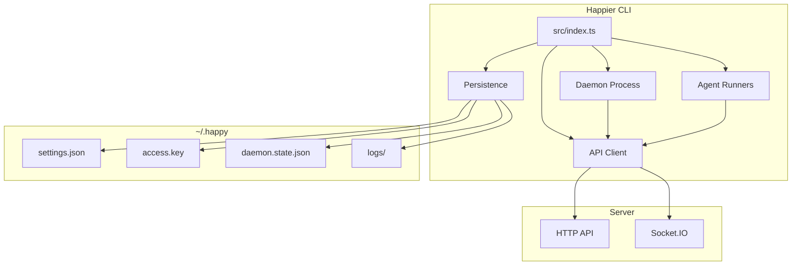

In 0.3 development, `persistence.ts` owns the local Account changes-feed
checkpoint in `changes-cursors.json` beneath the CLI home, keyed by server and
Account. Cursor acknowledgements atomically replace that file only when progress
changes; they do not rewrite `settings.json`. Logout clears the selected server's
checkpoint, profile adoption copies it through the same owner, and diagnostics
read the checkpoint directly. The first access imports 0.2 cursor fields from
settings when the checkpoint file is absent. Settings publications preserve that
import before removing the legacy fields; an empty checkpoint prevents a cleared
cursor from being imported again.

Workspace replacement in 0.3 development calls the same
`commitGuardedFileReplace` owner as editor saves: the replace handler authorizes
each rooted path and supplies raw bytes plus the reviewed SHA-256 expectation;
it does not own another filesystem writer.
The same apply owner accepts semantic edit sets: zero-based UTF-16 ranges
address each file's original text, and successful writes return the existing
post-coordinate inverse edits for Undo. File renames and their inverse moves
also require a current source hash and an absent destination. Results remain
per file; semantic edit sets and inverse file-move sets stop at the first refused or incomplete file and
mark dependent files unattempted. Earlier files remain applied, as required by
the negotiated LSP abort failure mode.
If a rename succeeds before its content write fails, the result preserves the
move and its hash with a failure reason so the caller retains Undo custody.
Replace apply uses the shared Socket RPC `waitForResultOnCancel` opt-in: the
existing correlated cancel stops work between files while the caller and relay
retain that call's own ACK for partial results and Undo edits. The existing
deadline and transport-loss handling still apply; ordinary callers keep their
immediate cancellation behavior.

## Claude unified questions and approvals (development)

`packages/protocol/src/agents/claude/settingsPolicy.ts` owns the independent
question and permission response-location policy. The Claude plugin's
`agentSettings` contribution declares the controls and projects their values to
the runtime. The existing explicit bridge opt-out is translated before plugin
defaults are applied. The controls apply only to unified sessions and do not
select another execution mode. SDK permission handling and classic runtime
selection retain their existing owners. Permissive classic sessions have no app
permission-hook producer in 0.3.

The plugin's shared permission-hook handler uses the existing app request flow
for `app_only`, shown as **App prompts**. Questions wait for the app in that
flow. Ordinary permission controls remain Claude-owned and can accept terminal
responses while the app hook waits; observed native results must retire the
outstanding app request. The setting does not disable Claude's terminal controls.
For native delivery, the handler returns the hook and passes the correlated
occurrence into the unified dialog owner. Sidechains and calls requiring host
permission enforcement retain that authority rather than using native passthrough.

The existing `createClaudeUnifiedResumeChoiceStartupHandler` in the plugin's
`terminal/unified/resumeChoice/startup.ts` also owns the native question and
permission dialogs. Authenticated hooks and live transcript rows reach its
`observeSessionHook` and `observeTranscript` through `turnOperations.ts`.
Native questions reuse the actual tool-use ID, joining the transcript and request
into one card. Permission choices use a separate structured-question projection
to preserve Claude's exact displayed scopes. Original plan controls require a
live matching request, including for reconnect fallback and at fresh dispatch.

The owner uses the rich Session permissions `requestDecision` and
`acknowledgeDecisionApplication` flow. App question answers require a matching
correlated native result; terminal writes alone do not prove acceptance.
The optional `settleObservedDecision` operation delegates observed local outcomes
to the host permission coordinator, guarded by the request's source, owner, and
runtime occurrence. It records the Agent's observed decision without creating a
new permission grant. Successful native answers retain their structured values;
native cancellation retires the waiter. The screen parser and terminal drivers
preserve multiple questions, checkboxes, freeform answers, exact permission scopes,
and plan-revision feedback. Unknown forms and conflicting terminal drafts require
terminal interaction.

After native `ExitPlanMode` acceptance, the Claude plugin calls the optional typed
host operation `modes.complete({ modeId: 'plan' })`. The existing
`createNativeAgentSessionPublications` owner uses the current Session metadata
publisher and shared ACP mode-intent reader/writer to clear a matching saved Plan
intent. A different current mode remains untouched. Completing Plan does not infer
or assign Claude's next permission policy.

Runtime integration and live validation remain in progress in 0.3. This section
describes the development contract, not a released-channel guarantee.

## Public-profile maintenance (0.3 development source)

The native daemon bootstrap attaches `daemon/account/publicProfileRefresh.ts`
through the existing server-work scheduler. It uses the captured Account's
shared Action executor, not a second publication writer. Published, unrestricted
profiles become due 24 hours after snapshot computation; startup and reconnect
wake the participant, offline scheduling pauses it, and Account retirement or
shutdown aborts and drains its work. Requester Session bootstrap does not attach
this Account maintenance participant.

Refresh requires the canonical refresh Action to be Allowed for the **CLI**
surface; UI or Agent approval waivers do not transfer. It refreshes permitted
facts only and cannot apply private drafts, publish or resume. The development
data-preparation and public rendering integration is incomplete, so this wiring
does not establish a working automatic-publication workflow. Unavailable
preparation returns a typed refusal rather than uploading invented totals.

## On-demand language intelligence (0.3 development source)

`src/lsp/languageServerDefinitions.ts` reads `languageServers` from the current
admitted contribution registry, retaining every matching definition in qualified
plugin/id order. Bundled and externally installed plugins follow that same
normalization and projection path. A reload changes the registry supplied to the
reader; the definitions reader does not retain an installed-plugin snapshot.

`src/lsp/languageServerHost.ts` owns Machine-local language-server sessions,
document synchronization, queries and diagnostics. Explicit language requests
and entering Edit start the managed process on demand. View and Changes retain
query-driven activation, and declaration discovery does not activate a plugin. The host uses the existing
managed protocol client and process supervisor, rather than a separate spawn or
JSON-RPC implementation. Native acquisition and companion-file layout are owned
by the [binary runtime](binary-runtime.md#native-language-server-acquisition-03-development-source).

The same query family carries completion and resolve, signature help, formatting
and organize-import previews, type/implementation navigation, occurrences,
selection ranges, visible-range inlay hints and semantic tokens, call hierarchy,
workspace symbols and explicit project diagnostics. Per-server support and
trigger characters come from `initialize`; merged capabilities advertise only
observed support. Semantic tokens retain their server's legend, and delta
requests require that server's advertised delta support. Native TypeScript
currently provides range/full tokens without deltas.

Completion and call-hierarchy native payloads stay inside the server session.
Opaque item references are valid only for their captured document version and
generation; edits, close and restart invalidate them. Agent call-hierarchy
queries can prepare and follow incoming/outgoing calls in one request by source
position, so they do not depend on a transient session surviving between Actions.
All queries share version/generation fencing and transport cancellation; typing
uses incremental synchronization before a query rather than resending full text.
The session owns the accepted document version: open, snapshot or incremental
sync with unchanged text and language retains it, including another holder's
different local counter. Sync acknowledges that accepted version, shared across
the document's selected servers. Real text or language changes advance it even
when a client reuses a counter, so edit-then-restore cannot revive an old answer.
Equal acknowledgements also retain the UI holder's query identity; unrelated
syncs do not invalidate an unchanged document's in-flight query or native items.

Formatting previews can address the held unsaved buffer. The normalized edit
set carries that buffer's hash and never writes or saves it. Disk-based Actions
continue to reject unsaved editor changes and apply reviewed edits through the
existing guarded writer. Project checks use workspace pull when advertised,
otherwise the definition's declared checker through managed execution. They
settle as completed (including completed with problems), failed or cancelled;
the controller derives checking only while the explicit request is in flight.
The checker parses all output without a diagnostic-count cap. If a projected
diagnostic reply exceeds the existing Machine tunnel byte budget, the host
returns a fitting prefix with explicit `hasMore: true`; Problems must present
that answer as incomplete rather than an empty or complete project check.

## Explicit session creation targets (0.3 development)

Session creation and spawn-nonce recovery use the exact-machine RPC transport.
An unavailable explicit target cannot redirect a new launch or its recovery to a
replacement machine. Existing Session operations that follow a recorded Machine
replacement retain their separate replacement-aware transport policy.

The shared RPC acknowledgement owner distinguishes typed pre-execution refusals
from uncertain submissions. A launch with an unknown outcome retains its submitted
nonce and returns `pending`; callers retry with the same creation key to recover
that launch. A proven refusal remains a definite error, and cancellation of a
proven unsent request remains cancelled.

Seeded creation commits the Session before launching its runner. The private
spawn transport accepts that existing-row attach without requiring another
fresh-create outcome; ordinary fresh creation still requires its authoritative
create-or-rejoin settlement. This is unreleased 0.3 source behavior.

Fresh daemon admission resolves an omitted connected-account choice through
`resolveSessionSpawnConnectedServicesDefaultsPayload`, the same fresh Account
purpose-catalog owner used by CLI and Workflow creators before they commit their
Session rows. This covers direct UI Actions, Voice carriers and Agent-created
children without requiring each caller to supply the saved default. Requester
launches resolve under their captured Account invocation custody.

An explicit bindings object, including native-only or empty bindings, remains
the caller's choice. Existing Session and vendor resumes retain their recorded
authentication rather than acquiring today's default. An admitted empty purpose
catalog means native sign-in; unavailable default authority refuses the launch.
Defaulted Team resources keep the existing current-recipient and Session-slot
admission: the default and its slot intents are resolved together before Session
creation, and explicit slot choices win. These are 0.3 development semantics;
the wire retains its existing distinction between omitted and explicit bindings.

## Requester native home retention (0.3 development)

Foreign requester Sessions keep their materialized Agent homes beneath
`daemon/connected-services/materialized/requester-accounts/account-<encoded Account id>`.
The retained Session materialization identity selects the same home on initial
launch and inactive Pending resume. The daemon's custodian Account sweep excludes
the `requester-accounts` namespace: its own Session inventory cannot prove that
another Account's homes are unreferenced. Restarting before requester recovery
therefore does not authorize deleting that namespace. Ordinary custodian identity
and staging-attempt cleanup retain their existing retention rules.

## Compose service prerequisites (0.3 development)

Declared Compose Services use the native Compose lifecycle under the daemon's
managed-services supervisor. Start checks Docker engine access during review and
again with the final authorized launch environment before spawning Compose.
An unavailable engine returns `native_tool_unavailable` with a strict,
content-free prerequisite naming the machine and whether Docker is missing,
unreachable, or inaccessible to the daemon user. Native stderr stays private.

Stop first tries to recover the exact container identities. If observation is
unavailable and this occurrence never started a process or captured containers,
the managed binding can be cleared. An occurrence with a started process or
captured container identity retains incomplete cleanup until termination can be
confirmed. The launcher feed and existing Services row presentation consume that
same custody result after reload.

## Service establishment diagnostics (0.3 development)

Declared Service Start retains process exit evidence under the existing
`plugin_managed_service_establishment_failed` refusal. Its strict optional
`establishmentFailure` includes the observed exit code or signal and a meaningful
retained stderr line, sanitized against launch environment values within the
existing diagnostic bound. Selection prefers the latest retained error summary,
then the latest substantive line, skipping known runtime footers, stack frames
and traceback source excerpts. If only those structural lines remain, the
optional stderr line is omitted. A recognized
address-in-use failure also names its declared or observed port. The existing
platform listener census and workspace containment owner supply a same-project
association when available; an occupied port alone does not explain an unrelated
process exit. The existing Services failure dialog and Details action consume
this evidence. Start does not terminate the listener occupying the port.

In 0.3 development, launcher `denied` results precede Service establishment;
once the native starter runs, an unsuccessful result is `failed`. Service Move
settles a pre-establishment refusal with its typed cause after the confirmed old
Stop. A failed or unacknowledged establishment retains an unknown destination
outcome until inspection or confirmed cleanup. Cancellation requests reach the
active coordinator's existing abort owner; after that coordinator retires with
an unknown outcome, its snapshot advertises cancellation as unsupported. The
SOURCE and destination daemons need reload to consume these corrections.

Move checks destination setup consent before saving placement or stopping the
current Service. Its passive `projects.inspect` request asks for
`reviewSetupConsent`; the ordinary setup admission owner supplies the result
without executing setup or writing trust. Missing consent returns
`project_setup_consent_required` (or `project_setup_effect_changed`). Review and
run `projects.prepare` on the exact destination, then request a fresh Move. If
the destination does not yet contain SOURCE's setup declaration, Move returns
`project_setup_review_unavailable`; first bring that checkout current through
its existing Sync relationship and review its setup. These refusals leave the
current Service and saved placement untouched. The same preflight compares the
setup reviewer's file digests on SOURCE and the destination: consent for retained
bytes cannot authorize different setup inputs or native definitions arriving in
the upcoming copy. Sync and review changed inputs before requesting a fresh Move.
Clean copying and any admitted
setup remain after confirmed Stop; the native starter rechecks the current
effect before launch.

Current Move snapshots retain their original qualified Source and selected
destination separately from native custody. Services projects those received
snapshots for the authenticated Account and checkout, including CLI-origin work
and after navigation. Definitive Start denial publishes `stopped` with its typed
cause; uncertain establishment remains unknown. The existing row and controls
show progress, Inspect and native-corroborated stopped recovery without replaying
Move. These are development semantics and require both daemons plus the UI to
load the updated Protocol/source.

A forwarded Move Start also consumes a permission from the SOURCE's existing
Action-operation runner through `actionOperation.serviceMoveStart.claim.v1`.
The Account-scoped claim checks the exact request, reviewed input, installation,
active coordinator and `starting` phase, then admits one Start. Cancelled,
settled or retired coordinators and a second Start are refused before the
destination handler. A missing SOURCE or claim method fails closed. The claim
lives only in the active invocation; it adds no durable replay ledger. The Home
server must load the current RPC route policy alongside both daemons.
An acknowledged refusal before destination establishment, including unavailable
SOURCE claim transport, settles the original Move with that typed cause and
retains the confirmed old Stop. An already-claimed response can follow an earlier
admitted Start and therefore retains uncertainty, as do a lost destination Start
acknowledgement, cancellation during establishment, or a malformed response.

## Session permission flags (0.3 development)

`--auto` is an alias for `--permission-mode auto`, resolved by the common session
argument parser through the existing permission-intent owner. It is consumed by
Happier instead of forwarded to the native Agent. Permission flags preserve their
command-line ordering, with the last flag taking effect. For OpenCode, automatic
mode approves reads and edits; other tools may still require approval. `--yolo`
requests full access. The managed Session's permission policy takes precedence over
the native Agent's defaults.

## High-level layout

In 0.3 development, Linux daemons release glibc-retained free pages from the
existing heartbeat after startup and at most once per ten minutes. Maintenance
requires an idle decision from the canonical managed-activity inventory; busy,
unknown and shutting-down daemons skip it. The existing Iroh Node addon runs
`malloc_trim(0)` as a NAPI async task, leaving the JS event loop free and avoiding
Iroh runtime startup in standard-only daemons.
Failures are logged and do not stop heartbeat publication. Musl builds return a
no-op result; macOS and Windows do not schedule this maintenance. This changes
allocator residency, without forcing V8 garbage collection or changing live
Session state.

- **Entry point:** `src/index.ts` parses subcommands and routes execution.
- **API client:** `src/api` handles HTTP + Socket.IO, encryption, and RPC.
- **Daemon:** `src/daemon` runs in the background, spawns sessions, and maintains machine state.
- **Persistence/config:** `src/persistence.ts` + `src/configuration.ts` manage local state in `~/.happy`.
- **Agents:** `src/agent/catalog` projects agent commands from bundled plugin contributions; agent-specific runtime code lives behind catalog entries instead of top-level `src/<agent>` trees.
- **Model Providers:** `src/providers` owns provider-neutral connection resolution, catalog assembly, probing, credential materialization, local discovery, and launch continuity. `src/cli/commands/providers` is the CLI adapter over those owners; it must not become a second settings or mutation implementation.

Executable Agents and model Providers are different domains. `happier agents ...` manages Agent runtimes; `happier providers ...` manages configured model-source connections. Provider contributions, connections, grants, settings, and structured model selections are protocol-owned. See [Providers](./providers.md) for the complete ownership and safety contract.

### Personal Saved Secret commands (0.3 development)

The generated `secrets` leaves execute the same personal Saved Secret Actions as
the UI. Create and value rotation read piped stdin or the existing hidden terminal
prompt; plaintext values are not accepted in argv or whole-input JSON. Rename-only
updates do not consume stdin. Name/id selection resolves metadata through the
canonical catalog and supplies the observed private-resource revision, exposed by
the Action as `expectedUpdatedAt`, not a timestamp.

Registry token options select an existing Saved Secret's canonical ref rather
than accepting a token value. The authenticated Action executor retains the
originating Account context through private-resource reads and registry mutation.
No Settings secret writer or separate CLI secret store is introduced. See
[registry ownership](registries.md) and [input approval custody](actions.md).

### Connected Agent homes (0.3 development)

Codex native startup admission is owned by the plugin's `nativeStartupLock.ts`.
For an explicit, resolvable SQLite root it pins launch `sqlite_home` to that
canonical root. A fresh database or a different Codex version takes the existing
OS-user startup lock through native readiness; a successful start records the
version at the SQLite root. Warm resolved starts with the same version bypass the lock. Failed
starts never publish a successful version. The pinned native contract has no
separate public migrations-complete signal, so first-start history backfill
may remain inside this exclusion.

Native managed requirements can replace even a command-line SQLite pin, and
cloud requirements can depend on credentials. Starts whose effective root
cannot be established before launch retain the predecessor OS-user lock for
that start, without recording a root version. Sharing this single lock with
resolved cold starts prevents the two paths initializing the same DB concurrently.
The current resolver takes this
conservative path for authenticated homes, uninspected config layers and
non-Linux platforms. A contended start logs the holder PID and lock age once;
waiting has no separate timeout. This describes development source and requires
a daemon/runner reload before existing managed stacks consume it.

`daemon/connectedServices/materialize/materializeConnectedServicesForSpawn.ts`
owns home materialization for launch and credential reapplication. Agents opting
into a durable native home reuse the existing account/group home resolver and
update managed files in place under the existing serialization owner. A group
declaration may instead select its active member's account home. Refresh, failed
launch and cancellation must not replace or recursively remove that durable
home. Other materializers and discovery probes retain their temporary/staged
lifecycle; probes do not import into durable or shared history.

Codex's descriptor declares `CODEX_SQLITE_HOME` as its state-root environment
key for materialized homes. The canonical descriptor application selects
the native source's configured SQLite root in shared mode, falling back
to its native `CODEX_HOME`. Isolated, probe and degraded launches select their
own materialized home. Complete `sessions`
and `archived_sessions` trees remain linked in shared mode; live SQLite files
and their WAL/SHM companions are never copied or linked. This matches 0.2's
native shared-home contract and avoids rebuilding the same history index for
each pool home. Sharing includes native pending inputs, global memories and
Account-tagged diagnostic rows across the machine user's connected accounts;
credentials remain in each isolated authentication home. Pool rotation may
continue a thread's pending input under the next selected account.

That same descriptor application emits both the launch environment and the
selected state-root environment in the existing home sharing manifest. Private
roots are stored as `.` so staged-home promotion preserves their meaning. The
SDK exposes only a read-only affinity projection of that manifest; the remaining
history-entry, import and lifecycle contract stays host-owned. Codex's single
runtime-home environment owner consumes this projection for native transcript
and candidate reads, hooks, handoff, takeover launches, index reads and resume
reconciliation.
Predecessor shared manifests without the new affinity fact retain native
configured/default SQLite selection; isolated and uninitialized connected homes
do not inherit ambient SQLite state. Malformed root projections fail with
`connected_service_state_sharing_manifest_invalid` before use. Existing private
pool databases are retained without merging their pending queues into the
shared root.

The serialized native-home preparation (private directory, declared state,
requested history import and sharing manifest) is one filesystem effect with
fresh requester authority before and after it. Cancellation remains checked
between its substeps. Credential release, credential writes and final promotion
keep their separate authority checks; preparation does not retain an admission
result for later effects.

Execution Runs keep the native home separate from their disposable request-auth
root. Fresh admission consumes the materializer's `requestAuthMaterializedRoot`;
restart adoption resolves that same per-Run root through the existing Run-root
owner. Capability validation, activation and retirement use that root, while the
retained `materializedRoot` continues to identify the native home. A durable
native home is never used as a substitute capability root or removed on release.

Run rematerialization reads its native conversation identity from the existing
sealed Run record, including after Stop and Session resume. Every isolated
native-home preparation, including an ordinary Session spawn, inventories
retained conversations before detaching a borrowed state link. The catalog verifier selects only
the authorized retained conversations before detachment and the existing
importer retains their exact files in the prepared home. The sealed records
must belong to the same Session or requester scope, and recorded Connected
Account selections must resolve to this native home. Another Account's records
cannot authorize importing its history. Spawn, refresh and auth-switch callers
carry their existing requester attribution to this shared home owner. An
incomplete retained-record read or missing requester identity for a matching
retained conversation refuses preparation before detaching the source. Agents that
declare a local resume verifier are checked against the prepared home before
native launch; Agents without that declaration retain their native continuation
contract. A definite missing conversation retains the typed continuity cause
through the daemon transport and becomes the existing permanent
`execution_run_provider_state_missing` outcome, with restoration or a new
conversation from the saved result as recovery. Other materialization failures
remain indeterminate. Credential-failure recovery uses the same preparation path.

A `linked` entry whose native source is missing remains local. The descriptor
must explicitly declare `createIfMissing: 'directory'` to create a native
directory. Shared mode imports declared private history before establishing
shared links; isolated mode keeps local state in the account/group home. Existing
resume roots feed the same import owner, and adoption does not authorize deleting
the previous root. Agent declarations own the state inventory and configuration
inheritance separately; no refresh-specific copier or migration registry exists.

Home preparation also reimports declared state directories displaced under the
owner's `.local-<timestamp>` names. A native process can keep appending through an
open file descriptor after that move; neither turn completion nor process exit
performs a sync-back. Replacement preparation adopts those writes before normal
resume verification, retaining the displaced directories and skipping symlinks.
Codex's existing state codec appends an exact complete-line rollout extension at
the canonical path, or keeps the existing rollout when the incoming file is its
prefix.

If isolated-to-shared import finds divergent bytes at the same destination path,
the existing importer retains that destination and preserves the incoming file
under a `.happier-import-*` name. Both versions survive, but no conversation merge
or conflict-resolution decision is made. Antigravity's shared view therefore does
not make the incoming version authoritative at the original path.

In isolated mode, adopting a legacy per-session or per-Run root retains its
declared private state. Between durable account homes, materialization imports
only the requested conversation verified by the existing Agent catalog; absent
a resume identifier, it imports no other account's state. Source paths are
canonicalized before exact-file matching so configured base-directory aliases
do not prevent adoption. Agent continuity policy still decides whether an
account transition is permitted; this import does not traverse borrowed state
links or authorize bulk import from the native home.

Execution-run isolation preserves the user's ordinary cache, data and state
locations rather than creating per-run XDG stores. Selected-purpose environment
removals travel through the existing bootstrap/execution-run unset channel and
are applied case-insensitively after environment overlays. Native launches keep
their inherited environment.

Authentication reapplication uses the same Account authority as initial launch:
the daemon's primary Account may retain native sharing, while a requester
Account is isolated from the custodian's native home. The Session control owner
passes that decision to the authentication-selection materializer; absent
authority remains isolated. Reapplying credentials must not force a primary
Account's shared home into isolation and detach the transcript needed to resume.

Codex app-server authentication is process-local after token application. Its
runtime records the account actually accepted at startup or hot application,
and reset-credit requests use that accepted access material rather than the
launch home's credential file. The daemon's existing runtime-auth refresh owner
returns access material only for the exact settled credential revision after
current-target and materialization checks; the plugin does not reread a previous
account's launch home after a switch. This proof carries no refresh token. These
development-source contracts do not establish successful provider token rotation.

In 0.3 development, the Codex plugin's shared Unix app-server waits for native
socket readiness until Session cancellation or native process termination.
The initialize RPC budget does not bound this phase: a new connected home can
backfill its linked history before publishing the socket. Stopping that work at
the RPC deadline can leave Codex's native backfill lease running and make a
subsequent native start fail. Native exit diagnostics remain sanitized; this
wait does not repair native databases or change Codex's own backfill policy.

The Unix JSON-RPC client has one npm `ws` transport and lifecycle on Node and
the pinned Bun 1.4.4 runtime. Its custom `createConnection` connects to the owned
Unix socket. Bun 1.3.11 fails this connection even with the real npm `ws` alias;
rebuild older QA payloads with the canonical compiler pin before replaying this
path. No runtime-selected transport or stdio fallback is used for this correction.

Unix connection failures retain a closed transport identity and classify whether
the UTF-8 socket pathname fits Darwin's or Linux's AF_UNIX capacity. A native
syscall is preserved when supplied; a runtime that omits it is recorded as
`unavailable`. Paths, addresses and native output do not enter this startup
diagnostic. This diagnostic context does not change transport selection or
socket-readiness retries.

### Exact Session creation targets (0.3 development)

CLI Action Machine discovery reads the authenticated Account inventory through
`listCurrentAccountMachines`; saved local server profiles remain the inventory
for `servers.list`. Fresh Session creation, directory preparation and spawn-nonce
observation address the selected Machine through `callExactMachineRpc`. A missing
or unreachable target returns an error rather than spawning on its replacement
or the caller's Machine. Historical Session control retains replacement-following
RPC because those Sessions still refer to their predecessor Machine ids.

After a submitted spawn loses its acknowledgement, the creator retains the nonce
when the shared RPC disposition is `outcomeUnknown`. Retry observes that nonce on
the same target without submitting another spawn. A disconnect before submission
does not claim nonce custody.

The common CLI argument partitioner consumes `--auto` as `--permission-mode auto`.
The canonical permission policy allows reads and edits; other tools can still
require approval. `--yolo` requests full access. This is current development
behavior, not a claim of released or live OpenCode validation.

### Checkout directory mapping (0.3 development)

`workspaces/activation/resolveDirectoryInCheckout.ts` owns mapping a selected
source subdirectory into an SCM-materialized checkout. Session target preparation
and Workflow workspace realization consume it; neither maintains a separate
directory mapper. It preserves the selected relative subpath and checks both
lexical and filesystem-resolved destination containment, including symlinks above
a not-yet-created descendant. An escaping destination is refused rather than
redirected to a guessed directory.

SCM still owns checkout realization through
`scm/workspace/workspaceCheckoutOperations.ts`. The mapper does not materialize a
checkout, grant filesystem access, run setup, accept a WorkspaceRef, or start an
Agent. Session-private managed directories retain their Session lifecycle owner.
Pre-spawn refusal or cancellation retains a prepared checkout: a historical
`created` receipt does not prove that no other consumer has since accepted it.
File removal remains an explicit operation at the canonical SCM owner.
These internal development-source contracts do not establish that agent-free
Project Open is available; its accepted-ref, setup and client integration are
separate required parts of that flow.

In 0.3 development, Project Open target admission uses
`server/serverProfiles.ts#isServerProfileHomeIdentity` to relate a daemon's local
profile id to the caller's qualified Home identity. An alternate identity requires
the profile's exact Home connection descriptor and an unambiguous profile binding;
names, URL equality and advisory descriptors cannot authorize it. Open and its
private Sync source route retain the local profile for credentials and requester
custody, while Workspace and Source addressing uses the admitted Home id. Current
Machine admission and requester authorization remain required.

Finite Project script/preparation, declared Service admission, passive definitions
and readiness, and local saved-review Actions use the same exact Home admission
helper. Project execution/review keeps the original local profile for
requester credential/custody validation, then uses the admitted Home for Account
rows and Workspace refs. Private Account row and setup-trust readers admit that
Home through the exact binding without relaxing requester Account/HTTP custody
equality. Saved-review filesystem access instead receives the active local profile
after admission; retained directory and Session authorization checks still apply.

Account Project listing and metadata keep the admitted Home in refs and row keys.
Project Open and its source-host Sync phase resolve that Home through
`server/serverProfiles.ts#resolveServerProfileHomeIdentityId`, even when the caller
selects the local profile id. They refuse an unbound or ambiguous profile before
checkout effects. Local and portable selectors read and edit the same Project rows;
the local profile remains the credential and requester-custody scope.
Sync reads recover that Home from the accepted endpoint row before topology checks;
usage transport receives the admitted request Home. The private requester Artifact
projection validates qualified refs through the same exact binding while its HTTP
route and credentials remain attached to the original local profile.

Worker Status, preferences, source inspection and clean-copy preparation also
admit the qualified Home at their CLI host adapters. Snapshots, worker candidates
and dequeue route checks retain that Home; local executor and HTTP credentials
retain their captured profile. The shared Account Action target guard applies the
same exact binding without replacing signed-request or cryptographic Home checks.

Daemon authenticated startup establishes an exact descriptor for a saved URL-only
profile through `server/serverProfiles.ts#refreshServerProfileHomeConnectionDescriptor`
before exposing Project Open. This covers credentials seeded, copied, or restored
without interactive enrollment, including retained 0.2 profiles. The authenticated
feature projection supplies both identity and descriptor; public predecessor fallback
does not acquire exact authority. Startup then resolves its pinned profile again so
downstream owners consume the established Home binding. Ordinary networking remains
available when an older Home has no authenticated descriptor projection.

CLI Action target resolution reads that persisted exact identity for explicit and
ambient saved profiles while retaining the local profile id for credential routing.
Widget Account scope, areas, and input admission consume the qualified Home identity
from that target; a routing profile id is not substituted for an available Home id.
The existing Action context carries that identity independently of its routing
profile id. Protocol's shared widget admission compares the target and context
against the captured Widget Account scope. The UI supplies its existing
server-profile identity comparison so a local profile id and that profile's
portable Home id identify the same Home; hosts without aliases retain exact
comparison. Account identity, captured lifetime and Artifact document identity
remain independent checks. Approval replay preserves its original input and
origin rather than rewriting them to the answering device's routing profile.

Retained Project Open intent belongs to Protocol's
`projects/openProjectDraftV1.ts` and the existing V2 draft repository at
`apps/ui/sources/sync/ops/sessionDrafts/sessionDraftRepository.ts`. Its
`project-open/<draftId>` address is Account-owned, not a Session or Composer.
Incomplete selections are draft data; only confirmed submission is admitted as
the complete `OpenProjectInputV1`. Uncertain and late outcomes stay associated
with their captured input rather than granting setup authority or choosing a
different checkout. This development draft contract is separate from completing
the Open screen and its live Machine/setup composition.

Open consumes the passive `prepareProjectSetup` owner for setup classification;
it never launches setup or records completion. The `prepared` classification
means the reviewed execution plan is ready with consent, not that setup completed.
Completed setup remains the exact target-local success owner's fact, and Agent
launch still performs the independent setup admission/recheck.

Saved-Source Open uses `projects/sources/projectSourceV1.ts#admitProjectSourceSelectionV1`
at both the retained UI draft and the admitted daemon boundary. The existing
authenticated Source read route rechecks current visibility on the exact Home.
Admission compares effective hosting/repository/clone-protocol selection, ref
and contained subdirectory, applying explicit overrides to captured and current
defaults alike. Metadata-only revisions and overridden default changes remain
usable; changed execution selection or withdrawn access refuses before
materialization while preserving the draft. Accepted refs record the current
admitted Source revision through the existing private-row writer. Revision is
provenance and metadata-write CAS, not an Open freshness gate. Source-based
copy also reauthorizes at the existing source-host Sync route. Foreign or
restricted requester Open still requires the original requester carriers and
cannot borrow the daemon's full Account credential.

In 0.3 development source, Source clone uses the contributed Git materializer
and GitHub's existing REST metadata owner. Public GitHub repositories can be
discovered anonymously for HTTPS cloning only when the credential owner reports
no bound Connected Account. Missing credential services do not establish that
fact. Metadata discovery prefers the requester's bound account; unavailable or
rejected bound credentials do not fall back to anonymous or ambient machine
credentials. The forge's observed public visibility, not the saved locator,
authorizes no-auth cloning.
Known failures before checkout publication refuse with their typed code.
Unconfirmed publication, ref selection after clone, and Account row submission
retain `outcomeUnknown` rather than authorizing replay. Open's existing redacting
file logger records failed and uncertain settlements, including the underlying
materialization error. Forge throttling stays `REMOTE_RATE_LIMITED` through SCM,
Open and its retained draft, with `retryNotBeforeMs` only when supplied by the
forge and a connect-account hint for anonymous requests. The person retries with
a new explicit Open; there is no automatic retry. Compact Open pages expose the
same cancellation path as desktop Cancel through the canonical page header,
returning to the origin while retaining draft choices. These source contracts
do not certify the loaded daemon.

Git's `activate(api)` registration is captured by the SDK's existing static SCM
snapshot owner, including entry history and commit capture/settlement handlers.
The host still rejects advertised capabilities without their handlers; Open
does not bypass that registry or fabricate repository visibility for saved
locators. The canonical clone parser supplies the provider URL-safety defaults.

Where the daemon's incumbent Action Operations observer is available, the
receiving Open route observes the original attempt once and `outcomeUnknown`
retains that operation id. The mounted Open controller's Check invokes the
existing `action.operations.get` Action against the captured Home and Machine,
not the currently edited destination. Only the original scoped `opened` or
`refused` settlement clears the retained uncertainty; a running, missing,
mismatched or still-unknown observation never replays Open or deletes files.
The operation owner keeps its existing retention and unsupported cancellation
contract. Without an original handle, the screen offers inspection of the
destination folder and Projects list, not a guaranteed Check, resume or cancel.
An edited selection may retain a settled original attempt without focusing it.

In current 0.3 development source, finite Sync preparation and a true same-Workspace
linked no-op retain that same private caller context through the existing handoff
adapter's preparation and finalization. Requester rows remain invocation-local;
they do not replace the daemon's Account snapshot. Persistent relationship
creation, reuse or a linked route needing synchronization requires a lifecycle
and native transport that preserve the original caller authority. Where that
producer is unavailable, the initial preparation owner refuses with
`workspace_sync_update_required` before Account or workspace mutation. Project
Open reports that exact initial prerequisite refusal as not started; later,
replayed or uncertain failures retain their existing effect/outcome classification.
No background requester controller or custodian-credential fallback is implied.

### Accepted Session checkouts and the private Project library (0.3 development)

The daemon's `sessions/onHappySessionWebhook.ts` enrolls a checkout only after
the canonical Session report is accepted. Ignored reports, failed readiness and
PID placeholders do not enroll anything. `registerAcceptedSessionWorkspace.ts`
checks the authenticated Session ownership before using the private Account row
writer; a shared-machine custodian cannot write the requester's library through
its own credential. An unavailable requester channel is reported, not redirected.
SCM's inspected repository root is enrolled while the Session keeps its selected
nested directory. Proven hosting facts come from the selected SCM contribution,
not a second remote parser. Non-repositories are not enrolled automatically.

Protocol's `projects/projectListProjectionV1.ts` is the shared UI/CLI projection
of accepted refs and Home-qualified organization rows. It groups by retained
Project anchors, never by guessed repository identity. Hide/Show changes only
`hidden` on the anchored organization row through `projects.visibility.set`
and caller-revision CAS, retaining pins and context. New accepted checkouts can
join a uniquely proven anchor without clearing Hide; identity enrichment does
not move an existing anchor. Unknown or ambiguous associations do not merge.
`projects.list` is an Account Action: hidden Projects are omitted unless
`includeHidden:true`, exact checkout addresses stay separate from presentation
keys, and incomplete or explicitly limited results report their coverage.
The Projects renderer opens full checkout addresses and does not enroll folders;
folder selection goes through the admitted Open workflow.

### Project definitions and guarded files (0.3 development)

`.happier/project.json` is a user-authored repository file. Protocol's
`workspaces/projectSetup/projectManifestV1.ts` owns its versioned known fields;
`projectManifestDocument.ts` keeps the known-field projection, original object,
exact text and diagnostics together. Unknown keys are diagnosed without disabling
otherwise valid declarations. Missing or invalid required fields remain invalid,
and unknown content supplies no execution authority. Structured field edits splice
the original text rather than serializing the stripped projection, preserving
untouched known and unknown values. Raw saves submit the intended text unchanged.

CLI `workspaces/projectSetup/projectDefinitionInspection.ts` owns passive native
detection. It returns tool/file/target references and separate environment and
Devcontainer selections, never copied command bodies. Unreadable, invalid or
dynamically unresolved sources produce per-file partial diagnostics while keeping
successfully detected entries. Inspection does not evaluate project code, launch
a tool, import declarations or write the project file. Package discovery and
package-manager selection live in `nativePackageScripts.ts`, shared with Local
Services rather than reconstructed by each consumer. Detection is not proof of
installed-tool availability or completed setup.

The strict `projects.inspect` Action takes the qualified checkout address
`{serverId, workspaceId, machineId, rootPath}` under `workspace` and returns
`{definition, detection, importCandidates, commands, tools}` and the development
`setupReadiness` projection. The definition includes exact file
text and its absent/present basis. CLI
`projectNativeResolution.ts#inspectProjectImportCandidates` owns the import
selection projection: offers are available, unavailable, unresolved or ambiguous,
and only verified available, unambiguous offers are preselected. Passive PATH
resolution proves tool presence, not a pinned version; an unproved requested
version stays unresolved. Plugin detection offers also stay unresolved until
admitted effect resolution. Inspection runs neither version commands nor plugin
command/environment effects. Native import offers and named manifest native
commands carry optional `invocation` facts (`tool`, native `args`, `cwd`, requested
version), supplied by the same static intent owner as launch, even when the
installed tool is unavailable. They never copy a package script body into argv.
Tool rows derive from those references, detected toolchains and static Mise
tool declarations, not a fixed prerequisite inventory. `requestedVersion` is
the declaration; optional `version` is an observed installed fact, and
availability reports host presence, not satisfaction inside a native environment.
The managed JS-runtime owner resolves installed npm/yarn/pnpm metadata to the
actual JS entrypoint and an absolute runtime tuple, preserving its PATH overlay;
arbitrary PATH/Corepack shims do not establish installed manager/version facts.

`workspaces/projectSetup/projectManifestFile.ts` owns project-file reads and
updates through the existing filesystem `writeFileForRpc` owner. Creation requires
an absent-file basis; editing requires the observed file's SHA-256 basis. Invalid
intended documents are refused before writing. A changed basis returns a conflict
and the current file, so a caller can retain its draft, reload and review before
another save. This is the filesystem owner's best-effort check-then-write guard;
external editors can race the check, and it is not an atomic lock.

`projects.manifest.update` takes that same qualified `workspace`, `expectedBasis`
and intended `bytes`, returning saved/conflict/refused. It is classified as a
dangerous write and uses the shared configurable Ask-first default. The editor
model's Form, raw, native/plugin import, remove and reorder operations share this
Action through `projectManifestActionClient.ts`; none owns a second file writer.
Invalid raw drafts remain text and disable Form/save until valid. The Action
catalog projects these operations as `happier project inspect` and
`happier project manifest update` through the existing CLI compiler.

These are development-source contracts, with integrated package and loaded-runtime
validation pending. Visual editor composition is a separate integration step.
Setup consent, preparation and process execution have separate owners; inspecting
or saving this file grants none of them.

### Project preparation and finite commands (0.3 development)

`workspaces/projectSetup/projectSetupPreparation.ts` owns current-effect review
and preparation. It binds the accepted Home, Machine, checkout and qualified
Project from the canonical Account rows; a working directory is not Project
identity. Review includes selected native definitions, raw setup-input bytes and
revision-qualified environment binding references, not secret values. Configured
Action invocation approval and actual human setup consent remain independent.
The approving-Account client in `projectSetupTrust.ts` consumes the reserved-row
and persisted Account-mode contract in [encryption](encryption.md#project-setup-trust-03-development-source).

The safe `reviewedEffect.presentation` carries authenticated saved-secret display
names and read-only provenance from the incumbent SCM backend: the project-file
path, repository HEAD, branch and observed modified/untracked state. Missing
labels stay null and unavailable SCM stays explicit. Repository HEAD is context,
not proof that the reviewed file bytes were committed; clean or ignored files
without that proof remain unknown. These labels and repository context are
excluded from the semantic effect and execution-environment digests. Renaming a
secret or committing unrelated files does not invalidate consent; exact binding
references and relevant command, configuration and setup-input bytes still do.

Built-in native resolution keeps the semantic invocation from its static intent
separate from the installed tool's target-local runtime prefix and launch PATH.
Review and queued-command freshness use that semantic invocation and the actual
installed tool identity/version; execution still consumes the complete resolved
launch tuple. Equal installed versions in different directories do not invalidate
cross-Machine setup consent. Selected config overlays and contained executable
bytes remain reviewed inputs. The ordinary setup-authoring prompt and read-only
GUIDE disclosure forward `projects.inspect`'s same commands/tools facts without
guessing installed versions or treating advisory availability as admission.

The strict `projects.prepare` input can retain a review preference as
`consentScope:'thisTime'|'untilChanged'`, only beside the existing
`expectedEffectDigest`. The canonical D18 review projection preserves it, but
the preference is not authenticated human consent, a Trust write or an invocation
approval waiver. A held operation keeps its original input and awaits the actual
human continuation owner; choosing a scope cannot silently resume it.

An explicit human one-time or Skip decision includes `heldOperationId` and the
current `expectedEffectDigest` on `projects.prepare`, addressed to the retained
operation's actual target checkout. Before any new finite admission, the same
operation runner validates requester, checkout, phase and active review, then
asks its existing producer to remeasure the current SOURCE/copy/target effect.
Only a matching decision resumes that invocation under its original reservation.
This prevents a one-slot operation from queuing its own preparation, including
when SOURCE and worker differ. Automation cannot supply this human decision.
Skip bypasses setup only for that invocation and writes no completion record;
normal native tool, environment, binding and final-effect admission still apply.

The Scripts review's explicit human “Until it changes” decision separately uses
`projectSetupConsentDecision.ts` and the approving-Account Trust API to remember
the exact accepted Project and current producer-reviewed effect. For a held finite
operation, authorized V2 inspection refreshes its review before the Trust write
and rechecks consent afterward; the runner resumes the original retained invocation
without submitting a different preparation request. A missing current review
producer is typed unavailable, not permission to grant the displayed old effect.
This is not authority supplied by the Action's scope field or an invocation-approval
waiver. Scripts, Services setup and Session cards share this decision owner and
the same This time (default), Until it changes and Skip control. A skipped Service
setup declines the waiting Service intent; it does not report setup success.

`projectSetupSuccess.ts` stores completion under the target's Happier home,
outside the checkout and Workspace Sync. Reuse requires the same qualified
target, platform, reviewed effect, setup inputs and environment references.
Execution invalidates that fact before a new attempt; only observed success of
every applicable setup step can write it again. Consent is not completion.

Development `projects.inspect` readiness uses `projectSetupPreparation.ts#inspectProjectSetupReadiness`
to compare target completion with the current passive `successBasis`, using the
captured requester's private review context, never custodian settings. Retained
operation success is history, not current readiness. Inspection captures contained
files, native references, adapter versions and provenance without acquiring native
production or invoking a plugin's effect-capable command resolver. When those facts
cannot establish readiness, including unresolved plugin-native setup, it returns
typed `unknown`. Native evaluation belongs to the admitted execution lifetime after
setup consent; inspection neither evaluates setup nor grants consent.

`projectFiniteAction.ts` owns `projects.prepare`, `projects.script.run` and
`projects.compute.exec` intake through the shared Action policy and authenticated
requester/currentness boundary. Ad-hoc argv and cwd retain their exact semantic
input and require the current Project opt-in. Worker execution inspects the
immutable SOURCE declaration, reserves before canonical clean Sync, then reviews
copied TARGET bytes; changed demand never silently widens a held reservation.

CLI and UI finite delivery share
`actions/executor/projectActionPlacement.ts#resolveProjectActionMachineV1` in
Protocol. The shared composition reads current SOURCE declarations and Account
execution preferences through the same Action executor, then delegates exact or
pool placement to the existing worker owners. Clients retain their captured
Home/Account and original request identity; selection does not grant execution
authority or replace the receiving daemon's admission and preparation checks.

`projectSetupExecution.ts` consumes final host-authorized tuples and the existing
held PTY/process-tree owner. Accepted work is not success: sequential setup and
the requested command settle only on actual exit. Unconfirmed Stop or native
cleanup retains custody rather than settling cancellation. These finite commands
do not manufacture Sessions or enter Agent-start admission. The incumbent mounted
`session.terminals.run_script` path consumes this same finite owner instead of a
private shell `initialCommand`; literal interactive terminals remain unchanged.
These are development-source contracts, not a claim of released availability or
completed package and loaded-runtime certification.

Fresh Project-custody interactive terminals and Restart use that same current
preparation owner before opening a shell. The PTY consumes B4's complete
host-authorized command, arguments, cwd and environment rather than reconstructing
a login shell or restoring variables removed by native resolution. Restart reviews
before Stop and revalidates after retirement; refusal leaves the incumbent intact.
Warm exact-custody reuse does not reactivate setup. Literal non-Project terminals
retain their existing launch behavior.

The existing operation attachment separates original admitted
`sourceWorkspace` and actual Script `{name?,source}` from the current output
Home/Machine/checkout/cwd/terminal. Script identity survives its setup steps;
standalone preparation and ad-hoc execution do not invent a Script. After the
real PTY exit observation, that same attachment retains a numeric `exitCode`
when one was observed, including failed setup and Script runs. Unknown exit
observations are not converted to zero. These facts feed Account-qualified
operation selectors for runs started by any client, not a client-local run log;
arbitrary executor failure details remain private.

Ordinary Action Wait returns an already-recorded uncertain observation even while
the operation retains process custody. Retirement still waits for actual physical
settlement; observing uncertainty neither claims an exit nor releases that custody.

### Sessionless Project Services (0.3 development)

`daemon/local/services/launch/projectDeclarations.ts` owns reviewed declaration
Start and fresh-review Restart. It consumes the accepted WorkspaceRef and exact
Home/Machine/requester, B1's declaration/native resolution, the setup preparation
owner above, and the existing final host Exec authorization. A reviewed service
effect is not a setup-trust grant. Restart reviews the current declaration before
Stop and then uses the independent full Start Action; it never replays captured
argv after a changed declaration or treats failed replacement as rollback.

Each declaration review freshly admits authority before its private reads and
before returning its result. Awaited passive reads retain requester custody,
cancellation and service eligibility checks; effect-capable preparation and native
command resolution retain their fresh authority fences. Worker Start reviews
SOURCE at approval, launcher admission and executor entry. After that invocation's
clean copy, destination reviews compare current manifest and execution inputs with
the approved SOURCE basis, while rereading placement, linked roots, setup and native
invocation facts. A held setup resume reviews SOURCE and performs clean preparation
again. The basis belongs only to that accepted Start and is not reused by another
operation or Restart.

`managedServicesOwner.ts` and `managedProcessSupervisor.ts` retain the one actual
service lifetime and requester attribution. An endpoint-none owned process can
be Running without being HTTP Healthy. Native resource custody requires an actual
native instance and its lifecycle witness; starter-process exit is not native
resource termination. Unsupported or unconfirmed native Stop retains custody.
Plugin-native foreground commands (no `nativeInstance`) use the same owned-process
supervisor as builtin foreground commands. A detached result carries an exact
manifest-declared native instance; the selected lease supplies its lifecycle codec.
Project-native lifecycle callbacks receive admitted invocation services in the
optional third `context` argument, after `instance` and cancellation options.
The host binds the reviewed root and environment, retains the invocation until
native settlement, and reacquires only the lifecycle role for recovery: it never
replays command resolution or Start to obtain inspection/Stop services.

Builtin Compose uses detached `up` under a stable requester-scoped project name,
then the same native supervisor observes immutable Docker container IDs. Successful
starter exit is not container death. Recovery inspects surviving containers before
considering Start; unknown observation forbids replacement. Stop addresses those
same IDs and needs a fresh stopped/absence witness, not just an accepted command.
Inspection, native stdout/stderr log diagnostics and Stop use the admitted Docker
tuple and do not depend on the YAML continuing to exist. Native published-port
observation supplies an optional loopback endpoint; absent/ambiguous ports do not
invent an address or prevent a portless service from running. Normal Stop preserves
Compose containers, networks and volumes; fixture cleanup removes its own resources.
This is development-source Linux qualification for Docker 29.9.0 / Compose 5.6.0,
not stable/preview availability or macOS/Windows certification.

Builtin Flox 1.18.1 uses the owned-process mode: Happier owns a foreground
`flox activate --no-start-services -c ...` which starts only the selected service,
streams `flox services logs --follow`, and observes that service through real
`flox services status --json` array output. The activation recipe exits on native
Stop or completion and propagates a failed service's exit code. An already-active
selected service is refused before taking cleanup custody. A log follower alone
remains alive after service exit because Flox keeps its internal service
manager running. The recipe therefore uses the incumbent Project supervisor's
observation cadence, with no separate deadline, restart policy or durable registry.
Stop signals the activation root first so its signal/exit cleanup can ask Flox
to stop the selected service inside that activation. The incumbent process
supervisor then confirms owned-tree settlement; signalling descendants first
can kill Flox's cleanup watchdog and strand its internal manager. The existing
termination join budget still bounds the caller's wait, not resource custody.
Graceful daemon restart
retires this owned activation; a fresh admitted Start creates a new occurrence,
rather than adopting it as a starter-independent native resource. Optional endpoint
discovery remains the existing owned-tree observation; no address means no HTTP
health claim. This is development-source Linux qualification for the installed
1.18.1-gf264cf2 binary, not stable/preview availability or macOS/Windows certification.
Portable native and non-host Service starts on a worker first use canonical Sync
preparation, then review that destination's native command and setup/environment
facts. SOURCE inspection supplies the selected command/config file hashes; the
copied files must match before native resolution or setup. Changed copied inputs
or a retired selected adapter refuse rather than falling back to the host.
Literal host commands keep their pre-copy declaration review. Both paths use the
same final launch authorization and managed supervisor; Service lifetime holds no
finite worker slot. Native platform/version qualification above still applies.

Service placement reuses the finite Run New Machine offers and the managed
acquisition/enrollment owner. The retained Services host shares one ephemeral
continuation between list and detail; selection alone has no effect. Explicit
Start or confirmed Move acquires, then waits for an enrolled Machine before
submitting the existing Service action. Start addresses that receiving Machine
while retaining the SOURCE workspace and declaration. Move remains SOURCE-owned
and leaves the incumbent untouched during enrollment. Cancellation, Account or
declaration retirement prevents late continuation; unknown acquisition reuses
its request identity, and an enrolled intent cannot replay Service Start. This
path does not create a Session or a second service supervisor.

The existing launcher feed projects that same managed occurrence and exact
workspace/declaration/cwd. Hide and history clear change only presentation, not
process custody. History Clear retains explicit Workspace scope through the
shared Action and Machine RPC adapters. The history owner dismisses only the
selected feed's recorded targets; an explicitly empty Workspace scope never
clears the Machine-wide history. Its receipt updates only the matching subscribed
Workspace feed. An unresolved Session-to-Workspace lookup refuses the mutation
rather than adopting the feed's Machine-wide read fallback. Snapshot Actions and
qualified Start receipts also retain Workspace scoping through their adapters.
The mounted UI callback retains the initiating Account and
cancellation through the same Artifact continuation as other controls.
Managed controls use the shared Action catalog and approval
policy through their individual Machine RPCs; the retained aggregate control
RPC delegates to those same handlers rather than bypassing approval. CLI, tools
and nonvisual UI adapters retain the actual target, with configurable Ask-first
defaults for dangerous operations.

Authenticated final effective Machine access loss retires serving authority
immediately and attempts exact-resource cleanup through this same owner.
Overlapping grants preserve effective access; uncertain termination does not
keep preview disclosure alive. Protected preview read/wait binds the current
Machine installation, actual starter and exact retained occurrence, as detailed
in [peer mediation](peer-mediation.md#sessionless-managed-service-admission-03-development).
These source-tested contracts are not completed package, loaded-runtime or native
device qualification, and the later Services visual composition remains separate.

### Project native environment production (0.3 development)

`workspaces/environment/produceProjectNativeEnvironment.ts` owns admitted native
environment effects, separately from passive definition inspection. Its ready
result is the complete environment, not an additive patch: launch integration
must replace the inherited environment so native removals survive, then apply
exact Saved Secret bindings. Development-qualified Linux x64 contracts are Mise
2026.10.4, Devbox 0.18.4, devenv 2.4.0, Flox 1.18.1-gf264cf2 and Nix flake
(Nix 2.35.2); uncharacterized tools, versions and platforms refuse without
a host fallback. The selected config must be resolved and reviewed before this
call. It reuses the passive owner's contained-file reader before evaluation;
missing or escaping files refuse. Config paths are resolved against the reviewed
Project root, separately from a command's nested working directory. Native process IO retains the incumbent
process-tree custody owner, not parent-only cancellation. Unverified native
cleanup remains `outcome_uncertain`; a structured termination error is preserved
as the host-private `ProjectNativeEnvironmentUncertainError`, never a settled
cancellation refusal. Operation-local IO retains the actual supervised resources,
publishes uncertainty and keeps production pending until physical settlement;
repeated Stop reaches that same capture. Consumers retain accepted reservations.

Plugin toolchains consume a real retained production from the canonical admitted
occurrence lease. Command and environment productions retain their own selected
invocations, including when they belong to different plugins. Environment-only
preparation omits launch intent; supporting adapters return a complete environment
without a wrapper. Wrapper-only adapters explicitly refuse that intent, and a
wrapper returned without an admitted command is never silently discarded or run
with a fabricated command. Its optional managed launch wrapper and reviewed file facts
belong to final host resolution before authorization; they are not PATH guesses
or plugin-supplied launch authority. Public fixture conformance does not qualify
the corresponding installed native tool.

`projectSetup/projectNativeIo.ts` composes passive command lookup with admitted
native process IO. It preserves installed argument prefixes and characterizes
actual versions through each descriptor's installed version-only CLI command
(`version` for Devbox, `--version` for the others) using the same operation-scoped supervised IO as environment production;
the retained invocation covers the version probe too. It does not probe during inspect, infer
a version from a declaration or download a missing tool. Only the qualified
versions are activated by the environment owner above. Passive inspection never
runs version probes or activation. Machine-global installation remains Mise-only;
Project environment qualification does not imply a native global-setup contract.

Devbox `shellenv` emits shell export statements, while devenv/Nix
`print-dev-env --json` emits typed variables and shell functions. These plans do
not capture the complete post-hook environment. The producer instead runs the
installed activation (`devbox run`, `devenv shell`, `flox activate -c`, or
`nix develop --command`) and captures a framed NUL-separated full export.
Flox's characterized bash shell-command mode includes common/bash profiles and
suppresses service auto-start with `--no-start-services` (service lifecycle is separate);
direct exec would omit them. The fixed probe restores the consumer's actual cwd
with literal arguments and separates hook diagnostics from environment entries.
The selected native config filename must be supported rather than evaluating an
unrelated default file. Native macOS and Windows remain unqualified.

`plugins/runtime/invocation/services/exec.ts` owns final tuple production for
admitted Project effects. The host-only authorization entries take the prepared
current-effect binding; ordinary SDK Exec options and purpose text cannot opt
into it. Native production and exact secret overlays run before the final
command/argv/cwd/env tuple is captured. Managed wrappers resolve through the
selected native adapter's admitted executable owner, not the original Agent's
namespace, while the installed Agent identity remains separate from that tuple.
Resolver environment overlays cannot revive native removals. Refusal returns no
authorized launch, and executable leases remain exactly-once released.

Cold Agent launches in 0.3 development source use
`projectSetup/projectAgentNativeLaunch.ts` for Project association, current setup
facts and final launch admission. A Session startup retains its original operation
through native open; setup review reuses that occurrence and its worker
reservation. One-time consent and Skip do not persist Trust, while Until it changes
uses the approving Account's existing Trust writer and remeasures that same
producer. Cancellation cannot revive the original startup through a late decision.
Detached Runs carry admitted requester/bootstrap context through their backend
parameters, not daemon-global credentials; the existing Run controller owns setup
review and Action Operations projects it. These are development-source contracts,
not loaded-runtime certification.

Session-hosted Runs project their existing pending daemon native-launch invocation
under the original Run id. Human choices use the Account Action `projects.prepare`
with `heldOperationId`; its existing decision route reaches the retained producer
and resumes the same native request and reservation. The Session-write RPC does
not grant Account setup consent. Run Stop closes that invocation and aborts its
review; native authorization does not establish that the Run has finished.
Without current requester custody or the installed operation owner, cold setup
refuses before native setup effects.
Zero-step and already-completed setup still use final native launch preparation.

Workflow Session startup observes that same original operation until native open;
a physical spawn acknowledgement is not step success. Setup review projects
`needs_attention` on the existing step, and accepted input restores its original
Session/Run correspondence. An interrupted observation rejoins the original
operation without another creator; an already-aborted fresh request admits no
startup. Run setup observations likewise retain the existing Run id rather than
starting a separate preparation Action.

In 0.3 development source, a proven failure of that original startup fails the
step and settles its failed parent when the authored failure policy stops the
run. Reclaim preserves the same failure; it does not leave an inputless startup
interrupted for input reattachment. A host-proven unavailable native mode records
refusal through the existing runner-open attestation and fails that same startup
operation while the runner can still serve late-input refusals. The Workflow
does not offer an original input or start another Session for that failed leaf.
Existing authored collection policies and
recovery of already-admitted inputs keep their own semantics. Operation discovery,
Get, Wait and Cancel on the executing daemon use its installed exact-Machine
transport. An operation retained on another Machine still routes to that original
Machine through Home. Home storage remains required for durable Workflow writes;
local operation evidence does not turn an unavailable write into settlement.
Read-only Session directory admission precedes spawn. Recognized transport
deadlines retain their redacted `launchError` cause in the existing creation
result; a spawn already issued with a lost acknowledgement remains pending
under its original creation key.

In 0.3 development source, saving startup correspondence may outlast the
Workflow claim. The original Action operation's cancellation signal owns its
admitted launch after that handoff; claim loss ends only Workflow observation.
Explicit Run cancellation and authorization loss still request startup cancellation.
If reclaim finds an admitting step without input correspondence, it snapshots
the exact Session input before waiting. Missing materialization becomes visible
`needs_attention` with `workflow_admission_ack_uncertain`, without replaying input
or inventing an observation timeout. Proven input retains its authored lifetime.

If a lost input-admission acknowledgement leaves only the startup receipt,
Workflow recovery verifies its request, Machine and immutable Session birth
identity, then observes the deterministic Workflow input in that Session. It
uses the existing completion subscription for a later result; startup success
alone cannot complete the step. Interrupted uncertainty remains in the recovery
index until exact terminal evidence resolves the child. This observation leaves
the interrupted parent and its explicit recovery controls unchanged.

Cancellation recovery keeps an exact-Machine parent with pending custody in its
index after the root becomes cancelled, even when every child has already
settled. Invocation facts and parent settlement are separate writes; a later
startup or reconnect pass can finish the parent after a failed settlement write.
A cancelled child alone does not establish whole-Run cancellation. The existing
recovery reader verifies the root and current child custody before committing
the terminal parent state, after which ordinary history deletion is available.

In 0.3 development source, the same recovery owner publishes accepted Discussion
results before retiring custody. Its publisher projects the accepted tagged
result destination into the strict committed-origin envelope used by the Machine
transport. Accepted Session leaves also return through the installed Machine
after the native Session exits, using the closed V2 terminal-return packet and
the existing installation/Session binding and original-input/turn/attempt checks.
They do not resume the Session or acquire a live Session publisher. The same
receiver retains V1 reviewed and non-Session Workflow publications. A definitive publication refusal on a terminal
Run records a Run/invocation-qualified failure diagnostic and permits custody
settlement while preserving the accepted result. Pending approval, unavailable
transport or encryption material, and a lost append acknowledgement retain
custody and the same publication identity for recovery. A missing publication
hook also retains custody. A successful Machine publication of a Workflow's
original-input return wakes the existing indexed recovery reader, including
approval replay after the coordinator has exited. The reader rechecks every
owed publication before settling custody and preserves a cancelled parent.
This wake adds no polling or retry timer; unavailable or unknown publication
outcomes still wait for a later return or ordinary lifecycle recovery.
A publication failure affects its own Run; recovery
continues through independent candidates and pages. These source contracts
still require the integrated loaded-runtime replay.

Environment-only setup uses the same environment body without inventing a
command. The plugin request's launch is optional; an adapter that returns a
wrapper without a real command explicitly refuses
`native_environment_launch_required`. When finite Script/Exec preparation has no
setup commands, it retains consent/current-effect checks and defers environment
production to the actual final launch. That prerequisite does not record setup
completion. Explicit `projects.prepare` retains environment-only production;
nonempty setup still prepares each actual setup command. Finite PTY launches preserve the complete final environment under
the existing token-filtering policy, without interactive prompt defaults. On
Windows, an already-rendered verbatim argv passes unchanged as a command-line
string rather than being escaped again by the PTY codec. This does not replace
the canonical Windows renderer or establish native Windows tool qualification.

`settings/secrets/secretReferenceOverlay.ts` owns exact binding materialization
for Profile, Execution Run and Project launches, delegating value admission to
the existing Saved Secret catalog. The historical Profile module re-exports
the generic API and retains only Profile-specific defaults and recovery policy.
Stored binding readers discard additive unknown fields; ingress remains strict
and malformed known references refuse rather than acquiring launch authority.

This producer neither grants setup consent nor captures launch authorization.
Cold-launch integration, plugin adapter qualification and composed process
validation remain separate obligations; this internal source contract does not
establish an available end-to-end Project execution flow.

### Preset Machine environments (0.3 development)

`workspaces/environment/applyMachineEnvironment.ts` owns Machine-wide preset
setup. It consumes the revisioned preset environment, writes the selected native
tool's global configuration as the Happier OS user, then runs native installation
and the setup script through the existing finite terminal/process owner. It does
not create a Project or Session, escalate privileges, or install a missing native
adapter binary. The native install may download the runtimes requested by its
configuration.
Global installation is characterized only for the same Linux Mise version as
native environment production above. A script without a toolchain uses the
ordinary platform shell. Exact Saved Secret bindings are added only to the setup
process after native environment production, never to tool installation.

Managed acquisition retains the admitted environment on its existing creation
row. Set up follows Join; the original first-message continuation waits for
observed success or an explicit skip. Retry addresses the enrolled guest rather
than acquiring another resource. Failed-setup Delete reviews the actual Machine
reference census and uses the ordinary Delete Action on that same retained row.
Declining review preserves recovery; an acknowledged Delete retires the local
composer continuation without creating a Session or discarding its prompt.
Apply uses the ordinary Ask-first
`machines.environment.apply` Action and exact-Machine authorization; managed
creation delegates through its existing signed creation proof, without granting
Session admission. Installation and setup output remain associated with that
same Action operation and actual guest, not a fabricated Workspace.
Retained snapshot reads require access to the managed row's controller; setup
stage reports require controller Manage as well as guest Manage. A guest-only
grant does not disclose a private controller preset or mutate its creation row.

These are development-source contracts. Shared-development migration deployment,
integrated package validation and composed loaded-runtime qualification are
owned by the corridor integration boundary, not evidence of released availability.

### Devcontainer native roles (0.3 development)

`packages/plugins/devcontainer` contributes through the existing
`machineProvisioners` family. Its acquire role runs Devcontainer `up`; native
Docker inspection and child execution then establish the actual container id,
OS user, workspace root, bind source and named volumes. Discovery never runs
initialization or lifecycle hooks. Running namespace inspection uses Devcontainer
exec, which may execute configured environment-probe shell startup; the same
reviewed-effect guard therefore runs before inspection IO. Stopped/paused
inspection remains passive. Private bootstrap exec/file roles address the
retained container id and recheck its namespace before delivering bytes. Binary
installation, credentials and registration remain with the ordinary managed
enrollment owner in `machines/managed/enrollment.ts`.

Native Stop retains the container, bind source and named volumes. Exact container
deletion uses no volume-removal option. The reviewed rebuild role rechecks the
retained id and selected config's container inventory, removes only that exact
container without deleting volumes, then realizes and observes its replacement.
It does not use Devcontainer's broader remove-existing-container selection.
Unknown or canceled native outcomes retain their recovery reference rather than
confirming absence or acquiring again. These source-level roles are development
implementation, not a released child-open or rebuild availability claim. Managed
admission, enrollment, root resolution and lifecycle remain host responsibilities.

The admitted managed row produces the nullable top-level `devcontainerChild`
field in the canonical ordinary Machine publication: managed kind/id, exact
physical controller and observed native user/root/storage. One Protocol owner
applies that server-derived fact after decoding metadata. The metadata copy is
enrollment context, not authority: an older client's whole-metadata write can
erase it without erasing the retained-row relationship. Content-access readiness
also governs disclosure of this field. It is not a second relationship store.
Fresh protected enrollment checks the current row and actual child namespace
before installation or credential delivery. Retained-home rebuild refreshes the
ordinary daemon metadata through its existing metadata writer.

Project Open resolves the child before accepting a Workspace. Bind-backed Sync
preparation resolves to the existing physical parent endpoint while preserving
the child's execution WorkspaceRef; independent child storage stays independent.
Missing/stale native facts or unavailable bind control refuse preparation instead
of creating a host/child mirror. The existing same-row intent reconciler owns
Start, Stop and the reviewed `machines.managed.rebuild` Action. Replacement needs
fresh enrollment and never retargets an existing Session or erases its history.

In current 0.3 development, creation-scope Stop/Delete policies are ordinary FIN
triggers placed on the admitted controller, not fields on the managed row. Their
single managed Action selects the row's current revision when it fires. The
installed controller operation owns after-idle waiting even after FIN accepts
the leaf. Its signed Action root retains the assigned FIN Run and exact request;
Home rechecks the canonical trigger revision, exact admitted workflow recipe
receipt and source occurrence. Replacing or resealing that stored recipe retires
the old unused effect; Home does not decrypt it or infer content equivalence.
Clearing or changing that trigger, unarchiving its source Session, or revoking the admitted
authority closes the pending effect. A later archive cannot revive the earlier
occurrence. Native custody rechecks currentness after credential and idle awaits,
before Stop/Delete IO. A definite pre-IO refusal retires its submitted tuple and
reopens the drain; an uncertain issued effect retains recovery custody. Reporting
the exact already-submitted native fact is permitted without renewing effect
authority. Existing FIN lifecycle, Action operations and Account socket changes
own cancellation and wake-up; there is no second scope store or watcher.
This source path requires the requester and controller custodian to be the same
Account under the owner-only Automation placement contract. On a shared
controller, creation offers Keep and reports automatic archive Stop/Delete as
owner-only unavailable before any FIN write; ordinary creation remains usable.
Requester Manage still permits manual native Stop/Delete. Actual failed or
unacknowledged own-controller FIN writes remain incomplete rather than being
reinterpreted as this intentional unavailability. A custodian sign-in does not
substitute for requester authority.

### Shared planet presentation (0.3 development)

`@happier-dev/brand/planet` owns the dependency-free planet model: palettes,
light/terminator shading, atmosphere, choreography and the 2×4 Braille-cell
projection. CLI setup and progress adapt its frames to terminal color; installer
generation projects the same model into standalone Bash/PowerShell, without a
JavaScript runtime requirement. Legacy Windows consoles retain readable text.
The animated step spinner uses Braille in capable terminals; redirected,
no-animation and dumb-terminal output stays linear.

Voice's dot microphone/planet projection consumes this same Brand owner through
the UI's native Skia and web canvas adapters. Its atmosphere follows actual microphone/output levels;
production silence does not synthesize a breathing level. Terminal choreography
keeps its existing recipe. Onboarding artwork and the website hero scrim remain
consumers of the Brand artwork tokens.

### Voice conversations and speech (0.3 development)

The UI's admitted Voice attempt owns its Account, Home, exact conversation/session
binding and microphone lifecycle. Top bar, Island, Orb, composer and Companion
consume the same attempt-control projection. Changing a container or navigating
does not change the authority for End, Retry or a submitted input. Dictation is a
separate input purpose: it returns editable draft text without sending a turn.
Native recording owns its existing capture lease during platform preparation,
so cancelling preparation releases capture and late completion cannot stop a
retry. WebSocket PCM startup preserves its typed capture failure or cancellation;
callbacks and cleanup from a retired capture cannot affect its replacement.
When the UI runtime remounts, its replacement waits for the prior controller's
existing cleanup before admitting a new capture at the requested target. The
retiring provider host can finish its exact ending snapshot, while a new attempt
remains fenced from late cleanup even when session and attempt ids are reused.

Local conversation Agent work uses the daemon-backed Agent/session owner on the
canonical execution machine. `voice/settings/executionMachine.ts` owns initial
Automatic selection, the Account's sticky machine and explicit fixed selection;
an unreachable selected machine produces recovery rather than silent failover.
Model Provider configuration remains in the ordinary Agent/Provider selection
seam, including migrated predecessor direct-chat settings. There is no second
Voice-owned HTTP chat runtime.

Local readiness checks the configured-Agent catalog only for a fixed Agent;
Follow session resolves the Agent from the bound Session. Home and the Voice hub
passively observe the model catalog's last actual check for the current Account
and Machine. Account retirement or daemon projection invalidation withdraws that
observation. Catalog and readiness inspection Actions publish through the same
observation owner; successful model mutations withdraw its old facts, whether
invoked from a mounted row or an Action. Only active checking surfaces recheck.
Opening Home does not probe the daemon, and a past successful turn does not
substitute for current readiness.

Coding and Voice prompt preparation load the selected Profile before demanding
the Account prompt inventory through its existing catalog loader. Profile
preparation can observe a newer Account wake that withdraws earlier prompt
rows; `loading` must await that loader rather than terminate Session
construction. Completed unavailable reads retain their typed failure, and
Account retirement still prevents admission.

Cancelling a Voice response also aborts that turn's pending prompt and Follow
preparation, including the Session socket observation and source HTTP reads.
Those reads retain the native Session lifetime as an outer bound; a cancelled
turn cannot wait for an unrelated context read or acknowledge undelivered
context. The microphone conversation remains connected while its response
stops. End separately retires the conversation and its capture.

Mute suspends microphone delivery without submitting buffered input. In 0.3
development, daemon STT finalizes its current stream on Mute and retains the
final text in the local capture owner until Send; Unmute opens a fresh stream
and preserves that text as the turn's prefix. A muted buffer therefore does not
depend on the daemon's abandoned-stream expiry. Local
capture exposes the existing Send operation while listening: it drains only the
current admitted capture, including a deliberately muted buffer, and cannot open
a new microphone after End. The legacy local turn toggle delegates submission to
that same owner. End discards unsubmitted capture; development media QA Stop uses
the same End path rather than finalizing a turn during cleanup. Hands-free input
must remain unmuted through its endpoint silence window to submit automatically.

The default shell/keyboard Start reuses the same Account's presented ended
attempt target. Dismissing that ended moment returns to the configured idle
policy; explicit Home/global and composer/session starts retain their own scope.
Setup completion reads both canonical realtime input/reply pairs and Local
capture input followed by the daemon's retained Voice Agent reply.

An explicit Brief request carries its privacy-projected Inbox facts together
with the text request through the active context channel. A connected Local
Voice Agent can initialize on that request without prewarming; ambient Session
updates remain daemon Follow's responsibility.

Voice text inputs retained by Pending have one transcript writer: Pending settles
the original envelope after the Voice stream accepts it. Native Voice turns
suppress their separate user-transcript write while retaining the local input id
for provider correlation; assistant transcripts remain native. Session titles,
summaries and excerpts are presented as quoted reference data, separate from the
current Voice request and Profile instructions.

For a session-sourced Local Voice Agent, the bound coding root owns the Agent,
currently applied model, connected-account selection and Launch Profile. Its
hidden Voice conversation owns transcript and RPC custody. Carrier creation
uses the root's declared Agent and rematerializes its connected selection;
reuse requires the same Agent target and connected selection.
In 0.3 development, native Session open uses the runtime descriptor captured
by launch admission before falling back to retained Session metadata. The
captured driver and starting mode therefore remain paired even when retained
metadata lacks that descriptor or Account settings change before open. This
does not bypass terminal transcript-follow admission.
For a retained carrier, the UI asks the existing Session resume owner to adopt
a serviceable runner or resume that exact Session before returning its RPC
endpoint. This applies to coding-root lookup, global reuse and an explicit Start
on the synced carrier; an active list projection alone is not runtime proof.
In 0.3 development, a fatal Session-loop startup, prompt-loop or terminal-follow
admission failure closes the Session through its existing close owner after
accepted transcript/lifecycle writes drain and before native cleanup. Close withdraws runtime controls and
cancels pending RPC handlers while their reply channel is available; the
original startup failure remains the runner's failure. This does not archive
the Session or authorize replay. Pending Voice Run creation/resume carries that
request's cancellation into the existing Voice startup occurrence, prompt
preparation and provisional native disposal. It joins native cleanup before
returning failure and detaches the request signal once startup accepts, so later
caller retirement cannot stop an accepted retained Run. Abrupt process or
transport loss after an issued request still carries an unknown outcome when no receipt arrives.
Carrier metadata writes use the canonical Session tuple writer. A failed Voice
title/scope publication retains the underlying rejection through non-enumerable
error causes in the shared UI metadata publisher and Voice wrapper. Public Voice
failures still project only their bounded code and reason; a successful Session
read does not establish that a subsequent metadata mutation can commit.
The current model catalog is validated against the daemon's actual runner process identity; pending
intent and historical accepted-turn models are not current-model evidence.
Missing execution facts fail closed rather
than selecting another Agent or an Account default. Configured global Voice
Agents retain their explicit settings selection.

Daemon Voice run retention follows its effective native-session transcript
configuration, not the raw Voice-memory preference. The current daemon transcript
is persistent and therefore uses resumable run retention; the raw memory setting
continues to govern cross-attempt replay and provider-resume eligibility.

An Agent may ask to open or recover Voice through the existing danger/Ask-first
Actions; approval does not give it control of the conversation. The execution-run
dispatcher admits caller turns and run Actions for `voice_agent` only with
`present_user` authority, including transcript-aware streams. Agent/MCP execution-run
calls retain automation authority through the existing Session/Machine socket
`authorityCeiling`; no caller-authored request field can elevate it. Other run
intents keep their existing admission policy.

Speech capture and inference retain their existing application/attempt authority.
The daemon's `voice.daemonInference` local policy defaults on, with
`HAPPIER_FEATURE_VOICE_DAEMON_INFERENCE__ENABLED=false` as the operator opt-out.
Bootstrap and Machine RPC registration use the same feature decision and catalog
dependencies. Startup creates a lazy inference handle; model downloads require an
explicit install, and native runtime loading/worker spawning waits for a model
operation. The Account's Machine speech preference remains separate and defaults
on in 0.3 development, independently of Experiments; explicit off choices remain
respected. Effective availability still follows the canonical feature dependencies.
The 0.3 development STT default is the published
`sherpa-onnx-streaming-zipformer-en-2023-06-26` pack (chunk-16/left-128 int8,
72,703,581 bytes including notices), using the existing
`sherpa_zipformer_streaming` runtime family for streaming conversations and batch
dictation. `voice/modelPacks/catalog.ts` owns the default; the Local STT settings
schema and Dictation's shared STT schema resolve through it. Explicit persisted
pack choices are preserved, including the still-published February 2023 20M pack.
No model is installed automatically; the Settings installer fetches the canonical
integrity-declared manifest. The catalog retains Parakeet as optional, unavailable
until its publication and runtime prerequisites are met.
Binary speech grants authorize the speech application, not a TCP destination port;
see [peer mediation](peer-mediation.md).
Streaming PCM capture shares the sender's existing packet coalescer on binary
and JSON/RPC transports. Each transport supplies its admitted PCM packet capacity;
the JSON/RPC capacity derives from the consumer's existing Base64 schema bound.
Capture callbacks do not each consume a packet while acknowledgements are pending.
The sender's in-flight byte credit counts the encrypted carrier envelope,
including the authentication tag and Base64 expansion, against the application
substream owner's existing pending-dispatch budget. Raw capture-buffer accounting
remains separate, so PCM admission cannot exceed the daemon's encoded-byte credit.
Opted-in STT diagnostics capture completed input while the worker still owns the
upload or upload-bridge WAV, after successful recognition and cancellation checks.
The inference lease is released before that capture; the worker removes the input
after capture settles, including capture failure. Failed or cancelled recognition
does not start diagnostic capture, and diagnostic storage failure does not fail a
successful transcription. Native streaming retains its separate diagnostic WAV
through the stream owner's existing cleanup.
Streaming STT retains a shared model lease between chunks, while creation,
append and finish acquire the existing per-model inference slots only for their
native work. Explicit model warming uses the same shared model-use admission,
so a receiver's preflight can reuse the loaded model while the sender stays live.
An open microphone therefore does not prevent another client from starting on
the same Machine. Model removal, replacement and eviction still
wait for retained streams and in-flight native work to retire. This permits the
continuation receiver to connect before the sender observes its continuation
note and ends its own microphone; it does not arbitrate microphone ownership.
Authenticated transport-loss cleanup also aborts a pending native stream start,
so a result that arrives after its client retires is closed before publication.
Sender-start and PCM-delivery failures retain their original exception as a
non-enumerable local cause. The explicit media QA wrapper preserves the matching
canonical runtime failure and its cause chain; the public machine projection and
serialized diagnostics remain redacted.
Semantic output segmentation and character/UTF-8 budgets are owned by the shared
Protocol speech policy and the selected provider's declaration, described in
[plugin platform](plugin-platform.md#batch-speech-output-03-development).

Public daemon model-pack metadata retains optional `lastUsedAt` (epoch
milliseconds), exposed by `DaemonPublicVoiceModelPackRuntime.list()`. The voice
worker records it through that owner after a fresh successful native model load
and cancellation checks. Installation, integrity probes, listing and cached
runtime reuse do not refresh it; older metadata remains readable with the field
absent. Owner change subscriptions invalidate cached Storage facts after a load,
installation or removal, separately from plugin-reload runtime invalidation.

In 0.3 development, `voice.canApproveRequests` defaults on for Local Voice and
realtime modes that expose host decision tools: the Voice agent may approve or
deny any pending request on the person's behalf through the incumbent decision
owners. Prompt guidance tells it to read the request within the current
sharing policy, ask, and follow the person's answer. Decisions are attributed to
the Voice agent acting for the person. Turning off **Voice agent can
approve requests** requires a tap in the request UI. Other automated callers keep
their existing authority floors. End leaves pending requests reachable.
Native Codex Realtime is excluded from this delegation. Its agent should read the
request within the sharing policy, explain that it cannot decide there, and ask
the person to tap the request or switch to Local Voice; see
[plugin platform](plugin-platform.md).
Android's ongoing microphone notification opens the
app; it does not own conversation state. The existing iOS Focus activity is
session-attention delivery. A dedicated Voice Live Activity remains deferred.

### Storage sizing, pile and Trash (0.3 development)

The daemon mounts `daemon.storage.summary.get`, `category.list`, `size.refresh`
and `watch` through its existing Machine RPC attachment owner. Attachment dynamically
constructs one `storage/storageService.ts` owner and initializes maintenance;
reconnects reuse it, while Home/installation retirement and daemon shutdown dispose
it. Category sizing remains demand-driven, with owner edges invalidating its cache. Actions
use `machines.storage.*` and authenticated exact-Machine transport, not local
invocation without Home admission. Custodians can read all categories and explicitly
resize; recipients receive shared capacity/Happier totals and only Session folders
whose Account custody is proven by the incumbent requester owner. Inventory and
scan paths remain in Machine RPC payloads, not Machine metadata or broadcast Sync;
the user's protected-folder policy is the exception described below.

Storage keeps the dispatcher's initial Home admission, then verifies current
Machine authority at two boundaries: the service's effect callback, after local
owner initialization, policy and Session-custody awaits, and the RPC handler
immediately before result disclosure. Passive reads only need the disclosure
verification after dispatch. Local target, installation, actor, role, custodian
and request-lifetime checks remain around local awaits. Parked watches verify
before returning their answer. Accepted cleanup retains its detached authority
checks when the requesting transport closes. Each subsequent effect and reply
requires current Home authority at its own boundary.

The category catalog borrows current managed-session, Project/SCM, model-pack,
recording, process-use and temporary-custody facts. Worktree retention goes through
the canonical SCM registry and repository queue. Main checkouts, live use, changed
files, unpushed commits, unsaved drafts and open pull requests produce Keep reasons;
unknown change facts remain unavailable rather than an invented stable fingerprint.
An unavailable or partially resolved Project snapshot marks affected category
sizes `atLeast`; it is not reported as a known-empty catalog. Resident model packs
borrow the actual inference worker's ready/warming state, including paths passed
over IPC rather than visible in process arguments.
Unknown ownership remains Check; known retained data is Keep or Forbidden rather
than inferred disposable from age. `disk-measure` in the existing process-custody
helper owns allocation and hard-link accounting. Most-specific requested roots
attribute nested categories; owned-root remainders, including the current-user
temporary parent and its sibling markers, remain noncollectable own data.
One measurement returns the catalog sizes and the requested category and Safe-volume
unions from the same traversal. Ordinary single-link files contribute directly to
aggregates; only sharing and physical-root overlap evidence needs retained identity state.
The common temporary-directory owner resolves the trusted OS temp parent to its
physical path (including macOS `/var` aliases), while still rejecting a symlink
for the private current-user leaf. The native helper's no-follow rule is unchanged.

Snapshots retain their last successful sizes until owner invalidation or explicit
Size again. Vitals alone publishes capacity changes. Mounted Storage consumers
join its existing shared Vitals subscription with the measured Storage snapshot;
capacity changes neither advance Storage's revision nor project actors, enumerate
processes or walk the pile. One-shot Storage reads join current Vitals capacity
without publishing it again. Mount/reportability edges still invalidate Storage.
Every explicit actor summary and new watch disclosure observes fresh protection;
there is no retained cross-request protection snapshot. Between Storage events,
capacity updates retain the displayed suggestions and pile figures, so a newly
used folder may stay suggested until an explicit read or Review opens.
Review always observes current protection and classifies an in-use item as Keep;
Apply checks current facts again at admission and immediately before each effect.
The existing Keep confirmation/approval rules still apply, and Forbidden is
never removed.
The daemon projects the ownership runtime's existing census through
`daemon/resources/projectStorageProcessUse.ts`: Happier-owned work holds its
workspace, cwd, executable and absolute arguments, with live Session bindings;
other processes hold their cwd. The census exposes cwd only for same-principal
processes on Linux/macOS; Windows has no per-folder cwd protection for other
programs. Standalone cwd facts protect the held folder and its ancestors, rather
than every child folder below a program's working directory. The private
`StoragePathUse.cwdPaths` observation flows through category, physical-protection
and scan projections; Happier's existing subtree holds remain `paths`.
This projection performs no second census.
Resource proposal cards, pile group/range sweeps, low-disk preparation and Review
share `storageVerdictSelection.ts`: only Safe starts selected. Caution, Keep and
Check start unticked; Forbidden is listed as staying, without a checkbox.
An unchanged verdict preserves an explicit Review choice across a re-check;
a changed verdict takes its new default. Category and protection loss facts
are merged at `storageOperations.ts`, retaining detailed holder facts once.
`parkWatch` parks on revision edges without a storage sizing timer. The UI storage
data store shares demand/subscriptions through `createSharedSubscriptionStore`.
Storage forwards `availableIncludingPurgeableBytes` only when that sampler reports it.
The capacity bar distinguishes this reclaimable space from free-now space and from
Happier's cleanup candidates; an absent fact remains unknown. Review's disk-attention
copy uses the selected items' volumes and the canonical configured disk threshold,
not a separate percentage rule, and still initially selects Trash.
Each measured summary volume also reports optional `canGoBytes`: the native
reclaimable union of its verified-Safe suggestions, including hard links across
categories only once. Volume attribution borrows the daemon's current mount facts;
clients do not infer it from item paths. Caution, Check, Keep and Forbidden items
do not contribute. Missing means unreported, not zero; capacity-only edges retain
the last measured value, and recipient summaries omit this inventory figure.
The same lazy service owns the per-Account Pile, current review and mutation RPCs.
Volume `pileBytes` and `trashBytes` retain allocated occupancy for the chart;
optional `pileFreesBytes` and `trashFreesBytes` carry measured exclusive bytes for
the cleanup forecast. Capacity-only updates retain both. A reader with no exclusive
figure omits the forecast rather than promising allocated/shared bytes as free space.
Collection stamps identity and attribution from current admission, not caller facts.
Review measures the selected union once, absorbs nested selections and uses identity,
worktree change facts and current loss facts (including each Session holder) for `expect`;
overlapping Caution loss facts remain visible even when Keep takes verdict precedence.
Size growth does not invalidate an otherwise
unchanged reviewed item. Forbidden is never executable. Keep carries the loss facts
for the person's confirmation or the agent's proposal. Approval belongs only to the
ordinary Action policy: no Caution floor, Safe-only waiver, or verdict-dependent
approval rule. Trash, Empty and Delete now ask first by default for agents; a waived
Action can act on Safe, Caution and Keep items whose execution facts still match.
An indexed container composes its owned descendants through the catalog and retires
them child-first through their existing lifecycle adapters. Their current identities,
worktree fingerprints, protection tiers and loss facts participate in the parent's execution check.
Intrinsic item facts remain separate from descendant presentation so successful child
effects can continue without accepting a new or changed descendant. Only exact reviewed
loss contributions of successfully retired children are normalized; a fresh Safe empty-folder
proof can account for the generic unknown-content fallback becoming empty, but cannot
hide changed holder or protection facts.
Batch Undo restores the container before its nested owners. Main-checkout removal
remains unavailable at the current SCM owner: moving its common Git directory would
invalidate retained registrations. Review exposes that specific lifecycle limitation;
it does not make a Keep item Forbidden or recursively remove registered worktrees.
Existing `scm.worktree.remove` and `session.delete` keep their own policy and behavior.
Storage Actions declare the shared approval-narrowing seam: a signed subset can remove operands,
refresh `expect`, and reduce `emptyAfter`, but cannot rewrite immutable operands.

Happier Trash records a protected same-volume manifest before the owner retires an
item. The Trash category, summary, and per-volume Trash total sum retained entries;
an empty Trash reports zero bytes, excluding the root directory's own allocation.
Category adapters preserve managed-session/model-pack/SCM ownership rather
than bypassing it with generic filesystem mutation. Restore uses the existing native
helper's atomic no-overwrite operation; an occupied destination is refused. Move,
empty and Undo receipts consume the shared Activity log, not a storage-local journal.
Generic temporary-directory retirement moves the validated sibling owner marker
beside the payload inside that entry. Put back moves the same marker to the restored
path without replacing an existing file, preserving the creator's process witness
and cleanup classification through Undo; it never creates a new witness.
An entry whose protected manifest is missing, malformed or identity-inconsistent is
retained and reported in the local file log; it cannot block healthy entries from
listing or reconciliation. Unknown payloads are never restored or deleted on that
evidence, and root-level protection checks still fail closed.
Recipient projections and effects require current proven Session-folder ownership;
accepted effects detach from request cancellation but continue revalidating authority.
The data-layer Pile hook exposes optimistic pending deltas without introducing a
second cleanup owner. The separate visual lane owns Storage rendering; these
development-source contracts do not establish released or loaded-UI availability.

Managed configured ACP installs are indivisible Account/definition/version/source-kind cache items.
Pin changes install side by side through the existing archive/npm owners. A complete ready
daemon-Account catalog identifies removed definitions, displayed as
`<name> · removed agent` from retained install metadata. Exact items use the same
live-session-protected version remover as install jobs and successful catalog sweeps;
the automatic sweep considers only the custodian Account's namespace and removes
only versions no longer referenced by its complete catalog. Storage binds an exact
namespace/version/source kind so removing one item cannot remove another Account's
install, another pin, or a retained item from a different distribution kind;
ancestor and descendant paths cannot bypass it. Cache containers expand to expose
managed children without withholding unrelated cache cleanup. These installs do
not acquire generic Trash restoration.

#### Storage policy and protected folders

[`MachineStoragePolicyV1`](../packages/protocol/src/storage/storageV1.ts) is the
`storage` section of the one resources policy, not a second settings file. It holds
whole-disk opt-in (off), protected folders, log age (30 days), Trash age (7 days), a
weekday/local-time scan schedule (off, only on power), and the unused-item suggestion
age (30 days). Day values are positive whole numbers, not preset enums; `null` means
Forever for logs, Never for Trash, or no schedule. The admitted custodian edits them
through `machines.resources.policy.set` and the existing metadata-field CAS owner.

The service's readiness-aware reader is the sole Storage policy source. Unavailable
or locked policy never becomes default retention or an empty protected-folder list.
Policy-dependent reads and effects return `policy_unavailable`; per-item failures
preserve that code when an earlier item already committed. The UI data store retains
the last good summary with status `policy_unavailable`. Explicit Empty Trash and
Restore with no matching entries need no policy and remain allowed, subject to the
same Account and entry authority checks. A nonempty Restore requires classification
against current protection before it changes the filesystem.

`machines.storage.protected.add` and `.remove` use
[`storageProtectedFolders`](../apps/cli/src/storage/protection/storageProtectedFolders.ts)
to normalize physical paths and submit a minimal protected-folder patch with the
observed revision. Contention returns the current policy; there is no alternate
list writer. Additions mean Keep, not Forbidden. Removal checks the classifier's
actual built-in rules and refuses to remove those protections. Suggestions and
low-disk preparation consume the same classification and never collect Keep or
Forbidden items; declined fingerprints affect non-person proposals, not the
person's visible list.

#### Retention and scheduled work

[`storageMaintenance`](../apps/cli/src/storage/maintenance/storageMaintenance.ts)
owns one due-time timeout for logs/traces/reports, Trash entries, recording expiry
and scheduled scans. It runs at service initialization, re-arms after passes and
policy/volume/recording/idle/power edges, and steps delays at the platform timer
boundary rather than capping a retention setting. Changed Trash age is applied to
already-retained entries. Git-touching owner work and scheduled scans wait for
canonical live-work/SCM idleness; scheduled scans also wait for power. Ordinary
file expiry does not require the machine to be idle. Failed or blocked due work
waits for a change edge, not a retry interval. Under the approved development
folding contract, scheduled scans include present volumes that have never been
scanned or requested by a client; prior client geometry is not an eligibility rule.
While policy is unavailable the owner clears its timer and skips reconciliation,
retention rewrites, Trash emptying, log pruning, recording expiry and scheduled scans.
The policy subscription wakes it when ready, and every effect rechecks availability
after intervening awaits. Opening the Trash store itself performs no reconciliation.

[`logRetention`](../apps/cli/src/utils/logs/logRetention.ts) and the shared
[`pruneLogs`](../apps/cli/src/utils/logs/pruneLogs.ts) replace the separate
managed-service pruner. The daemon applies age to the known log roots, preserving
current/live logs and the crashed-session exemption. Session-process startup keeps
only explicit `HAPPIER_*_LOG_KEEP_COUNT` caps; plugin-declared managed-service count
caps still use the shared pruner. Recording `expiresAtMs` remains owned by the
recording service. Its former 60-second scheduler is removed; the existing
`browser.recording.cleanupExpired` Action remains a manual trigger of that owner.
A pass that removes anything writes one `housekeeping` Activity record; a no-op
pass or scheduled scan writes none, and housekeeping does not light the Guard dot.

#### Whole-disk index and reads

Whole-disk scanning is custodian-only and requires `storage.wholeDiskEnabled`.
The protocol owns `STORAGE_CHART_MAX_DRAWABLE_NODES`, derived from the approved
largest-desktop Map/Rings geometry: the maximum of the Map's 203 nodes and Rings'
180 arcs. The runner supplies this shared budget for every interactive, direct-folder
relist and scheduled native scan; the index uses it for folding thresholds and default
paging. Clients do not send `drawableNodes`; there is no separate headless cap,
unpruned mode or first-client prerequisite. The approved chart-culling contract
consumes the same export; visual chart integration is a separate development lane,
not established by the scan runner's wiring or a released-runtime certification.
[`scanRunner`](../apps/cli/src/storage/scan/scanRunner.ts) owns the native invocation;
[`scanIndex`](../apps/cli/src/storage/scan/scanIndex.ts) persists completed directory
records through the existing protected SQLite owner. A volume has at most one
current `storage/scans/<sha256(volumeId)>.sqlite` database and one
`.previous.sqlite` database under the daemon's persistent `activeServerDir`,
independent of its install or source-runtime directory. Initialization reopens
retained indexes and marks a running scan without a live invocation as interrupted,
so finished folders remain readable and the same scan can resume. An unavailable
or locked resources policy blocks scanning but preserves the indexes. Once policy
is ready, disabling whole-disk scanning deletes every index; while enabled, a
reported volume census removes indexes only for volumes established as absent.
During an incomplete replacement, the latest complete
baseline stays inside the current database; it does not advance the previous
complete scan. Prior-size hints are streamed into a transient NDJSON projection
for the helper and disposed after the invocation, not retained as a third index or
loaded as a daemon-side tree.

Replacement admission still copies the retained baseline, so its total work is
proportional to that baseline. It yields by a row count derived from the actual
SQLite page size and leaf-cell layout, without JSON-encoding rows to schedule
them. The writer transaction retains atomic rollback while existing readers
continue to see the committed tree.

The current development index stores each entry once. Folder/chart and Large/Old
file queries project that same relation; folding does not create a second full
file payload. Integer references share exact paths between entries, parents and
physical observations, and stored JSON omits fields already held in columns.
Native leaf kinds remain stored so symlink/other chart leaves do not become
ordinary Large/Old file-query facts merely because their wire kind is `file`.
Large files has no size floor, including zero-byte files, so a folded file still
has queryable metadata. Index statistics distinguish the physical `entryRows`
from the overlapping logical `nodeRows`/`fileRows` and the smaller `chartRows`.
Completed, interrupted and failed replacements reclaim unused current path
references and retired SQLite pages without removing the retained baseline;
an existing development index is normalized in place without dropping its facts
or previous complete baseline.

The native helper also spills its work frontier, directory headers, prior hints and
physical-allocation winners to invocation-local files. It streams individual
entries and allocation facts, then completed directory aggregates, rather than
retaining completed child lists or encoding a whole wide directory at once.
Verified developer artifacts are atomic folder summaries. The existing recognizer
table supplies their names, manifest requirements and SCM-proven ignored paths;
the native walker checks those descriptors during enumeration and prioritizes them
on a first scan. Hidden scalar directory edges preserve real ancestry for subtree
replacement, while ordinary file facts remain queryable in Large and Old files.
Completed descendant chart and coverage summaries are suppressed within the atomic boundary.
Raw file metadata remains in SQLite before chart folding; zero-byte rows keep the
same folding rule. Full physical keys and exact path bytes determine allocation
ownership; a hash only locates an on-disk slot.
The adapter creates this scratch through the marked Happier temporary owner and
removes it only after the child's actual close, including cancellation and parser
or consumer failure. The helper reports its own scratch as an explicit unscanned
boundary instead of recursively scanning its growing implementation files.
Actual stdout chunks share an immediate SQLite transaction without collecting a
record array or adding a batching timer. Queued-path Skip checks use indexed SQL
membership rather than loading the complete frontier into daemon memory. Failed
prior-projection acquisition or close also removes its marked temporary directory.

A folder scan replaces only its subtree in the containing volume index and records
per-folder coverage with `scannedAt` and `complete`. Unscanned neighboring trees do
not become measured zero. Initialization marks orphaned running scans interrupted,
and reconciles databases against the current canonical volume list. An unavailable
volume report preserves indexes; only a known absent volume is removed. Opt-out or
known volume disappearance cancels affected native work, waits for settlement and closes
the database before removing its owned index files. A returning volume needs a new
scan; no separate index-retention setting or target-per-folder database exists.

`scan.get` serves paged SQL views rather than sending the tree: Folders at the
requested chart depth, Large files without an implicit size floor, Old files by
modified time, Find, and comparison insights. Old-file filters accept custom days;
mtime at 0 or 1 second is unknown age, not old. File and age facts are accumulated
before visual folding. Find ranks name prefixes before substring matches and
reports the indexed fold threshold instead of pretending it searches every folded
entry. Ordinary pages compare only their returned rows; sorting by change compares
the requested candidate scope, while Insights requests the full comparison including
disappeared rows. These queries expose coverage-qualified deltas and keep growth and reclamation
separate. The stored unreadable boundaries and coverage remain part of that read,
not evidence that missing files occupy zero bytes.
At a known whole-volume root, canonical reserved bytes are a separate synthetic
node. APFS container-wide capacity never produces a per-volume hidden-space
remainder. Synthetic space and folded aggregates are excluded from trusted
filesystem-node lookup; they are not cleanup operands.

In current 0.3 development, the same native scanner reports an observed
`apfsLocalSnapshotCount` from a read-only `tmutil listlocalsnapshots` query for
the APFS mount. Zero means the query observed no local snapshots; omission means
the count was not observed. This fact supplies no byte estimate or deletion
operation. Folder shortcuts use daemon-reported Downloads and cache paths from
the existing protection/environment facts, plus admitted Project roots on the
selected Home and Machine. They start the ordinary scan Action. Shortcut paths
are omitted from recipient summaries.

Resume uses the persisted pending frontier for the same root, not a fresh scan of
every completed folder. Retained allocation observations are supplied to the new
helper invocation so already-observed hard links and clones remain one union.
Skip records the selected active/frontier path and retains that skip history for
same-scan resumes; a fresh start clears it. A blocked worker retires with an
interrupted frontier before the runner starts the same helper again. Completed
subtrees remain readable. Packages stay atomic when recovering an interrupted
package walk. Cancellation waits for the native child's actual close/settlement.
The frontier itself streams into temporary SQLite replacement state and is swapped
only with the terminal summary; an interrupted stream preserves the existing
pending work. Resume streams frontier rows through the same transient prior
projection, rather than materializing them as a daemon-side array.
Drilling a folded or unmaterialized folder can request a one-folder relist through this same runner
and fresh effect admission. Once that level is materialized, ordinary reads remain passive,
including after sibling navigation; explicit scan requests still refresh it.
Drilling an atomic summary uses the existing recursive scan to materialize its subtree,
preserving nested file facts and later explicit subtree replacements.
There is no second scanner or journal-based incremental
rescan guarantee.

The native `disk-scan` stream also owns permission observations. On macOS it emits
`unknown` with `waitingForConsent` before no-content access probes of Desktop,
Documents and Downloads. A readable TCC database and at least two local data-vault
directories prove `granted`; a permission denial is `not_granted`; absent evidence
stays `unknown`, never an inferred grant. The observation names the actual helper
binary needing access on the scanned Mac, not a binary on the viewing device.
Other platforms report `not_applicable`. A blocked permission probe has no
invented timeout; cancellation retires the helper. Signed-build TCC prompts and
Settings behavior remain a release check, not a claim of these source contracts.

The helper does not follow symlinks or open cloud placeholders; foreign mounts are
leaves. Each native scan resolves sibling APFS devices once from the canonical
mount-volume reader, using the same real-device identities as enumeration; startup
System/Data firmlinks remain traversable while foreign containers remain leaves.
Progress names the longest-inactive in-flight directory only after ten seconds
without a metadata batch. A fresh batch clears that stalled observation; the index
replaces these transient progress facts rather than retaining an earlier stall.
Whole-volume progress uses that volume's measured `usedBytes`, including an
observed zero. Folder scans omit `progress.usedBytes` because their total is
unknown; the index reader normalizes retained folder denominators to absence.
Progress without a denominator remains indeterminate, and a measured zero is
never replaced with a fictitious denominator for percentage arithmetic.
Allocated and logical bytes remain distinct; hard-link/clone allocation facts
support union accounting rather than summing overlapping rows. A POSIX name that
is not UTF-8 retains base64 `nameBytes` beside its display name. Native path operands
use a canonical `bytes:<standard-base64>` encoding for such absolute paths, not a
lossy display string; relative paths, NUL and noncanonical encodings are rejected.
Windows does not admit byte-path operands. This representation is an identity
carrier, not permission to bypass current Pile admission or physical classification.

### Local-service Machine summary (0.3 development)

Plugin managed-service lifetime remains at
`plugins/runtime/invocation/services/managedServicesOwner.ts` and the incumbent
`managedProcessSupervisor.ts`. An owned endpoint-free process is Running without
an invented port or HTTP-health claim. Native mode retains its exact resource
after starter exit and consumes the admitted `projectNativeAdapters` lifecycle's
phase/readiness/endpoint observation. Definitive stop is authoritative;
accepted-only stop needs a stopped observation, while unsupported or uncertain
stop retains custody. Runner transport is not a second native-lifetime owner.
These contracts do not establish that the Project declaration starter, accepted
root discovery, requester attribution or shared sessionless previews are complete.

The daemon pushes `daemonState.localServices` through the existing Machine-state
transport. `LocalServiceMachineSummaryV1` is a small strict presentation union:
`ready` carries a nonnegative `runningCount`; `unknown`, `error`, and `disabled`
carry no count. Missing or malformed projections remain unknown to readers.
This is a retained presentation observation, not an independently refreshed live count.

The local-service inventory runtime owns the projection and its stable reference.
It counts current listening user services with the shared listener grouping rule,
combining loopback/wildcard bindings and excluding proven Happier internal services.
Preview registration alone does not establish a listener. The Machine publisher
subscribes passively to that runtime; publishing a Machine row does not demand
inventory polling. Parked inventory readers demand the existing scan loop, and
ordinary inventory/Guard reads refresh through its single-flight owner. Identical
summaries produce no change notification;
reconnect and Machine-client replacement republish the current projection. Deferred
transport/CAS handlers read the current runtime summary when they execute.

### Agent installation commands (0.3 development)

The dedicated `happier agents install <agentId>`, `happier agents update <agentId>`,
and `happier agents setup` commands submit software mutations to the local daemon's
single install-job owner. `src/cli/commands/agents/installJobClient.ts` consumes
cursor reads through the authenticated daemon control client; human output streams
steps, download bytes, and logs to stderr, while `--json` returns one result envelope.
These remain dedicated command adapters over the job owner. See
[Agent install and update jobs](./agents-catalog.md#agent-cli-install-and-update-jobs-03-development)
for ownership, outcomes, dependency steps, and reconnect/restart behavior.

`--dry-run` uses the canonical local install planner without submitting a job or
starting the daemon. Real installs require an already-running daemon; an absent
daemon returns `daemon_unavailable` with `happier daemon start` guidance. The
commands do not automatically start or restart it. Vendor recipes require
`--yes`, `--allow-vendor-recipe`, or an interactive confirmation whose default is
No. `--force` requests reinstall with install intent rather than substituting
update intent. SIGINT/SIGTERM request cancellation, then read the owner's terminal
outcome; a completed success that wins the race remains success.

### Review verdict ownership (0.3 development)

The start composer's “Report to this session” choice uses the existing optional boolean `notifyParentOnCompletion`. Review/Plan/Delegate Action starts and the rowless first-Send start preserve explicit `true` and `false`; malformed values are refused rather than silently dropped. When omitted, `resolveExecutionRunNotifyParentDefaultV1` defaults bounded work to On and long-lived conversations to the existing Account preference (Off unless enabled). The runtime uses that one resolved value for state and the daemon marker. `review.start` requests `retentionPolicy: 'resumable'`, but continuation still depends on the Agent's retained resume support.

`review.follow_up` admits a successful review only when the runtime lifecycle owner proves that its exact retained provider session can resume. It never substitutes a fresh reviewer. Running or retiring reviews return `execution_run_busy`; cancelled, failed or timed-out reviews return `review_follow_up_ended`; ephemeral reviews return `review_follow_up_not_resumable`; missing or mismatched resume handles return `review_follow_up_resume_unavailable`. The card's retention pre-check is advisory; runtime admission remains authoritative. `execution.run.cancel_turn` uses the existing `execution.run.cancelTurn.v1` RPC and cancellation owner, addressing an exact Run occurrence and turn without stopping the Run.

The execution-run host bridge materializes successful review findings through the existing signed ReviewComment transport before publishing terminal evidence. ReviewComment, not a transient review overlay or a Judge response, owns persisted dispositions. Findings retain the returned comment reference so triage can read and CAS-update the same comment after the execution run leaves memory. A finding decision (Implement fix · Ignore · Decide later) is one `reviews.comments.transition` built by `buildReviewTriageTransitionRequestV1`, whether the review card writes it (user principal) or `review.triage` does (agent principal); `review.triage` no longer rewrites or republishes the run's `review_findings` result, so the result carries no decision copy (0.3 development). Review scopes may use a Project or a machine/path workspace; semantic identity is separate from the reviewed worktree fingerprint and line range.

At review launch, the bridge reads the worktree fingerprint through the SCM owner and stores it in the run's intent input. Terminal outputs retain that launch value on success, failure, cancellation, timeout and invalid findings; they never replace it with model-supplied values or a later SCM read. An unavailable fingerprint is recorded as null and does not suppress review.

`review.start` stamps one `display.groupId` on every engine Run in its panel. Materialized comments retain panel membership in `metadata.reviewGroupIds`; a later panel that deduplicates to an existing semantic finding adds its membership through the same signed CAS transition, without changing the finding's verdict. Group membership grants no access. Dispute detection compares the actor of the latest state-changing dismissal with the reopening actor: the same principal, or another user on the user side, can change their mind without creating a dispute. Same-state triage annotations do not replace dismissal provenance.

The run pane shows a panel as one result. It lists the Runs that share the opened Run's `display.groupId` (through `execution.run.list`/`get`), merges their findings on `ReviewComment.findingIdentity`, and derives the headline ("2 reviewers · N findings · N high") from the merged rows. A merged row shows the most severe source's finding. Read-only viewers see the same merge. A finding several reviewers reported is one row: its decision is written once per distinct canonical comment, including a shared comment first created in an earlier round; a question goes to each reviewer as `review.follow_up` in that reviewer's own thread. Members that did not finish are listed, and members that never started are named when the start returns. Follow-up questions use the one composer (`AgentInput` behind `ReviewFollowUpComposer`), mounted either in the dock or the open finding thread, with the question draft retained under the opened Run. Comment reads, writes, reviewer RPCs and write announcements retain the exact Home and Account. A Home/Account switch withdraws the previous projection, and an older in-flight reload cannot overwrite a confirmed newer revision. `reviewRunComments.ts` announces confirmed writes to the SCM review panel and review results holding that comment (0.3 development).

Apply and delegated file comments use the Protocol-owned verification input builder. Its data is untrusted review evidence: dismissal uses `reviews.comments.transition` with a reason, and uphold uses `reviews.comments.setDisposition` with `blocking`. Writes carry scope, current revision, mutation identity and (for transitions) current state; a conflict requires a fresh read and reconsideration. No `review_publish_request.v1` marker authorizes a write. Agent/MCP callers require host-bound session identity; workflow moderation uses the server-owned origin session and cannot invent origin authority.

Agent reads and verdict writes may target their own Session or a currently readable led Session, as proved by the Session relation owner. Verdict writes also require existing `submitAgentInput` access; relation membership adds no grant. Default listing stays on the principal Session, with an explicit `sessionId` selecting an admitted led scope. Workflow verdict authority remains limited to its server-owned origin Session. ReviewComment storage remains Account-scoped.

This is the current development contract, not a released availability claim. Automatic E2EE materialization is not verified: the current mutation transport seals the event but does not seal raw finding body/snapshot request fields, which the server rejects only after receipt. The canonical encrypted create/read transport must be completed before this path is usable for E2EE Accounts. Package and loaded-runtime validation of the integrated review path is still pending.

### Execution result ownership (0.3 development)

SCM explanations have one saved machine result, separate from the disposable
analysis cache and personal Account-KV reviewed marks. Capture/generate Actions
resolve authenticated source evidence before admitting a retained analysis Run;
read/edit/refine/Undo and accepted commit progress use that result's revision
owner. Review narration publishes through the same store after findings, without
replacing ReviewComment's disposition authority. The Git plugin owns ordinary,
stacked and accepted-plan publication; CLI checkpoints share only temporary-index
mechanics. [SCM comparisons and walkthroughs](scm-diff-summary.md) owns the detailed
source, coverage, persistence, Git-version and truthful recovery contracts and
names the unfinished UI/live integration.

`workflow.run.wait` parks in the shared Account Run Action owner. The CLI uses
the existing user-scoped Account socket; the UI uses its captured Home Account
change feed. A change or reconnect wakes an exact durable snapshot read from
the server's Workflow Run owner. The server does not hold a database polling
loop. The optional caller deadline remains observational: it returns `timeout`
without cancelling or mutating the Run, and paused, attention and terminal facts
take precedence when the deadline's final read observes them.

In 0.3 development source, `conditions` selects a nonempty unique set from
`terminal`, `attention` and `paused`; omission retains first-of-any observation.
The server applies the existing Run/invocation attention predicate. A match
returns `matchedCondition`; a terminal Run with no selected match returns
`not_matched_terminal`, retaining the terminal summary and available result.
An attention-only wait therefore skips an ordinary pause and ends with a typed
non-match if the Run settles without attention.

The same admitted Action accepts the host-only `onWaitSnapshot` callback for
passive observation. It delivers `{run: WorkflowRunSummaryV1}` from the exact
summary/attention projection, awaits each callback to preserve output order,
suppresses unchanged snapshots, and catches up current state after reconnect.
Passive observation continues through matches and terminal state until its
deadline or cancellation. Cancellation releases its observer without changing
the Run. This is a current-state feed: coalesced invalidations do not promise
replay of every intermediate state. This seam is available to INT's generic
`watch`; the callback is never serialized as Action input or carried by a new
transport.

Blocking Artifact approvals use the shared `blockingApprovalCoordinator`.
Each host supplies durable Artifact reads and its existing Account change feed,
including reconnect catch-up. Local approval notifications remain supported by
that same coordinator; there is no periodic reread loop. Built-in approved
requests still wait for execution settlement, while target and Execution Run
host Action approvals retain their existing decision semantics. Abort, captured
Home retirement and settlement release the demand-scoped subscription. These
are 0.3 development contracts; loaded-runtime validation remains pending.

`packages/protocol/src/execution/runs/resultContract.ts` owns result normalization,
prompt instructions and raw-text/typed-value validation. Task and Agent profiles,
long-lived prompt sends and the Workflow coordinator consume that owner. The
coordinator keeps its `invalid_result_contract` failure classification; the codec
returns a typed failure reason and, for schema mismatches, RFC 6901 path issues
from the existing plugin JSON Schema compiler.

Raw text is preserved exactly for a text contract. JSON and decision text is
parsed once, accepting a single whole-answer JSON code fence as well as raw JSON.
Surrounding prose, multiple blocks and schema-invalid contents remain typed
failures. An already-decoded value is validated directly, so a JSON string
value is not parsed a second time. The V1 contract schema remains separate from
the runtime compiler. Session custody and recovery observation belong to the
CLI; moving the codec changes no persisted or wire result shape.

Workflow Session observation treats the Session owner's successful
`terminal_no_result` / `missing_final_assistant_text` as exact empty text; failed,
cancelled or unavailable inputs keep their separate outcomes. Required JSON and
decision contracts still reject missing output. Custody recovery opens the
accepted definition and bound invocation ancestry, resolves the authored leaf
through `workflowScopeBinding.ts`, and runs the same codec before committing a
result. A row's optional display contract is not authority. Usage and exact input
correspondence are retained; an unavailable frozen contract stays unresolved,
and capturing a result never reopens a terminal parent. Integrated package and
loaded-runtime validation of this development path remains pending.

In development, a long-lived Execution Run publishes a failed input turn together
with its classified Agent error. Workflow's exact-input observer can therefore
retain an authentication or execution failure's code and message on its first
terminal observation, before the Run finishes its remaining cleanup.
If provisioning refuses a detached initial instruction before native admission,
the start owner retains that instruction's failed identity in both its live
controller and retained state, so the public projection does not hide the refusal.
Existing-Run Actions preserve their admitted causal permission witness and current
caller ceiling through the same private direct transport as start. That private
context cannot fall through to a public Machine transport that cannot carry it.

In 0.3 development, Run error projection and native error sanitization share
one HTTP diagnostic collector. It records Axios failures from native execution
and host publication before discarding their private transport objects. File diagnostics
retain the Run id, method, origin, redacted route, HTTP status and an identifier
domain code when present. The shared URL redactor removes credentials, query
values and token-shaped path segments; headers and request/response bodies are
not copied. This host boundary serves installed and bundled Agents, and does
not retry a rejected request or change the public error shape.

HB-4's development causal-loop work is partial, not a completed guarantee.
The server's `automationTriggerCauseChain.ts` reads retained Run causes, exact
Workflow turn origins and Session-birth origins before lifecycle trigger-budget
reservation. A later user turn is not attributed to the Run that created its
Session. Generic write-origin persistence remains blocked: current database
cause-arm constraints do not admit the proposed host wrapper around Account
evidence, and HB-4 has no migration authority. Legacy raw/null envelopes remain
unchanged. History clearing uses the same walker to retain ancestors referenced
by actual live Run/turn custody. Signed execution origins use the existing
Run-lifecycle cause JSON arm; they do not wrap private Account evidence.
Execution-Run retention/observation and local plugin callback Action provenance
carry host origin, never event-payload claims. Producer completion and integrated
validation remain open. Delayed cross-Machine Stop needs an approved durable
actor-authority contract; external GitHub deliveries need a proven outbound
correspondence. Neither gap is replaced by a cap or payload-based inference.

Workflow Action leaves validate bound input against the accepted snapshot before
admission and use the real executor's prepared one-shot invocation. The private
correspondence retains the Action request id and original input; an Action that
declares Execution Run completion additionally retains its immediate output and
every launched Run id before native observation. Live completion and recovery
consume Protocol's Action completion owner, not get/wait Actions. Lost invoke
responses remain uncertain and replay never invokes the Action again. Typed
terminal output is checked against the frozen schema. The exact-machine
materialization host reads host catalog contracts through its host adapter and
qualified contributed Action schemas through `daemon.plugins.actions.schemas.read`,
bound to the merged catalog's current `occurrenceId`. Missing, unavailable, stale
or output-schema-less contributions fail preparation. This schema path is
implemented; it is not proof that every qualified Action is executable as a
Workflow leaf or has an Execution Run completion declaration. The one-shot
executor and completion owner still decide invocation and terminal settlement.
Proven pre-invoke validation failures, prepared refusals and finished typed Action
failures are ordinary failed leaves that `collect_outcomes` can collect. For a
declaring Action, a typed terminal failure is collectable only after native
observation proves completion and the launch projection contains no failed
launches. An invocation failure with unproven launch custody remains
`outcome_uncertain` and fail-stop, including on replay. Fresh detached
conversations use the native start owner's resumable,
long-lived settings so subsequent generation can send a new input to that Run.
The coordinator persists an authored absolute observation deadline when the
adapter supplies the actual acceptance timestamp and preserves it on rejoin;
row allocation does not start it. Initial and retained native inputs project the
`input-accepted` event's `emittedAtMs` through the host-private Workflow
observation sink. The detached adapter persists that timestamp before arming its
existing observation timer, including when acceptance follows the start response.
Preparation consumes none of the authored budget. Loaded-runtime validation of
this development deadline path remains pending.

An inline Workflow leaf selects the accepted frozen child definition and sidecars
by source key. Its resolved inputs are retained as `frameInputs` in the existing
sealed body progress before child effects, so reclaim cannot change an admitted
round bound by rereading live context. It appends a Workflow scope segment,
creates a separate lexical and conversation root, and resumes its body cursor
inside the parent Run; it allocates
neither a child Run nor another worker slot. Its resolved workspace becomes the
child frame's project base. Authored workspace provenance distinguishes a leaf's
explicit selection from an inherited frame default, avoiding duplicate worktree
creation. These are development contracts; composed loaded-runtime validation
remains pending.

In unreleased 0.3 development source, every Workflow block may carry an optional
authored `name`, independent of its prompt, Role or Action name. Protocol trims
the name; blank input restores an unnamed block. The shared block-label owner
uses the authored name for editor headings, read-only cards, Flow/Map nodes and
Run rows, with the existing derived label as the fallback. Inline heading edits
use the canonical draft callback and its Undo/Redo history. Fresh step Sessions
receive a creation title from the accepted definition: `{ordinal} · {step name}`,
plus ` · {item}` for per-item work. The ordinal matches the block heading and
map. Unnamed steps omit the creation title; retained Sessions and later human
renames remain under the existing Session naming owner.

An explicit **Run workflow again** is a new Run, not custody recovery. In 0.3
development it uses the existing inline `workflow.run.start` source with
`replay.runId`. The Account Run owner opens that Run's authenticated accepted
snapshot and passes it to the same materializer: roles, child definitions and
references, workspace facts and per-step targets stay frozen. Only declared
inputs and one optional `replay.agentOverride` engine group change. Current
Agent-start policy and target availability still apply. Accepted source lineage,
including a saved definition's revision and `savedBy`, is retained rather than
read from the current Artifact. The reviewed inline definition is not authority
to replace a replay's stored graph.

In 0.3 development, a lost Machine reply to `workflow.run.start` is an unknown
admission outcome, not a refusal. The shared UI start controller reads the exact
caller-allocated Run UUID through `workflow.run.get`; an admitted Run opens
without resending Start. If the exact read returns `run_not_found`, the controller
rejoins Start with the same Run UUID and the immutable reviewed input and target.
Absence does not prove rejection while the original request may still commit;
canonical admission deduplicates both deliveries. If the read or rejoin remains
unconfirmed, active progress ends with an unresolved-outcome message. A later
press retains the same request rather than allocating a replacement Run.
An explicit transport `notSent` witness remains a typed, retryable failure when
no earlier admission is unresolved. The Account lifetime retires retained inputs
and fences reads, projection and navigation.

In current 0.3 development source, Workflow cancellation ends authored work
even when a child's launch or stop outcome remains unknown. The canonical
coordinator transitions the Run to terminal `cancelled` while retaining
`pending` custody and the unresolved child facts. It does not claim that the
child stopped or that a missing launch record proves rejection. Terminal Runs
are no longer reclaimed; the existing indexed recovery reader observes their
child custody and settles it only when genuine evidence permits. This source
contract does not certify cancellation in an already-loaded daemon.
Recovery uses the installed exact Machine Action transport for detached reads,
stops and waits, as normal Workflow execution does; raw remote execution-run
RPC methods need not be exposed by the daemon.
The direct transport preserves the admitted Workflow caller and original Action
request identity through the host-private RPC context. Native start uses that
identity for its existing deterministic Run id, so observation after a lost
reply or reclaim addresses the actual input rather than an unrelated Run.
For a terminal parent, a successful read of its exact detached Run in a terminal
state with no active input also proves that custody has stopped when historical
input correspondence is unavailable. Recovery administratively cancels that row
with `uncertainPriorEffects.activity: stopped`, preserving the unknown effects
without attributing a Run-wide error or result to the missing input. This permits
custody settlement and history deletion. Interrupted parents and observation-only
reads retain their ordinary exact-input recovery semantics.
The server's existing Stop control also ends authored work when the incumbent
claim lease has already expired, retaining `pending` custody and signalling the
same Machine. A concurrent lease renewal prevents this transition. Historical
claimed Runs whose cancellation was already requested need another user Stop;
this is not an automatic orphan sweep or evidence that their children stopped.

The successful claim grants the Automation executor its existing lease duration;
renewals use the existing heartbeat endpoint and retain its server-returned expiry.
Transient transport/server failures keep observation alive only within that
confirmed lease; a successful renewal replaces the expiry. Definitive refusal,
revocation, worker cancellation or expiry ends observation. The heartbeat's one
timer also observes expiry while a renewal request is pending, so a lost
or late response cannot extend the lease or resurrect an expired claim.
In 0.3 development, healthy renewals retain the configured cadence (15 seconds
for the default 30-second lease). A claim delivered with less than one cadence
remaining renews immediately. Each attempt gets half the remaining confirmed
lease. Only transient retries shorten their spacing, using one third of the
remaining lease at attempt start, bounded by the configured cadence and the
existing one-second floor. The same timer cancels publisher-proof waiting and
HTTP at that deadline; proof preparation consumes the HTTP budget,
which also retains its existing request ceiling. A transient failure resumes a
missed retry tick serially; requests never overlap.
Neither an unavailable server nor a late proof extends the confirmed lease.
Authorization and control reads remain serialized independently of renewal;
a slow read cannot withhold the next heartbeat, and its eventual refusal still
aborts the claimed execution.
Local-file observations carry the Run, Machine and claim attempt with each
failure, expiry, stop and late response; healthy starts and successes stay quiet.
Timer due time, last confirmed expiry and pending renewal/currentness state distinguish a late
timer from a pending request. The existing transport separately records
publisher-proof preparation, HTTP dispatch, response or decode failure, using
only timings, status and structural error classification. No proof, token,
request body or response body is logged. These diagnostics do not change the
lease duration, cadence, request deadline or stale-writer refusal.

In 0.3 development, Automation-origin Workflow claims materialize the accepted
snapshot only on first admission. Subsequent claims carry the Run-owned snapshot
through the claim client and executor into the origin-neutral coordinator, so
Continue and daemon replacement preserve frozen definitions and per-run keys.
The signed claim receipt excludes private snapshot bytes and reads them from
the canonical Run row on replay.

Before that first snapshot, a failed Workflow-source or materialization-host read,
including a nested child definition, required Role inventory or external-plugin
source, returns a typed admission refusal. Known source/content/target refusal
codes are preserved; other read failures become `source_unavailable`. The executor settles the current occurrence
through the existing pre-start failure transport after rechecking Account content
identity and claim lifetime. Required inventories never become empty defaults.
Exceptions during accepted-snapshot resolution/storage and subsequent execution
retain their existing recovery semantics; this classification adds no retry loop
or lease change.

Accepted snapshots also freeze `targetSessionIds`: resolved `origin_session`
and explicit `existing_session` destinations from the materialized leaves.
`workflow.run.list` accepts `targetSessionId` alongside `originSessionId`.
The Account Action owner opens the existing list sidecars and filters privately,
advancing past nonmatching pages with the server's bound keyset cursor. The
server never learns E2EE destination content. Definitions and Automation trigger
sets derive their destinations through the same Protocol walker and authorized
definition resolver; unresolved references remain explicit.

Project-scoped `workflow.run.list` uses the same accepted-snapshot restriction as
`workflow.run.get`. It returns only Runs whose private accepted Project matches
the caller's target, including exact-id selections; unreadable snapshots cannot
prove that match and are omitted. The existing private page filter advances past
nonmatching pages without sending Project content to the server.

The 0.3 development UI consumes this same relation for the Session Work tab's
**Writes here** group. Upcoming rows and the global Work sidebar's **Scheduled**
group consume `workflow.trigger.list { scope: 'account_all' }`, including
Account-inline, saved-workflow and Session-scoped sets. The existing trigger
projection retains `scopeSessionId`; leaf labels use `workflowBlockReferenceLabel`
and visible ordinals use `listWorkflowBlockOrdinalsV1`, continuously across
containers within each definition. Nested definitions number their own leaves;
persisted sibling `memberOrdinal` is unchanged. Neither UI path walks the graph.
Concurrent Account trigger reads share pending work while keeping consumer
cancellation independent. Data remains in the incumbent Automation store.

Relative occurrence and history labels register their formatter's next display
boundary with the existing shared runtime clock. Scheduled, Trigger and Board
leaves keep their own snapshots until that boundary; no per-row timer or whole
Board minute invalidation is introduced. Calendar-day labels wake at local
midnight, while minute/hour countdowns and elapsed ages use their rounding rules.

Habit history uses the shared Run window filtered by `automationId`; last
results page the shared Account window until the relevant latest Runs are
known, rather than issuing a request per trigger row. Active destination rows
retain the destination Session id and show that destination's accepted
`step N · title` labels alongside aggregate Run progress. The lean row shows the
Run's canonical lifecycle word once; individual step outcomes remain in Run detail.
The existing root `stepProgress.destinations` projection carries each accepted leaf's last observed
invocation lifecycle, physical record identity and revision. Unopened observations
survive reload; missing observations remain unknown. An observed completed loop
iteration does not claim that the whole loop is complete. This uses the existing
lean root envelope, not a per-row history/detail read. Active rows reuse R22 and
the existing viewport-demanded live map. Neither scheduled
occurrences nor transcript event order manufacture a Run or step identity.
Upcoming occurrences open the existing trigger or workflow detail; admitted
occurrences open their Run. Transcript first display batches exact Run ids and
invocation references through the same lean `workflow.run.list` owner, including
host-numbered messages whose private result provenance has not been opened.
Its optional private provenance sidecar opens only those invocation envelopes
and derives the visible number through `workflowBlockOrdinalV1` in the frozen
definition (including frozen nested workflows), never from sibling position or
event sequence. A host-stamped number takes precedence. Resolved facts merge
into the existing Account Run/invocation maps; only pending batch reads are
shared and Account retirement cancels/discards them. Chip selectors read their
exact title and ordinal, without replacing messages or subscribing the transcript
list to Run changes. Public snapshots and other-Home transcripts issue no private
hydration. The Account-change reader retains its lean exact-summary read and
refreshes only already-hydrated invocation references in the same response;
neither path pages invocation history or loads full Run detail to decorate messages.

Notify me's quiet-report option composes the existing `onlyWhen` condition
with a whole reachable text result not equal to `''`. It adds no execution or
notification delivery path and retains independently authored conditions.
In the 0.3 development implementation, the coordinator records the actual
Notify me `onlyWhen` evaluation against the whole text result's physical
invocation id. The mutable private root retains `resultProvenance`, so a later
condition does not rewrite a completed result. The authorized list provenance
sidecar exposes `notificationCondition?: 'matched' | 'suppressed'` on that exact
invocation fact. A matching consumer wins over a suppressed consumer of the
same result; absence means unknown, not quiet. This is condition provenance,
not notification-delivery success. New writes remain strict and retained
progress reads tolerate extra fields. Transcript rendering can consume this fact;
it must not infer suppression from empty text, a sentinel or the last step.

Workflow machine start capacity is independent of trigger scope. The incumbent Automation
worker's active-execution map reserves the existing server-configured budget
only for accepted graphs that can start an Agent. Existing-Session writes from
Account recipes and Session-scoped triggers reserve no slot. At a full budget,
the worker still claims Workflow recipes so it can classify their private graph;
new Agent starts wait on that same budget with claim cancellation and heartbeat
still active. `scopeSessionId` retains Session-trigger identity and serialization,
not capacity authority. Old accepted snapshots derive these projections from
their frozen leaves when the added fields are absent.

Automation warnings use the single daemon telemetry owner. Error messages,
causes and transport payloads remain redacted; diagnostics retain a typed error
name/code, the failing operation and recognized repository, packaged-runtime or
Node code locations. Absolute user paths and function labels are not logged.
Assignment-refresh failures leave the worker's last successful assignment
cache intact; the existing reconciliation loop owns retries.

In 0.3 development, Workflow Action failures keep their typed public result. The shared failure
normalizer emits `workflow_action_failure` through the CLI file logger when
that result is `storage_unavailable` or Account role-override preparation fails,
retaining only the projected and original error codes,
HTTP status, operation and measured duration. The storage client attaches the
operation and duration to the original exception, and storage translation keeps
its cause; request bodies, headers, messages and stack traces are excluded from
this diagnostic. Unreadable Account role overrides project before admission as
`content_unavailable` with the closed detail reason `account_role_overrides_unavailable`.
The shared presenter explains that Account role settings could not be read and
offers Retry; this is separate from an unusable selected role. The diagnostic
retains `account_role_overrides_unavailable` as the original code.

Accepted replay and Another round spend the original `workflow.run.start`
authorization on invocation-history reads before admitting the next Run. The
server's Workflow HTTP-purpose owner permits those reads with the same exact
publisher and request-signature checks as snapshot reads; it grants no worker
mutation authority. An untyped HTTP 401/403 from Run storage projects
`run_access_denied`, while recognized typed domain refusals keep their code.

A transient requester-Home read failure before an external Action envelope opens
is `storage_unavailable` with HTTP 503, not `target_unavailable`. The daemon,
generic relay parser and HTTP error projection share that closed pre-open code.
Workflow feature/currentness reads likewise preserve transport failure for the
existing Workflow failure normalizer rather than relabeling it as unreadable
content. These are error classifications, not additional automatic retries.

In 0.3 development, a Session startup failure becomes a failed Workflow leaf
only after the daemon's existing startup-cancellation owner proves the launch
wrapper and runner exited and finishes custody cleanup. Its strict
`launch_retired` detail binds that proof to the exact spawn nonce and wrapper
PID. The Session executor checks the nonce and returns failure to the existing
coordinator fact writer (`applyWorkflowInvocationFactV1`); no Workflow input is
sent. Stop and recovery then consume the ordinary failed-leaf fact. A generic
`SPAWN_FAILED`, incomplete retirement or missing execution correspondence still
leaves custody unresolved. Older stuck Runs without a decisive fact are not
automatically settled merely by a daemon reload or Machine reachability.

Workflow conversation reply handoff reads a fresh owner-bound Run-key census
through the authenticated storage client and uses Protocol's per-run key
resolver before opening the final result. It refuses missing recipient material,
foreign Run/owner binding or changed Account currentness. Ordinary Automation
results and conversation reply context retain their distinct Account envelopes;
they are not Workflow content-key fallbacks.

After opening a claimed Workflow, the coordinator and heartbeat share one
currentness check: Account mode/key identity must remain unchanged and the
accepted credential/source authority must remain current. The Account-wide
change cursor is not revocation evidence: Workflow initialization and ordinary
fact writes advance it. Ordinary Automation work admission retains its
exact-witness contract. Terminal failure and pre-start refusal compare Account
mode/key identity under the exact Run claim/attempt/lease CAS, so unrelated
publications cannot leave a deterministic refusal available for reclaim.

In 0.3 development, a successful Run claim starts the existing lease-duration
budget, and successful renewals supply the server's next expiry. The shared
heartbeat owner retains that lease through transient request failures and retries
on the existing heartbeat cadence, logging each failure. The HTTP request deadline
does not independently revoke a valid lease, including on its first renewal.
Server refusal or expiry of the last granted lease aborts the execution,
including when a renewal request remains pending; a late response cannot revive
it. Direct Workflows and Automation-origin Workflows, including Session-scoped
triggers, use this same owner.

Workflow review keeps one private result on the invocation. Publication through
the Account Run Action owner validates against the frozen contract without
completing the row. Human completion requires host-stamped `present_user`.
Use checks current controller authority before committing `completed`;
Generate records intent on the still-held row without a live continuation or
controller-currentness preflight. The claimed coordinator, not the Action caller,
admits the deterministic same-conversation replacement through `replaces`.
After a pre-input refusal, the next explicit Generate resolves the last retained
correspondence through the same slot's same-conversation attempt lineage; it
does not fabricate correspondence on the refused attempt or cross a fresh-agent
boundary. The worker checks live continuation/material, without a cached
capability fallback, and repeats the full controller/current-authority check
immediately before generation input admission, after asynchronous preparation.
A typed pre-input refusal re-holds the replacement without fabricating execution
correspondence. A Wait-for-you
leaf holds without an agent input and cannot Generate. Row writers carry exact
`contentRevision`; a stale background fact reloads and applies the closed
Protocol-owned `applyWorkflowInvocationFactV1`, while a stale human decision
must be reconsidered explicitly.

Held pipelines retain authored concurrency occupancy. Pending Session-context
reads and Action-context preparation stay in flight for the same hold owner;
they cannot be mistaken for quiescence. The coordinator confirms
quiescence by reading the parent revision and then exact held rows, and the
worker parks using that confirmed revision rather than a later refreshed one.
The parked parent releases the worker slot; durable Run custody stays pending
and retention protection remains. Human decisions wake through the existing
claim owner; boundary Resume requeues a paused Run without opening its private
snapshot. Explicit Machine restrictions use the public Run row; project-scoped
boundary Resume fails closed because project identity is private. The server
records `workflowResumeRequestedRevision` in the same CAS that requeues Resume.
The successful claim clears it atomically and carries the consumed revision to
the worker through the existing V3 claim/receipt. Only that claim runs Resume's
controller-dominance check; denial settles paused with "Couldn't resume: …".
Initial claims, review wakes and subsequent reclaims do not acquire Resume
semantics. Generate retains its own live authority and continuation checks and
"Couldn't generate: …" disposition. The composed real-database and loaded-runtime review checks remain
pending; this describes current development ownership, not release readiness.

### Workflow loop decisions and context (0.3 development)

Agent-step engines may bind a declared input or the current item value, with an
optional field path. `resolveWorkflowStepSelectionV1` resolves those choices at
the existing accepted-snapshot materializer. Finite item choices and repeated
child inputs retain their concrete selections in the leaf's sealed
`engineBindings`; invocation admission selects only a matching accepted value.
Role changes after admission cannot replace that selection. Restart uses the
existing loop source and frame inputs to recover the same item. Result text
cannot introduce a new executable identity. Participant pickers and composed
live Pattern validation remain separate, pending integration work.

The coordinator reads the root checkpoint and each entered body, If, loop or
inline Workflow cursor. It does not rebuild completed siblings to recover a
result map. Completed container selectors expand only when a declared dependency
or final output selects them; nested Workflow exports select the frozen child's
final producer through the same lexical binding owner.

Parallel cursors record started members, not a completion watermark. Opaque
current-member indices retain unfinished earlier pipelines, including held
ones, ahead of never-started work. Branches and items share authored capacity
and definitive-member release policy; an item loop persists only its next
unstarted capacity waiter. An omitted cap does not create a workflow slot limit.
The durable store's process-local record and slot indices are projections, not
another persistence owner. Content reuse requires matching row currentness,
not merely an unchanged lifecycle. Integrated and loaded-runtime frontier
validation remains pending.

The same durable progress owner publishes the Run's lean authored-step aggregate
on its sealed root progress record. The denominator is top-level authored blocks:
a loop or If is one block, not its expanded children. Completed current attempts
advance the numerator; an active loop has a separate completed-item projection.
Its total uses persisted item/count facts or the accepted materialized round
bound, never the admission cursor or an unresolved authored input reference.
After interrupted native reattach, the recovery writer reuses this aggregate
publisher with exact interrupted-Run revision and root-content CAS. The narrow
`root_list_progress` fact resolution cannot change the root or Run lifecycle.
No second aggregate store or public invocation-index count is introduced.
Loaded-runtime count verification remains pending; this is development-only behavior.

Decision contracts declare their own values. The shared Execution Run codec accepts
a declared JSON string or a strict `{decision, reason?}` object; only a loop
evaluator must declare `continue` plus a terminal value. Any declared value other
than `continue` closes that loop, preserving its reason and evaluation history.

The admission materializer freezes an `until`/`evaluate` round bound from a
positive safe integer or a declared number input. Reaching it completes the loop
with `{kind:'exhausted', rounds}`, not a failure. `WorkflowContainerClosingV1`
records a decision, stop condition (including the first matching top-level `any`
arm), or exhaustion. The canonical producer binding exposes it through a result
reference with path `['outcome', ...]`; an empty path still selects the existing
iteration-results array. Restart reads selected results without re-evaluating
committed iteration decisions or stop conditions.

Result paths also accept `last` on arrays, so a bounded Repair seed can select
`['last', 'check']` without copying the final iteration into a second result.
Item references may project a path from `item.value`; missing fields are absent
for `exists` and fail a required binding. Item index/position/count remain scalar.
These forms share the existing reference schema and input resolver.

The Protocol built-in catalog owns four portable definitions and the six
unsaved starter seeds. Keep going and Review & converge require an origin
Session. Their final output is the loop's recorded outcome; stopping for budget,
strikes or exhaustion does not complete a goal. Review uses ORC's shared verify
instructions and ReviewComment Actions under CAS, then checks persisted
comments. Plan with a panel and Open a pull request remain origin-neutral;
their synthesis review and disagreement Wait are genuine effect-gating holds.
This is current-development source, not released or loaded-runtime certification.

Session-scoped Habits keep scope, lifecycle source, execution placement and
conversation destination separate. `session.trigger.add` authorizes its scope
Session and defaults omitted `project` to that Session's project; an explicit
project may repeat that authorized placement. A conflicting project returns
`session_trigger_project_mismatch` rather than changing the execution Machine.
Managed scope-end Actions retain their existing resource-controller placement.
A B-scoped Habit may target A, while a lifecycle trigger's `sourceSessionId` must
still name B. Invalid trigger inputs retain `invalid_input` with a specific
closed `details.code`, such as `session_trigger_source_mismatch`. These are
0.3 development semantics; they introduce no new stored format or migration.

Workflow archive Actions carry the host-stamped caller's `originRunId` through
the archive service, including its inactive-session retry, to the existing
Session archive HTTP route. The CLI signs that exact request with its current
Machine installation. Before passing the origin to the canonical archive
transition, Home verifies the publisher proof, Run access and assignment to that
Machine. The existing trigger ancestry owner then suppresses ancestor triggers
and retains the origin for unrelated triggers. Human archives remain originless;
Session creation origin does not identify who caused a later archive. This is
a 0.3 development transport correction, with no new Action input or stored format.

Original CLI archive and unarchive Actions use that Home record service directly.
An inactive Session remains archivable by its authorized Account after its worker
grant is withdrawn or the worker daemon becomes unavailable. Home still rejects
an active archive; the existing archive service then requests Stop through its
normal runtime admission before retrying. This is current 0.3 development behavior.

Session PR-comment and CI-failure triggers use the Channels binding writer to
attach an authenticated GitHub pull-request endpoint to the scoped Automation.
Native SCM credential selection, connection creation/reuse and principal resolution
stay with that owner. The binding is also the Session↔PR link: the Protocol
trigger read receives the Channels projection of distinct selections in binding
creation order through `session.trigger.list`, including retained disabled links.
That read lists ordinary scoped trigger sets even when the PR-link reader is
unavailable or rejects the request. Its `pullRequestLinks` result is either the
successful link array (which may be empty) or
`{ status: 'unavailable', code: 'target_unavailable' }`; failures never become an
empty link array. Both CLI and UI consume this result from the Protocol executor,
while caller cancellation and ordinary Session authorization failures still
reject the overall read. The Session UI keeps ordinary rows usable and offers
a separate retry for the unavailable links.
A successful `scm.pullRequest.openOrReuse` with an origin Session writes through the
same binding owner; an originless call writes no link. Replay rejoins the existing
binding. Removing a trigger disables its ingress binding while retaining the link.

Channels carries typed observation identity and repository-write evidence into
the Automation conversation admission owner. Only explicit write access admits
either scoped kind; unknown, denied or mismatched identity returns a checkpoint-safe
typed refusal. The Run's conversation cause retains the scoped `triggerId`, so
the existing trigger coalescing and claim policy apply. PR-comment content enters
the Workflow input as labelled untrusted data, not instructions. These are 0.3
development contracts; loaded-runtime validation remains a separate check.

Origin context uses the authorized Session/transcript readers and the existing
usage query owner. It does not use native goal usage. No usage records means
`{kind:'unavailable'}`; a missing budget or usage field cannot satisfy a comparison.
Trailing strikes are computed from committed loop results, without a stored
counter. Session-context input drops oldest turns to fit the canonical 256 KiB
materialized-input bound, keeps the goal, and marks `truncated`; if no turns remain
and input is still too large, preparation fails with `workflow_input_too_large`.
Context bindings and `origin_session` inputs without an origin are refused at
Run admission, before leaf effects. The Session-step producer renders the exact
input, including frozen role and result-contract instructions, into admitting
progress. The origin's context-only consumer uses that text verbatim rather
than rendering it again. Definition authoring does not require a future Run origin.

## Streamed transcript recovery (development)

`api/session/streamedTranscriptWriter` retains a closed segment until the existing
session outbox accepts its full snapshot into durable local custody. Its original
completion or interruption intent and local id survive a failed admission; later
output uses a separate segment. The keyed bridge releases only drained writers,
including when output arrives during a flush. Unresolved terminal admission is
recorded in the default file log and can be retried by a subsequent flush.
Before local admission succeeds, that retained text is process-local. Once admitted,
the existing session outbox owns reconnect delivery and restart recovery.

## Permission cancellation recovery (development)

The permission coordinator distinguishes a cancellation that still precedes
provider or waiter effects from an already observed local retirement. A reset or
scope cancellation with live coordinator entries keeps its acknowledged-write
contract: a failed write leaves the request live and does not defer cancellation.
An abort after the last local waiter has detached, or plugin retirement with no
local entry, may retain exact unclaimed request cancellations in the existing
runtime mutation journal before attempting delivery. The caller still succeeds
only after acknowledgement; a failed attempt is reported while the journal
retains the cancellation for later delivery and same-Session reconstruction.

The journal replays exact request occurrences through the canonical owner
metadata tuple CAS, preserving newer requests, claims and neighboring background
work. When no request remains, the first acknowledged terminal completion wins
over later stale replay. Pre-effect approvals, policy closures, response targets and already-applied
native choices keep their existing acknowledged permission lifecycles. Native
choice identity and receipt recovery remain owned by the bound request store.
No additional native-tool event or historical transcript replay is introduced.

New private intents use the device-local secret storage owner with a distinct
`device_local_v1` content format, including on keyless plain Accounts. The reader
also accepts the 0.2 predecessor's explicit `encrypted` format using retained
credentials bound to the same owner token, and its `installation_encrypted_v1`
format using the original installation identity. The latter derives the key
with the existing KeyTree owner and the exact predecessor purpose, journal
profile, bound JWT Account id and Session id. A same-Account token refresh keeps
that scope. Recovery reads the existing identity without creating a replacement.
Missing or changed predecessor material leaves a logged, retryable journal entry;
it does not invent Account keys or discard the pending recovery intent. This is
local runtime recovery. This change does not add unattended daemon takeover.

Fast startup keeps the same owner: the deferred Session adapter forwards the
acknowledged Agent state snapshot and queues retirement behind request publication
until the real client attaches. It cannot report a dropped retirement as saved.

An authenticated, decoded settlement that violates the intent schema is retained
as encrypted bytes in the existing permanent dead-letter path, allowing later
mutations to proceed. The default file log records only Session and mutation
identity. Missing credentials and ciphertext that cannot be decrypted remain
retryable, so restoring the correct bound-owner key can recover them.

## CLI entry flow

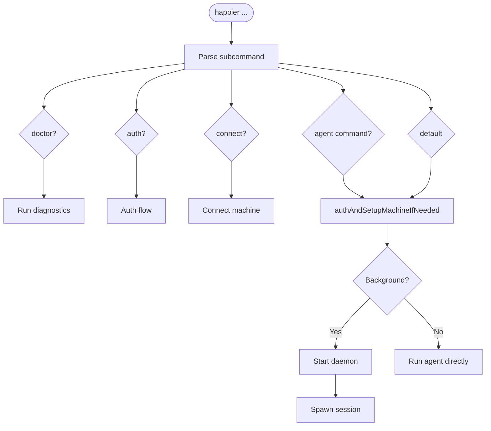

`src/index.ts` is the CLI router. It:
- Parses subcommands (`doctor`, `auth`, `connect`, plugin-projected agent commands, and default run flows).
- Ensures auth and machine setup when needed (`authAndSetupMachineIfNeeded`).
- Starts the daemon or runs an agent directly based on subcommand/context.

### Action-derived command arguments

In 0.3 development source, `happier notify` is generated from
`notifications.notify_me`, including its `-p`/`-t` aliases and channel selection.
It no longer bypasses Activity policy with a direct push call. Delivery and
channel discovery share the Activity dispatcher and the executing host's current
plugin notifications owner. The standalone CLI does not initialize that daemon
runtime; reaching its plugin channels, and credentialless Agent/MCP delivery,
still depend on the shared Account-placement relay. Missing Account credentials
fail closed rather than borrowing ambient authority.

An Action-backed command must not own a second description of the input the
Action already defines. The ownership boundary is:

| Fact | Owner |
| --- | --- |
| Meaning and validation of Action input | `packages/protocol/src/actions/actionSpecs.ts` schema |
| Field title, widget, choices, dynamic option source | `ActionInputHints` |
| Friendly command path, positionals, flag aliases, caller-shape binder | non-serialized `ActionSpec.cli` (`actionCliProjection.ts`) |
| Argv mechanics, global flags, TTY layout, JSON envelope | CLI |

`ActionSpec.cli` is deliberately excluded from `serializeActionSpec` and
`ActionDefinitionV1`: friendly paths and binder functions describe one packaged
binary, not a cross-version wire contract. Remote discovery publishes the canonical
JSON schema and hints needed to compile an equivalent field grammar without
shipping executable binders.

`apps/cli/src/cli/actions/` compiles those declarations into one descriptor per
friendly path. Parsing (`parseCommandInput.ts`), help (`commandHelp.ts`) and
completion (`commandCompletion.ts`) all read that same object, so a flag cannot
exist in help or completion without existing in the parser. `compileActionCliFields`
supplies the same field derivation to `happier actions invoke <action-id>`, which
therefore accepts ordinary `--field value` flags while retaining
`--<field>-json` and `--input-json` for nested or scripted input. A contributed
Action is first discovered through `action.spec.get`, then compiled from that
strict definition through the same field owner; only a Home that explicitly does
not support definition discovery receives the legacy JSON-only fallback. A denied,
malformed, or mismatched definition never falls back to looser parsing.

Input precedence has one rule: `--input-json` supplies the base object, distinct
field flags and positionals overlay it, and a second source for the same field is
rejected in either order rather than silently winning.

The same compiler owns the one-shot execution-run lifecycle commands (`list`,
`get`, `start`, `stop`, `wait`, and bounded stream `start`/`read`/`cancel`).
Their friendly `--agent`, `--intent`, permission, retention, class, and I/O
flags bind into the canonical `execution.run.*` Action schemas; there is no
separate CLI-only `--backend` interpretation or hand-written lifecycle parser.
In current development, `start`, `get`, `wait`, and `stop` declare `--machine`
as a friendly spelling of the existing exact `--machine-id` transport selector.
The compiler projects the same transport flag list into parsing, help, and
completion; neither spelling becomes strict Action input. `start --cwd` without
an authored Session selects detached scope. An explicitly authored Session in
canonical JSON remains selected when `--cwd` is an overlay, and explicit
`sessionId: null` remains detached rather than borrowing an active Session.
The multi-step `session run action` workflow remains dedicated because it
selects and invokes another Action dynamically.

The development Workflow command family follows the same rule. Its catalogued
`workflow.*` paths are `ActionSpec.cli` projections compiled by
`apps/cli/src/cli/actions/`; there is no Workflow-specific parser or transport.
Nested definitions and sources use the ordinary JSON-field grammar, opaque
cursors remain strings, and decimal-string wire values are never coerced to
JavaScript numbers. `--machine-id` routes `workflow.run.start`; it is not added
to that Action's strict input.

Development Workflow effect presets remain ordinary Action leaves. The
Protocol `stepActionsV1` family declares `webhooks.call` and
`machines.command.run`; the Action catalog supplies CLI/MCP discovery and the
editor's typed fields. Workflow schema admission requires literal command text
in every block dialect; dynamic bindings are permitted in `env`, not shell
syntax. The CLI host routes commands through the existing Machine BASH RPC in
the resolved step workspace, inheriting the Machine environment and passing
the containing cancellation signal. Explicit zero disables BASH's incumbent
legacy caller deadline; the new Action adds none. Workflow callers opt into
suffix capture at the same process owner, using the existing complete stored
envelope ceiling rather than a new output quota. Durable fact admission fits
command tails to the actual plain/E2EE envelope, including input, metadata and
duplicated cancellation output; `stdoutTruncated`/`stderrTruncated` expose lost
prefixes. Small output is unchanged. Direct standalone Action calls keep their
incumbent response owner; Workflow starts and reads through Actions/MCP see the
same persisted tail. Integrated verification of this correction remains pending.

Webhook Actions and Activity notifications share destination admission and
pinned POST in `sendWebhookActivityNotification.ts`. JSON Actions collect the
response without redirects and fail on status 300 or higher; notifications
retain their existing delivery deadline and signing behavior. Authored Actions
accept HTTP or HTTPS, while automatic notifications still require HTTPS for
public destinations. Both retain the same SSRF and DNS-pinning decisions. Workflow Action
request identities are `run/logical-invocation/attempt`, while the Session input
identity remains separate. Definitive JSON Action failure details are sealed
as invocation output without changing the failed lifecycle; a lost or malformed
post-effect acknowledgement remains uncertain rather than authorizing replay.
An authoritative Stop retains a known immediate effect response and closes the
leaf as cancelled; the durable CAS owner merges only the exact admitted Action
identity into refreshed cancellation custody, without retrying admission.

Development authoring's `runWhen` is owned by the canonical Workflow block
schema and coordinator's ordered-list execution. Omission means success;
failure inspects the preceding row's persisted lifecycle in the same sequence.
Ordinary success follows the persisted frontier, and always needs no predecessor
read. Only definitive, collectable failure can enter a handler. Holds,
cancellation, runtime interruption and uncertain outcomes retain their owning
control flow. Failed rows and the completed-with-failures aggregate remain
visible after a handler succeeds. Loop evaluators must make a decision every
round and do not admit conditional skipping.

The editor's in-place Test run admits `source: saved` with the exact reviewed
Artifact revision, not the unsaved editor document. Its results use the existing
`workflow.run.invocations.list` Action's opt-in `includeContent` page, incumbent
mode-aware progress opening and Account-scoped invocation fact store. The
default page remains an index-only read. No new activity stream or per-card
detail requests are introduced; exact invocation reads still own recovery
decisions. Card timing is the recorded creation-to-last-update interval,
including waiting, not a fabricated execution-only duration.

In 0.3 development, that same list owner supports an exact `invocationId`, a
newest direct-member slot (`parentRecordId` with `memberOrdinal`), or the
direct-child history of `parentRecordIds`. Batched child history includes
superseded attempts; it is distinct from the newest-member window. These
selectors remain bound into the cursor and can include progress through the
same mode-aware opener and response-byte budget. Workflow Action scope opens
only its logical attempt, current retry slot when needed, and accepted
ancestry. Its `workflow.run.get` sets `includeUsage: false` to avoid aggregating
unrelated history; ordinary Run detail reads continue to include usage.
Discussion round projection selects the previous projection or current
collection, then reads descendant frames in batches by parent. It preserves
recorded reply custody and sequence order without opening other rounds or
issuing one request per participant.
Selected conditionals retain the same invocation scope, so the narrow reader
follows their admitted branches when locating peer collections and preparation.
Protocol's `readWorkflowInvocationMembersV1` owns structural recovery for
the round projector, Action retry binding and the durable coordinator's
slot/member reads. Action binding
resolves superseded ancestors to their current physical slots before selecting
the requested logical Action attempt, preserving exact Run, Action and envelope
binding and fresh typed Session authorization. A replacement
parent inherits its predecessor's nearest unreplaced slots through
`previousAttemptRecordId`; newer and skipped slots mask older ones. A
root replacement updates the checkpoint's `rootRecordId` in the same recovery
write. `readWorkflowInvocationRootV1` verifies root predecessor correspondence
for both binding and the durable coordinator. A retained checkpoint pointing to
a superseded root uses the existing newest-member selector with explicit
`parentRecordId: null` and `memberOrdinal: '0'`; omitted parent selection still
means Run history, and cursors distinguish the two. The selector opens one
root body and then only its exact predecessor chain. Binding walks
current slots, including inherited Actions whose physical parents remain in
history. `readWorkflowCurrentInvocationAncestryV1` owns that correspondence for
both binding and recovery eligibility. Recovery derives causal parents from
the selected ancestry, so an inherited child can fail and retry after a root
or intermediate parent replacement without replaying completed effects.
Physical parent ids remain unchanged in authenticated stored envelopes.
The durable coordinator uses that checkpoint root for control and
member reads; the original-root list projection does not replace it. Independent
retry stops at a healthy ancestor, while a fail-stop group retains its complete
causal closure and eligibility checks. Completed
descendants survive a replaced parent, while skipped and superseded children
contribute no round outcomes. Recovery ancestry is read in batches, and unavailable
ancestry or incomplete declared collection membership fails closed rather than
reporting that everyone passed.

The Agent/MCP catalog derives the direct `workflow_run_start`,
`workflow_run_get`, `workflow_run_wait`, and `workflow_run_cancel` tools from
those same Action bindings. All other Workflow operations remain discoverable
through generic Action discovery/execution, with the same policy and errors.

Development Plan review recovery compares the child Run's authenticated
`authoredDefinition` from `workflow.run.get` with the held proposal through
`matchesWorkflowAcceptedDefinitionV1`, the same normalized source comparison
used by start rejoin. A different earlier proposal is disclosed instead of
attached to Use; running the new proposal uses its own derived admission id
through the existing seeded editor. The Account review owner also refuses a
`run_started` follow-up whose child's authored definition differs from the
accepted review value. The materialized execution definition remains a separate
read projection, and no second proposal store or admission transaction is added.

In development, Session MCP Account Actions use the existing authenticated
`/agent-runtime/session/services/v1` channel to their own daemon. Account
credentials remain with the daemon's credentialed Action executor. The daemon
admits a Session caller, never a host caller, and applies Agent policy and
approval rules. Approval replay preserves that caller and its original admitted
depth facts while rechecking current Session authority and Account policy.
The host-owned turn witness supplies admission facts; missing depth refuses
depth-dependent Actions rather than assuming zero. Missing daemon authority,
including a daemonless restricted runner, returns typed `target_unavailable`.
An uncertain dispatched outcome is not automatically retried.

In 0.3 development source, Happier MCP input discovery and native Session tool
descriptors share `projectMcpToolInputJsonSchema`. It presents an object root
without root `oneOf`, `anyOf` or `allOf`, including Action-backed plugin tools.
Union fields stay at their existing argument paths, with only common required
fields; intersection requirements combine. This is provider-facing presentation:
the original Action/plugin schemas still validate calls strictly, including
variant correlations and unknown fields, and canonical dispatch still owns
normalization. MCP output schemas and Action discovery schemas are unchanged.

The development definition family delegates to Protocol's
`createWorkflowDefinitionActions`; CLI Artifact transport is a host adapter,
not a second definition owner. Same-id create rejoins only matching normalized
definition and metadata, including after a lost response; different content
conflicts. Stored definitions are semantically validated before disclosure.
Create/update/edit may stamp the optional private `savedBy` field from the
host's Account and caller context; a matching create rejoin preserves the
original provenance. These source contracts do not certify the still-in-progress
UI Account adapter or all-daemons-offline controls.
Run admission always freezes the observed authorship in `source.savedBy` for a
saved source, using explicit null when its header has no author; accepted Runs
do not repair that fact by rereading the mutable definition.
Agent definition writes resolve selection and policy facts through the same
Protocol materializer without constructing a runnable snapshot or binding future
origin context and input-dependent loop limits. Run admission still binds and
validates them against the actual Run context before execution; saving an unbound
definition does not bypass Agent start policy.

Friendly Session commands resolve an ID, unambiguous prefix, or tag once at the
CLI transport boundary and pass the resulting exact Session ID to both Action
execution and presentation. A missing or ambiguous selector returns its typed
failure (including candidates where applicable); it is never retried against a
different Home, Session, Machine, or Run. A global `--server <saved-home>` (or
the documented explicit URL compatibility flags) selects the Home before
credentials and command dependencies are constructed. Action-derived commands
that support local selection also accept `--server-id <saved-home>`; both paths
resolve the same qualified Home identity, credentials, and endpoint as one tuple
for the invocation.

`createAccountServerActionDeps` makes that tuple structural: `serverId` and
`serverHttpBaseUrl` form one `AccountServerActionFixedHome` value that is either
wholly absent (follow the process default) or wholly present, and an incomplete
pair fails construction with `fixed_action_server_target_incomplete` rather than
combining one Home's identity with another Home's URL. Once an executor or
long-lived dependency (MCP servers, the daemon, a `--server-id` invocation) has
captured that pair, it keeps both halves for its whole lifetime: a later change
to the focused or active Home cannot retarget it, and a fixed URL never borrows
`configuration.activeServerId` after construction. A locally saved profile id is
routing identity only — external invocation authority still compares the explicit
`serverIdentityId`.

`--json` is CLI-owned and produces the standard single success/failure envelope
with a stable `kind` and `error.code`. `--` ends option parsing: later tokens
such as `--help` and `--json` are Action positional bytes, not CLI controls.
Shell completion is generated from the same admitted descriptors. Static paths,
flags, aliases, and enum choices therefore cannot drift from parsing; dynamic
choices use the canonical `action.options.resolve` Action and degrade to static
completion when authentication, connectivity, or the option source is absent.

Interactive CLI execution always supplies `present_user` authority explicitly;
it never inherits the executor's automation default. Discussion reads and Agent
posting remain usable by Account automation, while create, rename, archive,
restore, and personal read-state mutation are interactive UI/CLI operations.
Those interactive-only operations remain real user features but are omitted from
PAT/public-SDK and host-stamped plugin catalogs whose principals cannot satisfy
`present_user`.

In 0.3 development source, `cli/commandDescriptors.ts` owns static command
surfaces and their lazy handler references. The bundled-plugin generator
projects Action paths and bundled Agent/plugin command metadata from the same
canonical declarations into its data-only locator module. Root registration,
help and completion share the admission/collision owners; command execution
loads the implementation and Action field compiler only when needed.
`ACTION_CLI_ROOT_HELP` supplies the friendly Action-family help lines. Trusted
externally installed and bundled plugin commands retain the same Action-derived
field compiler and host authority, not a private parser or capability path.

Exact root `--version`/`-v` returns the invoked CLI's version without loading
configuration, credentials, schemas or command dispatch. Exact `--help`/`-h`
renders the shared static/bundled descriptors without loading command
implementations or executable plugins. With installed plugins, help reads the
current committed installation catalog and its already-admitted manifests through
the canonical installed-registry reader. It checks storage framing and revision
references, without rescanning source, revalidating whole manifests or activating
plugins. Missing admitted manifests contribute no executable-looking help entries;
the installation identity and unavailable diagnostic remain available to listings.
This is the existing admitted state, not a help cache or second stored projection.
Command invocation and activation retain their full canonical validation,
approval, source-custody and currentness checks.
Prefix options and real commands continue through normal bootstrap and dispatch.
Manager-family help and aliases use the same descriptor-owned help references,
including after prefix normalization in dispatch. Dedicated help text stays with
its command; Action help consumes generated models from the canonical field
compiler. Released JSON envelope spellings are pure presentation metadata shared
by execution and the help publisher, so rendering help does not load presentation
callbacks, executable catalogs or Agent runtimes.

An ordinary `hap_v1` API Token may cross the existing one-shot child/tmux
continuation. A compound `hapc_v1` credential contains process-local wrapping
material and is rejected before any child is spawned rather than reduced to its
bearer. Whole-Action protected transport remains an in-process SDK capability.

Genuinely local, interactive, streaming and multi-step commands — authentication,
installation, daemon lifecycle, transcript follow, provider configuration — stay
dedicated. They are not turned into synthetic Actions.

Session input addressed to a Session-owned execution run is not a separate
command family: `happier send <session> <message> --run <run>` is the ordinary
send command with one optional destination, and `happier session run send` is a
deprecated compatibility argv alias over the same `session.message.send`
invocation and its result. Omitting `--run` constructs no recipient. The CLI runs
no capability preflight for a targeted send and never strips the recipient to
retry into the parent Session; the canonical Session-input owner returns the typed
refusal. `execution.run.send` remains the detached-run Action, and it requires
explicit `sessionId: null` rather than accepting either scope.

The refusals the CLI presents for a targeted send are the canonical admission
codes, not CLI inventions: `session_input_target_update_required` when this
server, this exact target Machine's `sessionInputAdmission` revision, or the
nested execution-run pending resource cannot carry the target (no row is
created), and `session_input_target_unavailable` when the daemon's Execution Run
registry positively proves the target cannot accept input. Both are members of
`SESSION_INPUT_ADMISSION_REJECTION_CODES_V1` and reach `--json` unchanged in
`error.code`. `--wait` on a targeted send observes only that admitted turn, so a
lost correlation surfaces the canonical `outcomeUnknown` result with its
`localId` retained instead of a codeless failure. See
[Pending delivery architecture](pending-delivery.md#execution-run-targets) for
the queued/blocked lifecycle behind those codes.

## Automatic session-runner refresh (0.3 development)

Public runner status, model transitions and restart guards identify the executable
runner through `resolveTrackedSessionRunnerIdentity`: its PID, process birth and
command hash travel together. For a wrapper launch, V1 status and its V2 birth
witness describe the reported child, never the launcher paired with the child's
birth. Restart admission rechecks that executable witness through the final signal
boundary. The launcher retains separate physical custody: the tracking-map key,
restart reservation, completion/exit observation, remainder-tree root and signal
target still belong to its own PID and birth witness. A changed executable or
launcher refuses the restart before signalling; source-cutover guards use the
same executable identity. This is current 0.3 development behavior.

Connected Service switching retains the planned restart's closed refusal in
`diagnostics.restartRefusalReason` alongside the existing `restart_failed`
error. Manual switching, automatic generation application, unchanged-binding
rematerialization and the automatic restart fallback share this diagnostic
owner. An executable replacement reports `runner_identity_changed` with
`retryable: false`: the captured attempt cannot safely be replayed. The refusal
emits no signal and preserves the existing rollback of staged bindings.

`hdev daemon restart-session-runners --on-update on|off` changes the optional local
`restartSessionRunnersOnUpdate` setting through the existing locked settings writer,
without contacting the daemon. It defaults off. Once startup reattach and control
runtime composition finish, `startDaemon` invokes the session-control runtime's
nonblocking startup pass. That pass delegates `if_stale` and reason
`restart_session_runners_on_update_config` to the existing bulk/per-runner restart
owners, preserving exact process witnesses, Agent-runtime currentness, resume
eligibility and known turn custody. It skips observed busy runners without retry.
Missed notifications, including during daemon downtime, can leave activity
unobserved; this opt-in does not provide fresh runner-owned idle admission.

The planned signal primitive checks the daemon admission owner's shutdown state
after its awaited identity/activity probes. Bulk passes stop before the next
runner once shutdown begins. The existing shutdown spawn-drain budget also covers
pending refresh handoffs, including the interval after signal and before a spawn
awaiter exists. Restart reservations and the respawn owner's existing intended-cycle
state also cover connected-service restarts. Only the current intended respawn cycle
may complete before control-runtime disposal; a version handoff must match its exact
predecessor. Ordinary spawn/resume stays closed. Begin-marker
observations temporarily inhibit restarts without publishing rejected lifecycle
input into the turn queue; accepted terminal lifecycle precedes slow recovery cleanup.

The runner preserves a terminal transcript-follow refusal before launch, or a
typed `project_requester_credentials_unavailable` refusal, as exit 79.
The daemon treats that typed admission failure as terminal and leaves the Session
available for an explicit later Resume, rather than repeating the same failed
launch. In 0.3 development source, requester recovery preserves a transient Home
read failure as `project_requester_home_unavailable`. It retains exit 1 and the
existing restart/backoff policy; an unavailable Home cannot grant requester
authority or become a deterministic credential refusal. Follow loss after a binding became active remains an ordinary crash under
the existing restart/backoff policy. Other failures retain exit 1 and required
continuation refusals retain exit 78; all three remain nonzero direct-CLI exits.

## Local state and configuration

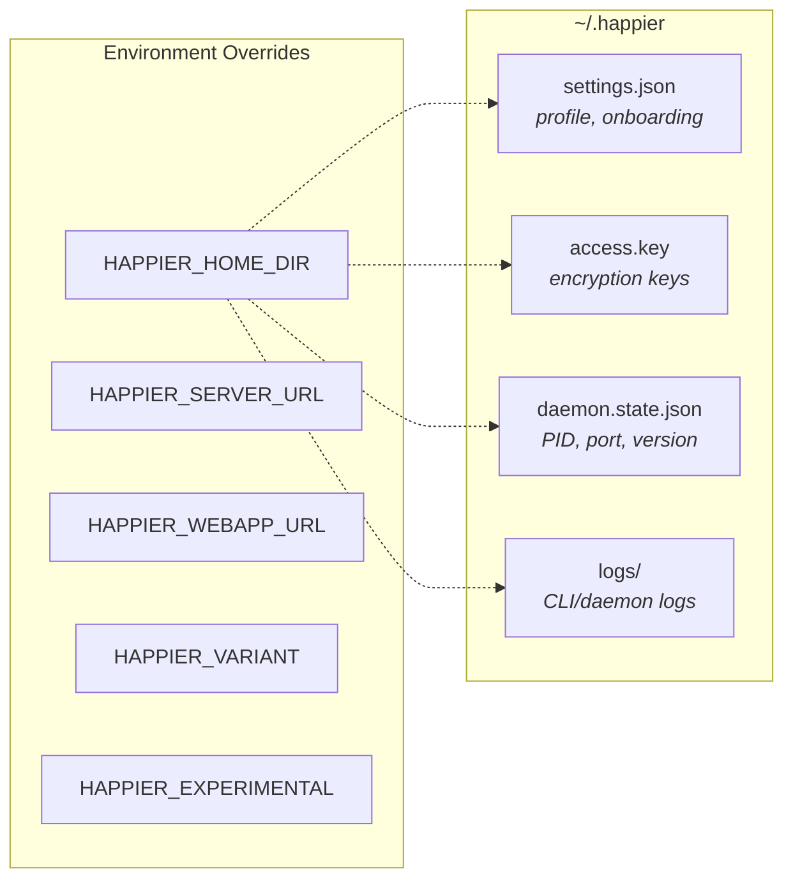

Local state lives under `~/.happier` (or `HAPPIER_HOME_DIR`):
- `settings.json`: onboarding and profile settings (validated/migrated).
- `access.key`: local key material for encryption/auth.
- `daemon.state.json`: daemon PID + control port + version.
- `logs/`: CLI/daemon logs.

In current development source, protected local files and MCP runtime
configuration use the shared Windows ACL boundary in
`packages/cli-common/src/fs/windowsProtectedAcl.ts`. It grants only the current
user and SYSTEM access and verifies the resulting ACL. Its PowerShell children
use the selected Windows PowerShell installation's own modules, with a
child-only `PSModulePath`; the launching shell's environment stays unchanged.
Both ACL scripts terminate on errors, and malformed inspection output retains
bounded stderr diagnostics without including stdout.

Configuration lives in `src/configuration.ts`:
- `HAPPIER_SERVER_URL` and `HAPPIER_WEBAPP_URL` override defaults.
- `serverUrl` is the canonical public Home URL used for first-contact key-challenge audience checks. `apiServerUrl` is the request transport: `HAPPIER_PUBLIC_SERVER_URL` selects the canonical URL, while `HAPPIER_LOCAL_SERVER_URL` selects a local/forwarded transport without changing that audience.
- In 0.3 development, `HAPPIER_LOCAL_SERVER_URL` and `HAPPIER_WEBAPP_URL` also override the selected saved profile when no canonical URL override is supplied. Daemon startup, reconnect and status consume those invocation endpoints without rewriting the saved Home identity or endpoints.
- In the 0.3 development stack, stack-scoped CLI invocations pass both URLs and reconcile the stack-stable active profile through `server set`, including on a fresh CLI home. The wrapper verifies the persisted profile before forwarding the requested command and fails closed if reconciliation did not apply.
- Recovery-key login failures retain the originating error code and operation phase (plus HTTP status when present). The CLI writes a local-only, redacted error diagnostic; attached HTTP bodies and credentials are never serialized into that diagnostic.
- `HAPPIER_VARIANT` and `HAPPIER_EXPERIMENTAL` control behavior.
- In 0.3 development source, the machine's `resourcesPolicyV1.guard.keepAwake` controls sleep prevention (`off`, `on`, `on_power`; absent = `on`). One daemon-owned inhibitor preserves idle reachability without keeping the display awake: macOS uses `caffeinate`, Linux uses logind's stdin-bound `systemd-inhibit` where available, and Windows uses the shipped native helper's system execution requirement. On power consumes the canonical vitals AC facts without requiring a viewer; unknown power does not report holding. macOS also enforces AC-only assertion behavior in the OS; closing the lid follows the OS. Inhibitors release on daemon shutdown or pipe closure. The former environment override is replaced by this single policy authority.
- The same development-source resources document owns the full Guard policy. The daemon's Guard composition shares the existing minute sampler, live-work inventory, native ownership verdicts and parked-watch primitive. Guard Activity is a local 30-day append-only journal; only committed guard-kind effects light the shared automatic-action indicator. Activity-only pages and widgets use `daemon.guard.activity.watch` through the shared subscription store, scoped by Home, Account, Machine, range and filter, without Guard preview, sampler or census demand. The log's projection revision changes after committed appends (including Undo outside Today's displayed rows) or a real query-time boundary. List reads retain only the next deadline for each of the three ranges, derived from UTC midnight, record expiry or future-record visibility; the existing 25-second parked-watch re-arm checks these without a timer or journal read. The numeric cursor carries no receipt timestamp. Undo invokes the receipt's original Action with fresh admission and that Action's approval policy. Recipient views expose their own work totals and Activity, plus counts for other work; withheld or unavailable left-behind sizes are `null`, not measured zero. The visual Guard tab and composed loaded-daemon certification are separate integration work.
- Automatic memory Guard observes accepted minute records and meaningful policy/owner changes; another surface's live demand does not accelerate candidate reads. Unrelated inventory edges can retire an auxiliary plan read without vetoing due memory admission, which still checks current policy and fresh target-specific identity, eligibility, pressure and sustain. Post-action verification still observes the next required sample, and idle/cooldown deadlines keep their existing owner. Auxiliary policies use the sampler's minute frontiers and reporting-state edges, including failed-reader retries; cheap Guard-state refresh remains on every completed tick. A viewed ladder consumes the sampler's summary cadence without inheriting a simultaneous Overview's two-second clock.
- Development-source idle Session, left-behind, Session ceiling and idle-terminal rules share that same Guard loop and earliest deadline. Session stop requires current draft, subagent, question and resume eligibility plus an acknowledged runner marker; next-message activation remains the existing activation owner's decision. Left-behind grace consumes the Processes owner's confirmed identities and cleanup Action, including its original Account approval. Linux Session ceilings use `MemoryHigh`, not `MemoryMax`; live enforcement requires a canonical Session-scope containment verdict, never an arbitrary runner cgroup. The root owner joins retained physical launch custody to the exact runner generation and observed native containment, including fresh launches whose unit name does not encode the accepted Session ID; Guard consumes that verdict without reclassifying the unit name. macOS and Windows expose an unavailable reason. Plain terminals have no count eviction or background reaper: the Off-by-default rule closes through the PTY owner, preserves its left-behind retirement, and records Activity without lighting the Guard-acted dot. Missing native foreground or authenticated notification facts prevent a commanded-terminal close.
  Near-ceiling notices carry the observed usage and actually applied limit from
  that existing ceiling owner. Preview-disabled notifications omit those
  measurements from both the message body and routing payload.
- The development-source service rung stops only Project services with captured Stop/Start again, no client connection observed on any listener throughout the sustain window, and no working Session in the same workspace according to that inventory (unknown is busy). Session-plugin services are excluded; stopping their idle Session ends its services and the Session wakes on its next message.

### Account-managed MCP configuration

In 0.3 development source, Account-managed MCP definitions and reach rules share
`@happier/account/mcp/v1/catalog` and one row revision. The
[Protocol catalog owner](../packages/protocol/src/mcp/servers/serverCatalogV1.ts)
owns admission and semantic mutations; the CLI `mcpServerStore`/`hydrateMcpServerCatalog`
and UI `apiMcpServerCatalog` consume that same contract. This Account row is
distinct from the daemon's executable plugin-contribution catalog.

Current development definitions use the neutral
`valueRefs/valueRefV1.ts` owner for literals, personal or qualified shared Saved
Secrets, and single-pass templates. Only used template variables resolve;
rendered secret bytes are never reinterpreted as templates. Base working folders
select the Session folder or an explicit path; per-Machine overrides configure
values and an explicit folder, never enablement. Resolved env values stay in
private launcher files, not Agent configuration. Remote bridge env is applied
at process startup, while headers stay in its private configuration file.

The `mcp servers` command tree and help are compiled from Action specs. Add
stamps an entry and uses the observed catalog revision before invoking the same
create Action as the UI. The 0.2 `add --name --transport --command --arg`,
`detect --provider --dir`, and `list --dir` spellings remain terminal adapters:
flag-looking argument values stay literal, Detect invokes `mcp.found.list`, and
List still reads the Account catalog independently of the accepted directory.
The adapters do not write Settings or probe servers themselves; `mcp serve`
remains the handwritten runtime entry point. The retired `mcp.servers.probe`
Action and `mcp.servers` feature gate are absent from current development source.

`mcp.servers.test` has one daemon pipeline; the retained CLI spelling dispatches
the compiled Action instead of running a second probe. A saved-server Test
captures the row revision, initializes and lists all tool pages through the MCP
SDK, then writes metadata and per-tool token estimates through the catalog CAS.
The remote stdio bridge accepts initialization after connecting upstream, then
forwards each `tools/list` request and cursor instead of discovering every tool
before initialization. It preserves upstream pages, server identity, version
and instructions; the probe follows `nextCursor` until discovery is complete.
A conflict is reported, not retried against newer configuration. Draft Tests do
not persist snapshots. OAuth Tests borrow the daemon's existing request-auth
issuer with the captured Account and RPC lifetime, without fabricating a parent
Session. The Test awaits capability retirement and private configuration cleanup
before returning, including on materialization or probe failure. Diagnostics use the existing bounded stderr and Saved
Secret redaction owners; a wrapped stdio spawn failure retains its typed runtime
diagnostic. `mcp.servers.tools.list` reads the checked snapshot without launching
a server; unchecked cost is unknown (`null`), not zero. Per-Agent control/loading
facts come from the target Machine's admitted plugin projection; absent control
declarations remain unproven, not guessed as host approval.

`mcp.servers.tools.set` patches server defaults and named tool overrides through
the same CAS owner. `inherit` removes an override; its returned `previous` patch
supports Undo without replacing unrelated overrides. The compiled CLI adapter
supports `mcp servers tools <name>`, `<name> set <tool> off|ask|allow|inherit`,
and `<name> default ask|read-only|all`; id matches take precedence over names.
The list-to-change flow retains its captured Home and Account. Approval is declared on
the Action spec: reversible present-user UI changes are direct, while Agent,
CLI and MCP callers ask by default. The pure per-tool resolver owns decisions;
with an admitted current Account-domain context, known MCP identities are checked before broad session grants and again when a
pending request is answered. The SDK carries typed `mcpToolPolicy` beside
`mcpServers`; host-controlled Agents never receive native Allow projections.
In 0.3 development, an interactive MCP request for an admitted wire key waits
for its captured catalog owner's existing admission when the catalog is loading
or not yet observed, then resolves against the newly published snapshot. The
foreground Account adapter joins or demands the existing hydrator; completed
unavailable reads do not start a retry. A failed admission, missing current
catalog authority or absent Account server row leaves the request unresolved.
In the default permission mode it asks
without a catalog identity for Always allow, rather than turning a missing catalog
read into an automatic denial. Independent role, causal and tool restrictions
still apply. A later request resolves against the recovered catalog normally.
Captured foreign Session/Run reads publish their admitted MCP row through the
existing invocation operation context, without replacing the focused Account.
The Session's authenticated Account-change socket, reconnect cursor callbacks,
and the daemon's existing MCP row-change branch demand that same owner; the
captured credential lifetime and identity map stay paired. Ordinary CLI Sessions
bootstrap Active state in their own child process and retain that scope/lifetime
adapter rather than borrowing a replacement Account. MCP publication does not
invent a scalar Settings version change or a second catalog cache.
First-party Agent leaves are a later integration unit. Native detached-Run leaves must
prove actual revocation before declaring native approval; these additions alone
do not certify that later leaf contract.

Kilo's ACP leaf resolves a native MCP alias only when its injected server key
is unambiguous and its tool suffix preserves the raw identity. A sanitized
underscore may stand for a raw underscore or a replaced character, so such
aliases (including `file.read` and `file_read`) are cancelled before policy
lookup or tool execution. A birth tool-policy projection is not a complete
identity catalog. Built-in Happier spellings remain with the Action owner.

The stored `bindings` array holds rules; configuration overrides live on each
server's `configOverrides`. Configuration saves preserve reach rules. The shared
[reach owner](../packages/protocol/src/reach/resolveReachV1.ts) resolves Agent-qualified
rules before general rules, then workspace, project, machine and Everywhere
specificity within that Agent scope. Session overrides are applied afterwards
by [the capability resolver](../packages/protocol/src/reach/resolveSessionCapabilitiesV1.ts).
Workspace comparisons use the target-platform path owner; Windows paths ignore
case and comparisons keep separator boundaries without rewriting stored roots.

Project rules follow the Account Project across checkout roots and Machines.
The CLI's [session Project adapter](../apps/cli/src/workspaces/resolveSessionProjectKey.ts)
and the UI's [Session context reader](../apps/ui/sources/sync/ops/actions/readUiMemoryInheritedContext.ts)
use the shared [Session association owner](../packages/protocol/src/workspaces/workspaceRefResolutionV1.ts)
to resolve the Account WorkspaceRef used by Project context and Memory. A directory-only Session or preview selects the
unique exact checkout on its Machine and canonical Home identity; it does not
infer a Project by containing-folder prefixes. An explicit workspace id must
still agree with that checkout and any explicit Project id. A fresh Session's
directory intent is sufficient: association is derived from those Account rows,
not a second persisted birth marker. In 0.3 development, Save as decision uses
that same Project context before falling back to Account Memory.
Reach asks for this association only when a
receivable item has a Project rule. An unavailable association remains
`project_association_unavailable`; it does not become an absent Project or an
Off decision. The existing MCP preview accepts an explicit `projectKey`, including
at the Machine level without a directory, through the same capability resolver.

`mcp.rules.set` is the rules mutation Action. The current user's reversible UI
changes are direct; Agent and CLI callers require approval by default through
the shared Action policy. The Action returns previous rules for ordinary Undo.
Every create path uses the shared create-reach owner, which defaults new MCP
servers to Everywhere On. Retained 0.2 bindings keep their rules and effective
configuration: the transfer folds Everywhere overrides into the base and adds
compensating configuration overrides for narrower bindings.

Current 0.3 launch, execution-run, workflow, Automation, ephemeral-runner and UI
draft carriers use one `capabilitySelection: { mcp?, skills? }` value. The
selection owner admits each kind and applies exclusions before inclusions; a
skill's native name exclusion remains case-sensitive. Released MCP-only carrier
spellings are folded at their retained ingress boundaries, with an explicitly
present current carrier taking precedence. Invalid current input does not fall
back to a valid legacy value. The released MCP preview RPC retains its old
`selection` input, while current callers supply `capabilitySelection` to the same
resolver. The generic `sessions.spawn.capabilities.preview` Action reads that
producer's safe MCP item projection and the resolved skill plan. An omitted
directory means Machine-level reach and Agent user-root scanning; an explicit
Project remains applicable without a directory. The released MCP-only preview
Action projects the same producer and retains its response envelope.

`reach/sessionCapabilityMetadataV1.ts` owns desired selection and applied-baseline
metadata. Existing `mcpSelectionV1` and `mcpSelectionRestartRequiredV1` keys remain;
skills use `skillSelectionV1` and `skillSelectionRestartRequiredV1`. Active edits
retain the initial applied baseline until the desired selection returns to it or
a new process positively acknowledges that selection. Attaching to a preserved
Agent process does not clear either marker. If desired selection advances while
startup is acknowledging a captured configuration, that captured policy becomes
the applied baseline and the newer desired policy stays pending. Daemon-committed birth metadata uses
this same writer; child environment variables do not provide a second selection
writer. These are development-source contracts, not certification of the later
composed live capability journey. `session.capabilities.set` uses this codec
inside the fresh Session metadata tuple mutation, preserving runtime acknowledgments
and refusing intervening desired-selection edits. It returns the previous override
for Undo. `session.capabilities.get` reaches the Session's Machine
preview producer even when the Session is stopped. The compiled CLI declarations
provide `session capabilities <session> list|add|remove|reset` and `session preview`;
they share Action approval and execution with the app.

Persisted Account encryption mode admits Plain content or domain-bound
`account_mcp_catalog` ciphertext (43). Unavailable material, a mode mismatch or
an incomplete reference inventory supplies no runtime authority. The scalar
`mcpServersStrictMode` remains an Account Settings preference, not a second
definition catalog.

An inactive `mcpServersSettingsV1` source is transfer input only. Actual personal
SavedSecret references require canonical promotion before first-row admission
at a fresh Settings baseline; empty or literal-only MCP sources do not require
unrelated credential imports. Source cleanup preserves strict policy and uses
the existing typed history owner. Finite MCP operations and capability previews
return after current destination admission, including first-use activation;
Account hydration owns optional retained Settings/history cleanup. Capability
previews read skill rules through the same finite prompt-library reader and
prepare independent Artifact, plugin and native inventories concurrently within
the captured Account and caller lifetime. Account catalog admission and exact
Session reads overlap the read-only Artifact inventory. Selected preview skill
bodies use the Artifact owner's existing batch reader; Off items remain in the
complete header inventory. This path does not initialize or test MCP servers.
Active or deleted rows never reseed from the
retained root. Runtime readers use the admitted catalog and canonical materializer;
mode conversion preserves the complete admitted stored payload and envelope metadata.
These are development-source contracts, not completed package or live-stack certification.

In 0.3 development source, a host-stamped plugin invocation of
`session.spawn_new` may supply `attestedContext` with `externalPrincipalId` and
`sourceMessageId`. Other caller surfaces receive the typed
`session_attested_context_forbidden` refusal. The canonical creator commits
these birth facts in the private owner metadata before dispatching the runner;
they are not Machine spawn RPC fields or shared Session presentation. A
creation-key rejoin keeps the original facts, even when a later message caused
the retry. The shared metadata mutation owner rejects post-birth addition,
removal or replacement with `session_attested_context_read_only`.

Remote MCP headers can select `{ t: 'sessionAttested', field: 'externalPrincipalId' }`,
`sourceMessageId`, or `sessionId` through the same value-reference schema as
literals and Saved Secrets. The runtime materializer reads the actual Session
ID and protected metadata snapshot, never launch hints, environment templates,
or model tool arguments. Missing facts omit that header even in strict mode.
Portable preparation retains symbolic references until the runtime has its
Session identity; Session-less environment materialization cannot invent one.
This is a model-facing authority boundary, not isolation from trusted plugins,
the Account owner, or the operating-system user. The integrator must separately
authorize its credential to assert the originating principal.

In 0.3 development, unused-MCP Coach evidence follows the actual runtime
selection: `resolveRunnerMcpServers` captures the selected, materialized enabled
binding's catalog IDs and row revision. Claude's native SDK tool inventory and
successful, settled foreground stream witness per-binding invocation counts.
Missing or changing inventory, unlisted/ambiguous tool mapping or hidden delegated/task activity
cannot prove zero usage; other Agent boundaries without equivalent evidence
remain insufficient. Native schema sizes are not exposed and stay `null`.

The host correlates native names transiently, then commits strict
`mcp-binding-usage` events through the existing Session transcript owner.
Retained evidence contains only IDs, revisions, counts, optional sizes and the
witnessed window, not server names, configuration or tool arguments. It follows
the Session's existing mode-aware content protection, not plaintext accounting.
A partial transcript page never establishes complete query coverage. Coach
reports observed-unused bindings across complete windows of the latest witnessed
catalog revision; it does not infer token savings or causal overhead. Apply is
offered only for one matching, currently enabled rule at that same catalog
row revision. Apply uses `mcp.rules.set` for that server and place, and Undo
resends the previous rules returned by the same Action. MCP Undo follows the
ordinary rules Undo contract rather than retaining the retired binding-specific
enabled-state reversal receipt.

### One default channel per Happier home

A Happier home has one default `happier` command and one default-following background service, and
both belong to the **default release channel** (`default-cli-release-channel.json`; the service runs
that channel's `~/.happier/bin/happier` shim). Installing another channel never takes the default:
`installVersionedPayload` keeps the recorded default channel (marker and `happier` shim) whenever that
channel's managed CLI is installed, and the installed channel only gets its own shim (`hprev`,
`hdev`). It becomes the default on a first install into an empty home, or when the user chose it
explicitly — the official installers' `self __install-payload --channel` passes
`selectAsDefaultReleaseChannel`, and `self release-channel use` switches it. So a desktop app's CLI
acquisition, a `self update` of another channel or any other second-channel install never changes
which CLI the user's terminal and the service run.

### One CLI update transaction (plan R13 f)

`runManagedCliUpdate` (`packages/cli-common/src/firstPartyRuntime/runManagedCliUpdate.ts`) is the
only way a managed first-party CLI is updated in place. `happier self update`, the desktop's
bootstrap `cli.update.v1` (`updateManagedLocalFirstPartyComponent`) and the daemon-hosted remote
`cli.update.v1` all run it, always from the version being replaced:

1. **One target version.** The ring's newest release (or `--to <exact version>`, tag
   `cli-v<version>`) is resolved once by the acquisition owner
   (`prepareFirstPartyComponentPayloadFromGitHubRelease`, every OS including Windows) and downloaded
   with its minisign-verified checksums; a version that does not belong to the ring is refused.
   Every later step is bound to that version. The transaction takes the two locks of step 3 before
   this download (admission, `onAdmitted`), so a concurrent update is refused before it downloads.
2. **Smoke.** The staged executable's `--version` must equal the target, or nothing is activated
   (`cli_update_smoke_failed`).
3. **Capture, then activate without pruning,** under two locks of the one lock owner
   (`withFirstPartyPayloadMutationLock.ts`, `proper-lockfile`): the install root's
   (`<installRoot>.mutation.lock`) and the home-wide activation lock
   (`<home>/first-party-activation.lock`), always in that order, because launchers (`<home>/bin`) and
   the default-channel record are shared by every channel. `installVersionedPayload` takes both for
   any component with launchers or the default-channel record. A busy lock is waited for within the
   owner's retry budget; an update still refused after it fails `cli_update_in_progress` and records
   nothing. A release that fails after the outcome is settled never changes it (reported through
   `onWarning`); a lock compromised during the transaction is still an error. The capture (`captureActivationStateForUpdate`, `restoreInstalledPayloadState.ts`)
   records the `current`/`previous` markers and the default-channel record, and moves every launcher
   the activation will rewrite into this transaction's own `<home>/bin/.update-rollback/<id>/`
   (renaming works on a running Windows `.exe` where deleting it does not). If moving one fails, the
   ones already moved are put back first. Nothing removes another transaction's set-aside entries.
4. **Restart and prove,** only when the service's own daemon was running before the update, through
   the CLI service owner (`service restart` run by the activated binary — its ownership wait is the
   budget); the owner must then report the target version. `last-update.json` says
   `pendingReconnect` meanwhile.
5. **Commit** (drop this transaction's set-aside launchers, prune to current + previous) **or
   recover:** restore everything captured, restart the previous binary and prove it, and only then
   report. Rollback happens only when activation or that local proof failed — never because the relay
   is unreachable. `rolledBack` means the previous daemon is back and proven (or none was running); a
   restore that failed, or a restored version whose service did not come back, is `failed` and says
   which. The desktop kind maps them to `cli_update_rolled_back` and `cli_update_failed`.
6. **Record every end** in `<installRoot>/last-update.json` (`CliUpdateLastResultSchema`) through its
   one non-throwing writer — failures before activation included (`targetVersion` is `null` only when
   no release could be resolved). A record that cannot be written never blocks recovery; it is
   reported on stderr.

In current development source, admitted post-update service repair runs through the activated
managed CLI. A successful update ends the invoking guided repair walk, discarding its remaining
stale findings and pending plan and directing the user to rerun repair against the updated CLI. The service row
displays the same inventory version used by the report's findings; it does not override that value
with the independently gathered daemon snapshot.

**What recovery covers — and what it does not.** Recovery covers activation and restart failures this
process catches. It does not cover the updater itself being killed or the machine losing power
mid-transaction (a set-aside directory may then be the only copy of a launcher), and it does not
supervise the service manager beyond the one restart it performs.

The service restart policy is shared by the CLI and desktop update consumers through
`planServiceDaemonsRestartAfterCliUpdate`. The CLI observes the daemon owner before the update
(`planServiceDaemonRestartAfterUpdate`: the service serving this CLI's current server selection on
this channel, never a manual daemon or another channel's service), and observes other servers'
services of this home and ring through `planServiceDaemonsRestartAfterUpdate`: when
the update stops them (the Windows quiesce, in `self update` and the installer's `__install-payload`),
each one observed running under its own service comes back and is proven. Only the services the
update owns judge it — the default-following service and pinned services the desktop manages
(`managedBy: desktop`); a pinned service the user installed that does not come back is named on
stderr with the exact `--server` and `--instance` restart command and never rolls the update back.
Where nothing stops them, they move onto the installed CLI at their next start.

**Desktop-managed services (R15, 0.3 development).** Desktop setup and repair ask the CLI to mark the pinned service
they create for a Home (`HAPPIER_DAEMON_SERVICE_MANAGED_BY=desktop`, set only by the scoped setup
executor, honored only by `service install`, baked into the definition on every platform, kept by
every rewrite, stripped from session environments, and reported as `managedBy` by `service list
--json` and the service inventory). A Home's own pinned service that the user installed is never
marked. Removing a Home in Settings first runs `daemon.service.relay.disconnect.v1`
(`disconnectHappierHomeService`): it uninstalls that Home's desktop-managed pinned service through
`--server <id> service uninstall`, proves it is gone, never acquires a CLI, and leaves a user-owned
service in place. An unreadable inventory before uninstall asks before removing anyway;
once uninstall is attempted, a command or verification failure stops the removal with
`service_uninstall_failed`. Every path that forgets a Home takes this one decision (`disconnectThisComputerBeforeForgettingHome`):
removing a Home (including the Personal Home's row) in Settings, and erasing the Personal Home —
there the erase owner (`useLocalRelayRuntimeControl.erasePersonalHomeData`) runs it after the person
confirmed the erase preview and before the task destroys any data, answering the erase "not
confirmed" when the uninstall failed or the person declined to go ahead without an inventory. The desktop kind reads
the addressed Home's `daemon status --json` (scoped by `relayUrl`) once the CLI is known to be managed,
and proves `daemon.startedWithCliVersion` after `service restart`.

**Service login triggers and desktop attribution (0.3 development).** `service install
--autostart at-login|on-demand` changes the existing platform service's login trigger; it does not
create a second service or change the separate manual start/stop commands. Omitting the flag keeps
an installed preference, or uses the existing at-login default for a new terminal installation.
`--keep-disabled` still preserves a disabled service during repair rather than activating it.
`daemon status --json` reports `service.autostart` from platform enablement and triggers, or `null`
when the service is absent or the manager cannot be queried.
Windows user tasks use the invoking user's SID in both the principal and the logon trigger, with
`InteractiveToken` and `LeastPrivilege`; registration needs no password or all-users logon trigger.
On-demand tasks register no trigger and omit missed-start catch-up. The existing task namespace,
hidden PowerShell wrapper, service policy, and explicit Run lifecycle remain the same.

The desktop status task publishes `serviceAutostart` from one common-mode fact:
every desktop-managed service in this Happier home and ring, independent of the requested Home.
An unreadable inventory fails with `service_inventory_unavailable`, and an unknown/mixed mode yields `null`.
The shared `discoverHappierServices` owner supplies both the CLI's installed-service projection and
Home lifecycle discovery. It reports named Happier definition read failures, and on Windows it
enumerates Scheduler tasks even without a wrapper directory. A registered task with a missing
wrapper remains an installed candidate; failed task inspection requires a successful fresh listing
before disappearance can be inferred. A readable definition remains an installed repair target when
its Scheduler registration is absent.
Home disconnect refuses an unverified matching pin before uninstall; an installed candidate found
after uninstall also prevents the Home from being forgotten.
The requested Home does not redefine the global preference. Individual service modes remain in
the existing inventory entries. Successful service controls refresh the same row/status projection.
The status owner calls the shared `readDaemonServiceInventory`; there is no separate
`daemon.service.servers.v1` task. Pinned rows use the service definition's public URL (falling back
to its transport URL), so a Personal Home's local transport does not replace its saved identity.
Row actions share the executor's installation/authentication eligibility. A lifecycle command error
is settled only when its status reread proves the requested postcondition; otherwise it is reported.
CLI server-selection follow-up uses the same installed pin/default selector. The default daemon's
separate standby check still asks whether a pin is active before yielding its lifecycle lock.
`runningManagedServiceCount` counts running managed targets before relay-row dedupe, or is `null`
when a managed target cannot be read. A default and a pin on the same relay can both be stopped;
one visible row alone cannot prove that the app can see every affected machine/account's sessions.
The same full inventory supplies `managedServiceInstalled`: `true` when a managed target is
present, `false` only when complete inventory proves none, and `null` otherwise. Desktop Settings
consumes this fact rather than inferring global absence from serving rows, which can hide a managed
default behind a user-owned pin. Missing or malformed presence is unknown to the UI.
The existing `daemon.service.start.v1` task accepts
`onDemandOnly: true` for an unscoped app-open request. Its aggregate owner starts each stopped
managed on-demand service through the shared lifecycle kind, skips other targets, and succeeds
when none is eligible. Manual Start keeps its existing behavior.

Native tray rows accept an optional known `activeSessionCount`; missing facts make no session
claim. Incomplete rows cannot prove that no managed service runs. Electron's host holds Quit and
window close for the same `desktop_app_exit_requested` / `desktop_finish_shutdown` handoff,
with `menuBarSupported: false`; the shared web owner decides consent and aggregate stopping.
Electron retains its normal window for a keep-open answer and uses its existing process/Iroh
shutdown for final exit. Its evaluation target adds no tray or menu-bar lifecycle.

The native updater records `updater-relaunch.json` beside `tray-state.json` before installation,
including `fromVersion`. Startup consumes and deletes it before choosing window mode; only a
different running version overrides a login-started menu-bar launch. Failed installation clears
the marker and retains the downloaded update for retry. Native tray pointer activity shares the
existing 15-second admission throttle: with a window it emits `desktop_tray_refresh_requested`
with `trigger: 'tray-pointer'`; without one it refreshes native status. Service-action notices
remain separate from login/status notices and settle after a successful action on the same relay.

An install-only `HAPPIER_DAEMON_SERVICE_BUNDLE_ID` request must be a reverse-DNS identifier. The CLI
records it in the service definition for later preview, repair and lifecycle rewrites; launchd also
receives `AssociatedBundleIdentifiers`. Attribution applies to default-following and pinned services
independently of the `managedBy` ownership marker. Bundle, ownership and login-preference metadata
are stripped before launching daemon and session children. Desktop setup forwarding and the composed
live platform checks are separate integration gates; this CLI contract does not assert they ran.

**Windows.** `happier self update` stops the payload's processes before activation
(`quiesceInstalledCliWindowsPayloadOwners` — running sessions are ended), as the installer does. The
desktop's `cli.update.v1` relies on the launcher move-aside and does not end sessions; it is
unverified on a real Windows host. Remote update is disabled on Windows (below).

**K5 — per-machine update facts.** `readCliUpdateFacts` (`apps/cli/src/cli/runtime/update/cliUpdateFacts.ts`,
schema `CliUpdateFactsSchema` in `@happier-dev/protocol`, the same wire shape the 0.2 line publishes)
reports `currentVersion`, the ring-filtered cached `latestVersion`, `channel`, `installSource`
(`managed` only when the running executable is inside its ring's recorded install), `updateCommand`,
`canUpdateRemotely` and `lastUpdate`. Every daemon publishes it in its encrypted machine metadata as
`cliUpdate` on its first connect after start and again whenever `last-update.json` changes (the
daemon watches its install root; `watchLastCliUpdateResult`). The desktop's own status fact
(`readLocalCliUpdateFact`, the flat `cliUpdate` of `daemon.service.status.v1`) and every other
reader use the update-check cache's one ring-filtered reader (`readCachedCliUpdateState`,
`packages/cli-common/src/update`); `self check` is its only writer (`recordCliUpdateCheck`) and
doctor repair never writes it or calls npm itself.

In current development UI, an explicit failed update remains failed even when the answering CLI
already reports the target version; equality settles only a reconnecting outcome. Retry still
follows the existing remote-capability decision. CLI actions show the existing session-reconnect
note by the item's machine identity, including this computer, on both the full Updates page and
the grouped popover. A grouped note describes only the CLI included in that row's action, not
unrelated updates on the machine.

In the current development UI, an explicit Update all or group press gives the already-discovered
plan to the shared in-memory update-action owner (`machineUpdateRuns`), scoped to its initiating
server and account. The Updates page and popover adopt its progress and Stop intent after navigation;
detail discovery remains lazy. Disjoint machine groups may run concurrently, but overlapping plans
cannot start a second batch. Stop prevents subsequent items without cancelling work already started.
The existing helper → agent → CLI order remains per machine, and all started branches settle before
the batch is released, including failures. This state is not persisted across app restarts.

Queued "this computer" CLI actions retain their planned task spec, server/account scope and machine
identity. Switching Home or account does not redirect the update, its original-Home status reread or
its completion attribution; the reread replaces shared status only while that initiating scope is
still active. Newly planned actions rebuild their context when the canonical Home snapshot changes,
including an endpoint refresh, while callbacks already queued retain their original context.

In the current development daemon, `tool.systemTasks` advertises `wait` alongside
its existing task methods. Consumers discover that method before starting an
operation that requires terminal completion; an older daemon without it is not
treated as a completion-capable executor. `wait` resolves the canonical task result.
Completion is kind-specific: a detached CLI update completes this task at updater
admission, whereas a Home runtime restart requires the reported runtime health
before settings reload. Losing the connection is not evidence that the runtime is up.
An invocation without an authored acknowledgement deadline uses the server's
existing caller-lifecycle forwarding policy (the Socket.IO platform maximum),
not the generic capability timeout. Authored finite invocation budgets and
capability discovery budgets retain their configured floor and ceiling. Waiting
observes the daemon's existing in-memory task settlement; it does not add task
cancellation, reconnect recovery or cross-daemon-restart persistence.

**Remote.** The daemon's `tool.systemTasks` capability lists `cli.update.v1` only when
`canUpdateRemotely` (presence = capability; older daemons never list it). The kind starts
`self update` detached from the daemon's own binary (output to `logs/cli-update-<ms>.log`) and answers
`{ started: true, currentVersion, channel, logPath }` only once the updater reported its admission on
its admission pipe (`updaterAdmission.ts`: fd 3, one JSON line); a refused updater
(`cli_update_in_progress`) or one ending before it reports (`cli_update_start_failed`) fails the task
instead. The updater outlives the service
restart because systemd uses `KillMode=process` and launchd `AbandonProcessGroup` (derived from the
unit templates, not executed). npm/Homebrew installs are refused with their exact update command
(`cli_not_managed`); Windows reports `canUpdateRemotely: false` (`cli_remote_update_unsupported`).

### Explicit-Home scope (desktop setup and "this computer")

Desktop setup, repair, `daemon.service.*` and `cli.update.v1` address one explicit Home, never the
terminal's active server (R10 D3). `packages/cli-common/src/systemTasks/executors/serverScope.ts` owns
the scope: `readLocalServerProfileScope` resolves the Home's saved profile read-only
(`server list --json`, which lists each profile's recorded `homeServerIdentityId`) — by identity
when the task names one, else the single profile on that URL; an ambiguous match fails
`server_profile_ambiguous` — and `resolveServerScopeTargetMode` picks the service from the OS service
inventory: the Home's own pinned service if it exists, else the default-following service when it
already serves that Home, else a new pinned one. Commands then run as `--server <id>` with
`HAPPIER_DAEMON_SERVICE_TARGET_MODE`. Setup saves the profile with `server set --no-use` only after
proving the flag read-only from the CLI's own `server help` usage line; released 0.2 CLIs ignore
unknown flags, so without that proof setup fails `cli_capability_missing` before any write. A Home
whose profile was resolved is used as saved and never rewritten: the CLI's URL upsert only adopts
identity-free profiles (a URL-only write would save a second profile beside an identity-bearing
one), and an endpoint write would replace the Home's recorded canonical URL with the loopback URL
the app reaches it on. `server set --no-use` runs only for a Home with no profile yet. In the
UI, `buildLocalDaemonServiceSystemTaskSpec` scopes every daemon task to the app's active server
(URL and identity) unless the caller names a Home (the Personal Home bootstrap names its own).
The scope is also the one context rule for inherited selectors (0.2 R13 a): `scopeHappierJsonExecutor`
drops `HAPPIER_ACTIVE_SERVER_ID`, `HAPPIER_DAEMON_LIFECYCLE_SCOPE_ID`, `HAPPIER_SERVER_URL`,
`HAPPIER_LOCAL_SERVER_URL`, `HAPPIER_PUBLIC_SERVER_URL` and `HAPPIER_WEBAPP_URL` from every scoped
command, so a stack-launched app pinned to another relay cannot put the Home's daemon state and lock
in that relay's lifecycle directory (`--server` alone replaces the URL/profile selectors but not the
lifecycle scope). The SSH enrollment approval (`auth approve --home-target-from-request-json`) already
binds its credentials to the Home target the request names.

In current 0.3 development, `home pair-device` also accepts an authenticated
URL-only profile retained from 0.2 or created by Stack auth seeding. The shared
terminal enrollment carrier verifies its selected HTTPS or loopback origin;
the authenticated features projection supplies the complete Home descriptor.
`serverProfiles.adoptServerProfileHomeConnectionDescriptor` persists it on that
same immutable profile before pairing starts. Public fallback observations,
inconsistent Home identities and existing advisory profiles cannot authorize
pairing. Stack seeding does not manufacture a descriptor or copy routing trust
from another Home.

Managed enrollment in 0.3 development extends this normal terminal ceremony.
The admitted Home, controller, intent revision, request and retained resource
are carried through protected guest stdin into normal Machine registration;
the server validates and links the managed row in that registration transaction.
The guest receives the ordinary terminal bearer (`terminal` kind,
`account_automation` authority), not a resource-restricted guest credential.
The existing pairing task asks for Account-wide automation approval. Managed
enrollment persists the credential only after registration succeeds; ordinary
pairing retains its existing path. Prepared SSH/native tasks share the live
system-task runner, so existing setup status/respond/cancel consumers retain
prompt and cancellation custody without a second installer or task controller.
SSH retains its single-process streaming ceremony. Native exec needs only a
buffered process result: finite normal `auth request` and `auth wait` share the
existing protected pending state. The request returns a non-secret profile id;
wait selects that exact profile without focusing it until successful enrollment.
Both lifetimes use the credential owner's same managed registration-before-save
policy and emit only non-secret bootstrap completion facts.

In current 0.3 development, ordinary `auth wait` success returns authentication
and Machine facts without the saved bearer. Default API-token creation output
contains token metadata only; the existing documented `--encryption` option
explicitly requests the one-time encryption-capable credential output. Native
email provisioning retains Account material locally and omits recovery keys
from both human and JSON success output. Authentication error presentation uses
the shared diagnostic redactor and excludes attached HTTP request/response
objects even under DEBUG. The short-lived terminal pairing challenge remains
part of the documented approval ceremony; it is not an issued Account bearer
or Account encryption material.

Stack's named-profile endpoint reconciliation refreshes an existing descriptor
through the requested HTTPS or loopback carrier using that profile's credential.
The authenticated Home publication supplies routing facts; the existing descriptor
adoption owner enforces the saved Home identity and revision. Public fallback
cannot refresh exact authority. The requested public URL may differ from the
Home's canonical URL, so URL equality is not an identity or publication check.

In the current 0.3 development UI, the system-task runner retains setup prompt answering after
navigation. Reopening adopts that run only for its initiating Home and account; an initially
identity-free Home uses the canonical saved-profile URL resolution, with ambiguous matches refused.
The same runner admits pending and running setup across Home, checklist and Settings, so a second
same-scope start adopts rather than launches another task. Enrollment owns cancellation on leave
and requests a non-adopting start; an existing setup is refused, never borrowed and cancelled.
Settings adopts the runner's activity; the local daemon owner retains only outcomes and post-success
inspection. Its status readback keeps the setup spec's original URL and backend identity (including an
originally absent identity), while publication checks the current Home's canonical profile
equivalence and account. Before pairing is sealed or posted, the explicit Home credential's token
subject must match the initiating account. A failed retained prompt continuation emits a default-on
diagnostic without prompt contents or credentials and remains retryable by its owner.

In the 0.3 development implementation, finite-output subprocess deadlines use
`packages/cli-common/src/process/execFileWithDeadline.ts`, including Bash argv RPC
and Herdr execution. An event-loop stall does not turn an already completed command
into a timeout; a deadline that actually interrupts the child remains a failure,
even if its SIGTERM handler exits successfully. Caller-owned cancellation and tree
termination hooks remain in effect. Bash argv stays literal and keeps its existing
uncapped output behavior.

## Machine processes (0.3 development)

These owners describe the current development build, not stable/preview availability
or a completed authenticated Processes journey. The daemon owns process evidence;
clients and Actions consume that evidence rather than classifying commands as ownership.

### Census and ownership

[`processes/census/processCensus.ts`](../apps/cli/src/processes/census/processCensus.ts)
owns asynchronous process observations for identity, Doctor, execution-run statistics,
terminal custody, session correlation and local-services inventory. Linux reads procfs
without spawning; macOS and Windows call the shipped native helper's `process-census`
subcommand. Shared reads coalesce only while in flight; identity-sensitive callers
request a fresh read. Persisted start witnesses retain their existing derivation, with
exact native generation evidence alongside them. Missing helpers, unreadable fields
and failed reads remain explicitly unavailable; there is no shell-listing fallback.
Private argv, paths and the narrow daemon-ownership environment projection are read
only for the daemon's OS principal.

Linux consumers select the optional observation fields they need. Local-service
inventory keeps the full principal, lineage and ownership table, while command
and cwd enrichment follows listener PIDs and their ancestors; it does not sample
unused CPU, memory or executable fields. Run-state, parent and birth probes read
only identity/state; Doctor requests command/ownership evidence and execution-run
telemetry requests memory/CPU. Procfs reads use an asynchronous file descriptor
and a small transfer buffer reused to EOF, including files larger than that buffer.
Successful process-local page-size observations are reused; command lines,
ownership environment, credentials and containment are observed anew. PID/start
equality does not make argv or the current exec environment immutable. Shared
captures coalesce only identical field and command-root demand. These changes
neither add a census timer nor alter the inventory/watch owners' cadence.

Local Services discovery still scans at the inventory runtime's existing cadence
while readers are parked. Its registry advances `generatedAt` and wakes that
Machine's watch only for material inventory or launcher changes; `lastSeenAt`
and endpoint `probedAt` remain current on demand without publishing each scan.
The runtime compares the canonical launcher projection as well, so declaration
changes and endpoint-free managed starts/stops retain scan-driven freshness.
Missing-listener transitions use the latest observation, not the last publication.
Action identity probes consume the existing fresh native observation stage;
neither their freshness proof nor discovery admission uses the material cursor.

[`processes/tree/processTree.ts`](../apps/cli/src/processes/tree/processTree.ts) owns
pure ancestor, descendant and containment queries over those rows, without per-hop
reads or a lineage-depth limit. Synchronous `cli-common/processInstance` lock
fingerprints retain their separate package/lock contract; they are not a process view.

[`daemon/processes/ownership/resolveProcessOwnership.ts`](../apps/cli/src/daemon/processes/ownership/resolveProcessOwnership.ts)
is the one process ownership decision-maker. The root projector reads existing Session,
terminal, service, Execution Run, sidecar and daemon-helper owners, not a new registry.
Local-services listener provenance consumes the same result; its socket discovery and
listener re-probe remain local-services responsibilities. Role classification and
command redaction are shared under `processes/classification` and `processes/redaction`.
Owned rows retain the classifier's catalog/tool `displayName` alongside the native
process name, role and generation reference. External rows retain their existing
name-only privacy boundary.
Ownership evidence records containment, parent chain, host marker and group/port hints,
each as met, not met or unavailable.

Owner totals sum each attributed member once; they are not cgroup/Job accounting totals.
CPU is the cumulative-time delta as a percentage of the whole machine and is absent
until a valid interval exists. Execution Run reads use the same counter-rate owner
as Processes, including its 120-second observation horizon; on-demand reads impose
no periodic cadence. Memory retains its OS kind: Linux resident bytes,
macOS footprint where available (otherwise resident, explicitly named), and Windows
private bytes. Unreadable values are unknown, not zero; shared pages may count in more
than one process's memory figure.

| Label | What it means |
|---|---|
| Proven | Live-owner attribution supported by native containment, an exact live-root chain or the admitted owner marker. |
| Likely | A live owner is suggested only by group/port evidence, not proven containment, chain or marker. |
| Left behind | Evidence points to an ended owner and the same process generation is confirmed in two observations at least 60 seconds apart. |
| Not Happier's | No Happier ownership evidence applies; this is not the result of a failed or unreadable observation. |

Unknown/unreadable evidence is a separate protected result, never a kill target.
The host-private [`HAPPIER_PROCESS_OWNER`](../apps/cli/src/processes/ownerTag.ts) marker
contains a version, Happier-home scope, owner kind and owner id. The host applies it
after native/Provider/plugin environment composition; plugins cannot replace it.
Children inherit it, including a Run-specific owner for Run execution. It is not sent
to clients or logged. A generic short-lived native-IO root without Run/service identity
belongs to Happier itself. An uncaptured detached descendant carrying only that shared
daemon marker remains Proven Happier's, not Left behind: its spawner's end is unknown.
Never sweep a shared daemon/session tag to clean up such work; its spawner's existing
abort/timeout owns automatic cleanup, and people can use the normal process Actions.

### Native containment

Linux's existing launch-spec builder gives supported roots owner-encoded systemd user
scope names under `happier-jobs.slice`; the self-migrating cgroup fallback consumes the
same naming owner. Names include the Happier-home scope and a unique launch suffix.
Membership comes from the census cgroup path, not a persisted containment registry.
Unavailable user-manager/cgroup support is an unavailable fence, not fabricated proof.
macOS has no such fence and uses exact tree, marker and group/port evidence.

Linux launch custody retains the exact physical scope name in the incumbent
in-memory tracked Session. A fresh launch can encode the launching Happier owner
before its runner reports a canonical Session ID. The canonical process-root
projector joins that captured name to the runner's exact PID/start witness, the
daemon's principal and its current census cgroup membership, then exposes
`containment: { kind: 'linux_unit', prefix }` for that Session. The prefix ends at
the captured unit, not an arbitrary parent cgroup; a failed migration or recycled
PID supplies no such verdict. Consumers use this verdict rather than requiring
the physical unit's encoded owner ID to equal the later Session ID. This is a
development-source contract, not a new Session identity or persisted scope map.

Windows session runners hold their own named Job handle; PTY Jobs are held by the
process owning the PTY host. The one-shot helper's `job-join` transfers custody into
that existing holder, with no extra keeper per Session or persisted handle registry.
Session Jobs omit `KILL_ON_JOB_CLOSE`, so restarting the daemon does not kill a Session
whose runner is still alive. Managed services and finite PTYs retain their existing
helper-held custody. Once a runner holder dies, the Job name can disappear while its
members live; owner-tag and captured-tree evidence then feed the same remainder and
Left-behind paths. Job absence is not evidence that all its former members exited.

### One tree terminator and owner-end recovery

[`processes/terminate/terminateProcessTree.ts`](../apps/cli/src/processes/terminate/terminateProcessTree.ts)
is the typed entry to the one shipped algorithm in `scripts/process_tree.cjs`.
Discovery uses the census/tree owner; every signal round revalidates PID and start
identity. Ownership-sensitive callers also re-derive current ownership and containment
authority through their authorization callback. Per-PID signals protect
the reader and its ancestors by generation; only group signals additionally protect
groups containing them. A non-detached child sharing the reader's group can still be
ended individually. Listener termination keeps its existing TOCTOU and port-release
checks around this terminator, rather than another descendant/signal loop.

The shared CLI process-tree owner gives Windows `taskkill` the containing
teardown phase's budget and spends only the remainder on liveness checks. A
hung tool is force-stopped at the same subprocess boundary. Cleanup that cannot
prove containment retains `plugin_exec_termination_incomplete` rather than
reporting success.

After a runner's confirmed exit, requested or unexpected,
[`endOwnerRemainder`](../apps/cli/src/daemon/processes/endOwnerRemainder.ts) ends only
the Session's remaining proven members, with fresh ownership checks; resumed owners
and replaced generations are not borrowed by an older exit. Likely or unconfirmed
survivors are not silently killed. Owner-end events and the daemon-start pass feed
the same two-pass Left-behind tracker. An instant-exit bare Exec with no Run/service
identity and no observed native subtree settles its existing lease as
`ended / remainder: unobserved`, not a claimed cleanup or a refusal. Captured trees
and explicit Run/service custody retain their normal settlement requirements.

In development source, a member losing ownership enrichment during orderly exit
still consumes the terminator's existing grace for exit observation. That refusal
prevents further signals; a fresh authorized census can confirm the captured
generation absent or zombie without requiring another Stop. A still-live,
unreadable or replaced generation, unavailable final observation, or revoked
execution authority keeps cleanup unconfirmed.

### Watch lifecycle and process Actions

[`createMachineProcessesView`](../apps/cli/src/daemon/processes/view/createMachineProcessesView.ts)
consumes that ownership runtime, the same Left-behind pass, the machine-vitals sampler
and the local-services inventory. An actively parked Processes watch holds the existing
`demand('live')` cadence (2 seconds), not Overview extras or a second sampling timer.
That cadence refreshes metrics for known PIDs. Full ownership discovery runs on
open and uses the shared 25-second watch window as its backstop. Host launch owners
also notify the view through the private authenticated control endpoint in
[`launchNotification`](../apps/cli/src/processes/launchNotification.ts); root owners
invalidate after their canonical registration becomes visible. A demanded view
reads fresh ownership and drains notifications received during that read. With no
viewer, a notification only marks discovery dirty for the next watch. Native
census/vitals helpers use their separate sampling execution boundary and do not
generate workload-launch notifications.
Successful targeted observations remove exited or replaced generations immediately;
unreadable identity or changed/unreadable principal observations keep the retained
identity uncertain, with unavailable resources and history points rather than
recycled census figures. Recovery warms only the affected CPU baseline.
Restricted native census reads honor
the requested fields and omit unrelated command, environment, path and inferred
Job discovery; explicit verified Job observations retain their existing boundary.
Ports use the existing local-services watch; no census-triggered socket scan is added.
`daemon.processes.watch` parks through the shared `parkWatch` boundary. Hiding or closing
the surface releases demand; return reads current evidence. At the last unsubscribe,
native tables and private port/requester projections drop immediately. Only CPU
baselines/history survive re-arms until one shared `MACHINE_WATCH_WINDOW_MS` (25 seconds)
passes without re-arm; then they drop. No samples are taken for that retained history
without a consumer. The one-hour detail history is daemon-memory-only; visible owner
aggregates are captured with those same samples, not reconstructed from current members.
Compact `view: 'owners'` reads omit history, including when a detail token is
supplied; Overview and widgets consume current totals only. Tree views retain
their owner sparklines and open-process history. The projection reads only those
visible series. Its first history answer supplies the baseline; `historySince`
then selects newer samples, including empty series for unchanged charts. The UI
joins those deltas and trims the same one-hour window without serializing held
history for comparison. A cursor that outlives the daemon's idle baseline still
receives a gap before the new observations. The metrics owner appends to its
retained arrays and amortizes expired-prefix compaction across the one-hour
window rather than copying each array on every sample.
Clients retain last-known rows only for their app lifetime, not across restarts.

The [protocol process Action family](../packages/protocol/src/actions/specs/machineProcesses.ts)
owns list/get/check, Stop, Start again, Kill and Left-behind cleanup. Destructive
execution re-reads evidence and checks the daemon-issued generation ref and expected
owner/level. Refs identify processes; they confer no authority. Stop dispatches through
the existing lifecycle owner; deliberate Session end stamps stop intent before signalling
so the respawn owner does not treat it as a crash. Start again keeps the service's original
reviewed effect digest on the same stopped-root record; definition changes return the
launcher's existing review-required result and use the existing review flow.
For a Session, Start again returns its next-message wake behavior after an
identity-only read and the same requester/generation checks. Service and browser
restarts reuse their retained reviewed declaration; an enriched read remains
available when native marker evidence is needed to establish that root.
In current 0.3 development source, each owner row's `canStartAgain` comes from
the exact live process root's retained `startAgain` callback. Missing or false
means the UI offers no Start again button. Language-server roots retain a
callback to their existing session restart owner: it starts only that server
and replays its open documents, including unsaved buffers. Closing all documents,
disposing the session or replacing its generation makes the old callback refuse.
Both controls use the existing `machines.processes.stop` and
`machines.processes.startAgain` Actions with their family approval defaults.
Stop and lifecycle-backed tree Kill share the same ended-member accounting:
`freedBytes` sums the admitted members' last measured memory only when a fresh
census confirms those generations ended. Survivors and unreadable disappearance
do not contribute; this is process-memory accounting, not a measurement of the
machine's physical free-memory change.

Each Action has its own user approval setting. Stop/Kill and cleanup default to Ask first
on agent/MCP/CLI; there is no cross-Action approval delegation or extra floor. Set Actions
declare the shared `approvalNarrowing` contract: a person can reduce, not expand, the
reviewed set. The Left-behind selector's count and cleanup refs are the same filtered,
deduplicated set; cleanup never sweeps unseen rows and reports ended/skipped outcomes.
The machine custodian may stop or kill a guest Account's work after confirmation.
On guest-owned rows, both Processes controls show the guest-consequence dialog before executing the Action;
physical custody does not authorize guest Home reads using the custodian's credentials. A port-release
Action may end its own Session shell after the UI confirms that this closes the terminal.

All processes is the custodian-only `processes.allProcessesVisible` opt-in in the one
machine resources policy, changed through `machines.resources.policy.set`. Not-Happier
rows carry name/group and metrics, never command, cwd or owner tag; only a same-OS-principal
single process may be ended explicitly, never its tree or by automatic policy. Use
recipients see their own attributed owners and a count of others' work. Plugin
managed services retain host-admitted requester evidence through their existing
service custody; explicit daemon preflight and shared-provider producers borrow
the startup Machine/Account authority. A missing Session is not requester evidence.
Unavailable requester or display identity withholds only the affected rows,
including their commands and history, while known rows remain available.
In current 0.3 development, the custodian's Machine view also reports an
`unverifiableCount` for ownerless unknown census rows and withheld requester rows. These rows supply no
commands or cleanup operands; recipients and Session-scoped reads omit the count.
Session ceiling presentation consumes the existing Linux ceiling owner's observed
charged-scope bytes (including cache), limit and five-minute throttle delta.
Until a full five-minute observation is available, the throttle count stays
unknown, not zero. No second census, timer or process-memory estimate supplies
these facts.
The same policy's nullable `processes.toolIdleCloseMs` controls documented tool-idle
environment injection at the next Session start; Off adds nothing, and authored
environment values win over the default five minutes. Guard's Agent tools controls
write idle-close and browser concurrency through the existing resources-policy
Action; they do not introduce another policy store or approval floor.

In unreleased 0.3 source, agent browser sidecars are admitted at the existing
[`productSource`](../apps/cli/src/daemon/browser/sidecar/productSource.ts) Session
launch owner. Auto reads the vitals sampler's reported effective memory total,
including Linux cgroup limits, and allows one engine per 4 GiB, at least one and
at most four: two at 8 GiB, three at 12 GiB, four at 16 GiB. An unavailable memory
sample keeps one usable engine. The budget rounds up the
2026-10-12 Linux observation of a 2340.7 MiB Chromium tree (main process,
renderers and helpers) to the next binary GiB budget, 4 GiB. Aggregate RSS can
double-count shared pages; this is a concurrency sizing proxy, not a process
memory ceiling or a guarantee for arbitrary pages.
`processes.browserMaxConcurrent` in the same resources policy overrides Auto;
null restores Auto and a positive safe integer permits a custom count through
`machines.resources.policy.set`. Changes apply to the next open without stopping
existing engines. Starting and stopping engines occupy slots; additional views
of an already admitted Session reuse its engine. A failed open with no usable
views retires its engine through the profile lifecycle once no sibling command
is still using it. At capacity, the open returns
`waiting_for_memory`, retryable with known no-effect completion. The caller
retries after the last view closes, the Session profile is purged, an exited
engine is retired, or the override is raised. Nothing launches later from a
hidden queue. Close and cleanup settle the engine through its original launch
and profile owners before releasing its slot. Tool-idle close remains separate.

Doctor's process section projects this owner through `machines.processes.list`; its
cleanup projects the confirmed Left-behind Action with terminal confirmation. Without
a reachable daemon it reports only narrow lifecycle/root facts. Those retained root
classifiers support daemon identity and reattachment, not a second process ownership
or runaway cleanup algorithm.

### Local service command deadlines

Local service install/start/stop/restart commands delegate their execution deadline
to the CLI's service lifecycle owner, rather than imposing the generic 60-second
subprocess cutoff over its OS-command, ownership-wait and recovery budgets.
`resolveLocalHappierCommandTimeoutMs` supplies this policy to both local command
adapters, including scoped Home commands. Task cancellation still terminates the
immediate command child; it does not promise OS-service rollback. Read-only checks,
install dry-runs, authentication claims and SSH execution retain their existing
deadlines. The local adapters keep their distinct release-environment behavior.

### One CLI per computer (desktop setup, plan R12)

In current development source, the desktop shell registers each release channel's custom URL
scheme (`happier`, `happier-preview`, or `happier-dev`) through Tauri's deep-link plugin.
The existing single-instance plugin forwards running-app links on Windows and Linux; macOS
receives Opened events. The main-window presentation owner handles revealing or recreating the
window. `installDesktopDeepLinks` subscribes before reading the plugin's startup URL snapshot
and delegates URL interpretation to the existing system-path classifier and terminal-connect owners, preserving V4 Home custody and released
update-required decisions. The renderer uses `desktopHost` and enables this plugin bridge only
for Tauri; the parallel Electron evaluation has no deep-link plugin IPC.
Terminal links reach `/terminal/connect` with pairing material in the fragment, where the
terminal URL reader accepts the bundled webview's `tauri://localhost` route carrier while
server addresses remain HTTP(S)-only. Router-provided fragments are resolved against the canonical
terminal route even when browser history still shows the previous page. Existing confirmation,
sign-in recovery, and URL clearing apply. This adds no automatic pairing approval. Channel-specific schemes allow installed channels
to coexist; the CLI's default
`happier://` link targets stable. Registration and cold/running/tray-only launches require live
OS validation; macOS registration must be checked in the installed application bundle.

A Happier home runs one CLI: the managed one, or a `happier` the person installed (npm, Homebrew, a
manual copy). The answer lives in `<happier home>/cli-choice.json`
(`packages/cli-common/src/firstPartyRuntime/happierCliChoice.ts`) and is read by the one resolver,
`resolveExplicitOrInstalledLocalFirstPartyCommand` (`systemTasks/executors/happierJsonExecutor.ts`):
env override → repo checkout → **own** (the kept CLI; a kept CLI that disappeared fails
`cli_choice_required`, never a leftover or fresh managed copy) → the installed managed CLI → while
nobody answered, the `happier` a new terminal runs first when it is not the managed one → acquire.
So no read acquires a second CLI before the question.

- **The question** (`setup.cliChoice`, step `setup.thisComputer.cliChoice`) is the setup executor's
  first step, before acquisition or any write (`apps/bootstrap/src/systemTasks/happierCli.ts`
  `inspectLocalHappierCliChoice`). It is asked when the terminal's first `happier` is foreign and
  nobody answered, when the kept CLI disappeared (`missing`), when the kept CLI cannot serve setup
  (`belowSetupFloor`), or from Settings (`reconsiderCli`). 0.3 has no version floor: "can serve
  setup" is the same `server help` proof of `server set --no-use` the executor requires
  (`serverHelpSupportsExplicitHomeSetup`). `keepBlockedBy` names a managed CLI that answers first
  through a route Desktop did not create (the installer's link); the executor then refuses **Keep**
  (`cli_choice_unanswered`) as the UI does. A dismissal fails `cli_choice_unanswered` with nothing
  written; **Keep** on a missing CLI fails `cli_own_missing` with nothing written.
- **Manage** records `managed`; PATH exposure (`ensureHappierCliPathExposure`) then writes the
  managed line even though another `happier` resolves (on Windows the managed dir is moved ahead of
  it and the move recorded in `HAPPIER_DESKTOP_PATH_MOVES`). Without an answer, a foreign first
  `happier` means PATH exposure writes nothing and reports it as `existingCommand` (INV5).
- **Keep my own** records `own`, removes only the PATH lines Desktop wrote (Windows moves are put
  back while they still hold), runs every command with that CLI (an `override` pairing, so the
  attended approval applies), and `resolveManagedDaemonServiceShimPath` proposes no managed shim, so
  the service runs that CLI. A kept CLI that cannot serve setup keeps the answer and fails
  `cli_own_below_setup_floor` naming its own update command; it is never replaced.
- Either answer given in a run is the consent to switch the service's CLI: the service disposition
  owner (`resolveBackgroundServiceSetupReconciliationDisposition`, `runtimeChanged`) runs the strict
  `service install` (which rewrites a definition whose launcher differs; its failure fails setup)
  and a restart.
- `daemon.service.status.v1` reports `cliChoice: { mode, otherCli }` (the kept CLI or an old copy,
  with its shown-never-run removal and update commands from `happierCliOrigin.ts`), and a status read
  that fails on the CLI the question is about fails `cli_choice_required`, so the app routes into
  setup instead of a Retry.

Limits: nvm/fnm/volta shims are not detected; machine-level Windows `Path` entries still precede the
user `Path`; desktop setup never rewrites the terminal's own default-following service (D3), so after
**Manage** a user service installed by the old CLI keeps its launcher until it is reinstalled.

### Default-following and pinned services on one server

For a terminal install of a pinned service, use
`happier --server <profile-id> service install --instance <service-id> --autostart on-demand --json`.
`--server` is a root prefix flag and selects the saved Home profile; `--instance` names the service
and does not select a profile. The service id may differ from the profile id. Address later service
status/start/stop/restart commands with the same prefix and instance. If the caller inherits a
`HAPPIER_DAEMON_LIFECYCLE_SCOPE_ID` for another Home, clear it before invoking this command: the
root profile selector updates endpoint/profile selectors, but not the inherited lifecycle scope.

In current development source, status attributes an installed service to this Happier home only
when its definition declares the same home. A default label, systemd unit or scheduled-task name
is global to the OS user and ring; finding that name alone does not establish ownership. On Windows,
the registered task's wrapper decides before a candidate wrapper in the invoking home. Foreign or
unknown homes report no installed service or autostart mode here. Targeted start, stop, restart and
uninstall fail with `foreign_home_service` before changing definitions or OS jobs. Raw inventory
retains foreign services for diagnostics and install-conflict reporting. The desktop's aggregate
controls consume only this home's installed managed identities, so a running manual daemon cannot
authorize stopping a foreign default service.

A daemon's lock is per Happier home and server, so one server has one owner. When the server the
default-following service follows has this home's pinned service (for example after a terminal
`server use <Personal Home>`), the pinned service owns it and the default-following service stands
by. Only a pinned service its manager is running or starting counts (launchd has it bootstrapped,
systemd reports it active/activating/reloading, Task Scheduler reports it running — the state
`service stop` changes; an unreadable state still counts); a stopped one serves nobody, so the
default service serves that server as before. `apps/cli/src/daemon/ownership/daemonServiceInventory.ts`
owns the rule (`selectPinnedServicesServingServer`, `resolveDefaultFollowingStandBy`,
`evaluateDefaultFollowingServiceStartup`; `readBackgroundServiceActivity` reads the manager state):
- at startup (`daemon start-sync` from the service definition, or its self-restart) the
  default-following daemon logs which pinned service serves the server and exits 0, which launchd
  (`SuccessfulExit=false`), systemd (`Restart=on-failure`) and Task Scheduler (restart on failure)
  all treat as "stay stopped" until the service is restarted for another selection or at the next
  login;
- the `server use`/`server set` follow-up (`backgroundServiceFollowUp.ts`) names the pinned service,
  asks no authentication for the new server, and offers the restart only so the default service
  stops serving the server the terminal left; `--json` reports the same follow-up as
  `data.backgroundService` (`servedByPinnedService`, `commands`) instead of skipping it;
- `service install|start|restart` of the default-following service still applies the service plan
  but does not wait for its daemon to own the server: it reports the stand-by (`--json`:
  `standingBy: { serverId, servedByPinnedService }`) and treats the pinned owner of that server's
  lock as no conflict.

## API client architecture

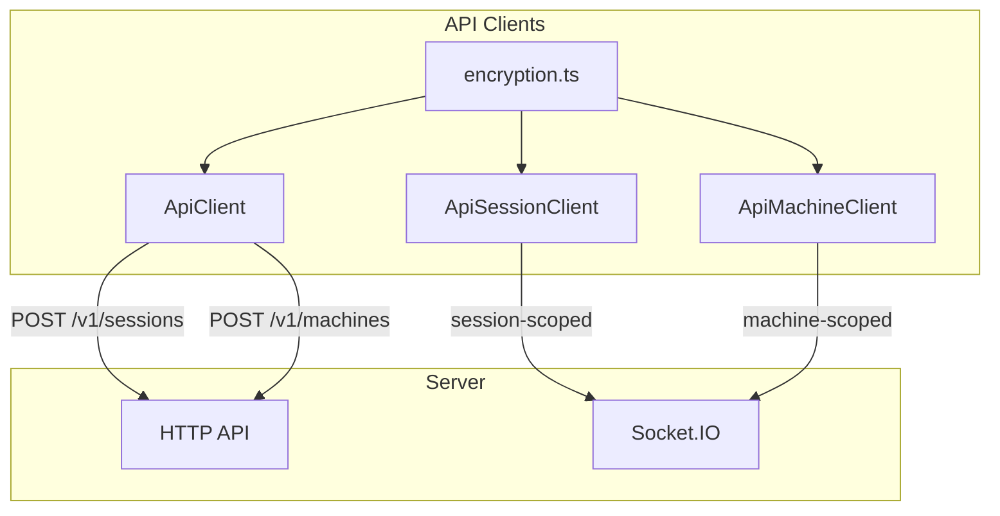

### HTTP
`ApiClient` (`src/api/api.ts`) handles:
- Session creation (`POST /v1/sessions`) with mode-compatible metadata/state.
- Machine registration (`POST /v1/machines`) with mode-compatible metadata/daemon
  state.
- Other CRUD actions through `ApiSessionClient` and `ApiMachineClient`.

### WebSocket

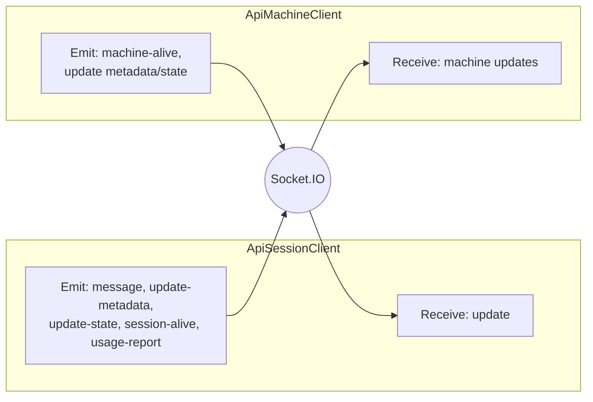

`ApiSessionClient` (`src/api/session/sessionClient.ts`) connects to Socket.IO as a **session-scoped** client:
- Receives `update` events and parses the Session's explicit plain/encrypted message
  representation, decrypting only the E2EE branch.
- Emits `message`, `update-metadata`, `update-state`, `session-alive`, and `usage-report`.

#### Session metadata authority

`ApiSessionClient` takes explicit metadata authority and transport dependencies.
The transport supplies the Home URL, Session socket factory, and optional Account
updates socket and token refresh. `ApiClient.sessionSyncClient` composes the
ordinary Account transport, preserving AccessKey provisioning. Restricted runtime
composition supplies its exact Session transport without that provisioning path.
Session HTTP operations retain the injected Home even if the process changes its
active Home. These dependencies are development architecture. The restricted
Runner now has a pre-Session, content-free credential-selection/readiness producer,
but the feature is default-on with
`HAPPIER_FEATURE_SESSIONS_EPHEMERAL_RUNNER__ENABLED` as the operator opt-out —
the ordinary shipped-bit shape in [feature-gating.md](./feature-gating.md). It is
unreleased, not off: the composed Runner, broker and native-host journeys are
release checks, so this is not an availability claim.

Current development Session detail readers keep the negotiated
`accessProjectionVersion=1` response strict. A rejected envelope or current
projection reports `session_detail_invalid_response` with the rejected schema
and structural issue paths/codes, never payload values. A missing negotiated
detail route reports `session_detail_projection_unavailable` with HTTP 404,
not a schema rejection or a legacy-list fallback. The ordinary JSON command
error mapper retains the diagnostic message; these local transport codes do
not extend the public Session-control error union.

The metadata authorities are:

- `{ kind: 'owner', credentials }` — the ordinary CLI/daemon composition. It
  opens and reseals the layout-1 owner envelope, writes owner Agent state,
  converges Account settings, and joins the Account-wide user-scoped socket.
- `{ kind: 'shared_editor' }` — a restricted Session-runtime composition that
  holds only the Session data key and a Session-scoped runtime token. It writes
  the shared projection through the server's `shared_editor` tuple mode, never
  reads stored Account credentials, never refreshes its token from Account
  storage, and does not open the Account-wide user-scoped socket. Owner-only
  operations (owner Agent state, current-publisher metadata,
  Session user-input admission, Account settings) fail with
  `session_owner_authority_required` before any effect.

In 0.3 development source, a current-publisher metadata precondition requires
the existing registration's `publisherGeneration`. Ordinary heartbeats advance
reachability without replacing that registration; publisher replacement or a
legacy lease reclaim invalidates its captured proof. A missing generation is
rejected, not treated as timestamp-only metadata authority. Historical takeover
additionally retains its exact captured `committedFenceMs` precondition.

A shared editor may only write the fields the canonical
`SessionSharedMetadataV1` schema admits (`summary`, `agentPresentation`,
`externalSessionOperationPresentationV1`, `publicAgentState`); owner-only fields
are refused by that schema instead of being dropped. Scoped reconnects recover
through the exact Session transcript and snapshot owners without reading an
Account profile or Account changes cursor.

`ApiMachineClient` (`src/api/apiMachine.ts`) connects as a **machine-scoped** client:
- Sends `machine-alive` heartbeats.
- Updates machine metadata/daemon state with optimistic concurrency.
- Receives machine updates and merges them locally.

### Encryption

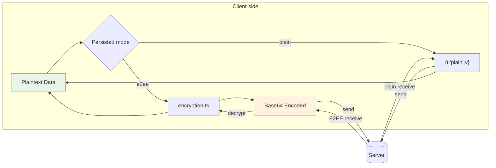

The CLI enters `src/api/encryption.ts` only for persisted E2EE content with real
matching material.
- Plain Session, Machine, Artifact, and domain-owned KV values use their strict plain
  representations and are intentionally server-readable.
- A token-only credential has zero Account E2EE material. Device-local keys may seal
  local secrets but are never uploaded or substituted for Account material.
- Some plain and encrypted values use base64 on byte-oriented routes; base64 is an
  encoding, not an encryption claim. See `encryption.md`.

## Terminal hosting (development)

### Session terminal workspace (0.3 development)

The client's existing AppPane scope owns device-local terminal tabs, horizontal
SplitCanvas layout, focus and list visibility. These are views, not another
process registry. The daemon's terminal manager remains the PTY authority;
`daemon.terminal.list` projects its current entries without creating or reaping
processes. Older daemons without that method cannot supply the cross-session
Jump group. Borrowed terminal views are read-only at the client's transport
owner, and closing them or an Agent attachment never stops that process.
Closing an owned shell stops its PTY before removing the view; hiding retains it.

Declining an open records `openCancelled: true` on that same device-local member.
Desktop/phone leaf replacement and renderer readiness retain its not-open state;
only an explicit Open or Restart clears the decline and runs normal admission
again. This is presentation intent, never a reusable approval or a PTY identity.
Closing the member removes the fact with it.

Package-script launch intent is resolved after directory admission by the existing
Local services run-target owner and admitted through the finite Project Action
owner. Its reviewed native executable, argv, cwd and environment reach the same
PTY manager directly; display previews are never executable authority. This finite
terminal execution is separate from starting a long-lived declared Project Service.
The latter, including declared native package scripts, uses
`local/services/launch/projectDeclarations.ts` and the existing managed-process
supervisor without a finite execution reservation. A portless Service can remain
running without an address; optional owned-tree endpoint observation is not a
readiness requirement and ambiguous listeners produce no address. Terminal URL
discovery separately reuses the existing output detector and `terminal_url`
inventory. These are 0.3 development-source contracts, not stable or preview
availability; the redesigned strip, list, Jump and phone controls require the
terminal UI integration.

Finite Project commands use the same `TerminalPtySessionManager` with a direct
executable/argv/cwd and the final native environment. Admission acquires a
`holdUntilExit` on that terminal. There is no terminal-count eviction or
hard-coded idle reaper. The Off-by-default Guard idle-terminal rule skips
finite holds and pending or unconfirmed stops. Its anchor is actual PTY I/O,
not output polling or attachment. Prompt-only shells close after the selected
idle delay; a running foreground command receives the selected warning lead
and Keep running reanchors the same terminal. Unknown foreground evidence
is ineligible. Closure uses the PTY owner and records surviving detached work
with the existing process owner, without a process-tree kill. The
`closed_terminal` Activity receipt offers Reopen and does not publish a
rail automatic-action dot.
`waitForExit` observes real exit, including nonzero, rather than shell readiness;
abandoning an observer leaves the process running. `requestStop` delegates to
the existing cross-platform process-tree owner and keeps retained output and
the hold while stop is requested or unconfirmed. A root exit after an
unconfirmed descendant stop cannot settle the operation or release that hold.
This manager contract is current development source. Script/setup/ad-hoc
ingress, shared requester authorization and the composed app journey must
consume and verify it before their integration is considered complete.

Standalone Project shells use an exact accepted `WorkspaceAddressV1`, not a fake
Session. The Machine RPC owner resolves the requester's current Account Project
rows and privately stamps Home, requester, Machine installation and accepted
checkout onto the actual PTY. Logical keys are scoped by that custody; list,
read, input, resize, ACK, restart and close recheck it before disclosure or effect.
Project reattachment and owned-view close use the list request's qualified
Workspace address; a copied logical key and the same physical root cannot
select a shell belonging to a different accepted Project association. Unqualified
listing remains the existing current-authorized Session/Jump census.
Restricted Runner Session terminals retain the existing exact Session receiver
authority. Ordinary own-Account Session shells freshly read the authenticated
owner projection and private root, using the canonical Machine-locality and
replacement proof rather than requiring a Project catalog association. Restart
and close observe process exit after requesting the
existing process-tree stop; detaching a borrowed view does not stop its process.

The Machine page's Open terminal Action opens an unqualified shell in the
Machine's home directory for its current custodian with manage authority.
The same Machine RPC owner enforces filesystem policy and stamps Machine
custody onto that PTY; it does not require an accepted Project checkout.
Explicit Project and Session targets retain their respective authorization.

This is development-source behavior, not loaded-runtime certification. Foreign
Project shells remain unavailable where the transport supplies Machine admission
without requester Account Project-row authority and E2EE material. The daemon
does not substitute custodian credentials. Retained predecessor terminals without
private requester custody have unknown attribution and cannot be selected for
requester-revocation cleanup by guessed paths or logical keys. A freshly proved
Session owner can reuse an existing exact Session/root association; that does not
infer standalone predecessor attribution. Revocation closes stamped interactive
shells even when presented in a Session, while held finite work remains with its
existing finite cancellation owner.

The development permission-mode controller verifies the current composer footer
before cycling modes. A clipped footer is unknown, rather than evidence of default
mode; historical mode text above the composer is not authoritative. Legacy mode
labels and compact HUD labels share that parser. If the footer is hidden by a short
terminal, control waits without cycling blindly; enlarging the terminal restores
verification through the existing retry path. Pending prompts still wait for their
required runtime configuration to be verified.

The development parser distinguishes Claude's automatic usage-limit wait footer
from the interactive usage-limit chooser. An empty composer still accepts a new
prompt, as Claude permits during the wait. Clearing an owned leftover draft with
Escape waits for the provider wait to end; it must not cancel automatic continuation.
The Rewind message selector owns keyboard input even when its only focused row is
`(current)`, so that row is never treated as a prompt draft. These keyboard semantics
follow [Claude's interactive-mode contract](https://code.claude.com/docs/en/interactive-mode).

Terminal hosting selects where an interactive session runs; it does not create
another Happier session registry. Happier owns session identity, Agent
configuration, transcript ingestion, permissions, and recovery. The terminal host
provides the process and screen; `terminal/attachment` persists their association
and owns attach, stop, and host disposition.

Zellij command panes inherit the native server's environment. The Zellij adapter
therefore passes the same launch environment when creating the server and submitting
the command, through its shared background-server launch path. Launch-only passthrough
values remain in the process environment rather than the one-shot launch-spec file.
Claude's existing spawn owner disables prompt suggestions through that environment;
the readiness parser continues to protect genuine user drafts.
In 0.3 development, Claude's ordinary queued prompts and turn-neutral inputs retain
the terminal host's quiet-period guard without predeclaring `user_typing`.
That deferral reason describes an observed blocker, not a permanent input policy;
stamping it on every input prevents even an empty, ready pane from receiving text.
All native pane discovery, input, liveness, and cleanup actions use the handle's
session name, so a second host cannot query or control another server.

Terminal-host setup failures retain `SPAWN_FAILED` with optional, Protocol-owned
`terminal_host_unavailable` detail. The session spawn action consumes that detail into
its existing non-retryable `incompatible_target` settlement and preserves the optional
`terminalHostError` field. Missing supported Herdr/Zellij installations and an unsupported
running Herdr server are host setup failures, not provider errors. Creation UI offers
installation/update or host selection recovery and retains the draft; other startup
failures keep their existing classification.

Development daemon admission captures the selected runtime's terminal-presentation
result before Session commit. Only `runner` presentation hosts the Happier controller;
`managed_terminal` and `provider_attach` keep it headless and present the selected
runtime's prepared native process. The private runner bootstrap carries
`terminalHostOwner: 'runtime'` for those two presentations. Both normal and deferred
Session initialization still report the controller to the daemon, while the selected
runtime owns attachment persistence, terminal binding, and fallback notices. Existing
bootstraps without that field retain ordinary controller startup behavior. The private
runtime request carries the admitted host context separately from metadata describing
a terminal that actually exists.
Herdr's exact socket is admitted before provider-specific authentication changes the
child environment; an explicit socket never falls back to another ambient server.

Optional server-backed presenters use the adapter's single private launch handoff.
Local attachment becomes available only after the native OS spawn receipt, within the
existing Session startup deadline. Failed preparation leaves the admitted controller
remotely usable; an unknown handoff retains its exact custody rather than replaying
creation. The existing daemon heartbeat retires positively dead optional owned
attachments without ending their live controller or automatically reopening a client.
Controller recovery distinguishes these optional clients from session-bearing hosts:
the former can be disposed before continuation, while the latter retain their existing
control and recovery fences. Borrowed shells are never destroyed by this owned-host
supervision. Existing-session continuation leaves the optional client remote until an
explicit Attach request. After that client has retired, Stop still requires positive
daemon ownership and current OS process-identity proof before terminating its headless
runner; a missing session-bearing host remains fenced.

For an optional presenter, normal runner exit retains marker evidence only while an
owned or legacy terminal descriptor is current, or custody cannot be read reliably.
Verified absence and borrowed-shell custody release the marker after terminal-finality
and exit staging complete. The initial attachment's historical publication is not
current custody; unexpected daemon recovery retains its separate existing policy.

The daemon's `spawn/routeSpawnModeAndWaitForWebhook.ts` keeps headless ACP runtimes
headless and routes supported interactive runners into the selected host.
`spawnAdapterHostedSessionAndWaitForWebhook.ts` reuses normal daemon registration
and webhook completion for zellij and Herdr. Agent runtime factories supply the
runtime and its local-control capabilities; `engineRegistry/nativeAgentSession.ts`
binds their terminal or provider-attach surface into the existing mode loop.
Initial native configuration options combine persisted metadata and launch preferences
through the canonical configuration-intent writer and snapshot reader, preserving
per-option timestamp precedence. Initial model selection already uses the canonical
public model-selection resolver; it is not a separate terminal-host selector.
Permission startup uses one shared seed-admission owner for the prompt loop and
runtime override synchronization. A saved mode is applied before eager native
startup even when its timestamp was already captured while building the queue.
Subsequent metadata changes still require a strictly newer timestamp; explicit
launch permission intent keeps its existing precedence.
Codex App Server and OpenCode server prepare their native TUI attachment against
the existing Agent session, rather than starting another conversation.

Managed provider-attach declarations retain their target and credential-environment
facts even when the host's access resolver is unavailable; attach fails closed
instead of becoming an unmanaged ambient-credential launch. For an in-runner native
TUI, the private host attach request reuses the same managed-services owner's exact
current Session/plugin/contribution/instance projection. Its client environment stays
runner-local, and currentness is checked again after executable/version resolution
before spawning. Original runtime-occurrence callers retain their existing lookup;
projection consumers use the underlying instance identity, not the projection token.
Independent Plain-account standalone attach still lacks a private daemon-to-runner
credential transport; this runner-local path does not disclose credentials over the relay.
OpenCode native fork/resume retains a canonical explicitly configured external server
origin through its existing runtime descriptor and external managed-service admission.
An observed managed-server URL is not that authority: ordinary managed-local servers
share the native data-root corpus, so the child may supervise a new endpoint without
copying the parent's private credential.

Herdr transport remains in `integrations/herdr`: direct argv launch, styled screen
capture, input, process inspection, and terminal attachment. In development
builds, both the installed executable and the exact running server require a stable
Herdr release at or after `0.9.2`. Opening Herdr, attaching or focusing a terminal,
and admitting a recovered host use the existing client's version check before
control; recovered-host admission never creates or replaces that server. Claude's unified
runtime lives in `packages/plugins/claude/src/agent/runtime/terminal/unified` and
uses the host's terminal service, composer parsing, and prompt-submission
verification. Successful terminal writes are not Agent acceptance acknowledgements.
In development source, Claude normal and shell prompts share one active-input
selection and wrapped-text reader. Shell input can verify an authorized `!` request,
but cannot make the terminal ready for an ordinary message or bypass a blocking dialog.
The Claude-native semantic classifier reconstructs exact shell-request identity while
preserving visible shell input/output. The ordered source reader admits acceptance;
a linked native no-query caveat and output parent produce the existing completion
candidate. Other shell output retains the provider lifecycle. Live local-completion
evidence stays binding-owned until output arrives, independently of echo-retention windows.
In current development source, the shared submission verifier observes staging and
consumption under the native Session scope's cancellation signal, separately from
bounded terminal write/capture commands. Slow Agent redraws do not exhaust a
transport deadline. It submits Enter once and reads the arbiter's existing
accepted/retired custody to stop waiting after provider evidence or manual
retirement. A positively foreign composer fails before Enter through the shared
Claude draft classifier; ambiguous capture remains pending. The same classifier
owns leftover-draft clearing, which independently refuses generation and usage-limit waits.
The Herdr client stages large text in sequential Unicode-safe requests within
Herdr's 1 MiB serialized JSON-line limit, including escape expansion and envelope
bytes. Submission still belongs to the existing verifier: it sends Enter only
after staging completes, and a partial failed write retains the existing
ambiguous-write result rather than replaying the prompt.
Herdr uses a shared default server namespace rather than the generated Agent pane
label. When creating a pane, a saved host supplies the default namespace on resume, while an explicit
named server wins; the label remains independent of either placement choice.

`terminal/runtime/inheritedHerdrRuntime.ts` verifies the foreground wrapper's live
Herdr endpoint and pane. `terminal/runtime/terminalMetadata.ts` reconstructs the
existing handle and distinguishes daemon-owned from borrowed shell hosts.
`plugins/runtime/context/terminalHost.ts` launches a managed child in that current
host and applies its existing attachment disposition: borrowed panes remain
intact when the runner stops, while an explicit stop can destroy a daemon-owned
host. The Herdr terminal identity resolves to its current pane without a separate
persistent index. Child termination and attachment release stay with the existing
host service and runtime lifecycle; normal runtime disposal surfaces cleanup
failures rather than reporting successful retirement. After positive exact-runner
exit proof, Stop may continue the same disposal and retirement pipeline with the
captured attachment identity if normal runner cleanup already removed its descriptor.
Unreadable or replacement evidence is not absence. After old-host physical
retirement is proven, a newer remote serviceability projection is left untouched
while only the old captured local evidence is retired. Borrowed-host release never
disposes the user's pane, and exact metadata retirement and hook-artifact cleanup
remain in the existing disposition owner.
If required descriptor removal fails, Stop reports incomplete retirement and retains
the exact local evidence for retry without disposing a borrowed pane.

For Claude Runtime Activity, the development unified terminal subscribes to the
current owned host's existing completion path. The foreground launch runner sends
private native-close proof only after its provider child closes. The host drains
that channel before publishing exit evidence, and the unified runtime settles its
task ledger only for that positive proof. Wrapper death or a post-spawn error alone
reports observation loss even if the wrapper has a numeric exit status. The
subscription is fenced by the captured host handle and released by the existing
runtime disposal owner. Retained and external hosts without owned completion
expose no subscription and cannot prove their provider stopped from pane liveness.
The readiness owner's confirmed dead-pane observation demotes unresolved Activity
to unknown through the same reconciler used for unproven process exit. An
inconclusive liveness observation preserves active facts, and readiness does not
fabricate a process-exit failure for that pane observation.

Claude's development SDK local-mode launch uses a separate invocation lifetime
for hook secrets, endpoint and plugin directory through the existing Session hook
service. Its prepared plan remains inert until the host reports the actual child
launch to the captured native Session runtime. That binding owns local task facts
in the same ledger as SDK queries; stale remote hooks cannot borrow its authority.
The generic process owner retains all physical control. The SDK query execution
adapter also receives the builder's optional direct-provider qualification through
the existing system-tool grant and public Exec projection. It combines that exact
invocation fact with observed process exit or signal before publishing
`providerStopped: true`; generic process exit codes retain their root-process
meaning. Runner and daemon resolution forwarders already preserve this optional
fact. Missing qualification, including Windows shell shims, remains unknown.
The Agent CLI launch
builder explicitly qualifies direct native execution, and the host combines that
qualification with actual child termination before reporting provider closure.
Shell shims without positive provider proof remain observation loss. Preparation,
launch and runtime retirement release hook resources at their existing owners;
cleanup failure reports a default warning and preserves the original failure.
Direct and borrowed physical stop handles share one attempt owner: concurrent callers
await the same attempt, a failed attempt permits retry, and successful cleanup remains
settled. Control return records the stop receipt without adding a second retry policy.
Failed shutdown or an inconclusive process error retains the containing operation's
cancellation listener; successful shutdown or observed child exit releases it.
Cancellation cleanup failures use the default file diagnostic; launch cleanup preserves
both the original failure and a failed physical stop.

The development Session-scoped terminal service can adopt an existing owned host
without launching another Agent. Admission requires the current runner's Session
lock, matching metadata and exact local attachment, and positive host liveness;
unknown or replaced evidence remains fenced. Inherited foreground borrowing takes
precedence, and a changed terminal preference does not replace a surviving owned
host. Claude's retained-host path reuses the Session's existing authenticated hook
endpoint and artifacts. The host receipt alone does not establish native identity:
an authenticated primary hook or statusline observation must match the requested
native session, followed by the existing transcript admission. This is distinct
from a fresh resume launch and does not synthesize a SessionStart hook.
The selected runtime's existing presentation result also declares whether it can
adopt a retained terminal. The daemon delegates an absent controller to that
recovery path only with its attachment-bound control descriptor and an affirmative
runtime declaration. Claude unified declares adoption; SDK and optional native
clients do not. Missing descriptors, uncertain liveness and changed attachments
remain fenced. This declaration permits endpoint admission, not a fresh provider
launch or a claim that authenticated recovery has already completed.
For this admitted headless continuation, startup preserves the exact active owned
association instead of publishing the controller's plain placement over it. It
leaves both current and supported predecessor attachment records untouched and
does not bind or report the old host as live before final adoption. Missing,
unreadable or mismatched active custody fails before the startup metadata update.
An owned attachment without a matching Session terminal association is likewise
refused rather than overwritten by the controller's plain placement.
Fresh placement, borrowed hosts and canonically retired associations retain their
ordinary startup behavior.

Cold Herdr attachment verifies the recorded standard saved namespace through the
native session inventory before starting that same server. It uses the existing
terminal-host startup budget, not the shorter API action budget, and never
substitutes an ambient same-name server. Foreground attachment supplies the exact
socket and named-session environment without `--session`, which would override
that socket under Herdr's released CLI contract. A restored public pane remains
only a candidate until normal Happier resume admission reconnects the Session;
opening it establishes neither authenticated identity nor owned custody.
Unsupported custom cold-start roots require reopening the original server;
already-running custom sockets remain attachable through exact-server admission.

The UI's canonical local-control projection distinguishes retained AgentState from
live controls. Inactive sessions, permanently absent terminal hosts, and preserved
but unservable hosts expose no live local controls, even if historical AgentState
still records an attached terminal or `controlledByUser`. The footer derives both
its local-control capabilities and exclusive-control flag from that projection,
using the session's canonical owner metadata view. Resuming a live runner restores
the current shared or exclusive controls without changing the retained history.

An accepted session identity prevents duplicate nonce launches but is not readiness
proof. Recovered nonce admission consumes the existing accepted runner marker and
process generation, completed startup custody, and current exact-session RPC
serviceability. Terminal-host sessions also require a readable committed attachment
whose handle matches the tracked terminal metadata; a known attachment ID must match
too. Windows window/console launches consume their required regular attachment:
the launch window and unique tab title must match, or the console PID must identify
the accepted runner. An in-runner Windows PTY instead uses its exact host descriptor
and requires the already known committed attachment ID; mode-only metadata is not
an exact binding. Recovery captures the original accepted runner/host facts and
rechecks the marker, local attachment, and current tracked custody after RPC awaits.
Actual plain launches need no host attachment but still require marker and RPC proof.
Unproven recovery stays pending. Normal completed spawn/report correlation remains
authoritative if it settles while recovered proof awaits filesystem or transport I/O.

In the current development source, all child-owned same-pane launches use
`terminal/host/launchSpec.ts` to pass the
final native argv and environment in a private one-shot file to the managed
terminal launcher. A private controller-lifetime IPC channel closes on controller
exit or death; the surviving launcher invokes the same owned-process-tree cleanup
used by normal shutdown. Native attach readiness uses that channel's actual child-spawn
receipt, not the launcher's spawn. Managed-service currentness is checked again after
private handoff preparation, immediately before launch. Normal attach cancellation
forwards SIGINT to the native child over the same channel; the existing three-second
escalation requests owned-subtree cleanup, leaving independent services untouched.
Borrowed shell panes remain intact. OS discovery or
signalling failures can leave descendants running. The cleanup owner still attempts
known-process termination and rejects with `plugin_exec_termination_incomplete`
when completion cannot be verified through its census, direct-child fallback, or
owned process-group/Windows tree proof. The CLI owner records that outcome in its
default file log; the surviving launcher reports a fixed, sanitized stderr diagnostic.
Cleanup cannot run if the launcher is also killed or cannot execute. Independent recoverable hosts
keep their adapter-owned topology and receive no lifetime channel.
An incomplete termination keeps its exact process custody: concurrent callers share
the current attempt, while a rejected attempt can be retried rather than permanently
replaying its rejection. Successful termination remains idempotent.

Tmux terminal commands retain the exact owning session together with the window
ID. Window IDs survive window renames but are reused when the tmux server restarts;
a bare ID cannot establish recovered ownership. The shared liveness probe resolves
the complete target with `has-session` before reading pane fields, because
`display-message` may succeed with a different current pane for an absent window.
Recovery, prompt/control delivery, foreground attachment, and owned-window disposal
retain that same target rather than dropping the session name.

Detached tmux creation uses the configured session `default-size` when no client
is attached to that session. The shared tmux command owner reconciles the exact
created window instead of inheriting dimensions from clients of unrelated sessions
under tmux's `latest` sizing policy. It preserves inherited or explicit window
sizing policy so attaching a client still controls its geometry. An unsuccessful
geometry reconciliation is logged and does not retry a successful creation.
Terminal-host creation failures retain the existing `not_created`,
`created_and_absent`, or `created_or_uncertain` evidence independently from
cleanup completion. Only a definitely unsubmitted tmux creation with complete
cleanup permits ordinary-process fallback. An unconfirmed hosted child retains
its private launch and session-attach inputs through the outer daemon spawn
owner; an exact, successfully disposed host permits cleanup. Private artifact
owners remove only their known files and empty directories, treating only
`ENOENT` as idempotent. Other failures emit sanitized default-on diagnostics.
Already ready native launches and completed Claude query outcomes remain
successful despite artifact cleanup failure; failed startup preserves its
original cause alongside cleanup failures. These are current development-source
contracts, not additional retry or recovery guarantees.
An explicit retirement retry continues from proven physical disposition, without
destroying the host twice, and finishes outstanding artifact cleanup and exact
metadata/report retirement. A replacement attachment is not retired by that retry.

Herdr lifecycle reporting projects Happier state. Managed Agent children suppress
Herdr's native Agent hooks, and the resume action uses the current Happier
release-channel executable. The generic `--runtime-context` command prefix carries
the existing resolved CLI context (home, relay profile and endpoints, and daemon
lifecycle scope), because Herdr does not restore the original pane environment
when restarting a saved command. Configuration applies this prefix before
resolving credentials, only at initial startup; later explicit profile selection
is not overwritten. The prefix accepts only the canonical runtime-context keys,
does not copy credential files, and rejects URLs with embedded user information.
Encoding is transport, not redaction. Generic `resume` delegates to normal attachment for
running attachable sessions; stopped sessions retain strict Agent resume. A
recorded local Herdr pane may be opened as a restoration candidate when its
controller is positively absent. A restored command already inside that exact
pane, socket and namespace continues through ordinary same-Session resume even
when relay activity is stale; a present or unreadable controller retains normal
attachment admission. The pane record is placement intent, not Session identity
or owned-host custody. A surviving shared headless controller can admit a native
client in that recorded restored pane through the existing strict Session attach
operation. The selected-session owner checks the current native identity, exact
socket/pane, prepared native invocation and launcher fingerprint/foreground
ancestry before binding the actual borrowed v3 record through the existing
terminal publisher. An absent descriptor requires the authenticated retired
placement's exact attachment ID; absence alone is not admission. Local Switch
and Detach join that same custody proof. Managed Detach retires only the exact
native launcher tree, preserving the borrowed shell, and a subsequent explicit
Attach can reuse the same pane. Ordinary independent clients without this
admitted association still do not claim managed status or Detach. These source
contracts do not establish automatic installed-channel replay or the composed
0.3 authenticated cold-restart live result. When a
preserved host cannot be verified, Resume remains fenced. Reconnect to
the original terminal host and retry Resume, or Stop the session if that action
is available before resuming on a fresh host. There is no parallel Herdr session
synchronization service. These are development-source
contracts, not a claim of release availability.

## Daemon architecture

In current development source, startup reattachment and resume of an already
running session reconcile the daemon's session access key and the session's
machine routing metadata together. The recovered-session machine-control owner
uses the canonical metadata tuple writer, including owner-envelope encryption
and version-conflict recovery. Routing changes only while the recorded host PID
matches the locally adopted runner; matching workspace-location bindings follow
the daemon identity. Provider identity, paths and unrelated metadata remain
intact. This does not replace or retire the live publisher's old Machine
identity, which must remain valid until its surviving publishers finish or
migrate. A handoff that has published another runner's PID is left untouched.

### Plugin UI artifacts

The daemon is the single Plugin UI build owner. Manifest artifact references
and exact package exports feed one esbuild compiler, which emits a minified
platform-neutral CommonJS bundle and a V2 digest manifest. Hosted web files are
staged separately as static artifacts. Clients fetch admitted bytes by digest;
there is no platform-specific build selector or parallel Vite/Re.Pack loader.

The same daemon owner also holds one process-local slot per plugin. Managed
third-party packages load from immutable installation generations, bundled
first-party packages load from the exact CLI version root or a pinned runner
snapshot (including a producer's immutable Stack daemon artifact), and trusted development/drop-in plugins load from their selected
source in place. Only a fully prepared candidate replaces its plugin's current
occurrence; a failed in-process edit preserves the incumbent without rotating
unrelated slots. A daemon restart rebuilds current development source and never
claims to restore a historical copied source.

In current development source, `resolveAuthoritativePackagedRuntimeCustody`
binds a Stack snapshot's physical daemon payload to its producer manifest's
artifact fingerprint, using the existing `pinned_runner_snapshot` custody shape.
Native launch and `package-dist` launch resolve the same identity, including
when several snapshots reference that artifact. This is exact loaded-runtime
custody, not selection of a release channel or a managed installation.

Artifact digests identify bytes, not trust, release selection, or slot
currentness. Portable installed UI follows Account release/digest adoption;
bundled and development UI follows the selected daemon projection. Collection
migration callbacks are prepared before slot publication and promoted through
the server's atomic Collection owner. Slot replacement never infers Collection
absence; the server-owned `absenceEpoch` continues to fence deletion and
re-creation.
### Confirmed daemon stop outcomes (development)

Current 0.3 development source distinguishes `not_running` from confirmed `stopped`.
`controlClient.stopDaemon` retains its existing incarnation-aware single-daemon stop owner.
Force stop checks the runtime recorded by that owner rather than the stopping
CLI's runtime directory, allowing a newer CLI to stop a proven daemon in an
older immutable runner snapshot. Matching lifecycle scope, structured lock,
OS process birth and the final process-identity recheck remain required.
Publication presence shares authenticated control probing for PIDs hidden from the caller.
Transient control failures remain unverified. After observing a hidden owner through
authenticated ping or accepted authenticated stop, stop confirmation requires release of its previously captured lifecycle-lock snapshot, because control closes
before shutdown cleanup completes. Ordinary exited publications remain absent when no hidden
owner was observed. Stop asks persistence to reclaim their unchanged state and matching lock,
using its exact-owner file primitive. Reclamation requires proven process absence and captured
lock bytes, accepts structured and predecessor PID-only locks through the canonical parser, and
preserves changed state/lock publications. Live, inaccessible, unverified and hidden owners are
not reclaimed by the observer. Persistence owns lock parsing and inspection; control transport retains
its canonical token headers. Initial startup-only locks with no observable PID or endpoint
remain outside this namespace proof. Status output preserves unverified publication presence.
`persistence.inspectDaemonLockOwner` classifies startup locks through the same lifecycle
incarnation classifier, including lock paths supplied by stop-all; it does not acquire or
remove another owner's lock.

`multiDaemon.stopAllDaemonsBestEffort` uses its durable servers-directory publication inventory,
including removed profiles and every release-ring filename. Stop-all opts into startup-only
lock discovery, while direct Action ingress retains its published-state-only inventory.
Stop-all attempts siblings after failures, counts only confirmed stopped owners, and repeats
that inventory after shutdown to reject live successors or startup locks before
`auth logout --all` deletes the home. Normal publication cleanup remains owned by the lifecycle
holder; persistence owns narrowly scoped departed-publication reclamation for both stop paths.
Hidden successor uncertainty is scoped to the exact observed publication and lock
path; unrelated proven-dead release-ring siblings can be reclaimed with the same owner checks.
An empty inventory reports `not_running`, and incomplete stop preserves the home.

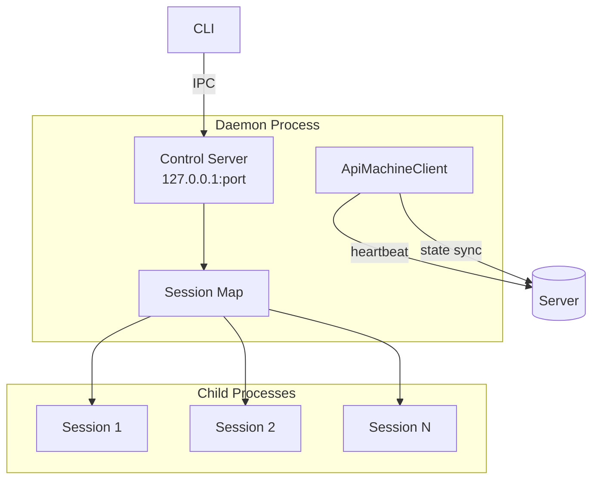

The daemon is a long-lived process responsible for running sessions in the background and maintaining machine presence.

### Lifecycle

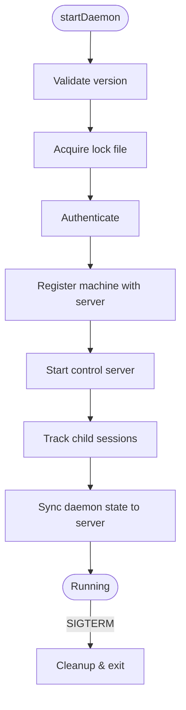

1. `startDaemon()` validates the running version and acquires a lock file.
2. It authenticates and registers the machine with the server.
3. It starts a local **control server** for IPC.
4. It keeps a map of tracked child sessions and updates daemon state on the server.

In current development source, primary CLI runners own Session locks through a lexical scope in
`sessionRunnerLock.ts`. Fresh startup claims the resolved Session id before
constructing its realtime client or committing pending first input; existing
startup claims before attaching. Daemon presence and resume preflight already
read that same lock. A fresh runner can publish its Session row before receiving
the id and claiming that lock. `resolveExistingSessionSpawnPreGate.ts` also
recognizes an accepted child still awaiting its first webhook: it reads the
existing attach metadata, requires the same Machine and Happier home, correlates
the reported runner through the shared webhook PID/parent/exact Windows custody
owner, and verifies `hostProcessStartTimeMs` against the current OS process
generation. Verified identity joins the tracked child through the existing
runner-presence owner. Missing generation or unavailable presence fences Resume;
a positively different generation leaves the child unbound. Acceptance does not
acknowledge startup: the qualified webhook still owns canonical marker adoption,
readiness reconciliation, and the original spawn awaiter. Pending Windows
Terminal launches retain custody when only the launcher exits. The
shared presence owner uses one paired runner PID/generation fact for ordinary
wrappers and exact Windows launches, preserving launcher identity until normal
marker promotion. Webhook and accepted-spawn marker refreshes update the launcher's
birth and command witnesses only from its own PID. A distinct runner's marker
retains its own witness without replacing the launcher's Stop and exit custody.
A distinct reported runner PID stays unproven while its OS generation read is
pending; the dead wrapper cannot prove that runner absent, and pending startup
custody cannot promote it before the paired identity arrives. An older
asynchronous report or OS probe cannot replace or prove absence of a newer
reported runner. Heartbeat, visible-console, and regular-child observations
delegate retirement to the canonical exit owner; retained wrapper custody does
not independently fail startup. Missing process evidence keeps existing startup finalization or
cancellation authoritative, and a reused runner PID cannot be promoted. Stop and
retirement retain their existing lifecycle checks. Startup failure and normal runner exit
release the scope's locks; process-exit cleanup uses the same owner.

In current 0.3 development, descriptor-backed Home transport preparation verifies
the selected Home identity before sending an Account credential or publishing a
runtime origin. Startup readiness uses the existing managed endpoint supervisor:
timeouts, connection failures and 5xx responses remain pending and retry under its
shared backoff policy; identity mismatch and rejected authentication fail closed.
TLS verification remains enabled, and a failed TLS identity request cannot admit
credentials or an origin. Identity requests inherit the fresh feature-request
owner's attempt deadline; authenticated readiness uses that same attempt budget
rather than a shorter phase cutoff. Shutdown cancels startup readiness; transport release
also cancels pending authenticated verification. Live reconnect consumes single
attempts under its existing connection supervisor.

Default runtime HTTP requests resolve their destination through
`api/client/serverHttpBaseUrl.ts#resolveServerHttpBaseUrl`. Its invocation-scoped
endpoint takes precedence over the verified process publication and then the
configured API address. An explicitly admitted destination stays explicit.
Configured Home addresses still identify profiles, credential audiences,
enrollment destinations, diagnostics and child-process configuration; they do
not select the default live HTTP destination after a runtime carrier is published.

A self-restart successor waits for verified bootstrap before publishing its local
control state. The incumbent confirms that state through authenticated local ping
and resumes after an expired confirmation wait if it can reacquire the lifecycle
lock; it never continues serving without that lock. Cold plugin initialization gets
its existing readiness budget after Home verification, so waiting for Home
reachability does not consume that budget before plugin startup begins.

In current development, `createOnChildExited` releases session-marker evidence only
through the tracked exit lifecycle. An exit notification for an untracked PID does
not authorize marker deletion. A positively dead plain runner may release local
tracking while its Home is unreachable only when its exact persisted Session marker
remains as recovery evidence. Explicit Stop keeps that marker until the existing
startup/reconnect orphan-settlement owner confirms Home finality and retires the
matching runner's terminal-control projection. A replacement runner is not retired.
Caller-local CLI cleanup removes only terminal-owned markers under captured marker
identity; it cannot erase the daemon's retained Home-retirement evidence.
No terminal attachment means final-exit handling needs no Account/plugin catalog.
This requires positive descriptor absence, including when tracked launch metadata
still names a terminal host. Unreadable descriptors and descriptors replaced during
the read retain final-exit custody. A dead runner with no descriptor follows the
same Stop retirement path without attempting to signal or dispose an unknown host.
If tracking has already retired, authenticated same-Machine terminal metadata may
still identify the exact attachment for recovery. A retired projection alone is
not a stopped receipt: the existing host probe must positively establish death;
live or inconclusive observations remain incomplete.
Failed local cleanup or durable terminal-turn staging retains tracking and marker
evidence; visible-console startup awaits that cleanup and reports an
incomplete retirement rather than allowing its rejection to escape.

Development startup recovery uses `daemonProcessScopeIdentity.ts` to keep runners
within their owning Happier home and daemon lifecycle. Markerless recovery,
including PID-placeholder adoption, requires recorded home and lifecycle identity;
older runners without an explicit lifecycle identity require the recorded
active-server identity and a matching server URL. Explicit lifecycle identity
survives endpoint changes. Existing local markers can supply ownership evidence
when process inventory is incomplete, but cannot override recorded foreign-home
or foreign-scope facts. `prepareDaemonSpawnLifecycle` publishes the resolved home
in the protected child environment even without an inherited home override.
Force-stop retains its additional recorded endpoint agreement requirement.

### Model-capacity recovery (development)

`ConnectedServiceTemporaryThrottleRetryScheduler` owns scheduling after a terminal capacity failure.
The Codex adapter reports that terminal failure to host recovery without an extra
immediate retry; native Codex retry-in-progress notifications remain nonterminal.
Consecutive capacity failures wait 5, 10, 20, 40, 80, 160, then 300 seconds before
jitter of ±20%. Provider retry/reset timing is a minimum, not a replacement for
the backoff. The delay is capped, not the number of attempts.

The capacity streak survives continuation handoff. Pending acceptance, a new turn
id, or reconnection is not evidence of model recovery. Only an accepted completed
turn resets the streak. A handed-off continuation has no second retry timer while
its outcome is pending; user cancellation remains authoritative. Authentication,
quota, and non-capacity transport recovery retain their own classifications and
policies.

Feature observations keep caller deadlines and cancellation active through response-body
consumption, including the authenticated-to-public compatibility fallback. No feature-owned
default deadline is added. Diagnostic artifact collection likewise retains its existing
request deadline until the server response body has been consumed.

### Control server (local IPC)

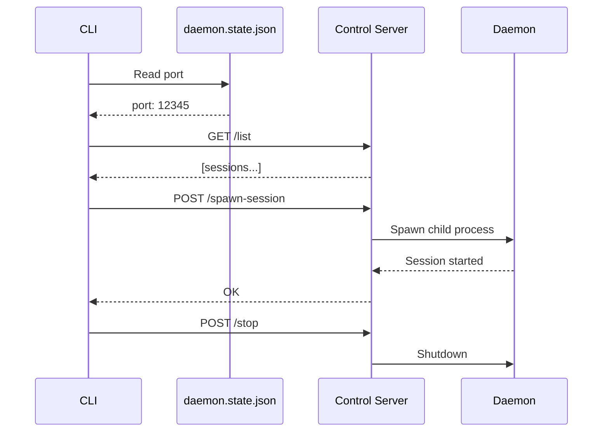

`startDaemonControlServer()` (`src/daemon/controlServer.ts`) runs an HTTP server on `127.0.0.1` and exposes:
- `/list` (list active sessions)
- `/stop-session`
- `/spawn-session`
- `/stop` (shutdown daemon)
- `/session-started` (session self-report)

The CLI talks to this server via `controlClient.ts`, using a port stored in `daemon.state.json`.

In 0.3 development, ordinary CLI Action dispatch uses that local control path only
when the selected live publication matches the captured requester's Account and
target Machine. Startup publishes the non-secret Account id from its captured
connection credentials alongside the Machine and runtime ids; Machine rollover
and heartbeats preserve that Account fact. A current credential file is not proof
of which Account an already-running daemon serves. Legacy publications without
an Account id require Home's positive own-target check before using the incumbent
local path. Foreign Machine targets retain Home admission and explicit private-custody
consent. Ordinary input to an existing requester Session instead names that exact
Session through Home and reuses its already-admitted installation custody, without
another Account credential box or disclosure. The existing Pending owner admits
the input before native Agent readiness; a different Account, Home, installation,
Session, or retired grant cannot borrow that custody. Original terminal requests
through this requester facade and explicit
automation contexts keep their original bearer, kind, epoch and automation ceiling
through Home's existing Account/Session owners or Machine carrier, rather than
borrowing a local daemon's Account connection. The configured interactive CLI
terminal-present-user policy remains unchanged outside that facade.

CLI Stop delegates acknowledgement expiry to the relay's existing finite
forwarding deadline rather than imposing the generic machine-RPC timer. Fork
cleanup uses the same Stop contract. Local `/stop-session` requests follow the
daemon operation by default; explicit caller deadlines and cancellation remain
available. A guarded refusal to signal does not authorize an unsafe kill: Stop
rechecks positive runner exit before reporting incomplete termination. Transport
timeout or disconnect never proves physical termination.

### Session spawning

In 0.3 development, the Claude plugin retains its effective native account directory in the existing native runtime descriptor. Its daemon environment hook restores that directory before the ambient daemon default; explicit profile and materialized credential selections still take precedence. No parallel host-owned native-environment metadata is introduced.

Once persisted provider identity is resolved, spawn admission reuses `resolveExistingSessionSpawnPreGate` to check other tracked entries for the same canonical Agent target and provider resume id. The existing process-presence owner determines whether a sibling is absent, live, or unverified. A live or unverified sibling blocks a second launch; ordinary same-entry adoption remains governed by that same gate.

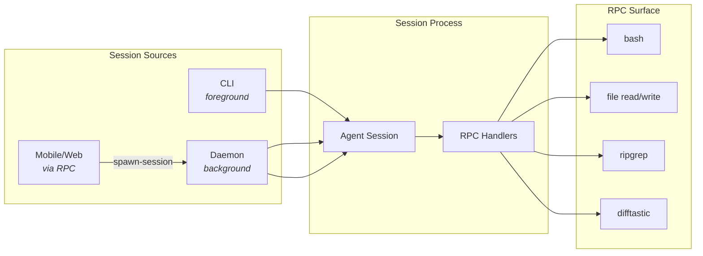

Sessions can be started by:
- The CLI directly (foreground).
- The daemon (background).
- Remote requests over RPC (from mobile/web via machine connection).

Daemon session spawning uses `registerCommonHandlers` to expose a controlled RPC surface (shell commands, file operations, search/diff helpers).

In current 0.3 development, `createSpawnedSession` uses the same authenticated
creation-tag proof before dispatch and after a returned or nonce-settled spawn
failure. A unique Account-owned candidate whose immutable correspondence and
requested Replay lineage match is returned as `rejoined`. An absent candidate
preserves the spawn failure; unavailable or conflicting proof fails closed.
This settles durable creation without launching again or claiming runtime
readiness. Initial input still receives its actual Message-owned admission result.

Shared-Machine requester starts in current 0.3 development use the incumbent
original Account Action transport, not the custodian-only raw spawn methods.
Home admission checks the current Use grant, and the receiving installation opens
the requester's sealed Account context. The daemon's existing bootstrap wrapper
prepares requester-owned Session credentials and attribution before physical
launch and cleans prepared custody on failure. An existing requester Session
resumes through `session.open`; its strict optional `resumeRequest` retains the
headless resume options while the private lifecycle owner restores that Session's
protected custody. Neither path borrows custodian Account settings or credentials,
and revoked authority fails closed. See
[Session Account-action authority](./runtime-core.md#session-account-action-authority-03-development).
This describes development source, not released availability or live certification.

#### Managed session directories (planned 0.3 development behavior)

The approved folderless-session contract is under implementation and awaits
integrated verification. This section describes the intended owner and lifecycle,
not released availability. The public directory intent is documented in
[Protocol](./protocol.md#session-creation-directory-intent-planned-03-development-behavior).

The target daemon will own each managed working directory through
`src/session/creation/managedSessionDirectories.ts`. Its root is
`<activeServerDir>/session-directories/`, where `configuration.activeServerDir`
is `<HAPPIER_HOME_DIR>/servers/<activeServerId>` after normal home/server
resolution. Clients choose `{kind:'managed'}`; they never construct a private path.
POSIX root/allocation permissions are 0700. Windows protection uses the existing
owner + LOCAL SYSTEM ACL boundary in `protectedLocalState`; protection failure
refuses startup.

A new allocation is keyed by the canonical namespaced `sessionCreationTag`, not
the raw creation key. Target preparation only derives its path. Materialization
belongs to the fresh-spawn branch after creation rejoin has found no existing
session. Per-allocation records under `.owners/`, written through
`protectedLocalState`, establish filesystem ownership. The metadata marker and
path are presentation/routing inputs and cannot authorize copy, recreation or
removal. One allocation belongs to one session; a session may retain several
allocations after handoff.

Resume, respawn, queued activation and reattach must prove ownership and retain
the existing directory. A missing or unproven managed folder returns
`SESSION_DIRECTORY_MISSING`, leaves queued input queued and creates nothing.
Only explicit **Continue in a fresh folder** consent, carried by the existing
`approvedNewDirectoryCreation` bit, permits an empty protected replacement while
preserving the session history. This contract does not change missing-folder
behavior for ordinary path sessions.

Same-machine forks receive a fresh allocation seeded from the proven source using
the existing workspace seed materializer. Cross-machine forks receive an empty
allocation and report that files were not copied. Managed handoff allocates on the
live target-prepare path using the handoff operation id, ignores a client-selected
target path, and copies files through the workspace seed export/materialization
step below WorkspaceRef enrollment. It creates no Project or workspace-sync
relationship for those private folders. Source copies are retained; a return
handoff creates a new allocation. Abort removes only that operation's uncommitted
target allocation.

Managed folders survive daemon restart and archive/unarchive. Durable session
deletion stops the tracked process tree before removing every allocation bound to
the session on that machine, after physical containment and symlink checks.
Offline cleanup is pending until the daemon returns. Persistent removal failure
records `pendingRemoval` and returns normally so later Account changes can advance;
startup retries it. Existing deletion replay and complete active/archived inventory
reconciliation cover reconnect and access reset. A partial inventory never proves
absence. Startup resolves unbound creation records through the existing creation-tag
lookup before binding or removal.

These private folders are separate working directories, not OS or tenant
isolation. Agents retain the daemon user's filesystem access, including access to
other managed folders. Claude's existing trust policy and user-scope skill/config
materialization remain unchanged. Project-scoped template seeding is deferred.

#### Initial access travels with fresh creation

The development collaboration transport carries the strict Protocol
`initialAccess` draft from Session authoring through `session.spawn_new` and
`createSpawnedSession`. `primaryTeamId` travels separately as fresh Team context;
neither field belongs to immutable creation correspondence or Session metadata.

The daemon places the access draft in a protected, one-shot local file using the
shared platform protection owner. Only its path travels in the private
`--session-initial-access-file-v1` runner flag. The CLI removes that flag from
Agent arguments and consumes and unlinks the file before Agent startup. The
daemon's launch-resource lifecycle retains failure and child-exit cleanup.
Tracked respawn options and persisted respawn descriptors do not retain access.

The host bootstrap and Replay-seeded HTTP creator send access and Team context as
top-level `POST /v1/sessions` fields. Replay attachment to the resulting Session
omits both fields. The HTTP creators use the shared collaboration feature
decision and preserve an explicit server update-required refusal; generic HTTP
errors are not treated as proof that creation had no effect. Recipient-envelope
construction and atomic grant application remain encryption/server concerns,
not transport-side or post-create sharing operations. This describes the
development transport, not release availability or completed live certification.

An exact initial-access `update_required` refusal uses the existing terminal
startup-failure webhook and spawn-nonce waiter. Protocol validates its operation,
reason, and component as a closed detail; both the immediate spawn response and
nonce recovery preserve it. The Action returns `update_required` with
`retryable: false`, rather than turning this no-effect refusal into a generic
failure or an unknown-outcome timeout. The outer daemon error remains
`SPAWN_VALIDATION_FAILED` for consumers that do not understand the added detail.

#### Direct Team launch material commits the Session first

Normally the runner creates a fresh Session from its creation tag. A fresh daemon
launch is different when its connected services select a Team resource with
direct delivery. The Home gives direct material only to an existing Session
that carries its own accepted Team binding, and the daemon opens launch material
before the runner starts. So the daemon first commits the Session through the
runner's own create-or-load call (`ApiClient.getOrCreateSession`, same creation
tag). That call sends the initial access, primary Team and Team slot bindings, so
the Home writes the accepted binding in the create transaction. From then on the
launch is an attach to that exact Session:

- the pre-spawn materialization subject names the Session as its direct-material
  consumer;
- the runner receives `--existing-session` and the attach file, with
  `replace_with_runtime_identity`;
- the daemon-held create-or-rejoin outcome is carried on the tracked Session.

The creator seeds only the launch intents an attaching runner never takes from
its own process: session mode, configuration overrides and capability selection. A
launch refused before its runner starts archives a Session this call created.
Before committing the row, the daemon validates Agent executable availability
through the same owner used by final child-environment admission. A missing
Agent therefore leaves no Session row or consumed creation key; installing it
and submitting the same key can start a fresh Session. Native authentication
and final environment checks still run after accepted Team material is available.
In 0.3 development source, an authenticated same-key rejoin of a committed,
inactive Session with runtime Activity revision zero and no runner-authored
`hostPid` launches that same Session through the existing committed-row spawn
owner before submitting initial input. Every existing-Session launch, including
this retry and explicit Resume, keeps accepted Team context in daemon preparation,
tracked spawn options and protected attach. Its runner receives the existing
Session id without fresh-creation Team or initial-access arguments; the Session
already owns those birth facts. The Action operation owner also carries
the previous same-input creation's typed launch refusal in its existing
host-only acceptance context. A dying runner can publish Activity and its process
identity before native startup; physical-launch nonce success alone does not
prove that startup completed. Outside the original revision-zero/no-process
baseline, an inactive candidate with a retained launch refusal keeps that typed
refusal and receives no initial input. The receipt cannot safely authorize
automatic relaunch: a separate Resume may have succeeded since it was recorded.
An eligible archived row first uses ordinary tag restoration. A repeated launch refusal keeps its
typed error and admits no initial input. Previously started then stopped
Sessions without a retained failed creation receipt keep ordinary rejoin and
explicit Resume; a resolve-only request
never dispatches another launch. If that request includes initial input while
the Session is still inactive, it retains the existing pending startup outcome
without admitting the input. A resolve-only request without input may still
return the authenticated Session identity. Explicit Resume after repairing setup,
or a new launch, remains the recovery path for a retained refusal. The receipt is
retained only by the daemon's existing operation store; it is not reconstructed
after that store retires or reloads.
No new persisted launch marker is needed.
Creation refusals keep their exact terminal spawn detail, through the same
classification the runner uses.
In development source, a Session create/load HTTP 5xx retains its status through
the API client and daemon launch classifier. A validated
`database_transaction_conflict_exhausted` receipt also retains that code; arbitrary
server response content is excluded. The existing endpoint classifier reports a
server failure rather than treating a responding Home as unreachable.

CLI-originated and workflow spawns that default to a durable Team target send
that target's Session Team slot binding with the create request. The binding is
resolved against the same Home catalog read as the default, and an explicit slot
choice wins.

In the 0.3 development implementation, direct Connected Account snapshots use
the contribution's existing configuration target. Per-credential Account configuration
remains revision-bound to the credential; supported service configuration comes
from the source Account's mode-admitted Connected configuration catalog and resolves
its Saved Secret references through the canonical materializer. Active catalog
authority, including an empty catalog or deleted row, never falls back to the
retained Settings source. Only an absent catalog can admit that source; genuine
personal Saved Secret bindings require canonical import and a fresh source snapshot
before admission. Partial or unavailable catalogs refuse materialization.
Ordinary configuration admission supplies declared
defaults and rejects missing required configuration before projection. Account
and attempt configuration still reject
Saved Secret references. The recipient receives resolved values, never source
Secret IDs or a recipient-owned credential/configuration copy.

The existing direct `sourceVersion` combines a Home-verifiable source basis with
the source owner's service-configuration revision and canonical materializer
fingerprints. Pool-member versions preserve that private part. Home admission
checks the source basis, while stored material and recipient opening require the
complete published version exactly. If source resolution or replacement
preparation fails, the source reconciler withdraws the captured publication with
`DELETE` on the existing resource `direct-material` route, fenced by source member,
resource revision and published version. It cannot withdraw a newer publication
or another member's material. Audience edits retain prepared material while the
recipient has another direct grant. These are development-source contracts, not
a claim of release availability or completed live certification.

#### Pool resolution stays outside the daemon target

In the 0.3 development Machine Pools flow, the Home resolves
`machines.pools.resolve({ poolId, requestKey })` before session creation. The client
adds the captured Home `serverId` to the returned `machineId`, producing the existing
`SessionExecutionTargetV1 { serverId, machineId }`. From that boundary onward, CLI
and daemon spawning use the same exact-target checks and RPC route as a directly
selected Machine.

The daemon never receives a candidate list, priority policy, or retry instruction.
When the existing Machine-operation compatibility projection positively supports it,
current components may attach `{ kind: 'machine_pool', poolId }` as informational
`placementOrigin`; without that positive support, the caller omits origin before
the first exact spawn. This does not establish support for mixed 0.2/0.3 components:
0.3 is a one-way upgrade of every component. The origin does not participate in
dispatch, so there is no automatic reselection if exact dispatch fails. Reopening a
draft that already has an exact target, or using a source
Session shortcut, preserves that exact target and does not perform a fresh Pool
resolution unless the user explicitly selects a Pool again.

Pool administration and selection use the six generated Account Actions
`machines.pools.list/get/create/update/delete/resolve` against one explicitly
captured Home. Their canonical CLI spelling is compiled from the shared Action CLI
declarations as `happier machines pools <verb>`, so there is no hand-written
`happier pools` command family, no Pool-specific flag parser, and no second
repository or selection policy in the CLI host. The same
`machinePoolAction` family dependency serves the CLI, the daemon, and the MCP
servers through `createAccountServerActionDeps`. A Home that does not positively
advertise `machines.pools` retains ordinary exact-Machine commands and spawn
behavior; missing Pool support is not interpreted as an empty Pool or as
permission to try another Home.

Resolve failures remain before daemon dispatch. `empty`, `no_available_machine`,
and `presence_unavailable` leave the draft and its prior exact target intact so the
caller can refresh, pick a specific Machine, or deliberately select the Pool again.
Once daemon dispatch starts, its result is authoritative: transport ambiguity or an
offline selected Machine does not cause another resolve or another spawn.

Connected Service Pools are credential-source bindings and do not enter this flow.
Current 0.3 source can use a personal Machine Pool as a Team credential resource's
broker location. The source-owning daemons report content-free eligibility for the
currently available candidates, the Home applies the canonical selector once, and
the broker and restricted Runner paths continue with the selected exact Machine.
This remains development-only with loaded-Provider validation open. Capacity-aware
admission, Machine sharing, and Team-owned Pools remain deferred rather than removed.

### Machine state

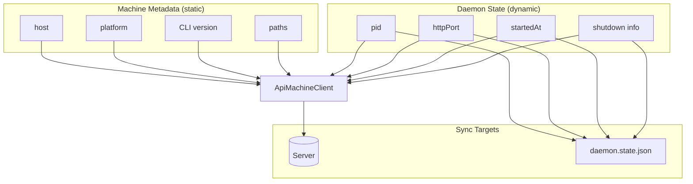

- **Machine metadata** is static info (host, platform, CLI version, paths).
- **Daemon state** is dynamic (pid, httpPort, startedAt, shutdown info).

The daemon updates these via `ApiMachineClient` and mirrors local state into `daemon.state.json` for control/diagnostics.

In the 0.3 development implementation, `doctor` reports the CLI entrypoint actually executing through
the canonical runtime identity resolver: source, `dist`, `package-dist`, or a Runner snapshot. It does
not assume that a source process came from `dist`. Its daemon status preserves the control inspector's
`running`, `starting`, and `not-running` results. A starting process or unknown control status is not
reported as stale or dead; Machine RPC readiness remains separately true, false, or unknown.
The former diagnostic environment flags no longer bypass Machine sync or Automation worker startup.

Current 0.3 development Doctor inventory also reads the daemon's cached vitals
sample and attention through the authenticated local `/doctor/vitals` control
route. Self memory, heap, active handles and event-loop busy share come from the
existing stall-monitor owner; Doctor does not start another Machine sampler.
Unavailable/older daemon replies leave this optional section absent. Bun's
placeholder busy/handle APIs are reported as null with `runtime_not_reported`,
not measured calm/zero. Real Bun busy/handle telemetry remains an unresolved
machine-resources plan amendment; Node metrics and observed memory are separate
from that obligation.

In current 0.3 development, detached `daemon start` waits for control-server
readiness within `HAPPIER_DAEMON_START_WAIT_TIMEOUT_MS` (60 seconds by default).
At that reporting checkpoint it returns `starting` when local ownership proves
startup is continuing, including the daemon log path when available. This is
neither readiness nor failure: the daemon continues its Home transport retries.
Stack passes its readiness budget to that foreground wait and separately verifies
the daemon. Restart and service readiness waits retain their own policies.
On Windows, the launch adapter preserves the detached daemon PID returned by
PowerShell; the launcher's own exit does not establish daemon failure.

The daemon acquires its lifecycle lock and publishes ownership before waiting
for credentials or Home transport. Its ordinary local state uses `httpPort: 0`,
no control token and `machineControlReady: false` until the control listener is
available. Inspection reports `starting`. Manual Stop uses the existing exact
process/lock identity checks, while service-owned startup still requires
`service stop`. Startup cancellation and failure clear only that lock owner's
publication. Older positive-port and legacy state remain readable.

Doctor repair's auth context uses the process's selected Home unless an explicit
`--server` target is supplied; reading a scoped report does not change the terminal's
saved selection. It probes only that Home's API endpoint and renders other stored
credentials as unverified. Successful `auth status --json` includes `serverId`.
The identity-free env-derived-profile adoption path carries the credential's machine,
account and reconnect-cursor maps into an empty named profile. It leaves existing
destination state alone and remains disabled after a Home identity is observed;
it does not repair an already-split installation.

### Machine vitals (0.3 development)

The current, unreleased machine-vitals primitives keep sampling and retained
history at the daemon. The Home transports reads; it does not sample the host or
persist a second history. [`createMachineVitalsReader`](../apps/cli/src/daemon/vitals/createMachineVitalsReader.ts)
selects one platform reader with a stable `MachineVitalsReader.read` contract;
[`createMachineVitalsSampler`](../apps/cli/src/daemon/vitals/createMachineVitalsSampler.ts)
owns that reader's cadence, counter baselines, live ring and minute aggregation.
[`startDaemon`](../apps/cli/src/daemon/startDaemon.ts) creates and starts this
single sampler, attaches its read routes through the existing Machine RPC route
cache, and stops it on shutdown or startup failure. Its history directory is
`vitals` beside the installation's `daemon.state.json`. This is development
source wiring, not released availability or certification of the entire
machine-resource program.

The sampler uses one unref'ed timer and the fastest held demand: wall-minute
alignment at 60 seconds without a viewer, 15 seconds for summary demand, and
2 seconds for live or Overview demand. In-process live demand does not request
Overview extras. GPU, thermal and battery detail are Overview-only, cached for
15 seconds. The base power fact serves keep-awake **On power** and enabled
whole-disk scanning without a viewer: manual scans use it for worker sizing,
and scheduled scans use it for admission and AC edges. The sampler reads their demand from the
canonical resources policy; **On** and **Off** keep-awake modes need no AC facts.
On macOS, the one Darwin reader runs `pmset -g batt` once per wall-clock minute
while a power-dependent policy needs it, reusing that result across summary/live
reads. Overview shares the same power reader at its existing extras boundary.
With no Overview or power-dependent policy, idle, summary and Processes reads
spawn no battery tool. A failed power read
leaves the power fact unknown. Linux's always-on reader spawns zero processes. Its optional NVIDIA
read first checks for an NVIDIA device and an executable `nvidia-smi` on PATH,
then runs at most one system-tool call per extras read; a missing or failing tool
does not hide the base sample. Non-Overview responses omit extras even when a
concurrent Overview has populated that cache.

[`createCounterRateReader`](../apps/cli/src/daemon/vitals/readers/counterRates.ts)
owns counter validity for Linux and native CPU, cgroup CPU, network, swap/events
and the sampler's minute-counter readers. Each rate uses the newest real
observation at least half the current interval old and at most 120 seconds old
(two always-on minute intervals), averaged over that actual span. This also
applies across watch re-arms, cadence changes, minute frontiers and slow reads;
the scheduler needs no counter-spacing exceptions. First readings, monotonic-clock
regressions, counter decreases and changes to the counted interface set yield no
rate. Excluded interfaces keep their inspectable detail but do not reset machine
traffic rates. Missing or invalid counters remain unreported; no rate is carried
forward or invented. Minute network history expresses the actual-span average in
one minute's byte units, so timer jitter and late reads do not inflate the chart's
per-second rate. A missing minute still leaves a history gap.

Linux container CPU uses one effective capacity: the smaller of logical cores and
the cgroup quota, preserving fractional cores. Live total/user/system percentages,
published host facts and minute history consume that same capacity. Processes,
owner totals and Runs consume the sampler's effective-core host fact through
one per-process CPU sampler, falling back to census logical cores before host
facts are available. A capacity change or unreadable process counter warms a new
baseline. Runs uses the same two-second live cadence, so reads a few milliseconds
apart cannot manufacture a rate below the shared minimum measurement span.

Memory composition belongs to the reader's memory observation. Linux derives
it from every existing `/proc/meminfo` read, and Windows includes it in the
existing native memory call without an extra process or API read. While an RPC
Overview watch is parked, macOS runs `vm_stat` with each two-second memory read
and parses its composition against that read's used bytes (`total − available`).
It retains no VM-stat output between reads and spawns no `vm_stat` for idle,
summary, Processes or Guard demand. macOS `pmset` and `ioreg`, and optional
`nvidia-smi` on supported platforms, keep their existing 15-second Overview
extras cadence. Summary RPCs
keep that detail with its totals. Neither the sampler's extras cache nor a
sibling UI view supplies composition for a newer memory observation. Linux
cgroup working sets omit the host-wide decomposition because it describes a
different memory scope; the Overview already leaves absent composition out.

An explicitly powered-off GPU is a quiet `powerState: 'off'` fact in the existing
More-from slot, without utilization or memory readings. Linux recognizes the
kernel's PCI `D3cold` state before querying telemetry and limits the existing
NVIDIA query to other devices. macOS uses the optional powered-off flag only
when the existing accelerator output includes it; Windows does not infer it
from missing utilization. The current battery APIs do not distinguish optimized
charging from other charging holds, so no optimized-charge reason is guessed.

[`batteryFacts`](../packages/cli-common/src/process/batteryFacts.ts) owns the
Linux power-supply and macOS battery interpretation shared by Home mobility
classification and Overview extras. Peripheral batteries do not classify a
Linux host as portable. Windows keeps native power-status sampling separate
from the Home chassis/CIM presence check. Worker memory admission consumes the
daemon sampler through
[`projectWorkerAdmission`](../apps/cli/src/workspaces/execution/projectWorkerAdmission.ts)'s
`readMemory` port; it has no independent OS-memory fallback. Memory-bound work
is refused as `memory_unavailable` when that owner cannot report capacity.

The daemon's
[`machineResourceSummary`](../apps/cli/src/daemon/resources/machineResourceSummary.ts)
owns the `daemonState.resources` publication, deriving attention through the
shared Protocol attention owner. This share-wide projection contains host and
reporting facts, attention reasons, and typed last-automatic-action facts—not
samples, chart series or session titles. Current numeric values and history
remain transient admitted Machine reads. Reporting requires observed host facts;
an unavailable summary may omit them if no successful observation exists. The
first failed read publishes its typed unavailable state immediately, without
inventing host facts. After reporting, ordinary reader failure becomes unavailable
after one minute; a missing helper is immediate. A policy-dependent nearly-full
warning waits for the policy read instead of guessing the default during startup.
Managed provisioner headroom stays unknown unless the provisioner's contract
establishes execution on this same host with a known storage root; current
provisioners do not establish that contract. The
[`machineResourcesPolicy`](../apps/cli/src/daemon/resources/machineResourcesPolicy.ts)
runtime reads and updates `metadata.resourcesPolicyV1` through the shared
[`Machine metadata-field CAS owner`](../packages/protocol/src/machines/machineMetadataFieldV1.ts).
Alerts, Processes, Storage and Guard consume their sections of this one policy.
`machines.resources.policy.get` reads synced last-known metadata; the single
`machines.resources.policy.set` writer is the admitted target daemon and returns
the current policy/revision on contention. There is no separate alert-policy
setter. The UI's `useMachineResourcesPolicy` sends minimal section patches and
returns to stored truth after failed saves. Alert durations, CPU thresholds and
disk thresholds store plain numbers, including custom values; presets are not
persistence enums. The Account's machine-offline consent is separate from this
share-wide policy. In development source it is stored in the Account's
`machineOfflineAlertsV1.machineIds` and changed through keyed `settings.set`
at `notifications.machineOffline` (`key` is the Machine id, `value` is Boolean),
not through daemon resource-policy RPC. Account and device alert-policy
derivation admit this enrollment independently of remote Session-alert consent.
Consent is default-off per Machine, and is not conditioned on historical Session
activity. Delivery is custodian-Account-only; a shared recipient's preference
does not enroll the custodian. The Account hook reports consent, not delivery
eligibility. The existing server presence timeout submits only Machines whose
inactive transition passed its exact last-heartbeat fence, including ephemeral
Session runners, to
[`submitMachineRemoteAlerts`](../apps/server/sources/app/activity/remoteAlerts/submitMachineRemoteAlerts.ts).
That sender rechecks current custody, revocation/replacement, settings-version
bound consent and existing Account/device notification policy. It reads no
Session activity and sends generic, content-free offline copy. The next admitted
Machine-alive read normally submits data-only quiet recovery. Enabling the
keyed alert while that Machine is already offline also requests one visible
"back online" notice. The Account settings CAS records that request at the
existing remote-alert owner in `SimpleCache`; the sender consumes it when
submitting recovery, so repeated alive reads and later outages stay quiet.
UI and agent settings Actions use the same enrollment producer and server
writer. Disabling consent clears the request. Existing Account/device delivery
policy still applies to the visible notice; a suppressed return retires the
request rather than carrying it into another outage. There is no new presence flag,
timer or notification lifecycle. These development paths do not claim released
availability or physical push certification.
Native optional name enrichment uses the authenticated current
Account and admitted Machine-mode codec, without including the name in the
server payload. A requested return uses the same Expo/native presenter and
Machine notification identity as the offline alert, with the generic body
"A machine you follow is back online." Android and JavaScript data-only recovery
enumerate presented notices and dismiss only matching offline notices after
re-admitting their exact Home, Account and Machine; a later quiet wake preserves
the visible return notice. An iOS thread identifier is only grouping, not the
OS request identity. Background delivery remains subject to platform policy.

[`minuteHistoryStore`](../apps/cli/src/daemon/vitals/history/minuteHistoryStore.ts)
restores the last seven days from protected, UTC-day-partitioned JSONL files.
Minute timestamps are the end of their measured interval; accepted minutes are
strictly increasing, including after a backward wall-clock change. Startup and
day rollover prune whole expired day files. Tolerant stored readers accept
unknown fields, skip malformed rows and ignore an unfinished final append.
Alert-episode rows use this same stream, not another store. Missing minutes remain
gaps. The 1-hour projection
combines the live ring with restored minutes, while 24-hour and 7-day projections
use 5-minute and 30-minute buckets with means and maxima and explicit null
buckets. Network buckets carry observed duration separately for received and sent
bytes; rates divide by that coverage, so partial or interrupted buckets do not
turn unmeasured time into idle traffic. Live history points carry their own rate
duration; persisted minute records retain their existing one-minute units.
Today's received/sent byte totals use observed minute deltas since UTC
midnight. [`isSustainedV1`](../packages/protocol/src/machines/vitals/isSustainedV1.ts)
evaluates consecutive minute records; a missing or stale minute breaks both a
firing streak and a predicate-defined recovery streak.

[`machineVitalsAlerts`](../apps/cli/src/daemon/vitals/alerts/machineVitalsAlerts.ts)
subscribes to accepted minute records without holding faster sampling demand.
The pure
[`alert evaluator`](../packages/protocol/src/machines/vitals/evaluateMachineVitalsAlertsV1.ts)
uses that shared sustained-condition check for memory and CPU: every minute must
be observed, CPU uses the minute mean rather than its maximum, and recovery needs
the same covered duration as firing. Disk conditions consume the shared attention
classifier: zero free-now bytes or exhausted inodes mean full, regardless of the
chosen nearly-full threshold, with independent episodes per volume. Missing pressure, CPU or
volume observations never prove recovery. Windows' observed low-memory signal
and exhausted commit feed the shared effective rule level; a negative binary
low-memory signal permits rule recovery without inventing a native pressure
metric for the UI.

The alert runtime journals each transition before delivery. Before historical day
files age out, the same stream carries open episodes forward with their original
fire time; historical display pruning does not close an active condition. Startup
restores that state before pruning, avoiding a duplicate fire or lost recovery
after restart. Its notification
builder calls the existing activity-notification dispatcher using `resource_limit`.
That event and Guard's distinct events share the `machines` channel topic.
Recovery delivery is quiet; machine/rule/volume notification identity is stable,
but the existing Expo transport does not promise collapse/replace behavior.
Working-session counts come from the live-work inventory and are omitted when
unobserved. Notifications describe the condition and say that alerting stopped no
work. The existing `usage_notice.v1` Account Artifact admits the strict machine
notice alongside connected-service notices; Inbox parsing and Account isolation
remain with that existing owner. Notification commands use the canonical Machine
page route and next-step resolver. Alerts-page visuals and the composed loaded
daemon/device journey are separate integration evidence, not implied by these
source contracts.

The [`read RPC owner`](../apps/cli/src/rpc/handlers/daemonMachineVitals.ts) serves
latest snapshots and history immediately after current Machine admission; reads
do not wait for the next sample or hold faster demand. A watch returns existing
newer samples immediately, or uses the shared
[`parkWatch`](../apps/cli/src/daemon/lifecycle/parkWatch.ts) and
[`waitForChangeOrDeadline`](../apps/cli/src/daemon/lifecycle/waitForChangeOrDeadline.ts)
owners for the 25-second park window, cancellation and cleanup. Only a parked
watch holds its summary/Overview demand, and admission is checked again before
disclosure after the wait. Watch deadline and sample cadence are separate
contracts. Mounted machine watches use the RPC transport's caller-owned operation
lifetime with bounded connection/setup. The daemon's park deadline returns an
unchanged answer; caller cancellation and transport disconnect retire the request.
Clients add no separate response deadline or transport margin. The protocol's
[`machine-vitals Action specs`](../packages/protocol/src/actions/specs/machineVitals.ts)
declare safe get/history reads and the account-level summaries-list seam. The
published resources projection and admitted transient reads have distinct
privacy and freshness boundaries.

The UI's neutral
[`machineResourceStore`](../apps/ui/sources/sync/domains/machines/resources/machineResourceStore.ts)
reuses [`sharedSubscriptionStore`](../apps/ui/sources/sync/runtime/subscriptions/sharedSubscriptionStore.ts),
keyed by Home, Account, Machine and view (or history range). Multiple viewers share one
in-flight refresh and one outstanding watch per key, with no client polling
timer. Last authorized values survive a failed read; unsupported older-daemon
results remain `not_reported` until daemon-state change permits a retry.
Fresh base samples update both retained views without replacing their distinct
detail payloads. A daemon-state change also refreshes failed, stale or unavailable
views with active demand, allowing a retired watch to resume without a client timer.
For freshness, a reporting sample supersedes an older published reader failure;
a failure published since that sample remains visible.
Summary warming captures the same credential-owned key and reads once without
holding a watch. The shared
[`daemon-read target`](../apps/ui/sources/sync/domains/machines/useMachineDaemonReadTarget.ts)
composes host visibility with destination/layout presentation for Vitals,
Storage, Processes, Guard and Activity. Hidden retained tabs release demand;
visible split panes keep demand even without keyboard focus. Account credential
retirement cancels Vitals demand and withdraws its samples from selectors, and
the existing Sync Account reset clears its retained store. Overview hooks
release demand on unmount or inactivity;
summary and in-process live consumers cannot activate Overview extras. Client
state is a retained projection, not a second persisted history or sampler.

## RPC and tool bridge

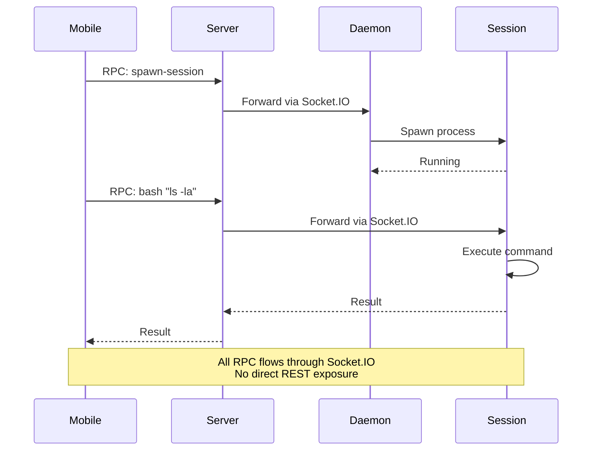

RPC is used to send commands over the Socket.IO connection:
- Sessions register RPC handlers (e.g., `bash`, file read/write, `ripgrep`, `difftastic`).
- The daemon registers a spawn-session handler so the server/mobile client can ask it to start a local session.

This mechanism allows the server and mobile clients to drive local actions without exposing a broad REST surface.

### Session-log RPC scopes (0.3 development)

Protocol's `rpc/methods.ts` declares method names and `rpc/socket.ts` owns Session
authorization and routing. The server consumes that classification for registration
and dispatch; Machine diagnostics do not register Session-only methods.
The canonical peer-route policy keeps `daemon.session.log.tail` server-required
with Account and Machine scope, like the existing ambiguous diagnostic reads.

| Method | Scope | Owner and input |
| --- | --- | --- |
| `session.log.tail` | Session | The bound Session's transcript Action handler; retains its Action input and `readTranscript` authority. |
| `daemon.session.log.tail` | Machine | Daemon diagnostics; `{ path, maxBytes? }` selects an explicit Session log file on that Machine. |

The Machine method retains the existing `.log` requirement and canonical-path
validation under the Happier home's `logs` or `stacks` directory. It returns
`{ success: true, path, tail, truncated }` or `{ success: false, error }`.
`bugreport.getLogTail` remains a separate bug-report operation: it only reads paths
selected by the diagnostics snapshot and uses its existing `{ ok }` response.
The [one-way upgrade basis](compatibility.md#machine-session-log-diagnostics-v03-development)
requires UI, daemon and server to move together; no Machine alias for
`session.log.tail` is registered or routed.

## Runtime-backed Stack and daemon artifacts

The CLI daemon is one component of the named-stack runtime format; it is not a
second runtime owner. In current 0.3 development, source validation and default
source QA resolve first-party source through `happier-source`. Native daemon
construction uses the same CLI/plugin/Agent entry authority and one esbuild graph,
with shared physical ESM chunks. Bun compiles a launcher that loads
`package-dist/index.mjs` beside its executable, preserving the host/plugin shared
module graph. It does not prepare a CLI dist snapshot or run
pkgroll first. First-party JavaScript, JavaScript sidecars and plugin resources/UI
package files belong to code. Target-native external dependencies, tools and Go
payloads remain independently reusable daemon support. JavaScript sidecars and
source-derived plugin failure diagnostics remain code-owned; linking static
support preserves those diagnostics. The daemon manifest owns that support reference.

Public npm/SDK publication is separate: CommonJS/ESM exports, checked declarations
and their package-build admission/locks remain required. Native emission is not a
typecheck result. See [binary runtime](binary-runtime.md#internal-workspace-packages).

The shared workspace build-mode owner also supplies compiler arguments to both
the generic package emitter and cli-common's atomic compiler. Remaining
`source-dev`/`qa-runtime` package consumers emit incrementally from captured inputs
without semantic checking. Output records identify that capture, while later source
edits demand the next build. Ordinary builds and public publication retain strict checking and
last-green replacement rules. Native source bundles do not consume these dist
outputs, and public typechecking remains separate.

In current development source, explicit artifact builds record requested components' preparation and terminal
outcomes through the producer's existing `runtimePublication` state writer. The launcher delegates artifact
admission to that build owner instead of publishing its own workspace closure first. A preparation failure
therefore appears in producer `stack info --json` even before daemon staging. Queued and lock-wait progress
goes to stderr; building an artifact alone does not certify a new selected or loaded runtime snapshot.

Managed server code follows the same boundary. Its generated Prisma/native runtime support is owned by the server component-artifact builder, while static web UI remains a separate selected runtime component. Stack launch supplies the selected UI path through `HAPPIER_SERVER_UI_DIR`; the server artifact does not decide which UI provider to use. Managed support references and snapshots are development/QA inputs only. Release/self-host packaging remains the existing per-target direct boundary that discovers and embeds each target's complete self-contained code/web/support payload; it does not consume or flatten a host-target managed snapshot.

Explicit built web artifacts and source QA share the source Plugin UI preparation
owner. The SDK compiler and existing inventory generator produce private inputs;
the source build owner reuses workspace input capture before preparation, so
the plugin compiler, QA export, web artifact and entry-size measurement consume
one copied authored-input view. Later checkout edits affect the next build;
interactive Expo retains live source and installed external tools retain their
own lifecycle. In 0.3 development, finite source exports, built web artifacts and
entry-size measurements consume `withSourceWebUiInputs` and reuse one captured
project-root path per export context, preserving Metro's Router-bound transform
cache keys. The existing owner-file lock protects capture replacement through
Metro's final read. Each attempt recaptures authored inputs and removes that
capture afterwards; the context retains the canonical compiler's inventory and
validated plugin candidates for the next export. Exported serving products keep
their separate output paths. Metro consumes that inventory for the ordinary Expo browser/asset export. The web
artifact owner retains project-local export staging and atomic final publication,
without workspace dist or declaration preparation. Ordinary Expo and public npm
preparation retain their separate package-output inputs.
Metro reads explicit authored workspace exports, preferring nested `browser` or
`react-native` source targets before the portable `happier-source` target. It
preserves platform implementations without inferring source paths from dist.

Noninteractive finite Expo exports in current development source take their
default transform concurrency from the executor's `GOMAXPROCS` CPU allowance,
capped at the measured eight-thread Metro knee. The shared export-worker policy
owns that cap; native admission can fit fewer threads to available memory.
Without an executor allowance, it leaves Metro's default in effect, as it does
for interactive commands. An explicit `HAPPIER_STACK_EXPO_EXPORT_MAX_WORKERS`
or caller `--max-workers` retains precedence, including the existing `0` opt-out.
Transform concurrency is execution policy and does not invalidate an otherwise
identical completed source export.
Finite web exports use the admission owner's separately measured
`source-web-export` envelope. On Linux, that owner fits the executor's thread
allowance to currently admissible memory and reserves the fitted thread count's
measured tree estimate plus the existing headroom, rounded up to whole GiB.
The estimate interpolates piecewise through the measured one-, eight-, and
47-thread points; the eight-thread knot retains the larger observed cold/warm
tree RSS. It is a measured admission estimate, not a process memory limit.
Peers and nested export processes consume the count recorded by that owner.
Explicit worker overrides keep their precedence and reserve their requested
count; opting out of injection retains the prior conservative envelope.
Runtime source bundles retain their smaller `source-bundle` envelope.
Re-measure the export tree when changing its workload or concurrency model.

In current 0.3 development, CLI source-test preparation runs the process-custody
Go build under the separately measured 2 GiB `native-custody` envelope. Go's build
cache still checks source and compiler currentness on every preparation. The
build writes a private temporary payload and releases its capacity before
acquiring `cli-dist-build.lock` for the staged copy. Prebuilt helper publication
replaces a complete sibling file, so an already executing helper keeps its inode.
The existing package-dist and validation envelopes remain unchanged.

Runtime snapshots are manifests plus managed references to canonical producer artifact payloads. A consumer selects a valid target-compatible published snapshot and retains only its own mutable state, process lifecycle, and selection pointer; it does not build or copy a payload. Snapshot validation checks component support references, and retention protects support artifacts transitively while a retained snapshot or external consumer selection needs them. Selecting a newer snapshot is non-disruptive: `selectedSnapshotId` can differ from `loadedSnapshotId` until an explicit restart, which is the proof boundary for newly loaded server or daemon bytes.

Generated bundled-plugin projections remain a source-tree publication concern. The projection publisher derives semantic artifacts and facts from authored plugin source, prevalidates the complete small UI/Protocol projection set, stages changed leaves, and commits them through the existing mounted-tree transaction. Known-invalid input is rejected before replacement; a caught commit failure restores the touched tree to last green, and the next canonical preflight repairs an interrupted partial replacement. This is an observable-failure/next-preflight contract, not a generation pointer, journal, or power-loss atomicity guarantee across package-owned source trees.

Ordinary projection writes/checks consume authored source through the canonical
generator. Source validation uses `--mode check --scope projections`, without a
generator completion cache, private compiler scheduler or prepared Agent-facts
child. Public/npm preparation explicitly requests `--package-artifacts`; its
installed runtime bytes and strict declarations retain the package-build owner.

The finite-task graph uses Turbo only as the outer dependency scheduler and read-only validation cache beneath `hstack-exec`. It is pinned through the current repository package manager; the later pnpm migration translates that ordinary development dependency rather than owning or delaying the task graph. Concurrency is set to 50% of the selected machine's logical processors, so a large development machine can use its capacity without imposing the same fixed process count on smaller CI or remote executors. Compiler-heavy inner schedulers remain separately bounded by their own memory profile.

Canonical build tasks do not pass through or restore from Turbo's cache. The root package-build command delegates its complete package set once to the existing workspace build owner, which already performs dependency-DAG scheduling, bounded concurrency, incremental/currentness checks, per-package locking, and atomic artifact publication. Package scripts remain directly runnable for focused diagnosis. Turbo is reserved for read-only source typechecks, API checks, tests, and projection checks whose exact-input results can be reused safely; CI restores job-scoped Turbo caches and Turbo revalidates the task hash before accepting them.

The repository typecheck reuses those canonical builds as the source-compilation evidence for buildable workspace packages. It then runs the six remaining source-only graphs (Terminal Native, Plugin UI, App, CLI, Server, and the cross-package Tests workspace) with `--noEmit`. Their Turbo hashes include the exact emitted declaration roots they consume, rather than every workspace source tree. This avoids immediately compiling the same package a second time, avoids pulling all first-party Plugin builds into a typecheck, and still invalidates a cached source check when a consumed declaration changes. Plugin SDK and the external SDK retain separate test-project typechecks after their public declaration checks.

In the development checkout, run the public `pnpm run typecheck` entry point. The execution owner selects the host and marks dispatched children with `HAPPIER_TYPECHECK_DISPATCHED=1`, including explicit local execution. The shared TypeScript runner refuses unmarked `typecheck:finite` and `typecheck:source:finite` invocations before starting the compiler. Turbo forwards and hashes this marker so dispatched children keep the selected host and an authorized cached result cannot satisfy an unmarked invocation. CI's public `check:public-sdk:finite` entry point grants the same permission through the execution owner.

The shared TypeScript dist builder excludes test-only roots, including `.test-d.ts` and `.test-d.tsx`, through a build-only configuration extending the package project. It preserves package exclusions and leaves no-emit project selection unchanged. Root typecheck also runs the Protocol and Triage projects with `--noEmit`, in both ordinary and compiler-only modes, because their type tests previously relied on production compilation. Plugin UI's source check and Plugin SDK's test-project check continue to enforce their type tests.

Generated-contract validation and mutable compiler-input preparation are separate finite facts. For example, the Plugin SDK Action-map and external SDK Action-wrapper checks are cacheable exact-input tasks, while synchronizing the physical declaration graph consumed by the Plugin SDK remains non-cacheable. This prevents an expensive semantic generator check from being repeated merely because declaration bytes must be refreshed through their canonical owner.

Incrementality is deliberately owned at the layer that can validate it. Canonical package builds retain compiler worktrees, build-info state, currentness fingerprints, and last-green `dist` outputs behind the workspace build owner. UI and Plugin UI source checks use their TypeScript build-info files; the remaining cold source/API programs use Turbo's exact-result cache rather than a long-lived compiler daemon. Targeted Plugin projection checks and the aggregate comparison are separate source validations; exact-result caching remains with the outer task owner. A cache miss may therefore still construct a large TypeScript graph, but an unchanged candidate does not need to repeat it in the next local or CI invocation.

First-party plugin packages are discovered through the workspace glob and canonical bundled-plugin membership owner rather than an enumerated Turbo list. The canonical first-party template supplies the finite build/projection scripts, so a newly scaffolded package joins the same graph after the normal membership projection. First-party plugin build and projection remain separate tasks: the build always passes through the package owner, the read-only targeted projection check may be cached, and one non-cacheable aggregate check consumes the serialized artifacts. The workspace-derived Plugin test/typecheck runner uses a bounded two-package queue and still attempts every discovered package before reporting failures. The public `happier plugins dev` command does not depend on Turbo: it registers the trusted source with the daemon and renders daemon-owned status. The daemon owns author-source watching, candidate preparation, reload, and diagnostics in standalone plugin repositories.

Public CLI package preparation also isolates Plugin build failures without serializing every healthy Plugin behind them: shared non-Plugin prerequisites build first, then up to two independent Plugin packages build concurrently through the same canonical workspace owner. Artifact publication keeps its fail-closed all-included-Plugins contract and delegates the complete Plugin set to that owner's own dependency-aware scheduler.

Broad unit, integration, database, and runtime suites are not automatically parallelized by the finite graph. Many launch their own Vitest workers or share databases, ports, Stack processes, simulators, or Docker resources. They stay with their existing owner until a focused pilot proves isolation and measures end-to-end benefit; adding another outer fan-out on top of their internal concurrency would otherwise trade a visible serial command for less predictable process and memory contention.

Default source QA uses a retained source bundle for the selected source/tool
fingerprint and does not request native artifact publication. An explicit restart
prepares current source; running code remains unchanged between restarts. Source
development reloads remain with their service owners rather than advancing a
managed runtime publication flight or selecting another stack's snapshot.
In current 0.3 development, `withJsonOwnerFileLock` serves registered waiters
in filesystem ticket order, including the shared source-bundle build lock.
Queue entries use the same PID/heartbeat reclaim rule as the held lock;
cancellation and timeout remove the caller's entry. Uncontended callers retain
the exclusive-create path. Already running scripts keep their loaded lock code
and can still compete outside the queue: synchronize the checkout and relaunch
the owning runner to pick up fairness. Bundle reuse still requires both the
source/tool fingerprint and matching consumed-byte digests; a change to an
unconsumed input can therefore trigger another build.
The detached Stack owner in `apps/stack/scripts/stack/run_script_with_stack_env.mjs`
owns services and logs; the TUI attaches, displays the same state, and sends explicit
controls. An unexpected TUI exit detaches from a healthy owner, while explicit
quit/restart/stop retains the command's lifecycle semantics.

For development services placed on a remote target, the target supervisor owns the worker and its independent SSH tunnel. Worker recovery retains a healthy tunnel and rechecks its lifetime at dispatch, replacing a tunnel that exited during backoff or retirement. Remote Expo readiness reports a degraded service at the existing readiness deadline, including with an attended TUI, and continues readiness recovery through the supervisor. Standalone attended Metro waits retain their cancellation-controlled checkpoints. An Expo heap failure is handled separately by the existing Expo process restart policy; it does not select a different host or start a local duplicate.

In current 0.3 development, a target that depends on the local server probes its
reverse forward once during initial startup. A failed probe returns to the same
target lifecycle recovery instead of ending the Stack runner. Recovery waits for
canonical local server readiness before rechecking the forward, using the existing
readiness policy, target backoff and controller cancellation. This allows the
server's source preparation and admission queue to finish. A live tunnel survives
a refused probe; an exited tunnel is replaced before worker dispatch. Server
authority, preparation refusals and explicit retirement retain their existing
failure semantics. An already running supervisor must be relaunched through the
Stack lifecycle owner to load this correction.

Sibling command routing reads each checkout's declared workspace format. For
the supported Yarn 0.2 predecessor, local validation consumes that checkout's
existing dependency-freshness decision without rewriting its admission marker;
remote bootstrap executes its existing Yarn bootstrap entrypoint. The 0.3
executor owns command placement while the source checkout retains dependency
installation and lifecycle ownership.

Remote dependency bootstrap installs tools without general workspace lifecycle scripts before loading the package-manager owner. Every install that materializes the shared UI dependency tree, including source-test and stage-zero refreshes, completes the canonical UI postinstall under the existing dependency-refresh lock, before publishing the ready marker. Warm prerequisite repair uses the same lock and withdraws admission until repair succeeds. The dependency-free `utils/proc/ui_postinstall.mjs` owner serves both bootstrap and full package-manager preparation; the UI verifier also loads without compiled Stack packages. The mandatory password-worker asset producer compiles the canonical Protocol codec source directly, so cold UI postinstall does not require or consume stale Protocol dist. Scriptless admission still does not certify other runtime lifecycle prerequisites. UI patches and asset-generator sources participate through `apps/ui/package.json`'s `happier.installFreshnessInputs`; changing either reruns postinstall even when pnpm reuses installed packages. Postinstall failure leaves admission stale and fails preparation; an unchanged source-test preparation reuses completed outputs.

In current 0.3 development, a dependency writer stops verified managed Metro consumers before changing their shared tree. Final Metro launch and existing PID-state publication acquire the same install lock; the existing Expo supervisor restarts only after complete dependency admission is available. The UI verifier prevents unchanged warm preparation from stopping a healthy Metro. A legacy running supervisor without this guarded restart capability causes dependency mutation to fail closed with a restart-required error; changing source does not retrofit an already-loaded supervisor. No new PID registry or suspended-process custody is introduced. Last-green launch requires a previously admitted coherent installed tree, not equality with newer source inputs: a successful no-install repair retains the old admission inputs, while the normal installer still sees those newer inputs as stale. Failed preparation never admits a replacement against a partial tree.

Remote validation bootstrap has the target's explicit package-manager cache context even when it does not inherit the running Stack environment. Both dispatchers provide `cache=<targetHome>/cache`; consumer discovery uses that target home through the same `dev_targets/stack_paths.mjs` owner as managed worker state, including its `stack-state` directory. It must not search only the remote account's default local Stack home. Planned dependency stops preserve the existing crash-restart budget, while a crash before successful PID publication remains an ordinary startup failure; user shutdown remains authoritative.

In current source development, the remote Stack supervisor retires the prior target-owned Stack before dependency bootstrap. Its retirement probe includes live recorded Expo processes even when their runner's runtime state has disappeared; the target's canonical Stack stop still verifies process identity and ownership before signaling them. Source and controlled supervisors both invoke target-owned Stack stop before closing their worker transports. If bootstrap still finds a live Metro without a verified dependency-safe restart owner, the supervisor reports a failed target with a one-time recovery instruction and does not retry that ownership refusal. Stop the owning Stack on that target, verify its recorded Expo has exited, then start again; source changes alone cannot retrofit a live legacy supervisor.

In 0.3 web development, `apps/ui/metro.config.js` rewrites development bundle, source-map and HMR entry requests to `lazy=false`. Dynamic imports are included in the initial graph and still resolve asynchronously; `inlineRequires` defers module evaluation. This prevents Metro from retaining overlapping transitive graphs for each large optional presentation entry. Native development and production lazy bundling retain Expo's existing behavior. Web Babel uses Expo's existing `import.meta` transform so optional dependencies remain valid in Metro's script bundles; the Metro cache-version bump invalidates older transforms on restart. App and vendor source maps remain intact. A running Metro must be restarted to load this configuration change.

In current development source, the reload coordinator revalidates each service
against its own consumed descriptors. A daemon-only edit cannot revoke a server
build or activation. Shared-input edits still revoke every affected service,
and edits arriving during preparation coalesce into the existing trailing cycle.
Package currentness and dependency ordering remain with the workspace build owner.
Its scheduling graph shares the manifests already read during workspace discovery
within one pass. Fresh package admission, transitive input/output fingerprints,
lock-wait rechecks, and publication fences are not memoized through that graph.
Manifest movement re-enters the existing single trailing pass with a fresh graph;
no scheduling observation survives an invocation.

## Implementation references
- CLI entry: `apps/cli/src/index.ts`
- Daemon: `apps/cli/src/daemon`
- Control server/client: `apps/cli/src/daemon/controlServer.ts`, `apps/cli/src/daemon/controlClient.ts`
- API clients: `apps/cli/src/api`
- Persistence: `apps/cli/src/persistence.ts`
- Config: `apps/cli/src/configuration.ts`
